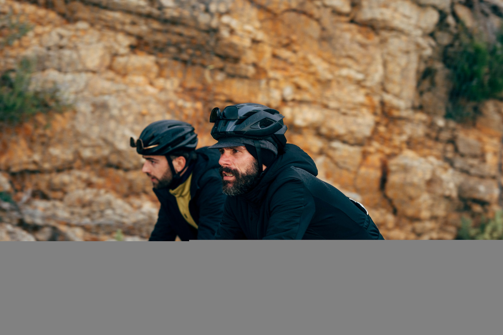
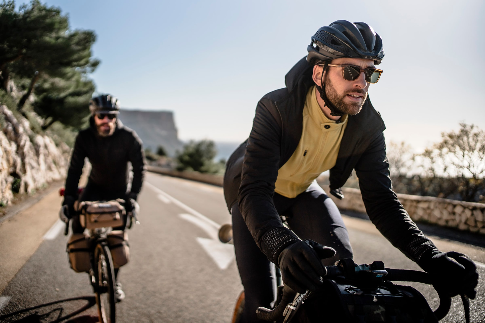
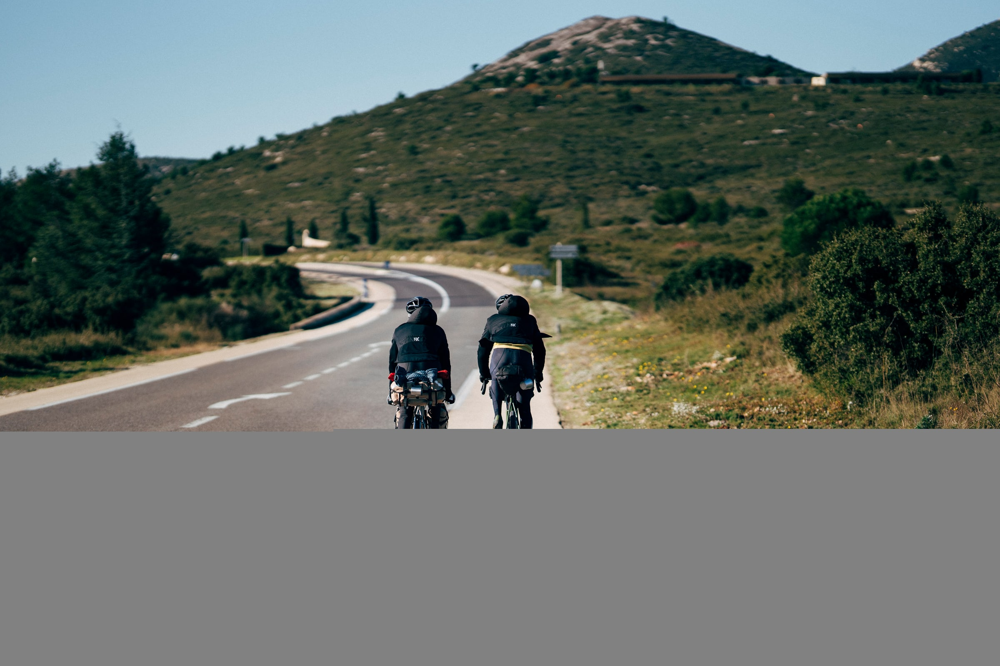

**ADVENTURE NEXT DOOR AVEC CAFE DU CYCLISTE**

« Ça te dit de camper début décembre au col de l’Espigoulier ? » C’est plus ou moins comme ça que ça a commencé. En octobre dernier, Matthieu avec Ali de chez Café Du Cycliste sont arrivés avec cette idée comme un cheveux sur la soupe.  
Une micro aventure à deux pas de la maison : **Un bivouac au col de l’Espigoulier pour un test grandeur nature de la veste « [Zélie](https://www.cafeducycliste.com/performance/audax-collection/men-cycling-jacket-zelie-black.html) » de chez Café Du Cycliste**, nouvelle venue de la déjà célèbre gamme « Audax ».

A première vue associer le mot « Camping » avec « Décembre » peut paraître surprenant voir même contradictoire pour certains mais on est à Marseille et l’hiver n’est pas encore vraiment installé. Ici on a 300 jours de soleil par an donc le risque de tempête de neige est plus ou moins égal à zéro.

Il est temps de ressortir les sacoches…

<!-- image manquante : 2019/01/bikepacking-gravel-marseille-45.jpg -->

> **Ce qui est assez dingue c’est ce sentiment d’être si proche de la maison et en même temps si loin de tout. On est au beau milieu du Massif de la Sainte-Baume, au mois de décembre mais la nuit est claire et on n’a pas vraiment froid. On ne va pas se mentir l’Armagnac nous à bien réchauffé…**

**ESCAPE MARSEILLE**

Vélos chargés, bonhommes changés et prêt à rouler. On quitte l’appartement de Matthieu mais avant de s’enjailler dans les lacets du Col de l’Espigoulier **il faut sortir de Marseille et ça, c’est déjà une aventure en soit**. Ici « piste cyclable » rime avec parking, « code de la route » avec Yolo… Globalement c’est assez chaotique mais au moins on a l’avantage de ne pas se faire klaxonner parce qu’on ne roule pas sur la piste cyclable… CQFD !

<!-- image manquante : 2019/01/bikepacking-gravel-marseille-3.jpg -->

<!-- image manquante : 2019/01/bikepacking-gravel-marseille-4.jpg -->

<!-- image manquante : 2019/01/bikepacking-gravel-marseille-5.jpg -->

<!-- image manquante : 2019/01/bikepacking-gravel-marseille-6.jpg -->

<!-- image manquante : 2019/01/bikepacking-gravel-marseille-7.jpg -->

<!-- image manquante : 2019/01/bikepacking-gravel-marseille-9.jpg -->

<!-- image manquante : 2019/01/bikepacking-gravel-marseille-11.jpg -->

<!-- image manquante : 2019/01/bikepacking-gravel-marseille-10.jpg -->

<!-- image manquante : 2019/01/bikepacking-gravel-marseille-13.jpg -->

<!-- image manquante : 2019/01/bikepacking-gravel-marseille-16.jpg -->

<!-- image manquante : 2019/02/cafeducycliste-camp-2.jpg -->

Une fois sorti ~~du Mordor~~, pardon de la Zone Commercial et Industriel de La Valentine on se retrouve vite à Gémenos pour un dernier contact avec la civilisation avant le lendemain. Gémenos c’est le village du sud par excellence : une boulangerie, un bar, un tabac. E basta ! **C’est aussi et surtout le début du Col de l’Espigoulier**.

<!-- image manquante : 2019/02/cafeducycliste-camp-1.jpg -->

Emprunté plusieurs fois par le Tour de France et Paris Nice, c’est clairement une des plus belle route de la région. Comme on le dit souvent avec Matthieu, ce petit col a tout d’un grand : Des beaux lacets comme dans les Alpes, une super vue au sommet, le tout en beaucoup plus court et accessible.

<!-- image manquante : 2019/01/bikepacking-gravel-marseille-33.jpg -->

<!-- image manquante : 2019/01/bikepacking-gravel-marseille-32.jpg -->

<!-- image manquante : 2019/01/bikepacking-gravel-marseille-29.jpg -->

<!-- image manquante : 2019/01/bikepacking-gravel-marseille-37.jpg -->

<!-- image manquante : 2019/01/bikepacking-gravel-marseille-34.jpg -->

<!-- image manquante : 2019/01/bikepacking-gravel-marseille-38.jpg -->

<!-- image manquante : 2019/01/bikepacking-gravel-marseille-39.jpg -->

<!-- image manquante : 2019/02/cafeducycliste-camp-3.jpg -->

A deux pas du sommet, une D.F.C.I ( les voies de défense des forêts contre l’incendie) qui serpente en contrebas nous emmène sous une lumière certifiée « Lightbro » jusqu’au refuge de Tuny qui sera notre repère pour la nuit. **On profite des dernières lumières du jour pour boire une bière et installer le camp**. A côté les réchauds sont déjà en route prêt à cuire nos Yolo et des pâtes. On rajoutera à ça un peu de saucisson et du fromage. Régalade !

<!-- image manquante : 2019/02/cafeducycliste-camp-4.jpg -->  
Ce qui est assez dingue c’est ce sentiment d’être si proche de la maison et en même temps si loin de tout. On est au beau milieu du Massif de la Sainte-Baume, au mois de décembre mais la nuit est claire et on n’a pas vraiment froid. On ne va pas se mentir l’Armagnac nous à bien réchauffé…

<!-- image manquante : 2019/01/bikepacking-gravel-marseille-42.jpg -->

<!-- image manquante : 2019/02/cafeducycliste-camp-6.jpg -->

<!-- image manquante : 2019/01/bikepacking-gravel-marseille-47.jpg -->

<!-- image manquante : 2019/01/bikepacking-gravel-marseille-50.jpg -->

<!-- image manquante : 2019/01/bikepacking-gravel-marseille-52.jpg -->

<!-- image manquante : 2019/01/bikepacking-gravel-marseille-51.jpg -->

<!-- image manquante : 2019/01/bikepacking-gravel-marseille-55.jpg -->

<!-- image manquante : 2019/01/bikepacking-gravel-marseille-54.jpg -->

<!-- image manquante : 2019/01/bikepacking-gravel-marseille-57.jpg -->

<!-- image manquante : 2019/01/bikepacking-gravel-marseille-58.jpg -->

<!-- image manquante : 2019/01/bikepacking-gravel-marseille-60.jpg -->

**MISTRAL GAGNANT**

Il est 2h du matin. Le vent commence à se lever et on peu l’entendre arriver : d’abord sur les houppiers des arbres au loin puis de plus en plus proche avant de s’abattre sur la tente.

**« Hello mistral my old friend… »**

De grandes rafales vont secouer nos tentes par intermittence une bonne partie de la nuit. Malgré sa violence, le Mistral à un atout majeur : Sa capacité à chasser les nuages. Il est 7h du matin et le jour se lève avec une lumière unique et propre à l’hiver. Un combo café bien chaud et Yolo muesli dans le refuge semble être la meilleur option pour commencer notre journée devant le lever de soleil.

<!-- image manquante : 2019/01/bikepacking-gravel-marseille-61.jpg -->

<!-- image manquante : 2019/01/bikepacking-gravel-marseille-65.jpg -->

<!-- image manquante : 2019/01/bikepacking-gravel-marseille-64.jpg -->

<!-- image manquante : 2019/01/bikepacking-gravel-marseille-62.jpg -->

<!-- image manquante : 2019/02/caféducycliste-camp-8.jpg -->

<!-- image manquante : 2019/02/cafeducycliste-camp-7.jpg -->

<!-- image manquante : 2019/01/bikepacking-gravel-marseille-67.jpg -->

On plie le camp tandis que les chiens et les chasseurs commence à pointer le bout de leur nez. Vu le contexte actuel on préfère ne pas traîner, des coups de feu retentissent au loin…  
On retrouve le Col de l’Espigoulier où des rafales à 80 km/h frappent le sommet avec une violence à laquelle je n’avais jamais assisté.  
**C’est clairement une mission de tenir sur le vélo, même chargé**. Heureusement quelques lacets plus bas on se retrouve à l’abri du vent et on peut donc envisager une descente en « full nasa mode ».

<!-- image manquante : 2019/01/bikepacking-gravel-marseille-69.jpg -->

<!-- image manquante : 2019/02/cafeducycliste-camp-10.jpg -->

<!-- image manquante : 2019/02/cafeducycliste-camp-8.jpg -->

<!-- image manquante : 2019/02/cafeducycliste-camp-9.jpg -->

<!-- image manquante : 2019/01/bikepacking-gravel-marseille-74.jpg -->

<!-- image manquante : 2019/01/bikepacking-gravel-marseille-75.jpg -->

<!-- image manquante : 2019/01/bikepacking-gravel-marseille-23.jpg -->

<!-- image manquante : 2019/01/bikepacking-gravel-marseille-21.jpg -->

On repasse par Gémenos et pour pimenter le tout, on décide avec Matthieu de rallonger un peu notre retour pour une arrivée à Marseille par la Gineste depuis Cassis. C’est sans doute la meilleure arrivée sur Marseille avec une vue de folie sur la ville lorsqu’on bascule dans la descente. **Vous vous êtes déjà sûrement demandé ce qu’il y a de plus lent qu’un cycliste dans un col ?**

*– Un cycliste dans un col avec un vent de face –*

Notre retour par la Gineste sera tout sauf une partie de plaisir. A 7km/h, on est littéralement collé au sol et malgré ça certaines rafales essayent quand même de nous faire rouler à l’anglaise… Ça en devient presque drôle.

<!-- image manquante : 2019/02/caféducycliste-camp-14.jpg -->  
Retour à Marseille par la corniche, retour à la civilisation, on prend la direction du centre ville. On retrouve les bouchons et l’effervescence de la ville mais on se faufile tranquillement entre les voitures jusque chez Matthieu. **Une partie de nous a du rester à l’Espigoulier pour qu’on soit aussi cool j’imagine.**

<!-- image manquante : 2019/02/cafeducycliste-camp-13.jpg -->

<!-- image manquante : 2019/01/bikepacking-gravel-marseille-80.jpg -->

<!-- image manquante : 2019/01/bikepacking-gravel-marseille-81.jpg -->

<!-- image manquante : 2019/01/bikepacking-gravel-marseille-1.jpg -->

Pas besoin de partir loin pour s’évader, c’est ce qu’on retiendra de ce bivouac. C’est certain, une aventure même a deux pas de la maison peux s’avérer être le meilleur remède pour les aventuriers à l’agenda chargé.  
Comme disait ce bon vieux Alfred : « Qu’importe le flacon, pourvu qu’on ait l’ivresse… »

Un grand merci à Ali de [Café du Cycliste](https://www.cafeducycliste.com/), au talentueux [Benedict Campbell](https://www.instagram.com/benedict13/) pour ses magnifiques photos et enfin à [Matthieu](https://www.instagram.com/manivelle.cc/) pour être aussi fun sur le vélo qu’à côté !

---

***LA MAP***

https://ridewithgps.com/embeds?type=route&id=29268533&metricUnits=true&sampleGraph=true&overlay=esriTopo

  
–  
**100km**  
**1850m D+**  
**2 Jours**  
–

Photos : [Benedict Campbell](https://www.instagram.com/benedict13/)
