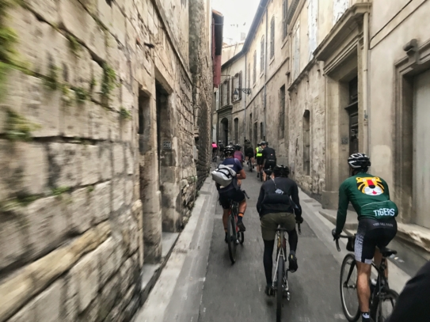
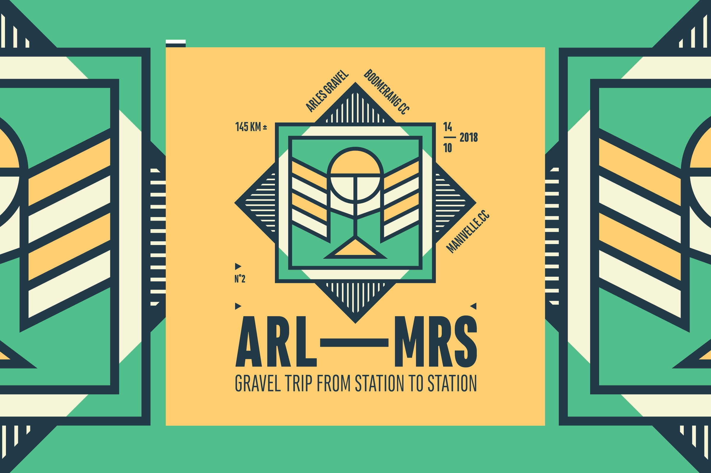
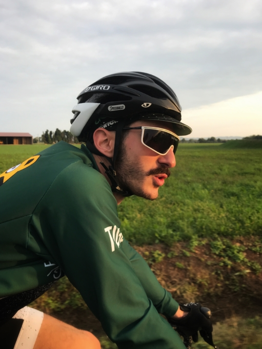
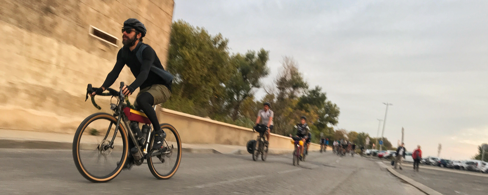
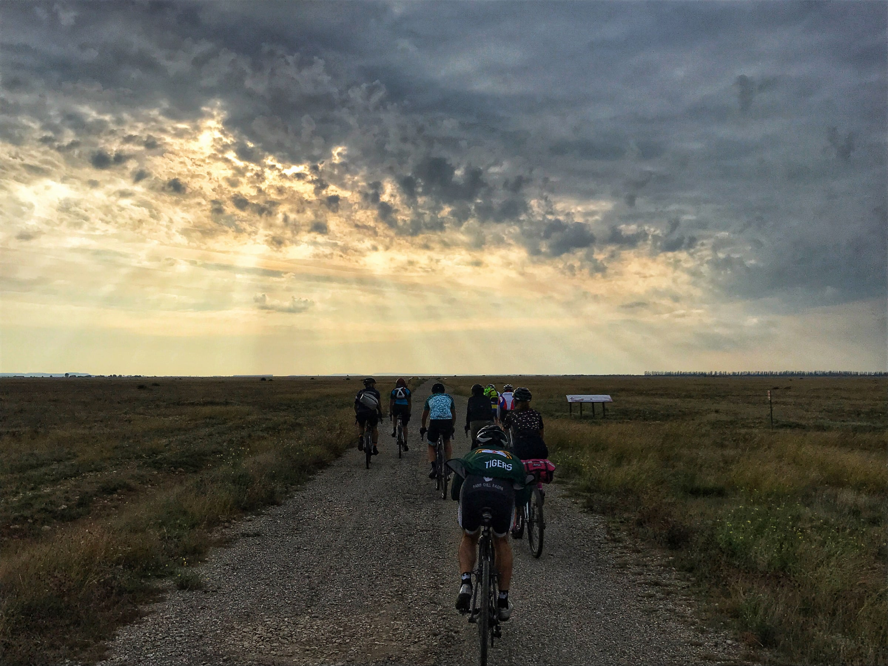
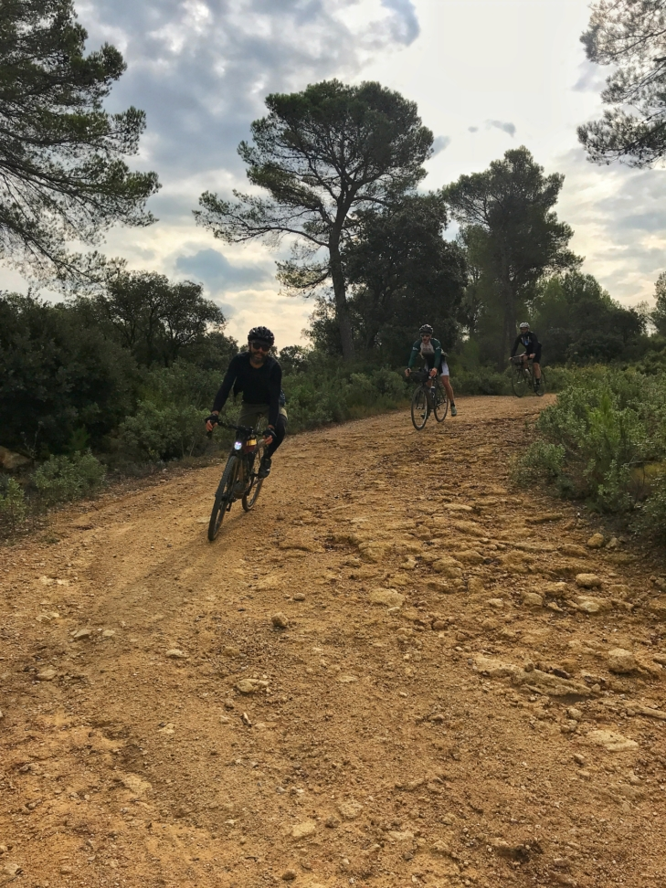
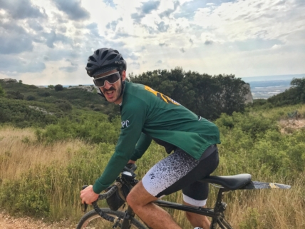
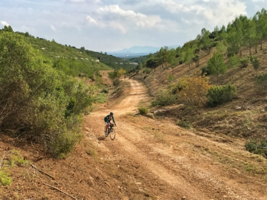
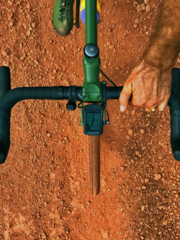
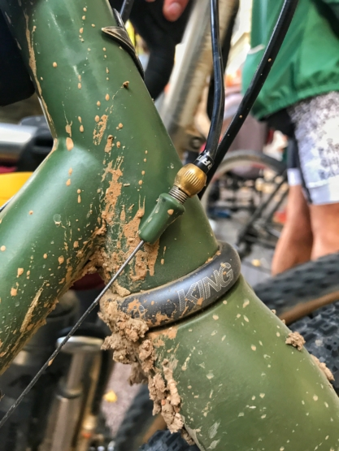

**A GRAVEL TRIP FROM STATION TO STATION**

Pendant que le gros de la team PCR Gravier était occupé à casser du gravier dans le Var pour le Roc d’Azur à l’occasion du [Gravel Origine 83](/gravel-origin-83/), une B-team se gardait bien au chaud pour la deuxième édition du Arles – Marseille gravel, organisée par Dan de Rosille ([Arles Gravel](https://arlesgravel.wordpress.com/)) en collaboration avec Matthieu Lifschitz ([Manivelle](http://manivelle.cc/) / [Boomerang](https://www.facebook.com/groups/boomerangcc/)). Le brief est simple : **145 kilomètres entre Arles et Marseille** via un max de Gravel et autres B-roads. On valide !

> Comme dans toute situation de crise nous mettons au point un plan redoutable : Rouler à la cool !

<!-- image manquante : 2018/11/arles-marseille-gravel_01.jpeg -->

**OUI SNCF**

Pour les Marseillais, l’aventure commence avant 7h00 du matin à la Gare de Marseille Saint Charles. Un groupe d’une quinzaine de lève-tôt se retrouve dans le train, **les yeux encore collés**, surtout notre B-team, qui à son habitude a encore un peu de buée dans le casque après avoir décidé de comptabiliser plus de bières la veille que d’heures de sommeil.

Les Arlésiens nous attendent sur site. A 8h une bonne trentaine de vélos s’élancent pour un **slalom géant dans les petites rues d’Arles** en guise d’échauffement. Le soleil se lève et vient réchauffer un peloton qui commence à s’étirer.

Jusqu’ici tout va bien… où pas ! **En vérité on vient de se faire lâcher** par une grosse majorité du groupe qui apparemment a décidée de plier les 150 kilomètres avant de manger. Comme dans toute situation de crise nous mettons au point un plan redoutable : Rouler à la cool ! Un effort régulier, continu digne d’un gros diesel nous conduira en douceur à Marseille.

**L’ENFER DU SUD**

La suite du parcours nous permet de sortir presque entièrement de Arles via des petites routes, singlestracks et autres passages gravelisant. Entre ZI et Champs d’éoliennes, les jambes arrivent gentiment à température mais au loin on distingue le désert de La Crau.  
Le désert de La Crau ? OUI MONSIEUR ! Les Arlésiens appellent ça « l’Enfer du Sud » et on comprend mieux pourquoi. **Si la trouée d’Arenberg avait une cousine sudiste ça serait précisément ici**… Sauf que les pavés sont remplacés par des galets. Ils sont gros et on en distingue environs 17000… Ainsi soit-il ! Après ce joyeux moment marteau piqueur, on laisse les Alpilles derrière nous et on fonce vers Miramas, capitale du Pit-Stop boulangerie pour gravelistes affamés.

<!-- image manquante : 2018/11/arles-marseille-gravel_14.jpeg -->

Deux ou trois croissants plus tard, on quitte Miramas par des chemins qui nous régalent. C’est roulant à souhait et on commence doucement à rattraper quelques ambitieux du matin. **Notre plan fonctionne à merveille !** Au loin, l’Étang de Berre pointe le bout de son nez. D’un commun accord on se dit qu’il ne faudrait pas trop prendre d’avance non plus… Un stop Sandwich / remplissage de gourdes s’improvise et on repart. On retrouve Patrick de [Bike-Café](https://bike-cafe.fr/) un peu plus loin qui fera un bout de chemin avec nous. Welcome onboard the naize train !

<!-- image manquante : 2018/10/arles-marseille-gravel_35.jpg -->

**GROS PLATEAU**

Nous arrivons au kilomètre 100 et jusqu’ici on peut dire que cet itinéraire est plutôt plat. Le dénivelé fait seulement son apparition à l’entrée du plateau de Vitrolles avec un joli casse pattes comme on les aime. **Highlight du parcours, caviar de gravel**. Le plateau de Vitrolles offre des kilomètres de pistes à flanc de falaise pour notre plus grand kiff. La vue sur l’étang de Berre n’est pas idiote non plus et au loin, on distingue le massif de l’Étoile qui sera notre digestif du jour.

<!-- image manquante : 2018/11/arles-marseille-gravel_22.jpeg -->

**PLS DANS LES TERRES ROUGES**

Alors qu’on quitte ce paradis de gravier, première crevaison du groupe, qui se transformera vite en festival du « flat-tire ». On va perdre une bonne heure en tout. Certains en profitent pour siester, d’autres collent de la rustine puis se retrouvent à **mettre des chambres à air en 650b sur du 700c**. Après ce moment « C’est Pas Sorcier », on décide de tracer notre route car il serait malin d’arriver avant la nuit et il nous reste encore un morceau de choix pour clôturer ce Arles-Marseille : le Massif de l’Étoile.

<!-- image manquante : 2018/11/arles-marseille-gravel_29.jpeg -->

<!-- image manquante : 2018/11/arles-marseille-gravel_28.jpeg -->

**MARSEILLE CALLING**

Alors que l’Étoile pointe le bout de son nez, on remarque qu’on commence sérieusement à manquer d’eau (en vérité on est à sec depuis 10 kilomètres). Heureusement pour nous, un ami du coin venu nous saluer sur le parcours avait tout prévu pour nous rincer en eau ! Donnez à cette homme la légion d’honneur !

Bien hydratés, nous voilà au pied du mur, pour de vrai ! Les casses pattes du Massif de l’Étoile sont déjà costauds en temps normal mais après plus de 120km, on a **l’impression de flirter avec le décès**, surtout pour Licata dont le pédalier a décidé de faire grève. Deux coups de clés allen plus tard, les manivelles sont resserrées et on continu l’ascension. A ce moment là on est globalement rôtis mais la perspective d’une « troisième mi-temps » nous permet de surmonter les crampes et de recoller avec d’autres participants. Arrivés quasiment au sommet de l’Étoile, Marseille est enfin face à nous. On descend pour enchaîner sur un ride safe dans Marseille jusqu’au Longchamps Palace pour quelques bières plus que pas volées !

Les vélos sont pourris, les bonhommes rôtis mais c’était fun à souhait. Chacun y va de sa petite histoire ou mésaventure et on se dit que **les post ride au bar devraient vraiment rentrer dans la Fédération Française de Cyclisme.**

Encore un grand merci à Dan et Matthieu pour cet événement aussi beau que solide et qui sonne déjà pour nous comme un classique ! Vivement l’année prochaine.

[metaslider id=”327″]

---

***LA MAP***

https://ridewithgps.com/embeds?type=route&id=29000448&metricUnits=true&sampleGraph=true&overlay=esriTopo

–  
**145km**  
**1500m D+**  
**7h17**  
–  
Photos : [Simon Taulelle](https://www.instagram.com/sims_teuteul/) & [Matthieu Lifschitz](https://www.instagram.com/manivelle.cc/)

## Commentaires

**Revue de presse gravel : attention les pros débarquent ! | Bike Café 31 January 2020** — 31 January 2020

[…] que celles des courses UCI. Un peu comme si Thibault Pinot prenait le départ de la prochaine classique Gravel Arles – Marseille, toute proportion gardée bien […]
