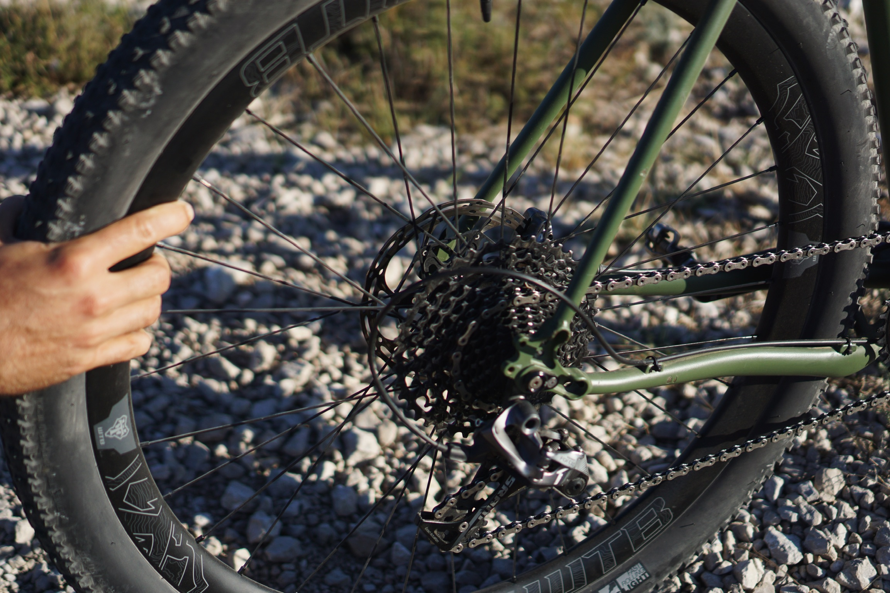
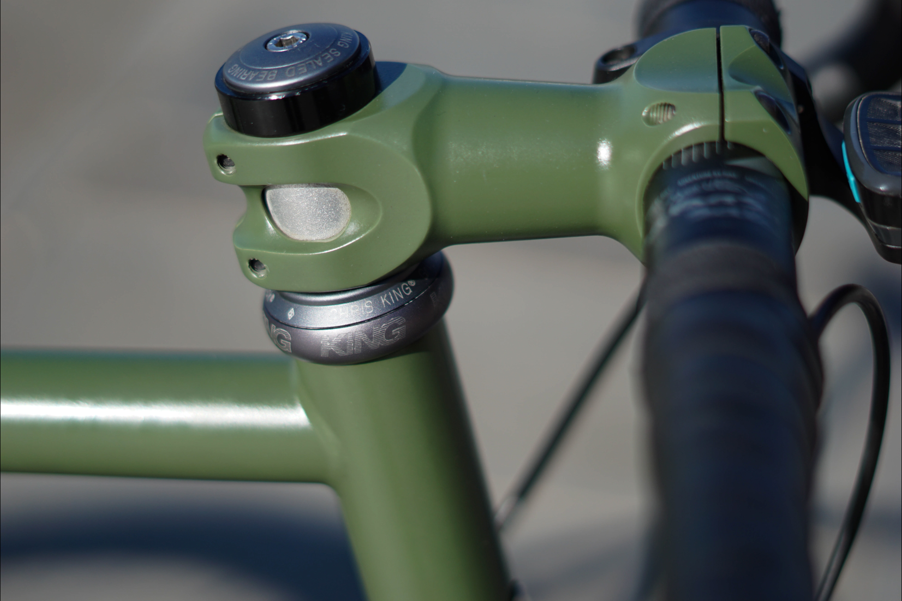
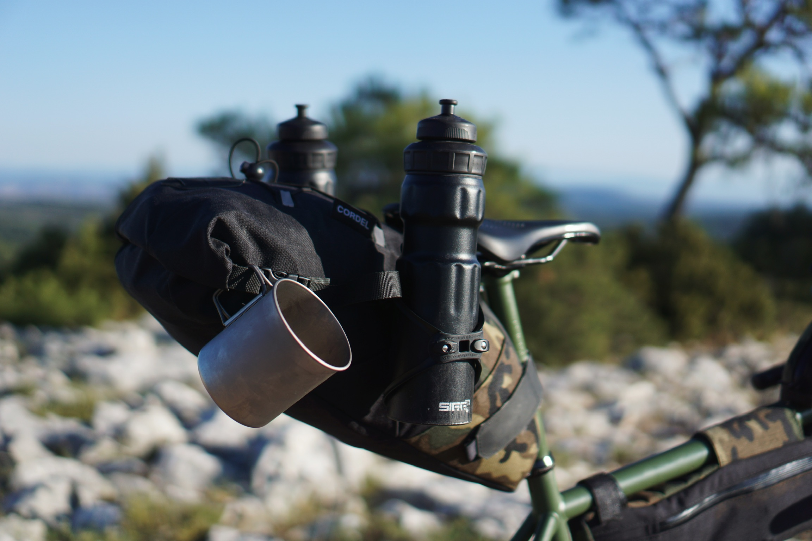
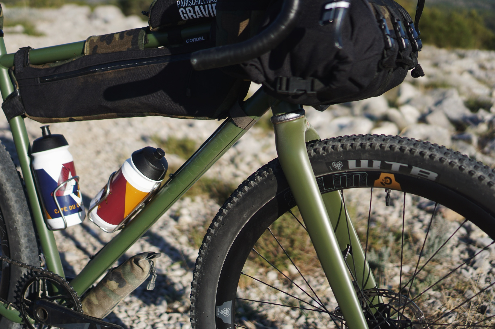
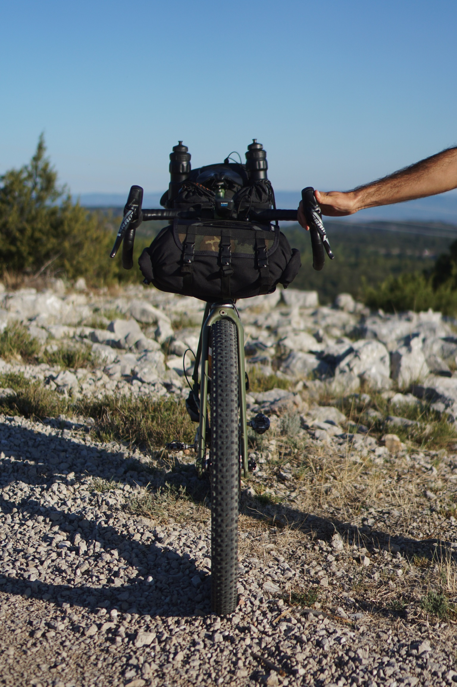

**L’important c’est le principal.**

Un vol de vélo c’est toujours relou, surtout quand c’est le vélo acheté avec ta première paye et façonné à ton goût au fil des mois, avec passion.  
Ce qui rend un vol de vélo un peu moins relou c’est quand, 3 mois plus tôt, tu te décides à l’assurer parce que finalement, tout peut arriver… safety first.

BINGO !

Il y a deux ans. Mon valeureux vélo de route a disparu dans la nature mais pour me consoler, j’ai eu l’occasion de me monter un vélo un poil moins exclusif. Un outil qui allait me permettre d’explorer mon nouveau terrain de jeu Marseillais mais aussi et surtout de suivre les amis du PCR Gravier dans leurs lolades estivales.

> C’est ton biotope qui devrait décider de ton matériel, pas Roger de Gravel Bike France qui pense que ce “peuneu” est nul car il a crevé deux fois avec.
>
> <!-- image manquante : 2020/03/Genesis-Fugio-Gravel-Bike_square.jpg -->

Avant de rentrer dans les détails et autres geekery cyclables, j’aimerai exprimer mon opinion sur le vélo et plus généralement le pourquoi de chaque pièce. C’est ton biotope qui devrait décider de ton matériel, pas Roger de Gravel Bike France qui pense que ce “peuneu” est nul car il a crevé deux fois avec. Ici, dans les collines Marseillaises, Mother Nature m’a fait choisir des pièces pensées pour survivre dans les cailloux et la poussière. Ça va sans dire qu’elle m’aurait conseillé quelque chose de complètement différent si j’habitais en Bretagne ou dans le Nord, mais revenons à nos castors.

**Cadre.**  
*tankism*

Un vélo déjà monté, on ne va pas se mentir, c’est toujours un peu frustrant. Tu ne l’a même pas encore roulé que tu voudrais déjà changer telle ou telle pièce, sans parler des peintures. Les couleurs fluo et des logos de plus en plus gros, c’est pas vraiment ma tasse de thé.

J’ai donc décidé de monter un vélo complètement à la carte, catégorie dentiste (cf : [le glossaire du gravier](/glossaire-du-gravier/)). De la peinture, aux rayons jusqu’aux poignées de porte et au pot Ninja. J’ai choisi chaque pièce de ce vélo pour en faire le puzzle le plus fun que j’ai jamais roulé.

<!-- image manquante : 2020/03/Genesis-Fugio-Gravel-Bike_26.jpg -->

Pour la petite histoire, quelques mois plus tôt, j’avais complètement flashé sur le [Stinner](https://theradavist.com/2016/07/a-4th-of-july-red-white-and-blue-stinner-frameworks-monster-cross/) de Kyle Kelley mais aussi le [Crema](https://theradavist.com/2016/08/my-agave-marginata-crema-duo-cross-bike/) de John Watson. L’idée d’avoir un champs d’action allant de la route au singletrack m’enchantait au plus haut point. Cependant, il y a deux ans, les vélos pouvant être équipés en roues de 27,5 avec des grosses sections de pneus ne couraient pas les rues. Mon choix s’est donc porté sur le Genesis fugio en kit Cadre que j’ai fait repeindre à mon goût avec ses périphériques.

<!-- image manquante : 2020/03/Genesis-Fugio-Gravel-Bike_wide_14.jpg -->

**Les Roues.**  
*swapism*

La deuxième chose la plus importante sur un vélo (dites moi si je me trompe), c’est les roues. Les gars de chez Mohawks Cycle ont fait un taf incroyable en me rayonnant des cercles carbone Wtb Ci24 en 650b (27,5) sur une paire de moyeux Chris King R45, le tout lacé avec des rayons Sapim Cx Ray.

On aurait pu s’arrêter là mais voilà, en bon castor de la division « SPORT » du PCR Gravier, je me suis équipé d’un deuxième wheelset, en 700c pour mes rides hivernaux et autres épreuves comme le [Born To Ride](/born-to-ride-2019-les-citadelles/). Une paire de Mavic open pro équipée d’un moyeu dynamo et d’un corps de roue libre Sram Xd capable d’accueillir une cassette 10-42 pour moins mouliner dans les descentes.  
Là tu te demandes si deux paires de roues c’est LA solution pour avoir un vélo 2 en 1  ?

C’est non !

La réalité, c’est qu’à chaque changement de roues, il y a toujours des petits réglages et ajustements à faire (dérailleur et freins). De mon côté j’en ai toujours pour 20 mn chrono. Certes, c’est pratique, mais toujours un peu la plaie. L’avantage en revanche, c’est que ça me permet de switcher du mode “Gravier” au mode “Rando” comme ci-dessous.

**Les Pneus.**  
*Cramponism*

C’est officiellement mon paragraphe préféré car sur ce vélo, c’est carrément la teuf à la clearance.  
En 650b, le cadre et la fourche acceptent des pneus allant jusqu’à 56c, faut-il encore avoir les jambes pour les traîner. Par contre, histoire vraie, chaussé en 27,5×2,2, le vélo est presque aussi confortable que mon canapé.

!Warning! ici à Marseille il y a 300 jours de soleil par an donc à part quelques mm de poussière, je n’ai presque voire pas besoin de dégagement au niveau du cadre. Si par contre, tu habites dans des contrées plus humide, une largeur de pneu entre 47c et 50c sera largement suffisante si tu ne veux pas découvrir les joies des crevaisons sur les flancs !

Mes petits préférés  : WTB Sendero 47c et Ranger 27.5 x 2.0.

<!-- image manquante : 2020/03/Genesis-Fugio-Gravel-Bike_wide_15.jpg -->

**Transmission.**  
*Simplism*

Niveau transmission là, c’est encore la gueguerre sur internet. Même si Jean Claude routard pense que le double plateaux “c’est nikel en graveul”, de mon côté et aux vues des dénivelés hors fédé autour de Marseille, j’ai opté pour du mono plateau. Déjà pour la simplicité d’utilisation mais aussi pour la facilité d’entretien. Un câble, un dérailleur, une cassette aussi grosse que ton disque et basta !

Pour ça, le groupe Sram Force 1 fait très bien le job (quand on sait le régler correctement), même si franchement avouons-le, pour quelques grammes de plus un groupe rival fera aussi bien le travail. Niveau denture, un plateau de 38 dents couplé avec une cassette en 11-42 me permettent de passer (presque) partout.

Le summum du chiant : le passage de gaine sous le tube diagonal. Sur le papier c’est très bien pour l’entretien mais à l’usage, mon câble est aux premières loges pour manger un maximum de biotope réduisant sa durée de vie à plus ou moins 6 mois, ou au choix 5 jours sous les trombes d’eaux d’un [Born To Ride](/born-to-ride-2019-les-citadelles/).

Protips : pour les freins, les plaquettes Jagwire, une fois rodées sont un must de longévité et de précision.

<!-- image manquante : 2020/03/Genesis-Fugio-Gravel-Bike_wide_00.jpg -->

**composants.**  
*Soliditism*

Pour le reste c’est que du solide et de l’éprouvé, tige de selle et potence Thomson aux couleurs du cadre, un cintre salsa cowbell en 44cm avec juste ce qu’il faut de flare (12°) et des pédales spd Shimano XT. Concernant la selle, Après quelques mois à me faire victimiser par une frabric ALM full carbon, j’ai redécouvert ce que voulait dire le mot confort avec la Power de chez Specialized.

Niveau navigation, RAS sur le Wahoo Bolt, c’est bien, c’est juste et c’est surtout diablement fiable avec en prime, une batterie dont la durée de vie frôle celle d’une Tesla.

Enfin pour l’éclairage, j’utilise les excellentes Bontrager flare RT pour mes (courtes) sessions gravel et en revanche, pour des rides plus long sur route, je me suis équipé d’une Sinewave Beacon qui à l’avantage d’éclairer très fort de nuit mais surtout de recharger mon gps, mon téléphone et ma batterie externe via un port usb à l’arrière de la lampe. C’est vraiment pas donné, certes, mais c’est clairement le meilleur investissement que j’ai fais sur ce vélo !

**Bagages.**  
*camouflism*

[Cordel](https://www.cordelcycling.com/), pour nous au PCR Gravier, c’est le michou du bikepacking ! En plus d’être extrêmement cool, il fait un super travail sur ses sacoches. Du petit sac de cintre pour les rides du week-end jusqu’au kit complet pour plusieurs jours de vadrouille, il est toujours à l’écoute pour t’aider sur des petits hacks comme [mon micro pump bag](/cordel-pump-bag/).

Protips : comme j’ai la phobie des sacoches de selle qui bougent j’ai acheté sur le net le [woho anti-sway](https://www.wohobike.com/products/xtouring-anti-sway). Déjà ça marche, ma sacoche ne bouge pas d’un poil même en danseuse mais en plus de ça je peux embarquer deux gourdes supplémentaires, idéal pour faire cuire ton ptit Yolo une fois au campement ou juste pour ne pas t’arrêter tout les 20 kilomètres l’été quand il fait trop chaud.

**Rouler.**  
*Stabilism*

Après plus de 10.000 km à son guidon, faut pas déconner, je pense pouvoir vous en dire quelques mots.

Alors c’est sur il est bien beau ce vélo avec des gros pneus mais il faut aussi le traîner dans le dénivelé positif. Même bien équipé, le Fugio affiche un embonpoint certain et ça se ressent dans les plaines et les ascensions. En revanche, à chaque bascule son méga empattement le transforme en TGV, tout biotope confondu ! Dans les descente et quand le rythme s’accelère, le Fugio est incroyablement stable et sécurisant. Forcement aussi, ce qui est perdu en rendement est gagné en confort. Ici on joue dans la catégorie Rolls-Royce avec un cadre en acier qui joue extrêmement bien son rôle couplé au gros volume des pneus. Tu l’auras compris ce vélo est donc plus à l’aise dans les longues vadrouilles que dans un sprint massif de 3ème caté à Noisy-Le-Grand.

Ça restera mon plus grand paradoxe mais le bonheur que j’ai a son guidon dans le gravier et en descente vaut bien mieux que tous les KOM que j’aurais pu choper avec un vélo plus léger et puis, comme je dis toujours : “l’important c’est le principal !”

<!-- image manquante : 2020/03/gravel-ride.jpg -->

---

**Cadre** *Genesis Fugio taille L ~* **Fourche** *Genesis Carbone ~ **JDD** Chris King Matte Slate ~ **BDP** Chris King Matte Slate ~***Pédalier** *Sram Force ~ **Plateau** Wolf Tooth 38t ~* **Manettes** *Sram Force 1 ~* **Dérailleur Arrière** *Sram Force ~* **Cassette** *Sram Force 10/42 ~* **Chaîne** *Sram 11v ~* **Potence** *Thomson 90mm -10° ~* **TDS** *Thomson* *Elite ~***Roues 650b** *WTB Ci24 / Chris King r45 / Sapim Cx ~ **Roues 700c** Mavic Open Pro / Hope RS4 / Shutter Precision PD8x ~* **Pneus** *WTB Sendero 47 / Ranger 27.5 x 2.25* *~* **Cintre** *Salsa Cowbell* *~***Guido** Lizard Skin 2.5mm*~***Selle** Specialized power*~***Disques** *Sram Centerline 160mm ~* **Freins** *Sram Force ~* **Pédales** *Shimano**SPD* *M8000 (XT) ~****GPS** Wahoo Bolt ~ **Sealant** Orange Endurance*

–

Photos : [Manivelle.cc](https://www.instagram.com/manivelle.cc/)
