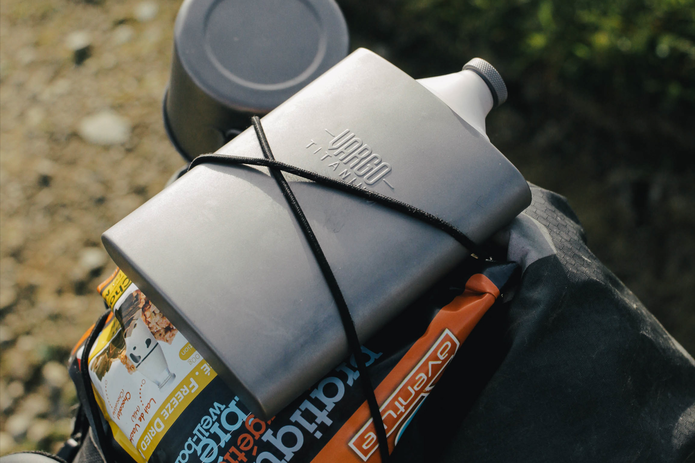

METAL GEAR SOLID

Concrétisation de plusieurs mois de réflexion, je souhaitais acquérir une véritable machine à plaisir, performante, confortable, polyvalente, capable de pouvoir pratiquer le loisir à outrance. Un objet que je voudrais garder pour la vie.  
Après plusieurs années à liker des vélos de “dentiste” sur Instagram, et après avoir récolté les fruits de mes dures journées de labeur, un montage à la carte est envisagé. Ce n’est pas la matérialisation d’une vie mais nous n’en sommes pas très loin.

> Que ce soit pour du tourisme régional, du gravel engagé chargé de type international, ou pour une simple sortie route, le vélo s’emmène rudement bien dans n’importe quel dénivelé. Il est diablement réactif et bigrement confortable. Il s’agit pour moi d’une bicyclette redoutable.

Un beau matin une opportunité s’est présentée sur les Internets, un magasin sudiste faisait des soldes; -20% sur un modèle invendu en taille 56 – BIM BAM BOOM, j’ai craqué. Non pas par persuasion de réaliser une affaire, mais plutôt par discernement. Le vélo c’est comme une bagnole ou un engin agricole; les premiers kilomètres effectués avec après la sortie d’usine, lui font perdre directement 20% de sa valeur neuve. Alors psychologiquement, ça faisait sens !

J’ai acheté un Kona Rove Space Metal. La firme Canadienne a fait produire ces cadres titanes cru 2015/2016 par le spécialiste LYNSKEY. Signature Américaine sur la machine “Hand Made in Tennessee – Built To Go Fast”; frissons garantis!  
Ce Titanium Body est de belle facture, les soudures sont régulières et la finition peau de pêche.  
A noter que la géométrie du cadre n’est pas la même que pour les autres modèles Rove de la marque, qui sont en acier ou en aluminium. Les bases et les haubans lui offrent un très bon dégagement permettant de passer des pneumatiques de belles sections. Le tube diagonal oversize lui offre une colonne vertébrale Herculéenne.

<!-- image manquante : 2020/09/Kona_Rove_ti_wide_0.jpg -->

Etant sur une base solide, j’ai marié le cadre à une fourche bobybuildée Whisky Parts modèle n°9. L’ensemble fusionne sur un jeu de direction Chris King, gage d’onctuosité. Kit cadre associé à un groupe Shimano hydraulique 11 vitesses, un mono plateau White Industries M30 en 38 dents, et une cassette XT en dentition 11-42. L’adaptateur WolfTooth Tanpan rend compatible la gymnastique entre des leviers Shimano route Ultegra et la transmission VTT Shimano XTR. Il permet d’augmenter le niveau des dentures pour des dénivelés conséquents.  
Le tout repose sur une paire de cercles carbones rayonnés en Sapim CX Ray sur moyeux Chris King et chaussée en Tubeless sur des WTB Riddler section 45.

Après plus de 20.000 km parcourus sur ce fidèle destrier, la satisfaction est totale; à l’aise sur tous les types de terrains et dans toutes les conditions. Ce vélo permet bel et bien de pratiquer le loisir à souhait, le brief de départ est rempli à 300%. Le plaisir est suprême.  
Que ce soit pour du tourisme régional, du gravel engagé chargé de type international, ou pour une simple sortie route, le vélo s’emmène rudement bien dans n’importe quel dénivelé. Il est diablement réactif et bigrement confortable. Il s’agit pour moi d’une bicyclette redoutable. Je suis un cavalier satisfait de sa monture. L’engrenage physique d’un vélo lié à l’anatomie de l’homme font dégager une fusion, nous glissons ensemble dans l’espace. Il y a un truc entre ce vélo et moi. Et je ne suis pas prêt de m’en séparer.

<!-- image manquante : 2020/08/JURASICK_GRAVEL_GTJ_PCR-124.jpg -->

Partant de ce constat, et validant le fait qu’il s’agit bien là d’un vélo pour la vie, j’ai souhaité lui offrir un nouveau lifting à la hauteur du swag qu’il mérite ; à savoir une belle mécanique couplée à des pièces de type usinage d’art industriel. Il s’est donc offert un nouveau dérailleur Shimano XTR M9000, ainsi que des étriers hydraulique Hope RX4 !

---

**Cadre** *Kona Rove Ti 56 ~* **Fourche** *Whisky n°9 ~ **JDD** Chris King ~ **BDP** Chris King ~* **Pédalier** White Industries M30*~* **Manettes** *Shimano Ultegra 11v ~* **Dérailleur Arrière** *Shimano XTR ~* **Cassette** *Shimano XT 11-42 ~* **Chaîne** *Shimano 11v ~* **Potence** *Thomson ~* **TDS** *Lynskey Ti ~***Roues** *Carbone / Chrisking* *~* **Pneus** *WTB Riddler 45c* *~* **Cintre** *Salsa Cowbell* *~***Guido** Lizard Skin*~***Selle** WTB Volt Ti *~***Freins** *Hope RX4 ~* **Pédales** Time Atac XC *~****GPS** Garmin Edge 1000*

–

Photos : [Renaud Skyronka](https://www.instagram.com/aknologic/)
