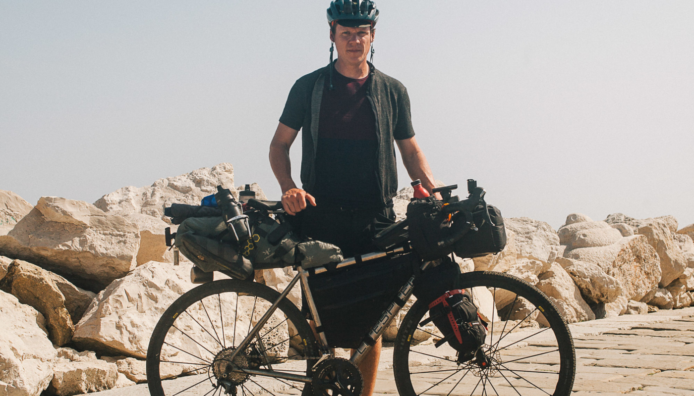
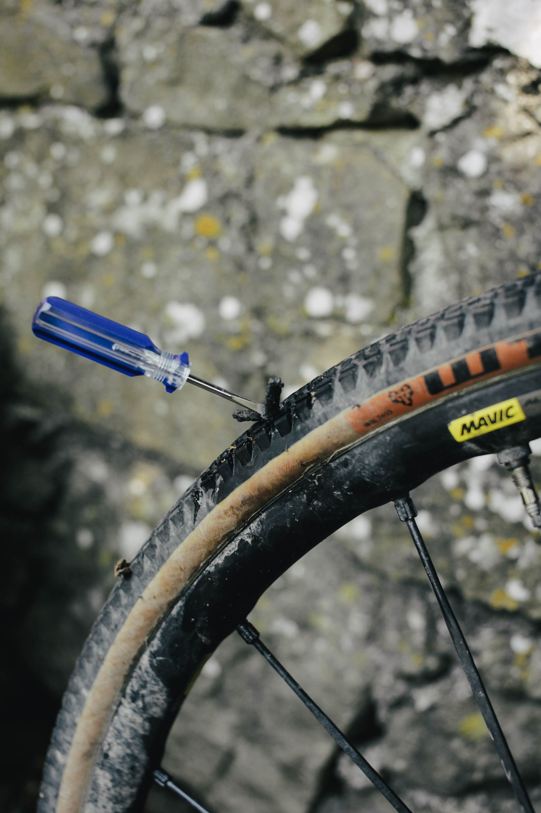
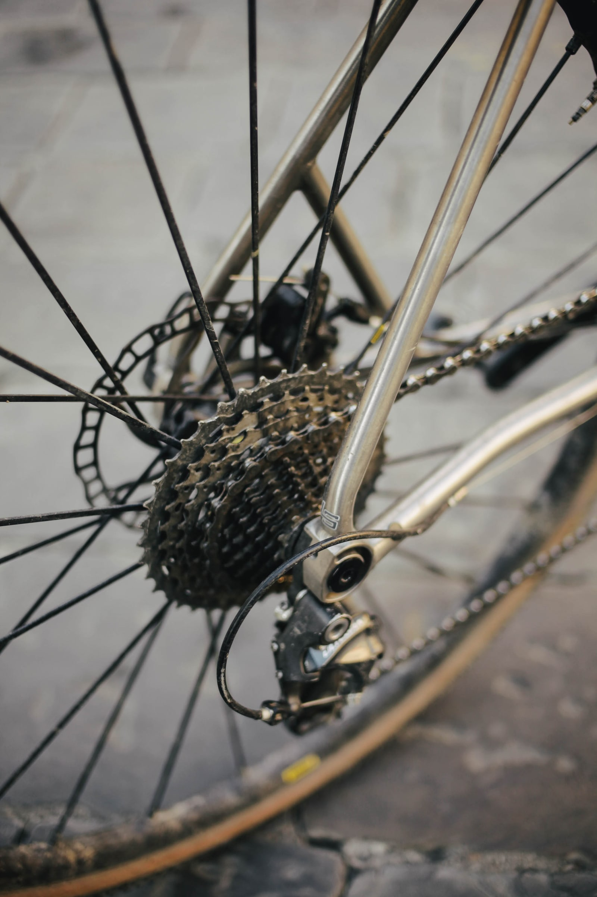
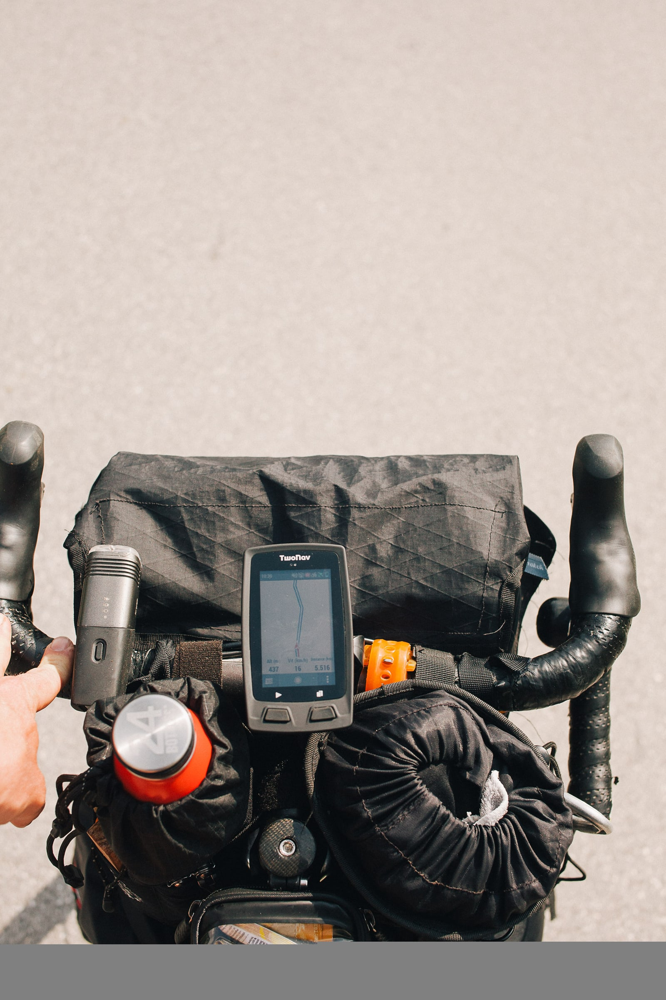
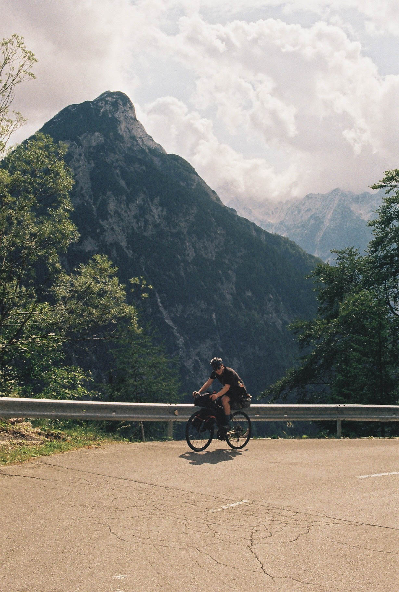

**TITANE IS METAL !**

En matière de vélo, j’ai toujours eu beaucoup de mal à mettre plus de 4 chiffres dans une monture.  
Après avoir commencé les aventures gravier sur un cyclocross *Ridley shlag 4000* en cantilever 8 v pneu de 32 à 300 €, puis fait un petit upgrade vers un Felt (toujours de cyclocross) d’occasion qui m’a rendu bien des services, mais qui s’est totalement fait rincer par la rudesse des aventures et du climat parisien, j’ai fini par décider de franchir le cap en rentrant **la confrérie des amateurs de TITANE**.

> Noble matière, numéro atomique 22 (presque celui de Mickael Jordan), de la famille des métaux de transition, il sert avant tout à faire des broches dans les tibias des skaters et à recouvrir les musées d’art contemporain.

Pour le vélo, il faut avouer qu’il a un avantage de taille : **il ne rouille pas !** Et quand on roule tous les jours à paris, c’est un sacré point fort. J’ai donc sauté sur l’occasion quand j’ai vu passer l’annonce d’un cadre Litespeed Gravel de première génération pour (presque) moins que les 4 chiffres que j’ai du mal à passer. Alors oui, c’est le prix du cadre… mais il suffisait de quelques dons d’organes et **d’une belle paire de roues Allroad Pro** mise à disposition par nos amis de chez Mavic pour enfin monter la monture de mes rêves (ou presque)

<!-- image manquante : 2019/11/litespeedt5_gravel_pcr_gravier-7-683x1024.jpg -->

Niveau config, je préfère rester sur des choses simples, et qui peuvent se réparer n’importe où. Un mix de **Shimano 105 et Ultegra** pour la transmission, des **freins HY/RD de chez TRP** pour un mix entre hydro et mécanique. (qui marches super bien si on sait les régler…), et la révolution de **pneus tubeless**, qui changent bien la vie si on n’oublie pas les mèches à la maison. J’ai gardé le développement que j’avais sur le Felt et qui avait fait ses preuves sur le Turin-Nice, à savoir **un copieux 11-40 à l’arrière** et un pédalier compact très classique **52-36 à l’avant**.

Paré à toutes les éventualités.

Niveau pneumatique, la question est toujours un peu délicate.  
L’envie est de monter du TRÈS gros dessus. Malheureusement, ce cadre de 2016 n’accepte rien à l’arrière au-dessus de 38.  
J’ai donc opté pour un montage hybride avec une paire de pneus **WTB Riddler ; 45 à l’avant, 37 à l’arrière**.  
C’est aujourd’hui mon presque unique vélo. Je roule chaque jour 20 km avec pour aller bosser.

<!-- image manquante : 2018/10/CAMERA_BAG_GRAVIER-17-1024x410.jpg -->

Pour les aventures PCR Gravier, il doit donc être légèrement upgradé pour pouvoir accepter tout le matériel. La principale modification est le **perçage de la fourche carbone par « composite Doctor »** pour y ajouter des cages Blackburn.

Ma capacité à transporter beaucoup plus que nécessaire pendant les voyages m’a « obligé » à opter pour une sacoche de cadre intégrale (et ainsi un ajout non négligeable de volume). J’ai donc déplacé les bidons derrière la selle grâce au système **Woho anti sway** qui a pour particularité de stabiliser la sacoche arrière tout en permettant d’ajouter 2 bidons à l’arrière.

<!-- image manquante : 2019/11/litespeedt5_gravel_pcr_gravier-4-683x1024.jpg -->

Dernier point, il fallait que je trouve un système pour pouvoir supporter le poids de mon sac photo sur le cintre. Une sorte de porte-bagages, mais sans les tuyaux de chauffage vers la fourche qui empêcheraient la mise en place de mes sacoches. La seule solution que j’ai trouvée est **le système rack de chez Tim-Tas Rek**. Ça se fixe comme un spacer au niveau de la potence, et ça soutient très bien le chargement. Très très solide.  
On pourrait toujours faire mieux, tout passer en Enve, mettre un groupe full Hydro à 3000 balles, rouler avec des Compass et se masturber dessus. Mais non, au final, je l’aime bien comme ça. **Je peux réparer tout ce qui est dessus, à peu près n’importe où.** En partant avec quelques rayons, 2 jeux de câbles, 2 galets 105 une paire de plaquettes et un maillon rapide, je suis à l’abri pour pas mal de km et pas mal de galères ! **Et puis… le titane quoi !**

---

**Cadre** *Litespeed T5 ~***Fourche** *Litespeed Carbone ~****Roues** Mavic AllRoad Pro 700 ~ **Pneus** Wtb Riddler 45c front et 37c back ~ **Pédalier** Shimano 105 52-36 ~***Manettes** *Shimano ultegra 11V ~***Dérailleur Avant** S*himano 105 ~***Dérailleur Arrière** *Shimano ultegra ~***Cassette** *Shimano 11-40 ~***Chaîne** *Shimano 11v**~ **Freins** Trp HY/RD ~***TDS** *Thomson Elite ~***JDD** *Cane Creek**~***Guido***Cinelli caleido + Gel**~***Selle** *Wtb Volt ti**~***Pédales** *Shimano Spd* *~***Sacoche de Selle** *Apidura* *~***Sacoche de Cadre & Food Pouch** *Cordel* *~***Sacoches de Fourche** *Restrap 6L* *~***Sacoche Photo** *Custom* *~***GPS** *Two Nav*

–

Photos : [Renaud Skyronka](https://www.instagram.com/aknologic/)
