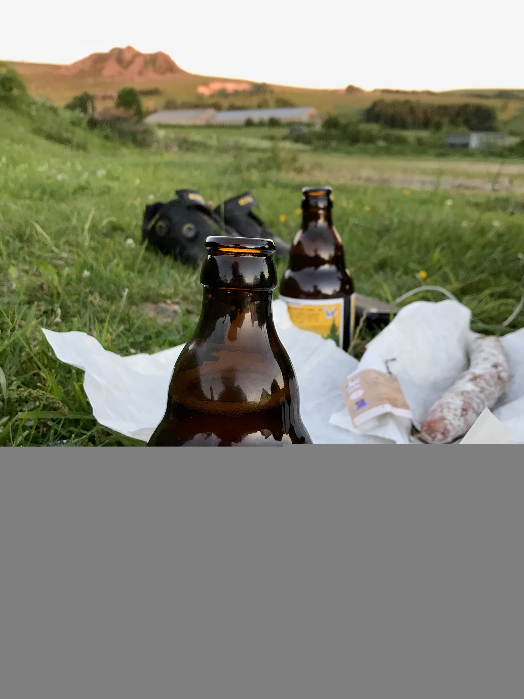

**DU BRÉSIL****À** **MARSEILLE. BROMANCE EN ITINÉRANCE.**

Après 8 mois au Brésil, il est temps de se reconnecter avec la France, la famille et les bros du PCR pour 1 mois de vacance.

> ***Arthur : “Esh copain, je pense rentrer fin juin en France pour 1 mois, ça te dit de prendre quelques jours pour aller shredder, de type à l’ancienne ?”  
> Hugues : “certainement !!! Sans doute! On va où ?”  
> Arthur : “J’aimerai traverser l’Ardèche par les chemins, ça a l’air sauvage et bien porn.”  
> Hugues : “Vendu !”***

<!-- image manquante : 2018/10/grande-traversée-ardéchoise13.jpg -->

Après quelques clics sur Google Maps nous partons sur une **Grande Traversée de l’Ardèche** (GTA) en plat principal, un Mont-Ventoux par le chemin des graviers blancs en dessert et en guise de digestif une descente du Lubéron direction Marseille. Un parcours d’à peu près 730km qui nous fera traverser une France méridionale aux saveurs multiples. Du 25 juin au 2 juillet.  

Comme à notre habitude nous partons en totale autonomie. Le seul impératif est d’arriver le 28 juin près d’Avignon, là où les bros Julien, Renaud et Simon vont nous rejoindre pour une bromance augmentée.

<!-- image manquante : 2018/10/grande-traversée-ardéchoise53.jpg -->

Lyon 15h, après une pizza et une pinte, il est temps de serrer les sacoches et de se mettre en route. Nous suivons la Via-Rhonna (poke [@ComeLoisirMérino](https://www.instagram.com/analog.come/) #JahLove) sur 80km pour rejoindre Boulieu-lès-Annonay, départ officiel de la GTA.

Nous avons 3 jours pour casser cette traversée balisée sur 300km de chemins, de GR, avec beaucoup D+, de petites routes, de chaleur et de douceurs visuelles.**L’Ardèche tient ses promesses**. Ça monte, c’est rocailleux, c’est beau. Une nature préservée, verte qui sent bon le début de l’été.

Le balisage est parfait, on se passe presque du GPS. Les premiers monts Ardéchois pointent le bout de leur nez, on y est, et une première baignade. Combo. Camp site 5 étoiles aux Estables avec vue sur le Mont Mézenc. Les paysages évoluent vite, le souffle du vent a une odeur différente, **la lumière se transforme**, la température monte. La suite est une belle descente vers le sud, l’Ardèche méridionale devient plus complexe, plus sèche, et plus tranchée.

<!-- image manquante : 2018/10/grande-traversée-ardéchoise8.jpg -->

<!-- image manquante : 2018/10/grande-traversée-ardéchoise11.jpg -->

<!-- image manquante : 2018/10/grande-traversée-ardéchoise12.jpg -->

Comme toujours à vélo **on devient vite de vrais petits castors,** prêt par exemple à investir la place d’un village médiéval à 14h, sardines à l’huile full prot’, plat yolo(philisé) sur le réchaud, petit Jack et café avant de repartir. A dormir sur un carré d’herbe en centre ville, entre deux entrepôts, les bonheurs simples de l’aventure à vélo.

Après 3 jours nous arrivons à Aiguèze. Fin de la GTA pour nous. 2 pintes au bar, on est en avance sur le timing pour rejoindre la team B en galère avec la SNCF. Un ravito Duvel à Pont Saint Esprit pour les attendre, c’est bon de profiter.

Nous sommes souillés de sueur, l’eau du Rhône est-elle propre ? Surement plus que nous, c’est l’heure du bain accompagné de son utile savon de Marseille. Un troupeau d’une cinquantaine de chèvres débarquent, **l’une d’elle renifle le cuissard d’Hugues**. Ça doit sentir fort, elle ne l’emmène pas et s’en brosse le nombril avec le pinceau de l’indifférence.

<!-- image manquante : 2018/10/grande-traversée-ardéchoise17.jpg -->

<!-- image manquante : 2018/10/grande-traversée-ardéchoise15.jpg -->

<!-- image manquante : 2018/10/grande-traversée-ardéchoise22.jpg -->

Il est 19h, les 2 teams fusionnent. **Sourires, accolades, bises, la bromance au sommet**. Repas 4\* pizzas & rosé en admirant un sunset sur le Rhône que Renaud tente d’immortaliser au drone. Mode sport, excès de confiance on manque de perdre le drone avant même d’avoir commencer. Renaud m’avait manqué.

<!-- image manquante : 2018/10/grande-traversée-ardéchoise24.jpg -->

**Nuit dans le verger, soleil au sommet.**En avant le Ventoux. Une matinée poussive pour arriver aux dentelles de Montmirail. Un petit échauffement avant le Ventoux. Sur le profil ça parait pas compliqué, en réalité on se farcît de bons % et Hugues commence à se mettre dans le rouge mentalement. C’est son premier vrai col et il angoisse. On tente de le rassurer autour d’une brochette de viande à la pause dej.

Il est 15h, il fait 40°C à l’ombre et on recharge de sealant le pneu arrière de sims. A 17h on est à Bédoin, on se charge de fromage, charcuterie, oeufs pour le festin du soir. **La complexité du bikepacking en mode Tetris** intrigue les estivants. 2, 3L d’eau par personne pour l’ascension, le repas, la nuit et le matin. Chantier. Au passage, énorme merci à l’employée du restaurant qui nous a gentiment laissé une bouteille d’eau sous une palette au sommet. Big Up.

<!-- image manquante : 2018/10/grande-traversée-ardéchoise25.jpg -->

<!-- image manquante : 2018/10/grande-traversée-ardéchoise26.jpg -->

<!-- image manquante : 2018/10/grande-traversée-ardéchoise27.jpg -->

<!-- image manquante : 2018/10/grande-traversée-ardéchoise29.jpg -->

17h30, sur le sentier. Enfin presque, Hugues stressé en a perdu ses lunettes. Coup du sort, karma jah, elles sont sur le sentier, 300 mètres derrière nous… 17h45, dans 4h il fait nuit, on a 24km de montée et 1600m à monter, sur du gravier. On est large. lol. Quel kiff. Chacun à son rythme, on s’arrête à l’ombre de bosquet pour mieux repartir. Le plus dur sera d’économiser l’eau … On s’attend en haut, Simon découvre une belle hernie sur son pneu. La route apparaît, “yes plus que 4km”.

<!-- image manquante : 2018/10/grande-traversée-ardéchoise31.jpg -->

<!-- image manquante : 2018/10/grande-traversée-ardéchoise33.jpg -->

<!-- image manquante : 2018/10/grande-traversée-ardéchoise35.jpg -->

Les 4km de l’enfer, à scruter la balustrade du prochain virage, à compter les centaines de mètres d’élévation à atteindre. On finit au crépuscule, right on time, Hugues en éclaireur telle une machine. On est salué par des cyclosportifs qui nous offrent pizzas & bières, le savisme est total.

Pas le temps de niaiser, on est mort, transit de froid, on file vers la chapelle qui sera notre refuge pour la nuit. Saucisson et beaufort sur l’autel du bikepacking.

<!-- image manquante : 2018/10/grande-traversée-ardéchoise37.jpg -->

Réveil à 1900m, l’aumônerie de Bédoin est là, les jeunes sont monté de nuit (pas de mauvais esprit). Nous replions le camp en dégustant nos oeufs brouillés/bacon, fraichement cuisinés dans la nouvelle poêle de Renaud. La lumière matinale est sublime, le café fume, **nous dronons dans le plus grand des calmes** à 1909m d’altitude. 

<!-- image manquante : 2018/10/grande-traversée-ardéchoise39.jpg -->

<!-- image manquante : 2018/10/grande-traversée-ardéchoise40.jpg -->

<!-- image manquante : 2018/10/grande-traversée-ardéchoise38.jpg -->

27km de descente vers Sault pour un traditionnel cassage de boulangerie. On part tard après avoir cassé 24 croissants, 12 cafés et changé le pneu de Simon. On ne le sait pas encore mais **cette journée sera un GoFast** pour attraper le bus de Renaud à 18h à Manosque. Chaleur, bitume, Colorado Provencal express. Simon et Renaud, frais comme des gardons partent en relais pour les 25 derniers km. Epic, Renaud arrivera à bon port.  

<!-- image manquante : 2018/10/grande-traversée-ardéchoise51.jpg -->

Une nouvelle journée placée sous le signe du drift et du gravel à l’américaine. Manosque, Vinon sur Verdon, Rians, le Var, la montagne Sainte victoire, nous shreddons comme des fous direction le sud.

Halte là ! **Apéro !** A travers la pinède, nous traversons un ranch où on nous stop. Ça redémarre. Ricard à 1€ accoudé à écouter les histoires d’un couple d’éleveurs de chevaux pas fâché avec la vie. *“Uneuh petiteuh zoneuh”* qui nous donnera une pêche d’enfer pour finir cette belle journée. On se marre sur les vélos, à moitié sec, on entame une longue descente de gravier lisse à plus de 45 à l’heure. YOLO.

**Plantage de Tarp dans la vigne.**Demain au programme, l’Espigoulier, Cassis, les calanques, la grande bleue, plouf, Ricard. Le dernier matin d’aventure a toujours une saveur particulière, un sentiment particulier. Dernier pliage de tarp, on refait les sacoches une dernière fois et zouh en entame l’ascension du jour. **L’Espigoulier par le gravier**. Mythique, symbiose parfaite. En haut, la descente en bitume nous amène en périphérie de cassis, la claque est violente, le retour à la civilisation, à travers une bonne vieille ZAC des familles … c’est rude.

Rude, ça pourrait être le deuxième nom du parc national des Calanques. Baroud d’honneur pour ce périple, on galère, on pousse, on sue, c’est aussi beau que fatiguant, Hugues est en fringale, assommé par la chaleur, on finit à Endoume, le plouf est royal. Ce soir c’est douche, Ricard, burger best maison by Chloé.

<!-- image manquante : 2018/10/grande-traversée-ardéchoise47.jpg -->

<!-- image manquante : 2018/10/grande-traversée-ardéchoise48.jpg -->

<!-- image manquante : 2018/10/grande-traversée-ardéchoise49.jpg -->

<!-- image manquante : 2018/10/grande-traversée-ardéchoise50.jpg -->

Une fois de plus ce fut **une belle aventure sportive et humaine**, des moments qui te font oublier tout le reste et te donne encore plus envie de repartir, à l’aventure, entre copains, sans trop avoir besoin de grand choses.

[metaslider id=”783″]

---

***LA MAP***

https://ridewithgps.com/embeds?type=route&id=29000892&metricUnits=true&sampleGraph=true&overlay=esriTopo

–

**728km**  
**12472 D+**  
**8 jours**

–

Photos : [Arthur Feraud](https://www.instagram.com/arthur_frd/) ~ [Renaud Skyronka](https://www.instagram.com/aknologic/) ~ [Julien Sommier](https://www.instagram.com/julienpcr/) ~ [Simon Taulelle](https://www.instagram.com/sims_teuteul/)
