**PLUS DE PHOTOS QUE DE KILOMÈTRES**

Il me semble difficile d’envisager de voyager sans prendre de photos.   
Pire… il me semble difficile de voyager sans prendre PLUSIEURS appareils photos.   
Pire… il me semble impossible de partir sans au minimum 3 boîtiers.  
Pire encore, ces boîtiers sont pour la plupart argentiques.

> **La question cruciale lorsque l’on emporte autant de matériel sur le vélo reste de savoir où va-t-on mettre tout ce bordel. Les appareils sont fragiles, ils craignent l’eau, la poussière. Bref, ils ne sont pas du tout adaptés aux destinations bikepacking.**

<!-- image manquante : 2018/11/CAMERA_BAG_GRAVIER-5.jpg -->

J’ai depuis toujours une passion pour la photo et depuis que mon père m’a offert son Nikon F90 pour mon bac, **j’ai un attachement particulier pour la photographie argentique.** Celle qu’on ne peut pas voir instantanément, celle qui demande du savoir-faire et de la patience, celle qu’on va chercher au labo 3 semaines après la fin du voyage et qui nous permet de revivre chaque moment fort après un délai de digestion impossible à avoir en digital.

Bien entendu, il faut vivre avec son temps et en bon geek, j’emporte également un boîtier numérique dans mes sacoches. Les photos sont très belles, précises, retouchables à l’infini, mais il leur manque à mon sens le côté palpable du film pour qu’elles me satisfassent totalement.

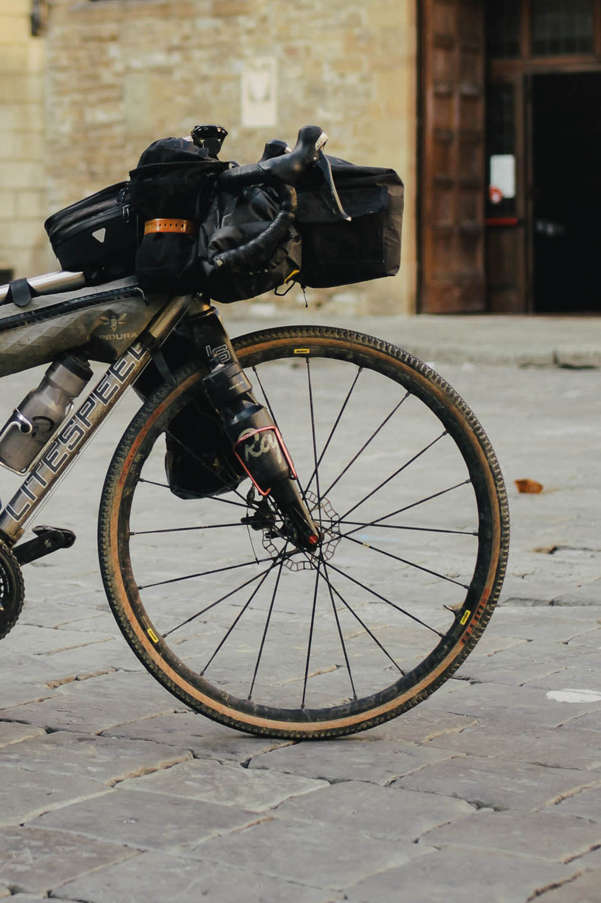

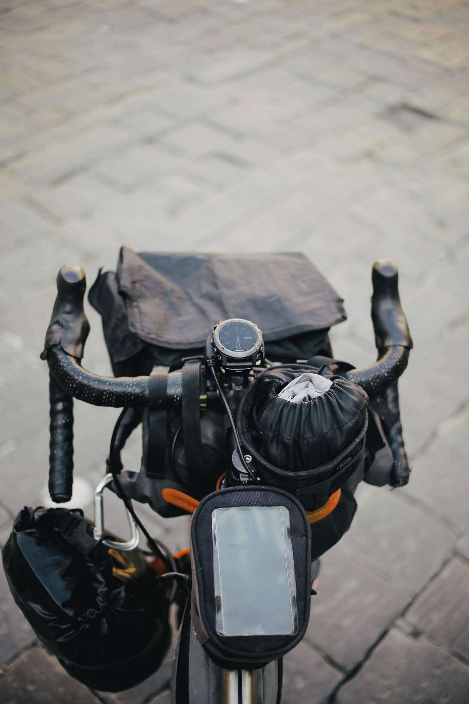

J’ai essayé à peu près toutes les configurations possibles et imaginables, avec des combinaisons de boîtiers tout aussi improbables les unes que les autres. Le « cahier des charges » de chaque voyage consiste aujourd’hui à emporter 3 boîtiers. Un moyen format argentique, un 24×36 argentique et un reflex full frame digital. J’ai essayé les compacts numériques, mais je suis toujours déçu du résultat final, même avec l’impressionnant Sony RX100 IV.  
  
Pour le boîtier moyen format, mon choix s’est porté sur le légendaire **Mamiya 7** et son polyvalent 80 mm f:4. Probablement le boîtier le plus performant jamais créé dans un encombrement et un poids record pour un 6×7. Chaque image est incroyablement piquée, à toutes les ouvertures et sa visée télémétrique en fait une option suffisamment compacte pour envisager de l’emporter sur un vélo.

<!-- image manquante : 2018/11/CAMERA_BAG_GRAVIER-10.jpg -->

Autre option intéressante, un folding télémétrique : le **Zeiss Ikon** probablement le 6×6 le plus compact jamais réalisé, qui tient dans une pochette et dont l’optique est, il faut dire, assez bluffante. On le trouve aujourd’hui facilement en brocante pour une centaine d’euros. Inconvénient : il nécessite une cellule à main pour être utilisé correctement, là où le Mamiya 7 est totalement autonome.

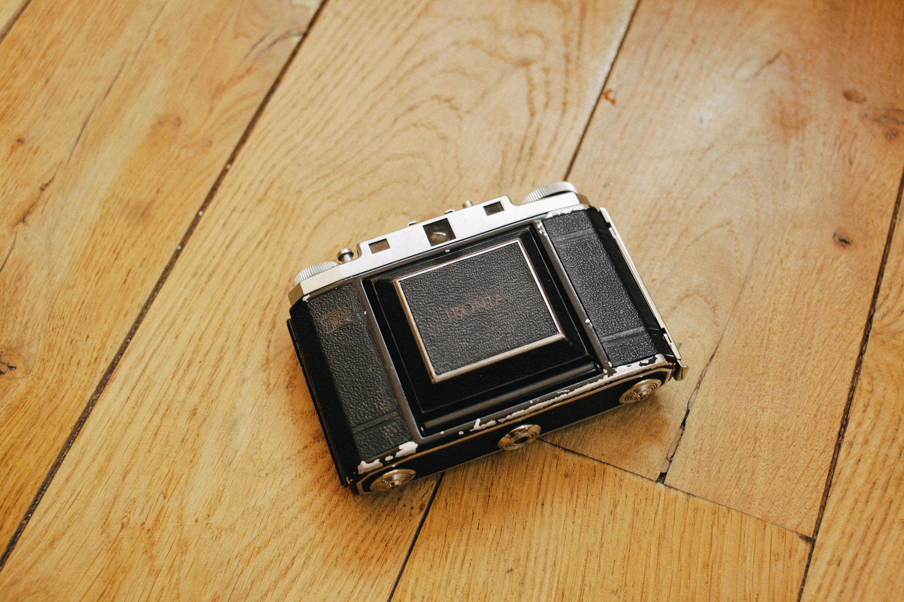

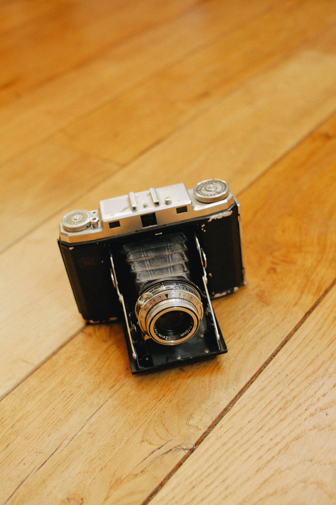

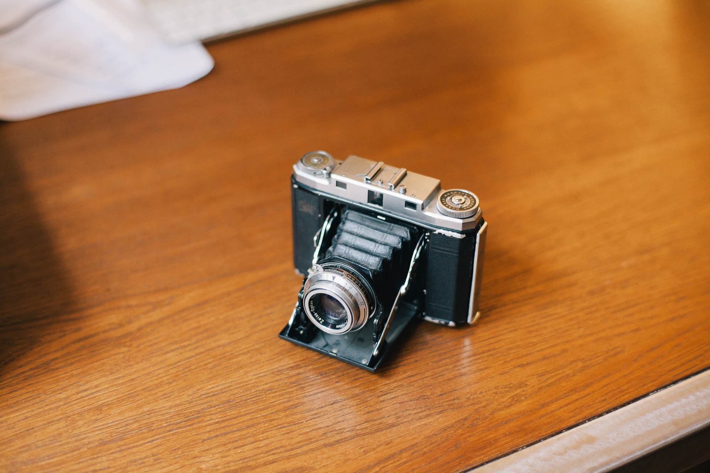

Pour le boîtier 24×36 argentique, l’idée était de partir sur un « compact bijou » des années 90. Solides, généralement en titane, ces boîtiers sont munis d’optiques de premier choix et servent de « bloc note » sur le parcours, toujours prêt à être dégainés. Inconvénient principal, les focales sont généralement fixes, aux alentours de 35 mm. On repassera pour le joli flou d’arrière-plan et la profondeur de champ.  
J’ai longtemps utilisé un **Yashica T4** en voyage, et malgré la qualité de son optique, il est beaucoup trop fragile, et sa côte disproportionnée sur le marché de l’occasion le rend totalement inabordable compte tenu de son caractère « jetable ».

Mon choix s’est donc porté sur deux boîtiers : le **Nikon 35Ti** (le Ti veut dire Titane), bijoux de technologie japonaise. Un peu comme si le patron de Nikon avait dit à ses équipes, **«****allez-y, carte blanche, mettez tout !****»**. 35 mm f2.8, boîtier à toute épreuve. Malheureusement, quasiment tous les 35Ti sont victimes au bout d’un moment d’un problème d’obturateur et deviennent inutilisables. C’est le cas du mien. Je l’ai donc remplacé par le non moins mythique **Contax T2**. Concurrent titane du Nikon, les caractéristiques sont à peu près similaire et il semble que l’obturateur résiste mieux dans le temps !

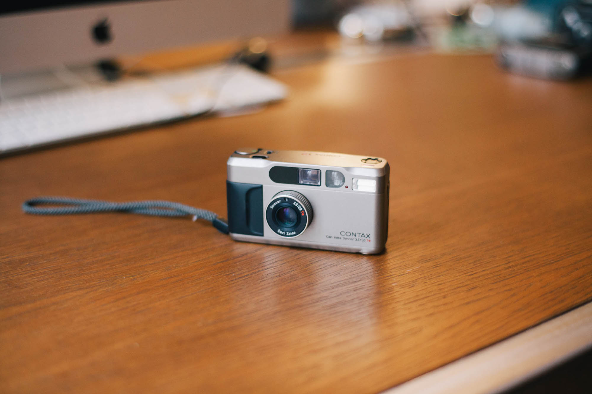

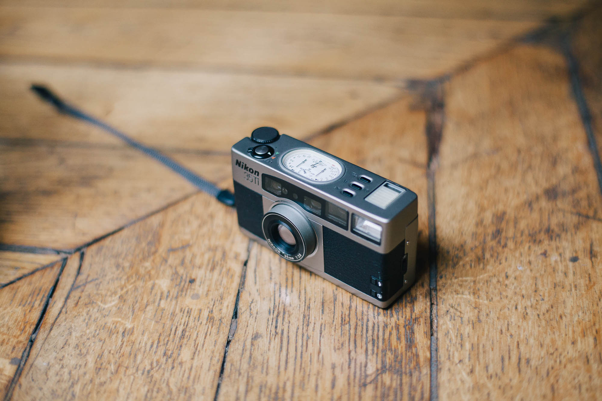

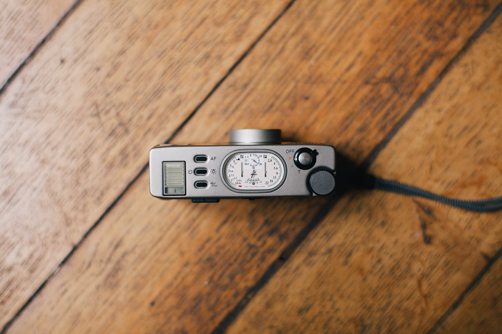

Concernant le digital, j’ai longtemps refusé de partir avec un boîtier numérique. Trop lourd, trop fragile, gourmand en batteries, c’est un sacré poids supplémentaire à transporter. J’ai sauté le pas cette année lors de notre ascension du [Mont Ventoux par les chemins de graviers](/brodyssee-ardechoise/). J’ai donc emporté un **Canon 5D mkII** monté avec une optique formidable de compacité : le voigtlander 40mm f:2. Un 40mm *pancake* extrêmement compact et solide qui résiste à pas mal de maltraitances. J’utilise ce boîtier pour les images mises en ligne quotidiennement sur notre compte Instagram, grâce à un capricieux adaptateur de transfert vers iPhone. **Ainsi, nos story ont pris une belle ampleur esthétique.**  
  
Cerise sur le gâteau, depuis 2 ans, j’emporte également un drone dans mes sacoches : un **Dji Spark**. Compacité absolue, légèreté et facilité d’utilisation.   
  
La question cruciale lorsque l’on emporte autant de matériel sur le vélo reste de savoir où va-t-on mettre tout ce bordel. Les appareils sont fragiles, ils craignent l’eau, la poussière. Bref, ils ne sont pas du tout adaptés aux destinations bikepacking.

<!-- image manquante : 2018/10/CAMERA_BAG_GRAVIER-17.jpg -->

Après avoir tenté d’utiliser les sacoches classiques de bikepacking, **la solution retenue sera de fabriquer une sacoche totalement sur mesure** en tissus étanche, avec un insert en mousse découpable pour y ranger les boîtiers à l’abri des chocs et des éléments.

Inspiré par différents modèles du marché, j’ai donc conçu un sac assez massif, compatible avec mon sac [Apidura](https://www.apidura.com/) de cintre et **pouvant transporter mes 3 boîtiers ainsi qu’un chargeur solaire**. Jusqu’ici, aucun problème. J’ajoute tout de même un sur-sac étanche recyclé d’un ancien sac à dos qui permet de mettre tout ça à l’abri en cas de grosse averse. Le drone quant à lui tient dans un *Hip Pouch* étanche et assez volumineux.

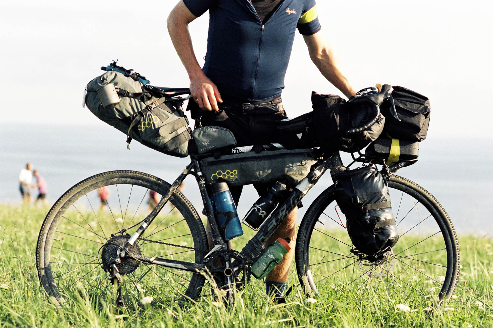

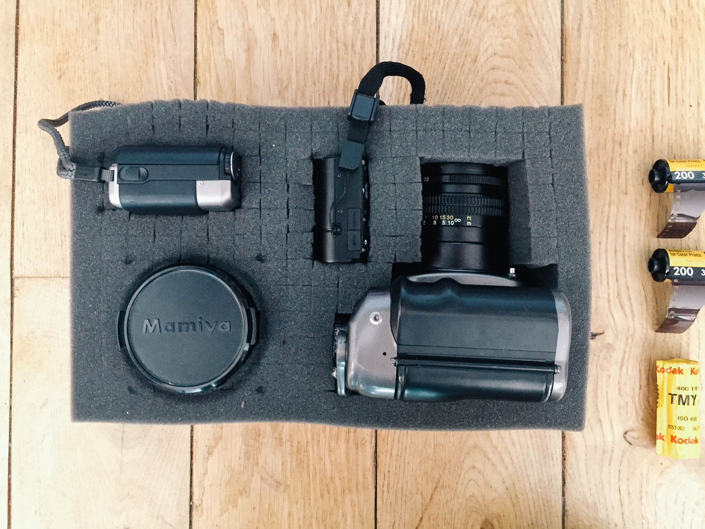

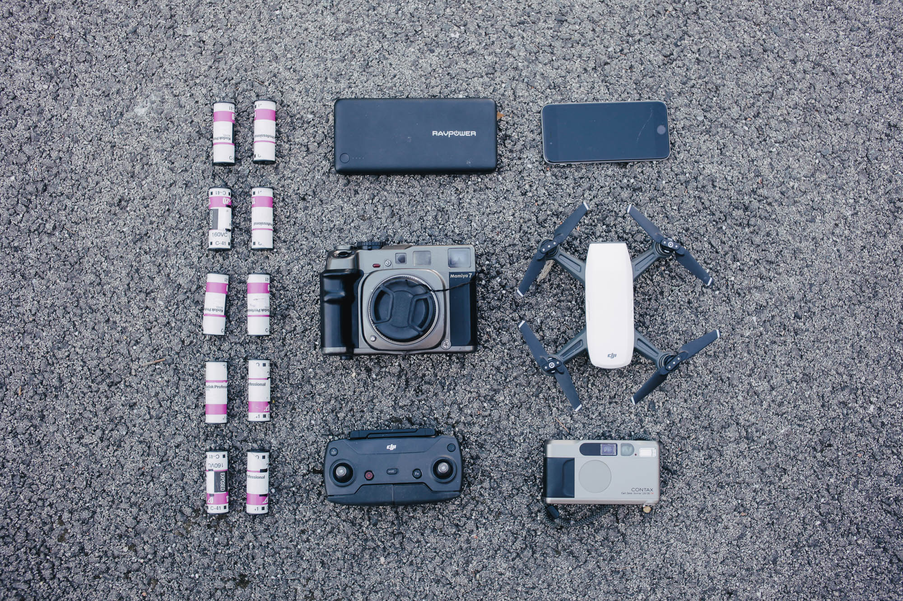

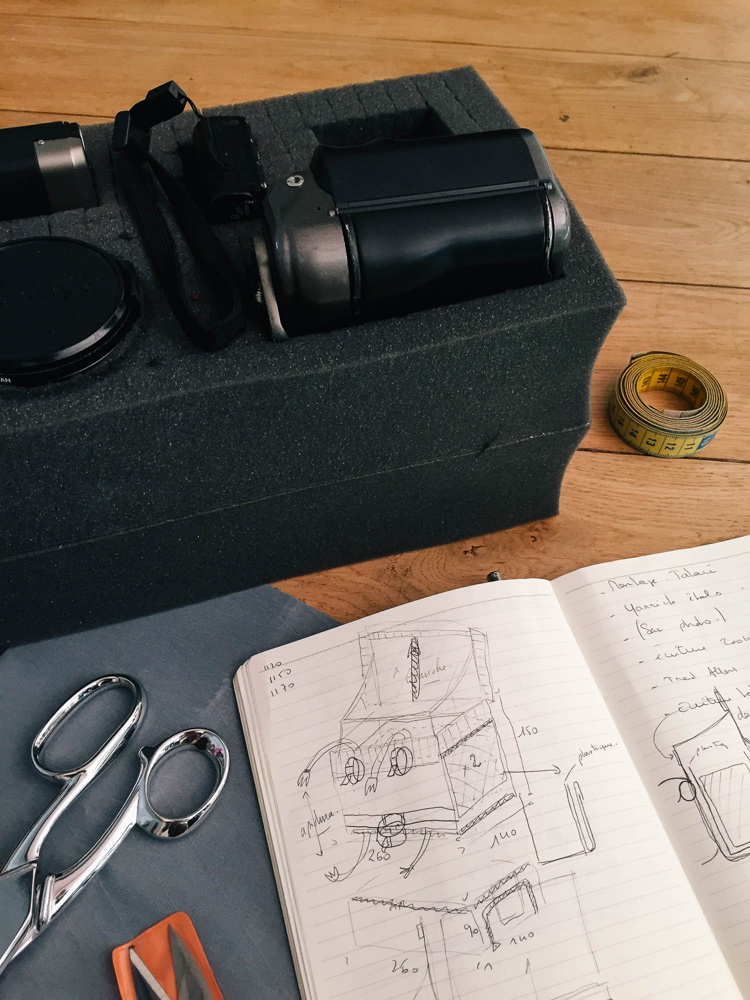

On me pose souvent la question du poids de tout ce matériel. Il est conséquent. C’est d’ailleurs **un vrai souci d’équilibrage permanent**, et une vraie source de contrainte pour la fourche. Je porte la plupart du temps le 5D en bandoulière pour soulager la sacoche.

La prochaine amélioration sera sûrement l’achat d’un mini rack fixé au niveau du jeu de direction, pour soulager les sangles, et peut être même la **conception d’un nouveau prototype** de sac en collaboration avec notre ami de chez [Cordel](/cordel-pump-bag/), pour une version améliorée, plus durable et avec des rangements plus pratiques.   
  
Je ne conseille pas à tout le monde de partir avec autant de matériel. Pour moi, c’est une part très importante du voyage, au même titre que la rédaction du récit de l’aventure.

Toutefois, un peu d’argentique ne fait pas de mal. **Les négatifs ne disparaîtront pas avec un disque dur qui crash** ou un vidage de corbeille intempestif. Commencez simplement avec un jetable c’est déjà 1000 fois mieux qu’un vulgaire filtre Instagram, et peut être que le virus vous prendra. C’est sur, il faudra attendre quelques jours avant de partager vos images, mais un peu de patience ne fera de mal à personne dans ce monde qui roule à 1000 à l’heure.

*Slow travel  
Slow ride  
Slow shoot*

<!-- image manquante : 2018/11/CAMERA_BAG_GRAVIER-3.jpg -->

–

Photos : [Renaud Skyronka](https://www.instagram.com/aknologic/)

## Commentaires

**The mystery of Gravier - PCR GRAVIER 3 September 2020** — 3 September 2020

[…] matos de camping, des appareils photos des années bissextiles… si bien qu’on se retrouve avec des bécanes de 25 kilos à trainer dans la pampa. On en arrive à un point ou on est plus à un ou deux kilos près… du […]
