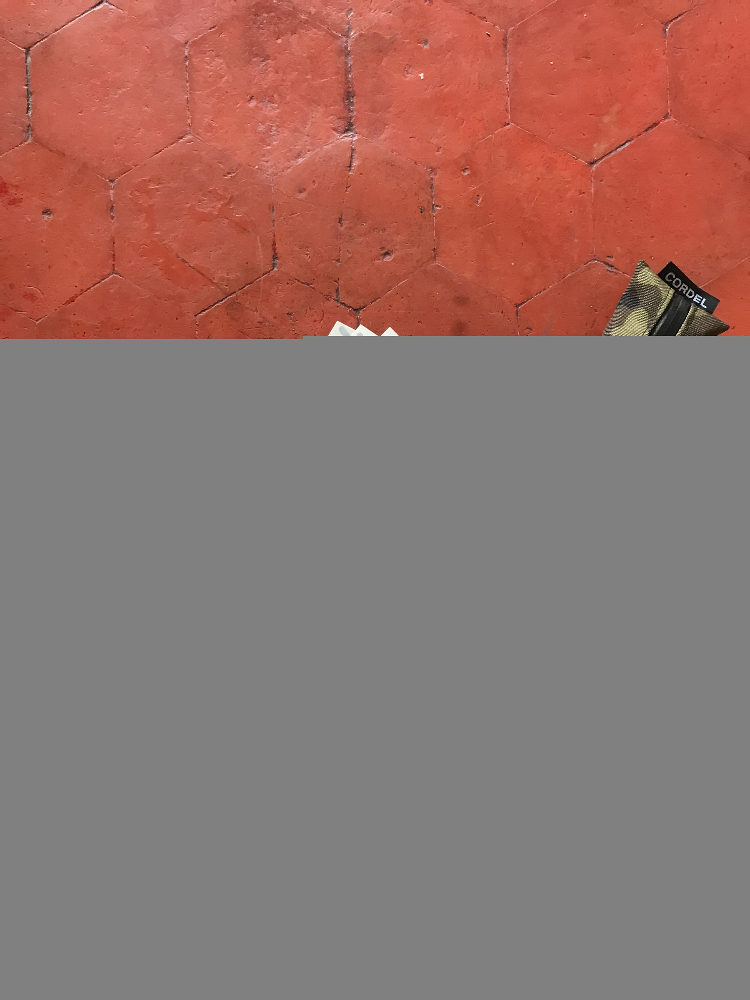
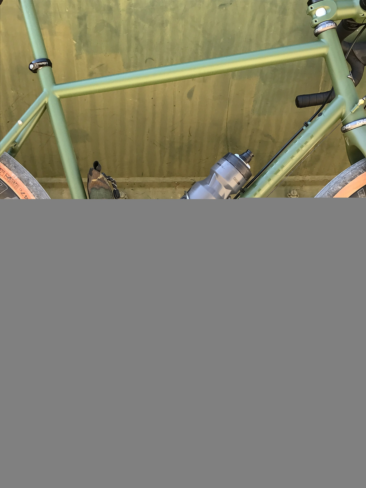

***CORDEL.CC CUSTOM PUMP-BAG***

Quand on n’est pas un coureur du Pro-tour avec une voiture et un directeur sportif à dispo, les solutions pour transporter son nécessaire de réparations ne sont pas nombreuses. Avec l’avènement du bikepacking et des sacoches en tout genre mais aussi la montée en puissance de l’enduro ou les pilotes se doivent d’êtres autonomes entre les spéciales. De nouvelles solutions plus ou moins smart commencent à pointer le bout du nez.

> **L’ultime solution sera de faire le plus grand Tetris jamais imaginé dans tes 3 poches de jersey.**

La plus rependue d’entre elles est la petite sacoche de selle. On en trouve maintenant de toutes formes ou tailles. D’autres préféreront sacrifier un bidon pour y glisser leurs outils. L’ultime solution sera de faire le plus grand Tetris jamais imaginé dans tes 3 poches de jersey.

De mon côté j’utilise un saddle bag de chez « Type Deux Manufacture » depuis maintenant quelques années. J’ai toujours était content de sa capacité et de sa fixation, un peu moins quand il s’agit d’y fixer ma pompe. Sur la route, j’avais pour habitude de seulement la sangler à ma sacoche de selle mais comme je roule maintenant sur des revêtements plus cassants cette solution n’est clairement pas la plus pertinente.

Vous aller me dire que je peux très bien la fixer à coté de mon bidon ou encore utiliser un Cargo King Cage. Oui mais non ! Ça fait quelques temps maintenant que je suis les aventures de [Kyle Kelley](https://www.instagram.com/kylebkelley/) à Los Angeles. Il gère le magasin [Golden Saddle Cyclery](https://www.instagram.com/goldensaddlecyclery/) et travaille avec beaucoup d’artisans du coin, en particulier avec [@Jonesville](https://www.instagram.com/jonesville/) qui lui a réalisé il y a déjà quelques temps ce à quoi je n’avais toujours pas pensé :

UN PUMP BAG !

<!-- image manquante : 2018/10/cordel-cycling-bikepacking-bags-1-of-3.jpg -->

L’idée ne fait qu’un tour dans ma tête et avec l’arrivée en masse des cadres avec 3 fixations de bidons je me dis que je suis prêt à en sacrifier un pour y ranger moi aussi mes outils. Mon seul soucis reste la barrière de l’Atlantique. C’est quand même dommage d’affréter un avion pour une sacoche de vélo. C’est là que Daniel rentre en piste.

Depuis un an maintenant nous entretenons une super relation avec Daniel de chez [Cordel cycling](https://www.cordelcycling.com/). Basé à Madrid, Daniel est un mec incroyablement gentil et talentueux. Il propose toutes sortes de sacoches pour le bikepacking entièrement customisable aussi bien en terme de taille que de look. En plus de travailler avec des matériaux de première classe, ses délais sont toujours courts et les prix très doux aussi.

Après plusieurs kits de bikepacking et autres « accessorie pocket », je suis revenu vers lui pour savoir s’il était partant pour me réaliser un « Pump-bag » dans le même style. Après quelques mesures et décisions techniques, j’ai pu choisir le même tissu que pour mon kit de bikepacking et j’ai reçu le tout 10 jours plus tard. Au final on peut y rentrer bien plus qu’une pompe. Je roule depuis quelques mois avec et j’ai toujours une pompe, 1 cartouches de CO2, des démontes pneus et un chiffon à l’intérieur.

Vous l’aurez compris, le Pump Bag n’est pas l’invention du siècle mais il est en tout cas diablement utile !  
Merci encore une fois à [Cordel.cc](https://www.cordelcycling.com/) pour cette réalisation.

---

–

Photos : [Matthieu Lifschitz](https://www.instagram.com/manivelle.cc/) & [Simon Taulelle](https://www.instagram.com/sims_teuteul/)

## Commentaires

**Bike Check : Genesis Fugio - PCR GRAVIER 17 March 2020** — 17 March 2020

[…] Cordel, pour nous au PCR Gravier, c’est le michou du bikepacking ! En plus d’être extrêmement cool, il fait un super travail sur ses sacoches. Du petit sac de cintre pour les rides du week-end jusqu’au kit complet pour plusieurs jours de vadrouille, il est toujours à l’écoute pour t’aider sur des petits hacks comme mon micro pump bag. […]
