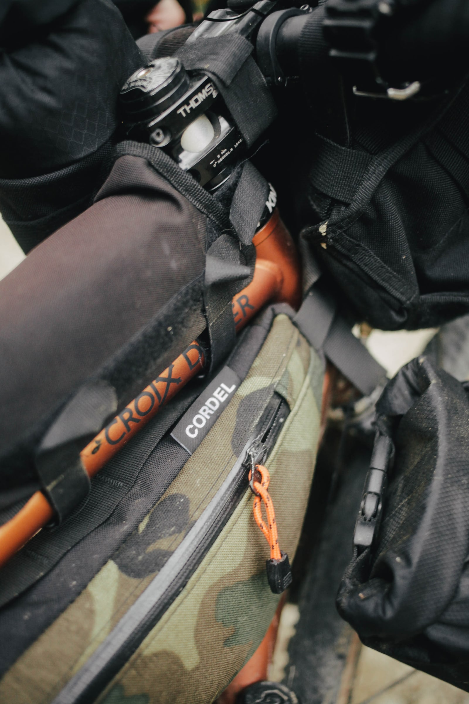
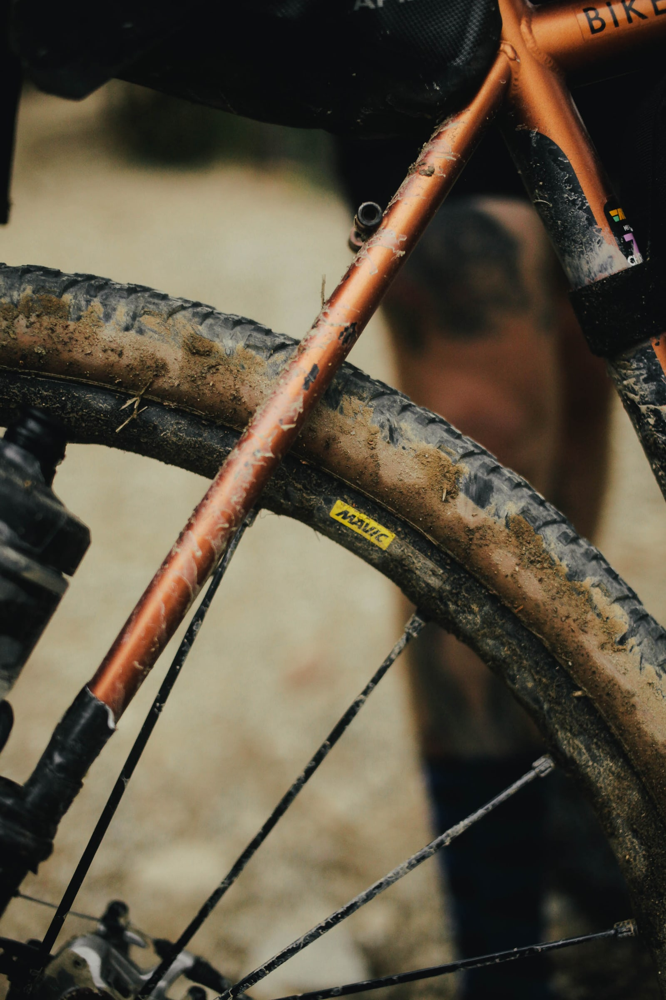
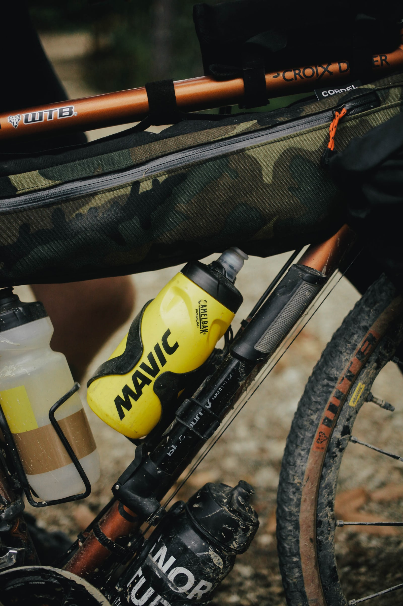

**STEEL IS REAL**  
En 2015, le terme « Gravel » n’existait pas encore en France. On utilisait à cette époque le terme de « vélo d’aventure ».

> **Le marché n’était pas ce qu’il est aujourd’hui et pour être honnête avec vous j’ai choisi le kit cadre Genesis Croix de Fer plus pour sa couleur que pour ses caractéristiques techniques.**
>
> <!-- image manquante : 2018/10/Bikecheck_JU_00.jpg -->

Gros coup de coeur pour la couleur cuivre métallique. Aujourd’hui le [Croix de Fer](https://www.genesisbikes.co.uk/) est un best seller et c’est justifié. Depuis plus de 3 ans ce vélo a évolué avec moi. **La géo est parfaite pour voyager**, il manque un peu de réactivité à vide, mais il s’avère redoutable off road et/ou complètement chargé en bikepacking. Très fiable je roule encore avec après tout ce temps car j’en suis complètement satisfait.

En ce qui concerne les composants, j’ai opté pour ce que je qualifie de “simple et efficace”. Sram à l’époque du 10V permettait de mixer facilement les composants route et VTT. Du coup j’ai rapidement remplacé le pédalier et dérailleur arrière Force par du GX. Alternative peu onéreuse face au Force CX1 permettant de garder un double plateau. Il m’arrive de remettre le pédalier Force compact en 50/34 pour des épreuves de route plus ou moins longues.

<!-- image manquante : 2018/10/Bikecheck_JU_12.jpg -->

Ce cadre est en acier Reynolds 725,  **à l’épreuve de ma façon de rider**, en plus il permet de passer des pneus [WTB](https://www.wtb.com/) Nano en 40. Idéal pour shredder le gravier !

Qu’on l’appelle “gravel”, “cyclocross”, “randonneuse” ou simplement “vélo d’aventure”, le [Genesis](https://www.genesisbikes.co.uk/) Croix de Fer est ce qu’on veut qu’il soit. Il sera votre allié peu importe le biotope ou le revêtement. **Un vrai couteau suisse ce cadre.**

<!-- image manquante : 2018/10/Bikecheck_JU_07.jpg -->

<!-- image manquante : 2018/10/Bikecheck_JU_08.jpg -->

<!-- image manquante : 2018/10/Bikecheck_JU_10.jpg -->

<!-- image manquante : 2018/10/Bikecheck_JU_06.jpg -->

Sortir des sentiers battus est la solution, l’objectif. Next ? Passer en 650b pour les gros trips sur les traces VTT et suivre Simon. Tenter un cintre gravel type Salsa Cowshipper.

<!-- image manquante : 2018/10/Bikecheck_JU_04.jpg -->

---

**Cadre** *Genesis Croix de Fer 725 ~***Fourche** *Genesis Carbone ~***Pédalier** *Sram GX 38/27 ~***Manettes** *Sram Rival 10V ~***Dérailleur Avant** *Sram Force ~***Dérailleur Arrière** *Sram GX ~***Cassette** *Sram Rival 11/36 ~***Chaîne** *Sram Apex 10v ~***Potence** *Thomson 60mm ~***TDS** *Thomson**Elite ~***JDD** *Chris King ~***BDP** *Sram ~***Roues** *Mavic AllRoad Pro 700 ~***Pneus** *WTB Nano 40c ~***Sealant** *Mavic ~***Cintre** *3T ~***Cables & gaines** *Jagwire ~***Guido** *Specialized Roubaix ~***Selle** Selle *Italia ~***Disques** *Shimano Deore IceTech 160mm ~***Freins** *Avid BB7 ~***Pédales** *Shimano**SPD M520*

–

Photos : [Renaud Skyronka](https://www.instagram.com/aknologic/)

## Commentaires

**Garla-Land - PCR GRAVIER 5 March 2019** — 5 March 2019

[…] Ça fait maintenant un an maintenant que je roule en 650b et Julien viens de chausser son Genesis Croix De Fer avec les nouvelles Mavic Allroad UST et des WTB Venture en 47c. Autant vous dire qu’il ne s’est […]
