**GRAVEL ORIGIN 83**  
Octobre, Paris, il fait gris, les températures baissent et nos trajets matinaux commencent à sérieusement se faire sous la pluie par 6 °. Nos fils Instagram commencent à être remplis d’images de cyclocross, de boue et de feuilles mortes. Bref, c’est le début de la loose hivernale.

> **Le programme semble parfait. Mais c’était sans compter les prévisions météo.  
> Il est tombé la veille du départ l’équivalent d’un mois de pluie.**

<!-- image manquante : 2018/10/ROC_AZUR_GRAVEL_ORIGIN_GRAVIER-26.jpg -->

Quand Laurent nous propose de participer avec lui au Roc D’Azur et d’inaugurer l’épreuve [Gravel Origin 83](https://www.rocazur.com/fr/les-courses/gravel), la perspective d’aller passer un week-end sur la Côte d’Azur nous redonne instantanément des couleurs.

Ni une ni deux, on monte une team, on réserve les billets et direction Fréjus pour une épreuve inédite de l’événement VTT de l’année. **2 jours de gravel, entre Fréjus et le lac de sainte Croix**, en passant par l’Esterel, le massif des Maures, les gorges du Verdon. 290km en tout et pas loin de 5000m de dénivelé positif et une nuit en camping. 

Le programme semble parfait. Mais c’était sans compter les prévisions météo. Il est tombé la veille du départ l’équivalent d’un mois de pluie. Le site du Roc d’Azur est un champ de bataille, les traces VTT sont pour la plupart devenues impraticables et toutes les épreuves du jeudi ont été annulées. Nous croisons les doigts pour que la nôtre soit maintenue.

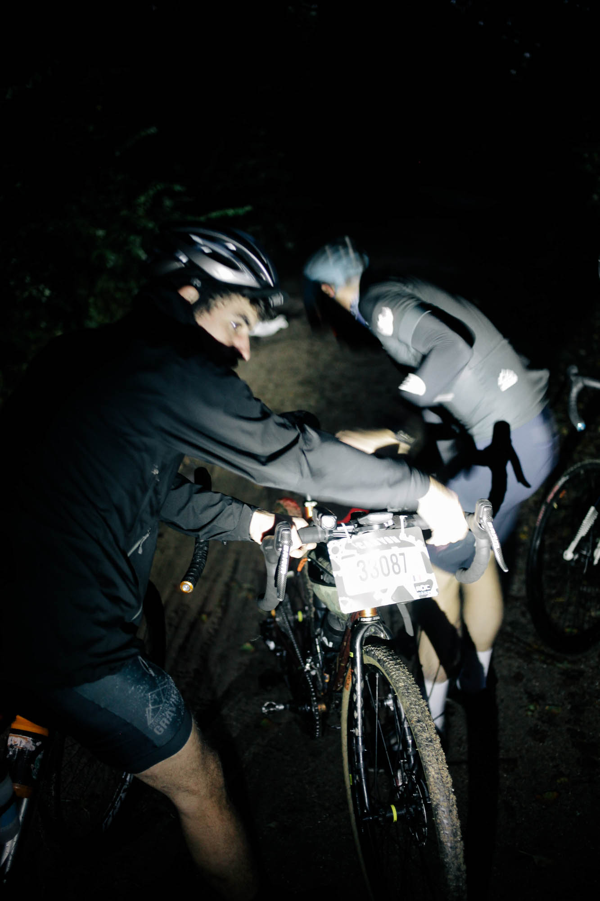

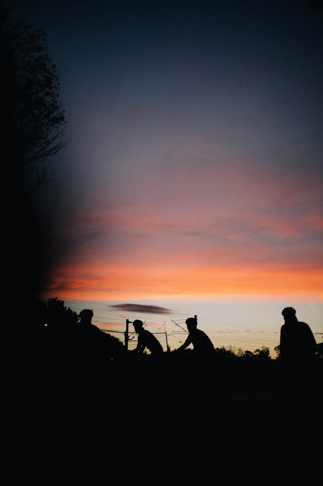

**4h30 du matin, réveil au milieu de la nuit.**On enfile nos cuissards, un café, 3 Pépitos et direction la base nature de Fréjus. Nous n’avons aucune nouvelle de l’organisation et imaginons que sans nouvelles, c’est que les nouvelles sont bonnes. Le départ est prévu à 6h30. Comme d’habitude, on galère à trouver le départ dans le noir complet, au milieu du champ de boue qu’est devenu le site.

Une lumière dans la nuit et la voix d’un speaker sous acide nous oriente. Au départ, nous sommes les derniers. On rejoint le groupe pile au moment où le speaker lance le groupe de 100 personnes sur l’itinéraire. Branle-bas de combat, on décharge les sacs dans la voiture-balai, on attrape nos transpondeurs au vol et on se précipite dans le sas de départ pour éviter de se faire rouler dessus par les 200 VTT qui attendent leur départ dans la foulée du notre. Dans la précipitation, évidemment, rien n’est prêt, on est habillés n’importe comment, on n’a pas mis nos plaques ni nos dossards. Bref, on est dans le noir au milieu du merdier, avec de la boue plein les pieds à essayer de nous organiser pour partir à peu près correctement.

**Le soleil commence à pointer son nez.**

<!-- image manquante : 2018/10/ROC_AZUR_GRAVEL_ORIGIN_GRAVIER-34.jpg -->  
La météo semble très clémente, et la journée s’annonce parfaite. Nous sommes prêts à en découdre avec les kilomètres et le dénivelé.

Après quelques kilomètres d’échauffements, nous croisons la première difficulté du parcours, il faut passer dans 50 cm d’eau au milieu d’un canal d’évacuation d’eau de pluie. **Ça s’annonce rock’n’roll** cette histoire. C’est surtout la traversée du massif de l’Esterel qui nous donnera du fil à retordre.

Le décor tient ses promesses, et nous profitons d’un itinéraire aux petits oignons ! Ça fait du bien de rouler sur une trace nickel, sur laquelle on est à peu près sûrs de passer correctement et où on ne devra pas mettre le pied à terre pour pousser pendant 2 km sur un sentier pédestre au milieu de la pampa. Bravo à l’organisation sur ce point !

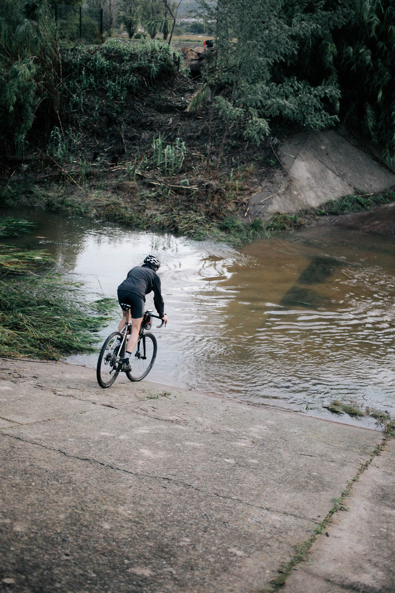

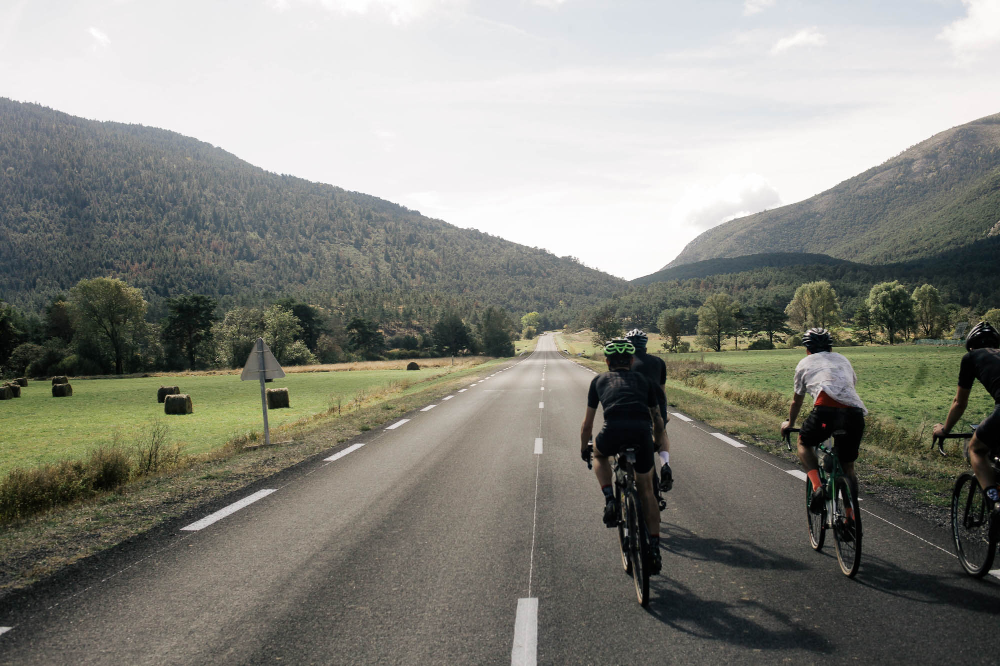

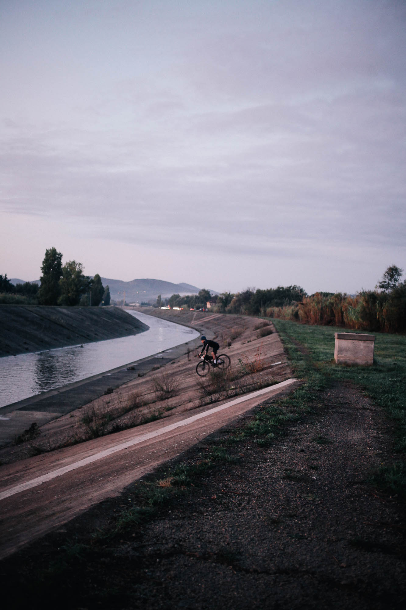

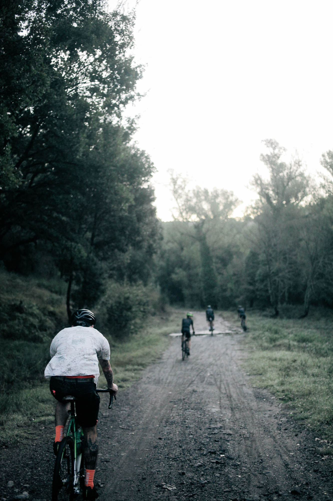

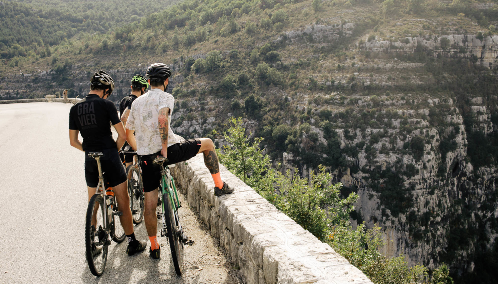

La suite de la journée sera une succession de solides montées et de paysages à couper le souffle, avec pour point d’orgue, la traversée des gorges du Verdon par le versant sud. Le plus haut. Les points de vue sont tout bonnement à couper le souffle.

Nous sommes ric-rac niveau timing à chaque ravito, mais pas les derniers. Il faut dire que nous avons profité de la proximité entre un ravito un peu chiche, déjà dévalisé par les premiers et un bar-tabac pour y descendre quelques pintes de panachés histoire de lier l’utile à l’agréable.

L’arrivée au camping se fait à la tombée de la nuit. Ça tire un peu sur les jambes et les derniers kilomètres sont particulièrement rudes. La dernière ascension au cœur du Verdon ne nous aura pas épargnées.   
 **La nuit s’annonce douce.**

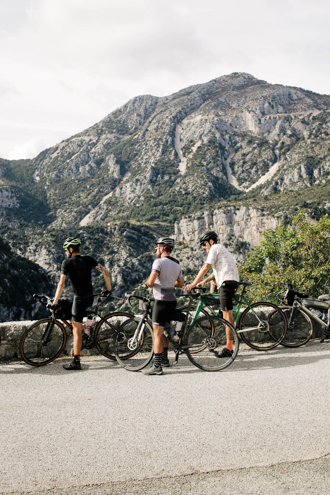

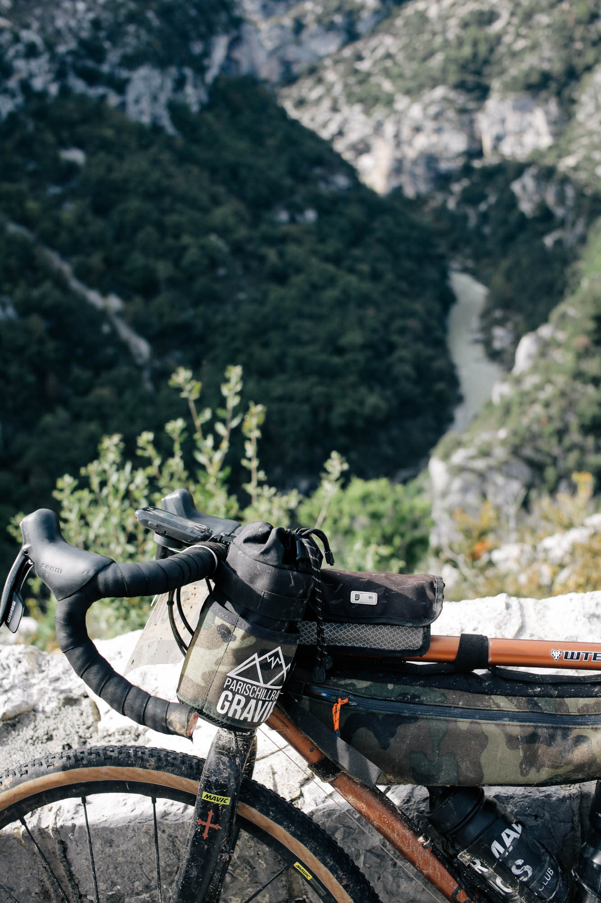

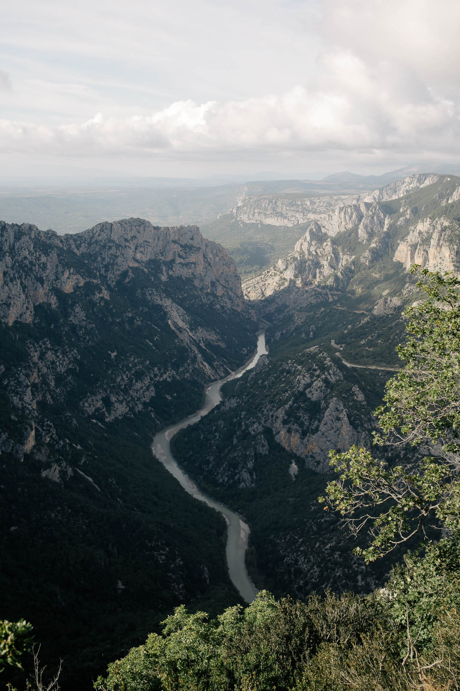

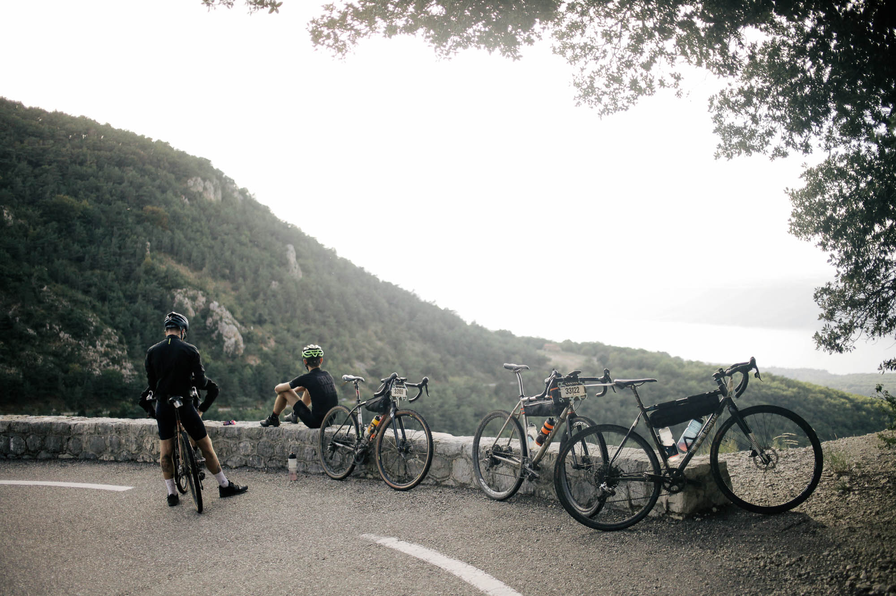

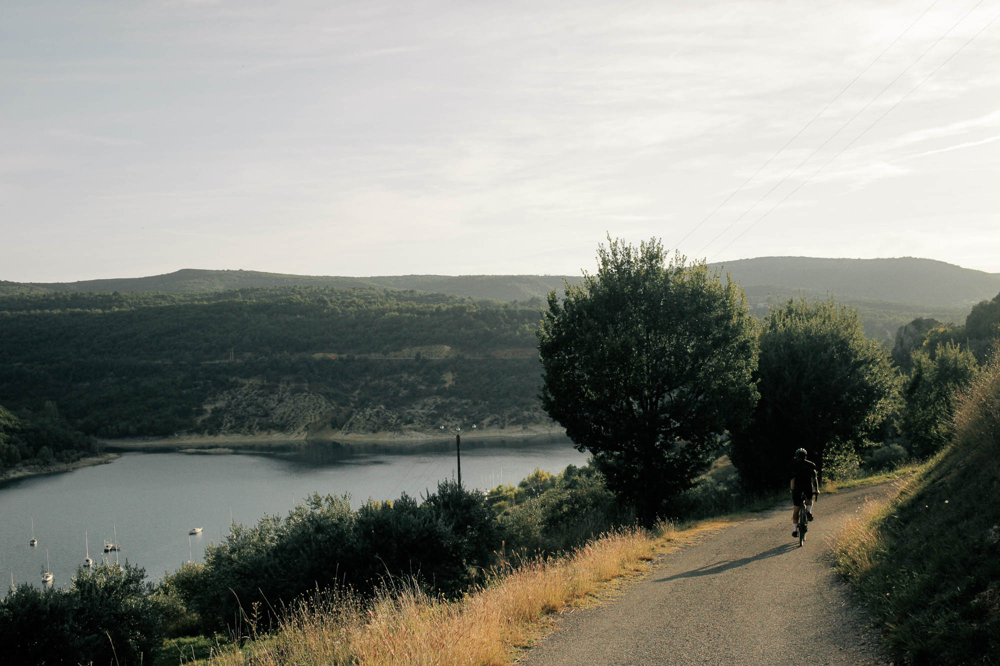

Au camping, nous sommes accueillis comme il se doit par une bière fraîche et un Ricard de bon aloi. Nous récupérons nos sacs et passons 30 minutes à nous décider sur l’emplacement où planter nos tentes. Il faut dire que le camping est vide, et que le proprio nous laisse l’embarras du choix.

Nous sommes 100 dans le camping, une bonne moitié a décidé de louer des bungalows, l’autre moitié sera sous tente. Le repas sera pour nous la première occasion de voir qui sont les autres cyclistes ayant pris part à l’aventure. Le terme « gravel » est assez jeune et pour certains, c’est juste un terme marketing de plus pour nous vendre des vélos à 3 000€. Pour d’autres, c’est un véritable état d’esprit.

**L’esprit gravel**. Pour nous, ce n’est probablement ni l’un ni l’autre. Ce qui nous attire dans cette pratique, c’est avant tout la liberté qui en découle. Rouler où l’on veut, à bonne allure, et le plus loin possible des bagnoles.

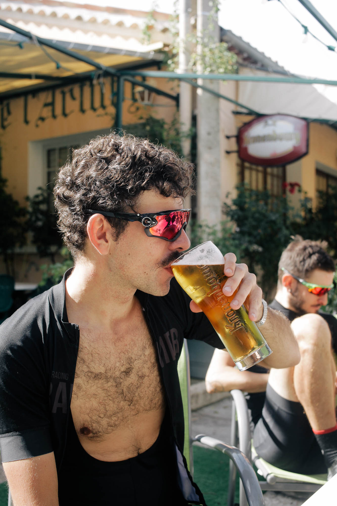

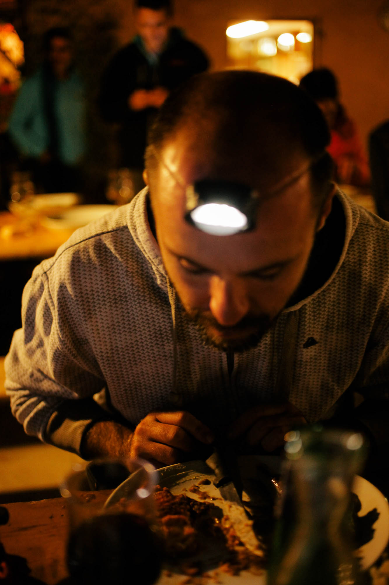

Les 100 personnes attablées nous donnent un bon panel de pratiquants. On retrouve des mecs comme nous, la trentaine, adeptes du bikepacking, de l’aventure et de la débrouille. Qui ne rechignent pas devant un Picon bière à 14 h et qui se satisferont d’un coin d’herbe pour planter leur toile de tente.

On découvre aussi que la moyenne d’âge des « graveleux » est assez élevée. 40-50 ans pour la majorité. Anciens routiers, ancien vététiste, ayant trouvé dans cette pratique **une manière plus «****slow****» de pratiquer le vélo**. Loin de l’esprit de compétition FFC qui peut régner sur les sorties route et beaucoup moins engagée que les autres épreuves du ROC, où la fracture de la clavicule n’est jamais très loin. C’est eux qui ont réservé les bungalows, et à qui il ne faut pas parler d’une nuit à la fraîche. « on a passé l’âge pour les bivouac ».

On trouve aussi pas mal de mecs en VTT qui n’ont pas du lire le mode d’emploi de l’épreuve et qui râlent sur les longues portions de route, à cause de leur plateau de 36 qui les oblige à mouliner comme des malades. À ceux-là, j’ai envie de dire qu’il y a déjà 342 épreuves pour les VTT sur le Roc et qu’une épreuve comme si celle-ci s’appelle Gravel Origin, c’est peut-être qu’il y a une raison !

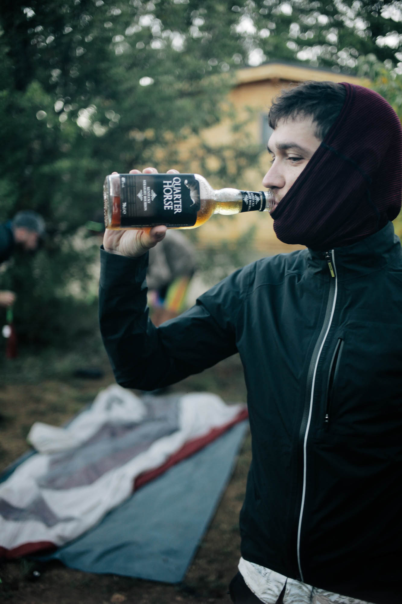

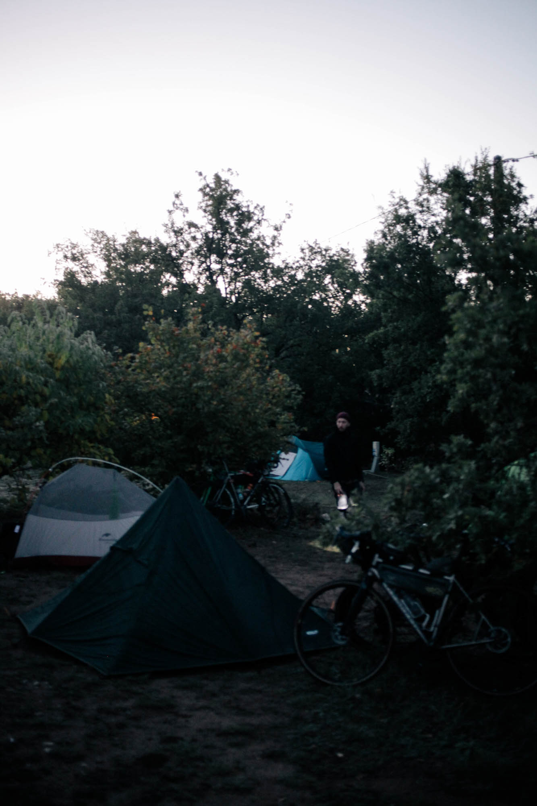

Côtoyer autant de pratiquants différents nous permet de mieux comprendre certaines choses, notamment le décalage que l’on peut ressentir sur les réseaux sociaux avec les groupes comme Gravel Bike France, où il est plus question de pignole sur un nouveau guidon ou une paire de pneus que de vélo à proprement parler.

C’est donc fondu dans la masse de cet « esprit gravel » que nous passerons une excellente soirée, organisée d’une main de maître par l’équipe en charge de l’évènement. **Repas gargantuesque, petit cubi de rosé et fondant au chocolat** pour clôturer le tout.

Petit bémol tout de même sur la bande de morfales qui n’avaient pas compris que le premier buffet était simplement l’entrée et qui se sont servis en jouant des coudes, des assiettes de Flunch débordantes, ne laissant aux retardataires (nous) que les restes. Tout ça pour se rendre compte que le plat arrivait et jeter la moitié de leur assiette à la poubelle dans le normal des choses. Vous n’êtes pas tout seuls les gars…   
  
La journée nous aura bien butés et nous ne tarderons pas à regagner nos duvets pour une courte nuit. Demain, le soleil est au rendez-vous et la journée s’annonce sous le signe du graver ! 120km, moitié route, moitié chemins. De quoi nous satisfaire !

<!-- image manquante : 2018/10/ROC_AZUR_GRAVEL_ORIGIN_GRAVIER-20.jpg -->

Départ à 8h après un rapide petit déjeuner. Les sacs sont dans le camion-balai et nous prenons la route pour Fréjus sous un lever de soleil de type prestige. La campagne se réveille autour de nous et nous attaquons le premier secteur gravier de la journée. **Ça roule à bonne allure.**

Les choses vont se compliquer un peu à mi-parcours. Je sens depuis quelques kilomètres que ma roue avant commence à perdre de la pression. Je vérifie mon pneu dans un cours d’eau au milieu de la pampa et constate une belle fuite sur le flanc. **Une mèche et et ça repart**. Mon pneu n’a visiblement plus de préventif et il va falloir faire attention pour la suite du périple. Je croise Julien quelques mètres plus loin. Il a crevé, mais impossible de déjanter son pneu. Nous passons un bon 1/4 d’heure à réparer, doublés par des dizaines de participants.

À peine reparti, j’entame alors une série de crevaisons en chaîne digne des pires films d’horreur de pneus. **2, 3, 4, 5 réparations.** Je finis par me débarrasser de mon pneu avant, qui visiblement a décidé de me foutre la haine aujourd’hui.

Par chance l’organisation a un peu de matos à disposition pour ce genre d’avaries et je me retrouve donc avec deux pneus dépareillés, dont l’un est désormais avec chambre à air.

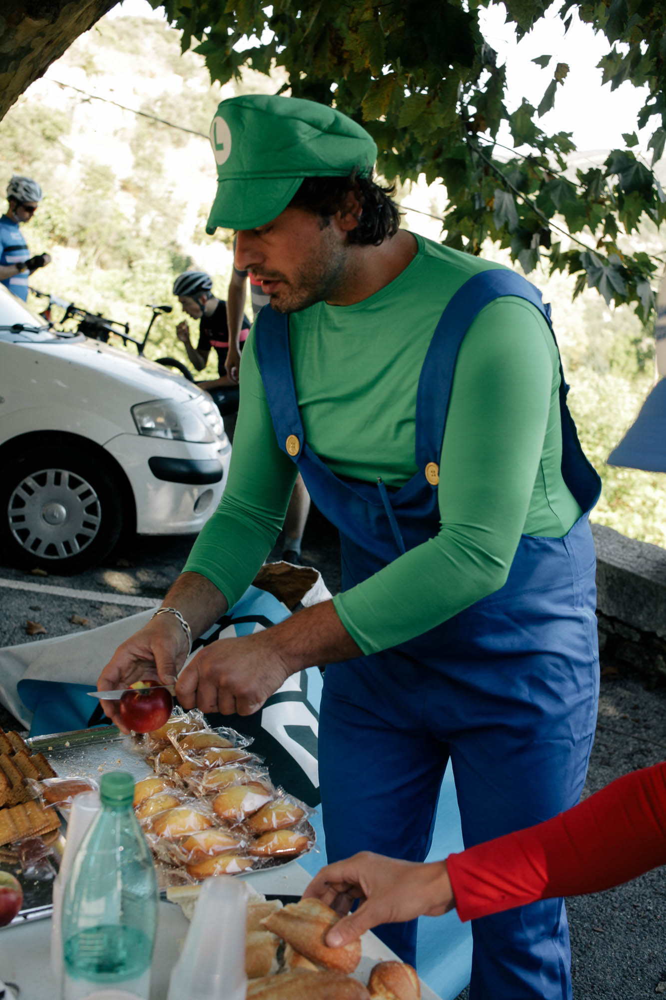

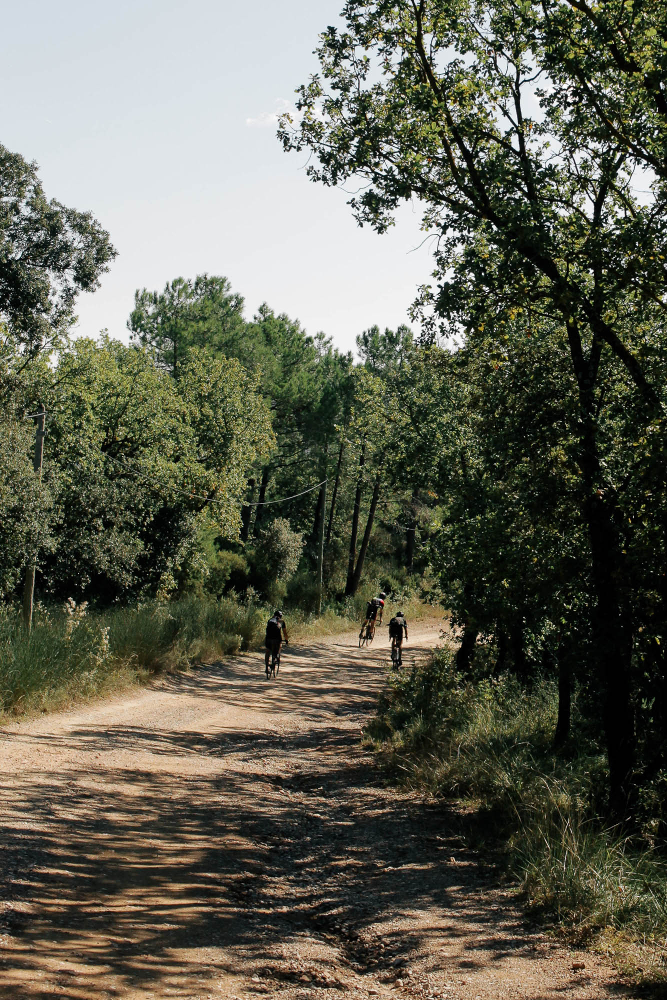

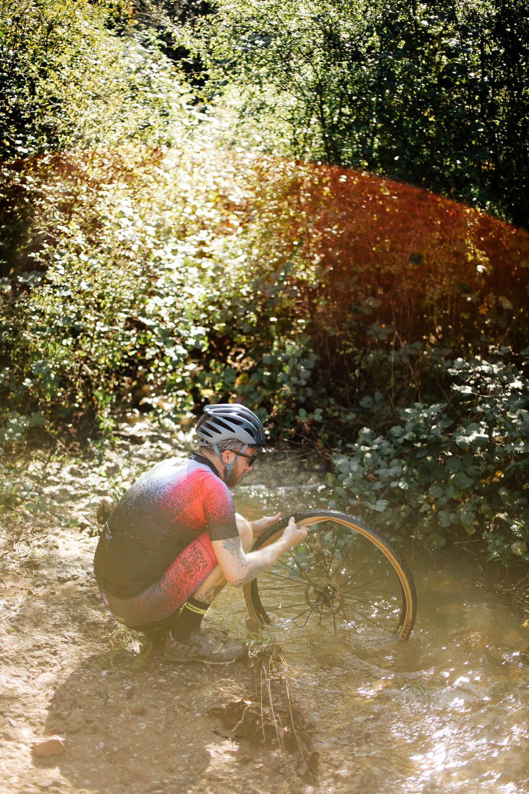

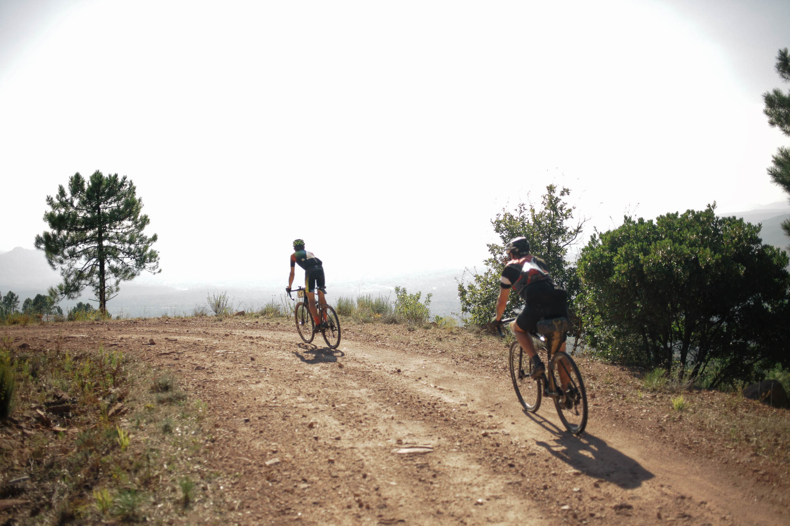

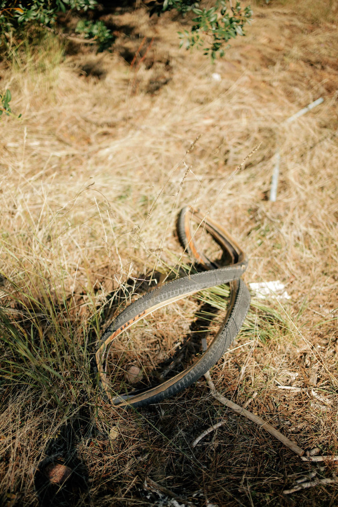

Nous sommes très clairement à la bourre sur le planning. Nous avons une bonne heure de retard et il va falloir turbiner pour rattraper tout ça. On se lance donc dans une **cavalcade dans les chemins** du massif des Maures, à 40km/h dans les graviers.

Ce qui devait arriver arriva. Je crève à nouveau. **Pétage de câble en règle**, je décide d’arrêter les frais et de contourner le dernier massif à passer avant l’arrivée. Rapide discussion avec le groupe, il est en effet plus logique d’éviter l’une des deux dernières bosses et de terminer pas la fameuse montée du Bougnon et ses 17 % pour descendre sur Fréjus.

<!-- image manquante : 2018/10/ROC_AZUR_GRAVEL_ORIGIN_GRAVIER-35.jpg -->

Les derniers kilomètres se feront par chance sans crevaison supplémentaires. Nous terminerons dans les mythiques embouteillages de VTT du Roc, sur le chemin douanier qui longe la digue, où un appareil photo automatique est placé tous les 3 mètres pour immortaliser notre galère.

L’itinéraire d’arrivée est très chouette, passant par la plage, via des passerelles temporaires. Nous terminerons par une ligne droite boueuse recouverte de 30cm d’eau, qui achèveront de détruire nos chaussures. On passe la ligne d’arrivée **sous les encouragements d’un speaker sous acide**, avant de siffler quasi cul sec une bière bien méritée !

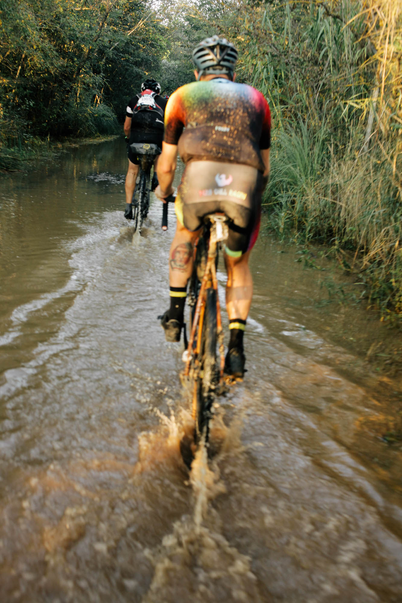

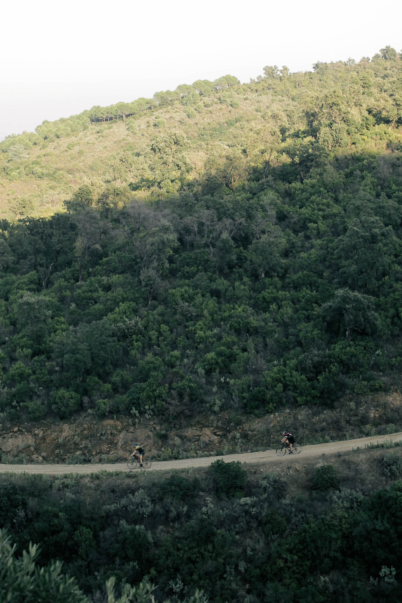

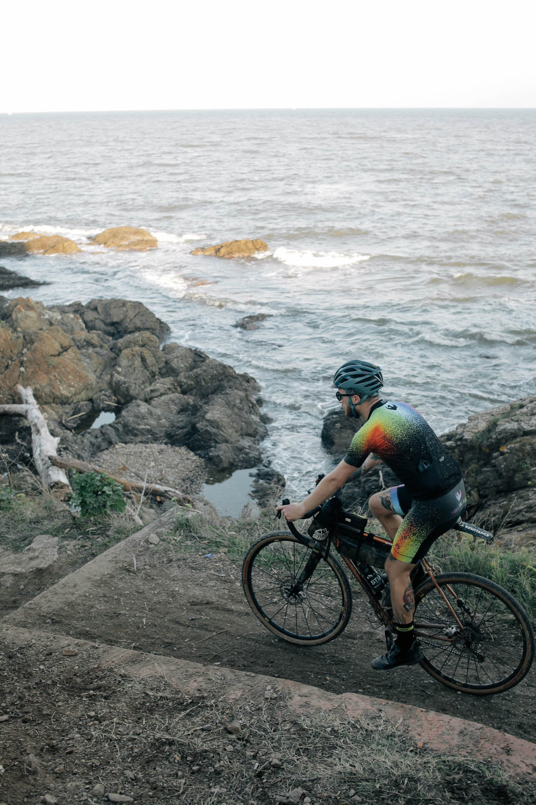

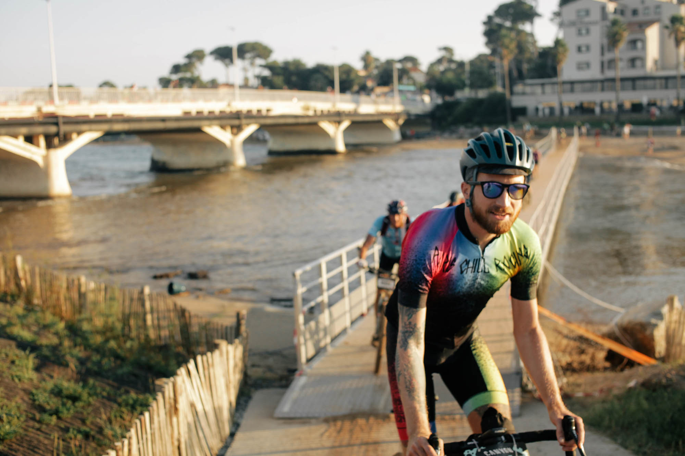

Pour une première édition, ce Gravel Origin est pour nous un sans faute ! Organisation au top, ravitos un peu légers pour les derniers au classement, mais tenus par des bénévoles très sympathiques, bivouac très convivial et repas copieux.

L’itinéraire quant à lui était vraiment un bon mix entre route et chemins. Les gorges du Verdon sont vraiment une destination de choix pour ce type d’aventures. **Bravo donc à l’organisation du Roc** pour cet évènement prestige, merci à [AllTricks](https://www.alltricks.fr/) pour l’invitation et merci à *Mother Nature* de nous avoir épargnés cette fois-ci !

Belle parenthèse de deux jours, pour recharger les batteries pour l’hiver.  
Franchement, si on pouvait décaler Paris sur la côte et remplacer la rive gauche par la mer, on serait pas bien ?

Ah bon ??  
Ça existe et ça s’appelle Marseille ???

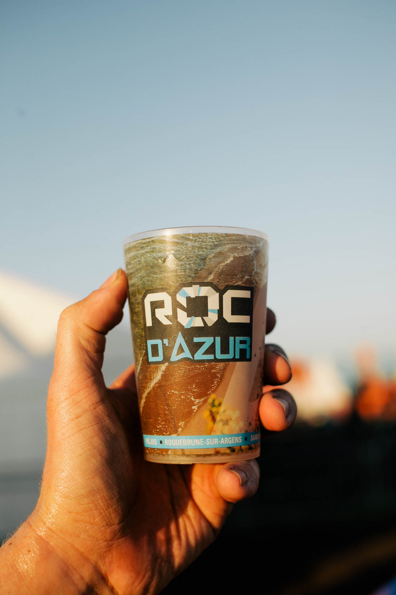

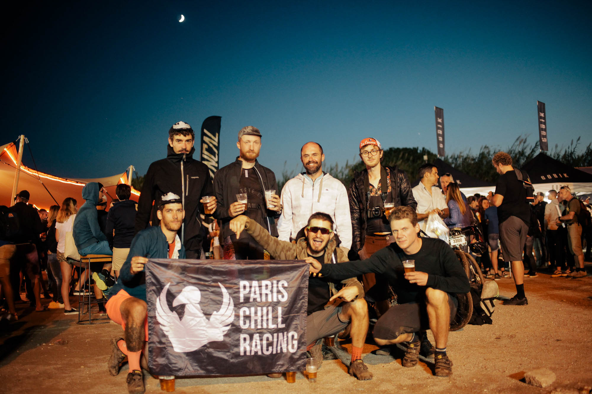

---

***LA MAP***

https://ridewithgps.com/embeds?type=route&id=29001107&metricUnits=true&sampleGraph=true&overlay=esriTopo

  
 **–  
303 km  
5200 D+  
2 Jours  
–**

Photos : [Renaud Skyronka](https://www.instagram.com/aknologic/)
