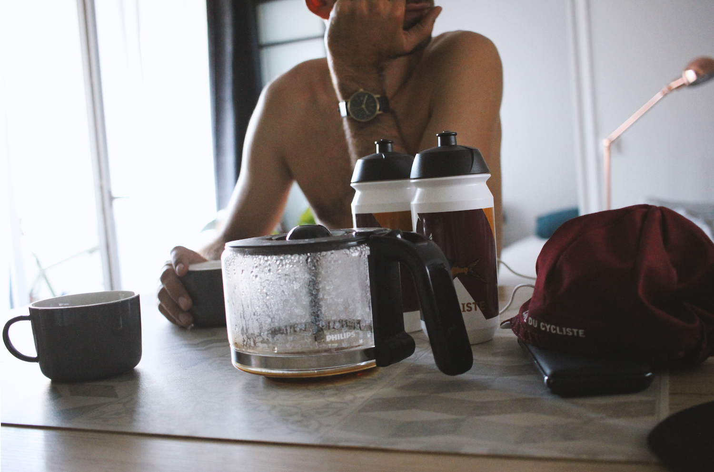
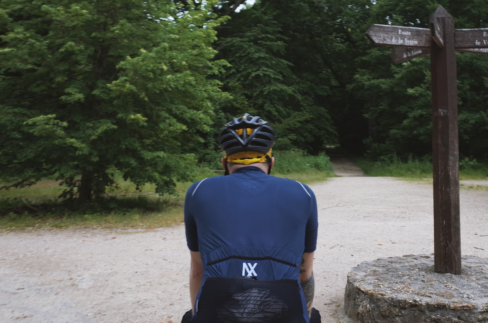

**ville natale**  
*/ nom féminin /*  
1. désigne un pays, une région, une ville Où l’on est né. Maison, province, terre natale.

Malgré les récits d’aventures et autres péripéties de l’autre côté des frontières françaises, **Le PCR Gravier est bien né à Paris**, sur l’asphalte et sans l’ombre d’une montagne à l’horizon.  
Alors comment s’évader sur des gros pneus et tutoyer l’aventure quand on vit dans la capitale du vélo de route et la maison mère du Tour de France ?

> On clique vers l’ouest !

<!-- image manquante : 2019/11/paris-gravel-bike-gravier-53.jpeg -->

***Exploration locale.***

Avec l’arrivée de l’été, une sortie à portée de vélo semble être l’occasion idéale de peaufiner l’organisation de notre prochain voyage en Slovénie en août. Le seul problème est que notre ” facteur de bonheur à vélo ” est inversement proportionnel au nombre de voitures et de zones industrielles que nous rencontrons sur notre route. Pour y remédier, **nous choisissons l’Ouest**.

<!-- image manquante : 2019/11/paris-gravel-bike-gravier_wide_1.jpg -->

On pense souvent que l’ouest parisien est préservé de l’industrie par sa proximité avec Versailles ou des belles maisons qui le traversent.  
En fait, c’est en partie à cause du vent. **A Paris, la brise souffle principalement de l’ouest vers l’est**. Par conséquent, au fil des ans, l’Ouest est devenu le spot le moins exposée aux émanations industrielles et autres fabriques de nuages, ce qui en fait la destination idéale loisir pour nos escapades locales.

***“Sortir de Paris, oui, mais pas n’importe comment ! “***

Rendez-vous rue Crozatier à 9h pour **une traversée de Paris via la rue de Rivoli et le “So French”, Arc de Triomphe**. Après un bref passage par l’hippodrome de Longchamps alias **“le hamster club”** où les locaux nous regardent comme des aliens sur gros pneus, nous traversons la Seine par **la très cool Passerelle de l’Avre** avant de nous diriger vers Versailles, Tout Shuss !

Ici, nous laissons enfin la civilisation derrière nous. Entre les chemins de gravier et les petites routes forestières, les kilomètres défilent rapidement jusqu’à **l’Aqueduc de Buc**, célèbre pour être la porte d’entrée de la vallée de Chevreuse. Une fois de plus, tout le monde est émerveillé par la vitesse d’un vélo sans 10 kg de sacoches dessus !  
**A Bièvres, le ravito caféiné est un must** avant de repartir sur **la poussière des plaines de Saclay et dans la forêt de Verrière**, dernier point vert avant notre retour vers Paris.

<!-- image manquante : 2019/11/paris-gravel-bike-gravier_wide_4.jpg -->

Direction la Tour Eiffel avant de finir au soleil, **bière fraîche à la main sur les Quais de Seine, après 100 kilomètres de loisir**.  
L’organisation de notre voyage n’a pas avancé d’un pouce, mais encore une fois, notre ratio photo/kilomètre frole des records. Tout va bien. Summer is coming !

*Paris Chill Racing Vie !*

---

***LA MAP***

https://ridewithgps.com/embeds?type=trip&id=42281618&title=PCR%20GRAVIER%20~%20HOMETOWN&metricUnits=true&sampleGraph=true&amsampleGraph=true&overlay=esriTopo

**–**  
**100 km**  
**870m D+**  
**5H00**

**–**

photos : [Julien Sommier](https://www.instagram.com/julienpcr/) ~ [Simon Taulelle](https://www.instagram.com/sims_teuteul/)
