***Tirer leçon de ses propres leçons***

L’année dernière lors de notre [voyage en Slovénie](/slowvenia-video/), il nous a semblé avoir trouvé une forme de recettes ; une sorte de façon idéale de concevoir le voyage à vélo. Lorsqu’il a fallu repartir cette année pour une petite excursion dans le Jura pour quatre jours, nous nous sommes dits qu’il serait assez intéressant de vérifier par nous-mêmes si nos propres théories étaient valables.

> On passe un, puis deux puis 780 petits ponts de métal qui permettent de rentrer dans les pâturages sans que les vaches ne s’enfuient. On croise un type qui fabrique des dinosaures en fibre de verre grandeur nature. On découvre que le nom qu’on a donné à notre voyage n’est pas galvaudé. Ce parc du Jura est totalement SICK !

**Premier point : la destination**

Pour ça, ce n’était pas très compliqué. Compte tenu de la période actuelle et de l’espèce de merdier pas possible sur la planète nous nous sommes dit que le mieux serait de rester dans notre bonne vieille France afin d’organiser ce premier voyage déconfiné.  
Nous avons donc choisi de partir dans le Jura. L’avantage principal est de pouvoir y aller en TGV et revenir par un autre TGV sans faire de boucle, car tout le monde sait que les boucles, c’est de la merde.

Au programme donc quatre jours de vélo entre amis sur la trace de [la Grande Traversée du Jura](https://www.gtj.asso.fr/). Une trace maintes et maintes fois empruntée et totalement validée par de nombreux cyclistes, mais dans une région où aucun de nous n’avait eu l’occasion d’aller traîner ses roues. Notre itinéraire sera donc celui dédié au VTT même s’il est de notoriété publique que nous ne roulons absolument pas sur du VTT, mais comme chacun sait, nous aimons les défis.

<!-- image manquante : 2020/08/JURASICKPARK_77.jpg -->

**Deuxième point : le choix de l’équipe**

alors là-dessus nous restons intransigeant : amitié – Castorité.  
C’est une version tronquée de notre équipe slovène qui empruntera les routes de l’est.  
Arthur et Alexis, nos deux membres fragiles des intestins sont retenus pour raison professionnelle, mais ce n’est que partie remise pour eux !

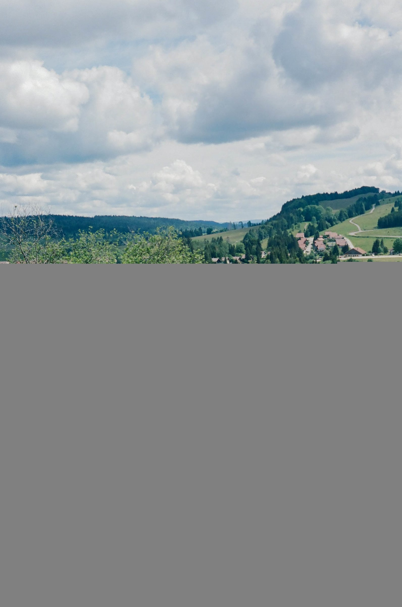

**Troisième point : la météo**

Cette année, ce paramètre aura été particulièrement fluctuant.  
Entre 4 jours de merde prévu 10 jours avant et du beau temps annoncé la veille, nous avons navigué entre nuages et soleil pendant le séjour. Une averse dantesque au bout de 20km tout de même et un événement météorologique de type inexplicable, limite “Triangle des Bermudes” qui nous a permis d’échapper à un orage par l’opération du Saint-Esprit . Sur le radar, la pluie fonçait droit sur nous, mais pour on ne sait quelle raison, elle s’est dissipée à quelques centaines de mètres, comme absorbée dans les vallées avoisinantes. La montagne et mother nature avaient l’air de nous dire qu’elles étaient de notre côté… Pour une fois !

Pour le kilométrage, on a fait une petite entorse à nos valeurs avec des journées de 90km en moyenne. Mais nous avions une bonne excuse : on part au solstice d’été, ce qui veut dire que le soleil se lève à 4h du mat et se couche à 23h… Autant dire que pour planter de nuit, il faut vraiment le vouloir… Tous les ingrédients sont donc réunis pour 4 jours de shred dans le plus Sick de tous les Parcs.

<!-- image manquante : 2020/08/GTJ_GRAVEL_BIKE_PCR_GRAVIER-39-scaled.jpg -->

> ***Le complexe d’infériorité de la moyenne montagne***

Le Jura, c’est ce qu’on appelle de la moyenne montagne. Ça veut dire que c’est moins haut que la haute montagne… Donc du coup quand t’es cycliste, tu te dis que c’est super la moyenne montagne, ce sera moins dur …

**Faux**

Dans le Jura, les mecs qui ont fait les routes, ils ont dû faire un complexe d’infériorité avec les mecs qui font les routes dans les Alpes. Comme les routes sont moins longues, ils ont dû se dire “vas-y, on va taper des pentes de malade pour montrer qu’on est fort nous aussi”. Du coup quand t’es à vélo et que t’as 15kg de sacoches, bah tu galères… Heureusement, c’est jamais bien long !

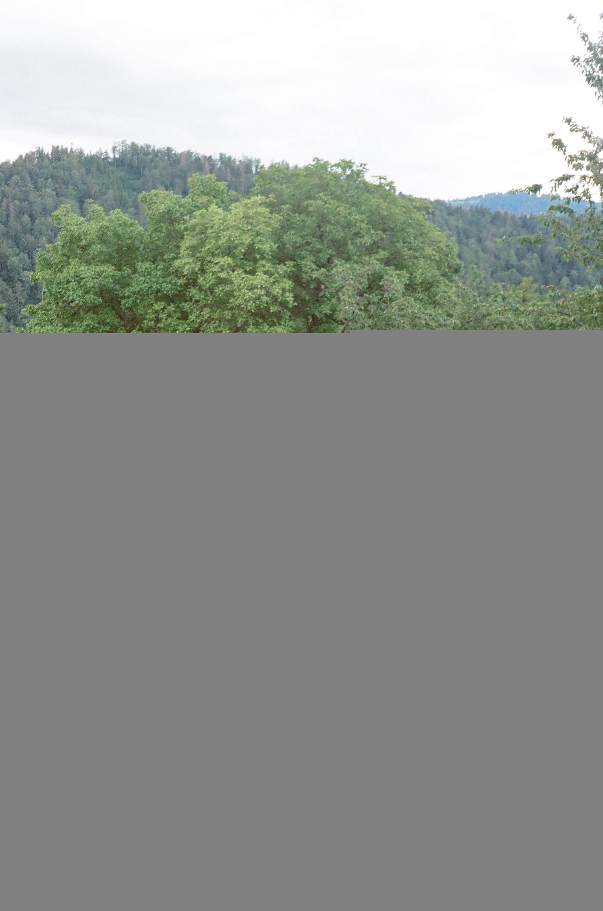

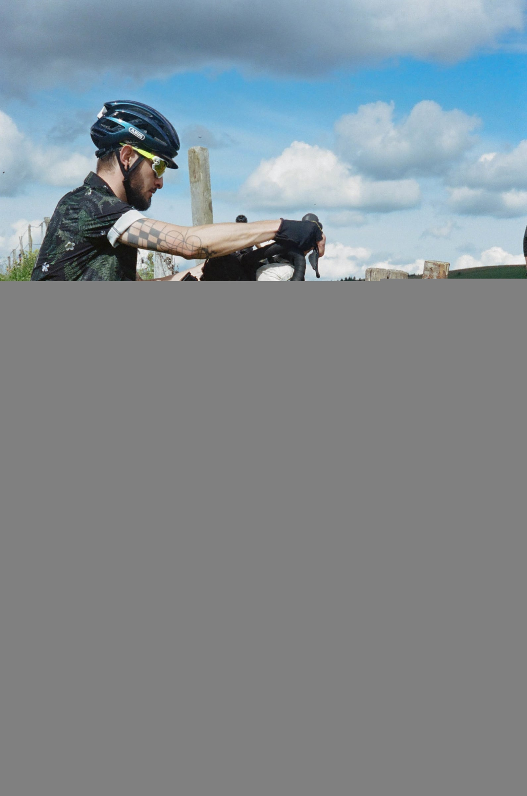

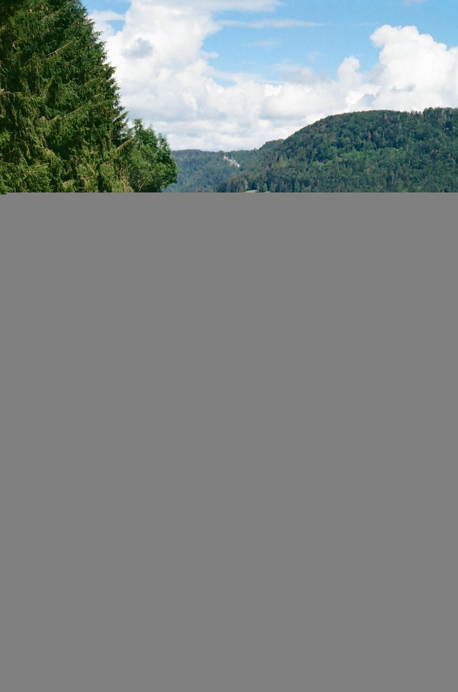

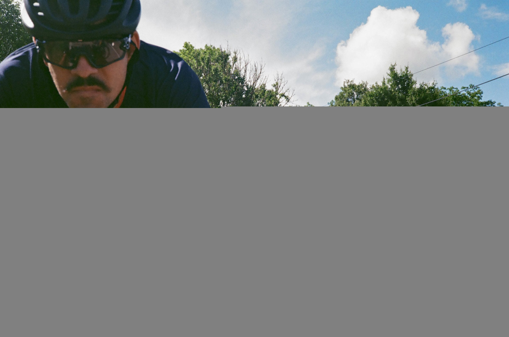

Ce trip aura donc été l’occasion de rouler la GTJ. Dans la grande tradition des grandes traversées grandement réussies et d’une grandeur tout à fait honorable.  
La GTJ est un modèle du genre. Déjà pour l’aiguillage. Les panneaux sont omniprésents et il faudrait vraiment être un aveugle à vélo pour se paumer sur le tracé. C’est simple, sur les 400km de trace on a dû croiser 30000 panneaux.  
Ensuite, c’est d’une diversité rare. Savant mélange de routes secondaires, sentiers, chemins et single de coupe du monde de VTT option rochers d’1 m de haut. Pour tous les goûts ! En ce qui nous concerne nous avons fait la route du nord au sud.

<!-- image manquante : 2020/08/JURA_GTJ_GRAVEL_PCR_GRAVIER_WIDE_40.jpg -->

> ***Une première journée sous le signe de la mise en jambes.***

Après quelques bornes d’échauffement sur l’Eurovelo 5, nous voilà raccrochés à la GTJ. On découvre alors un paysage verdoyant digne des plus beaux vallons de la Suisse et du décor de la scène des Galiminus de Jurassic Park (en même temps, on est presque en Suisse, ce qui rend tout ça assez logique )  
On a prévu une journée un peu express avec un peu plus de route que de chemin. Vu qu’on attaque à midi, c’était un peu du suicide de se caler 100km de gravel dans la journée (qui selon la légende représente 400 km pied nu sur de la braise)  
On se cogne donc les 40 premiers kilomètres en lombric à 35 sous des trombes d’eau qui seront les seules du voyage. Nos yeux sont rivés sur le radar de pluie pour s’abriter à la moindre averse. On a recensé grâce au site excellent [refuges.info](http://www.refuges.info/), les abris de rando sur notre parcours. Et dans le Jura, il y en a pas mal !

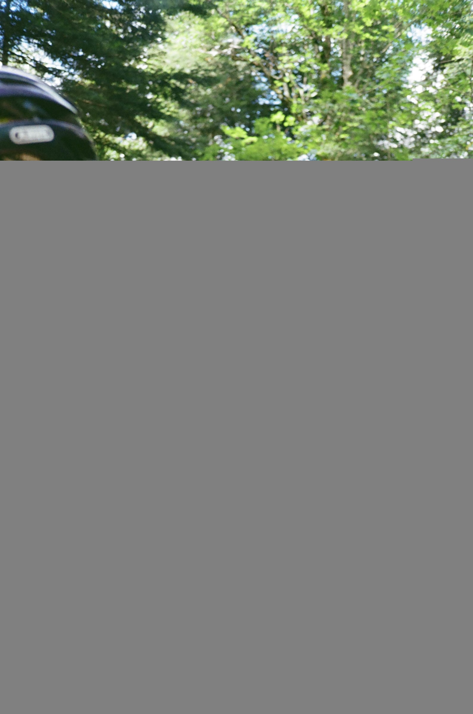

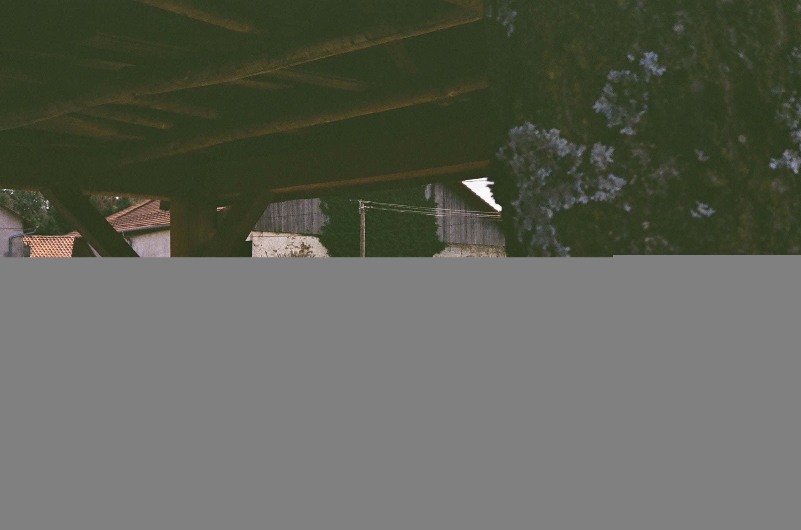

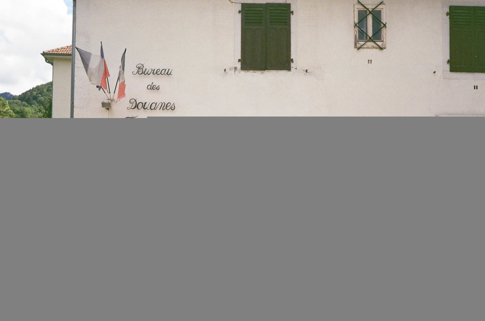

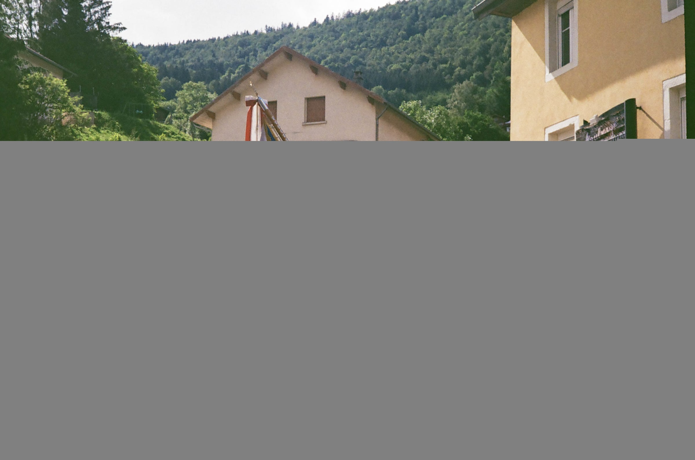

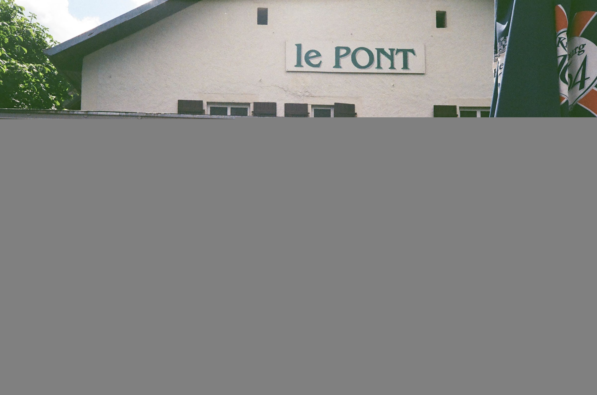

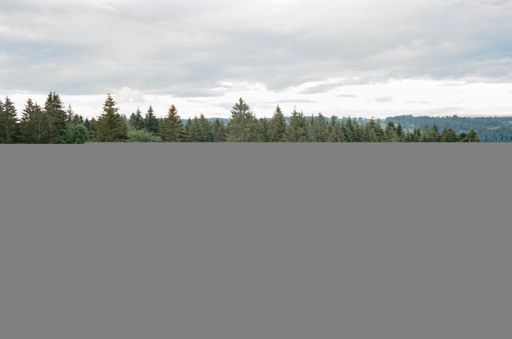

Ces abris sont construits par les michoux des montagnes. Il y a en général de quoi se chauffer, et même quelques stères de bois à l’extérieur. Une grande table pour manger, et en fonction du degré de michonnerie, on peut aussi trouver des livres, des jeux, une tente, etc… (On peut aussi rien trouver à part des tags et une gazinière de 1867 sans gaz… mais c’est une autre histoire)

Notre première rencontre avec ce type d’abri s’est d’ailleurs déroulé d’une façon un peu particulière. En gros, comme expliqué plus haut, un orage fonçait droit sur nous. Le ciel menaçant, l’humidité qui augmente… On va se prendre une saucée, et on n’a pas du tout envie. Alors on regarde la carte des abris, et BIM, un abri à 300m… On fonce pour se protéger d’une pluie qui ne viendra finalement jamais. Par contre, arrivé à côté de l’abri, c’est un autre problème autrement plus chiant qui vient toquer à la porte de ce voyage certifié sans problèmes.

<!-- image manquante : 2020/08/JURA_GTJ_GRAVEL_PCR_GRAVIER_WIDE_30.jpg -->

> ***Le di2 c’est ce qui rend la vie moins intéressante que pas mal d’autre truc surtout quand ça se débranche***

Comme vous le savez sûrement, on accorde pas mal d’importance à nos vélos. Améliorations perpétuelles, petits détails swag et coquetteries sont généralement au rendez-vous.  
Ce voyage est l’occasion pour Simon de sortir sa rutilante nouvelle monture. Un cadre « [DISTANCE](https://distance.bike/) » ( manifestement conçu pour parcourir de nombreux kilomètres, sinon ils auraient appelé ça les cadres « TERRASSE » ) équipé dernier cri en full Shimano GRX hydro Di2 comme les coureurs du Tour de France et les influenceurs qui font semblant de faire du bikepacking avec du plastic-bulle dans les sacoches…

Le Di2 c’est génial : pour ceux qui ne connaissent pas, c’est comme un dérailleur normal, sauf que le passage des vitesses ne se fait pas avec un câble tirant au travers d’une gaine un dérailleur qui exerce sur le-dit câble une résistance élastique à l’aide d’un ressort, non… Tout est électronique. La manette envoie un signal électrique au dérailleur qui passe les vitesses avec un petit moteur. Plus de câble, mais des fils, plus de ressort, mais un moteur. Dans la pratique, il faut avouer que c’est agréable, car c’est en général bien réglé.

L’inconvénient principal, c’est que c’est un peu compliqué à réparer dans la pampa si jamais tu casses un truc, et que ça marche avec une batterie, et que les batteries ça se décharge. Bref, donc on arrive au refuge pour éviter la pluie qui ne viendra jamais, et là… LÀ ! Simon réalise que plus rien ne réagit sur le dérailleur.

**RIEN.** **DU.** **TOUT.**

Panique à bord, comment faire. On ressort toutes nos connaissances en électronique des cours de techno de 3ème. On procède à un diagnostic par élimination… Je suis à deux doigts de sortir mon fer à souder … Mais rien n’y fait. Impossible de savoir. Rien ne s’allume, rien ne réagit. Le dérailleur est coincé sur le grand pignon (une chance) et c’est strictement impossible de le faire bouger.  
Une décision est prise : on continue la map autant que possible et demain matin, Simon ira dans un Culture Vélo tâter leur légendaire sens de l’accueil… Pour se rendre compte qu’un câble s’était débranché au plus improbable des endroits, et qu’en fait tout va bien et qu’il aurait bien pu s’épargner les 20 bornes entre le bivouac et le shop avec un ratio de 1 sur du plat façon Johnny Moulinette.

Moralité de cette histoire, le Di2, c’est bien, mais n’oublie pas de demander un plan d’implantation électro technique du groupe si ce n’est pas toi qui a monté ton vélo.

<!-- image manquante : 2020/08/JURASICKPARK_65.jpg -->

La seconde journée pour le reste de l’équipe débutera sous les meilleurs hospices, au départ de ce qui restera comme l’un des plus beaux bivouacs de l’histoire de la bande, sur un belvédère à la frontière suisse, avec une vue de type mer de nuage au petit matin. Mémorable.  
Pour ce second jour, on attaque les choses sérieuses et on se rend à Mouthe, village le plus froid de France, ou l’arrière-grand-mère de Pierre a eu la curieuse idée d’acheter une maison de famille il y a un demi siècle.

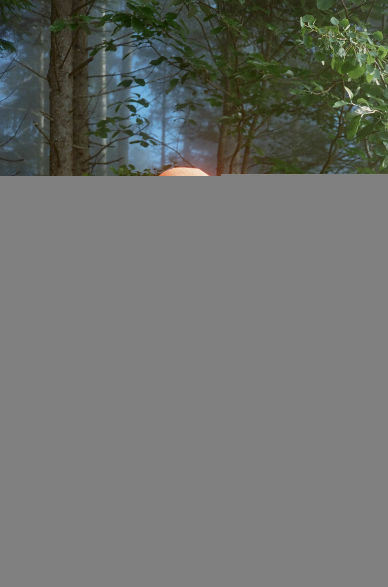

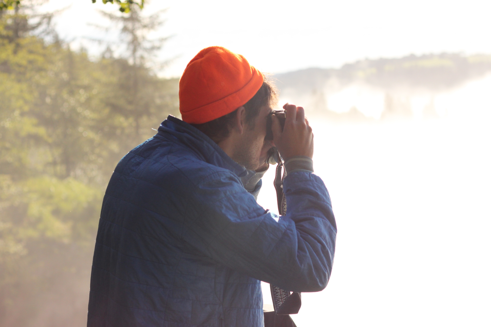

On trace alors sur les chemins, entourés de paysages plus grandioses les uns que les autres. On passe un, puis deux puis 780 petits ponts de métal qui permettent de rentrer dans les pâturages sans que les vaches ne s’enfuient. On croise un type qui fabrique des dinosaures en fibre de verre grandeur nature. On découvre que le nom qu’on a donné à notre voyage n’est pas galvaudé. Ce parc du Jura est totalement SICK !  
Notre arrivée à Mouthe se fera dans les temps, et de jour (il faut dire que la nuit tombe à 22 h, donc on avait un peu de marge) et la soirée commence avec une douzaine de pintes en terrasse.  
On découvrira ensuite l’existence du « Pontarlier Anis » , dit le « Pont » pour les locaux, qui arrosera le pire burger de l’histoire de la gastronomie.

<!-- image manquante : 2020/08/JURASICKPARK_103.jpg -->  
Nos estomacs en PLS, on touche du doigt la notion “d’ivresse d’altitude”. Nous nous couchons dans la plus grande maison de famille que j’ai jamais vu, avec environ 80 lits sur 5 étages. Une curieuse demeure qui respire l’esprit de famille et les grandes fêtes où nous nous sentons finalement bien seul, avec grosse envie d’y revenir y organiser une free party.

<!-- image manquante : 2020/08/JURA_GTJ_GRAVEL_PCR_GRAVIER_WIDE_04.jpg -->

> ***Le grand extase du sculpteur sur bois Steiner***

Le cyclisme est un sport intéressant. Il est varié, on prend des risques dans les descentes, on souffre dans les montées. Bref, c’est pas mal.  
Mais soyons honnêtes une minute… Le cyclisme ce n’est rien comparé au VOL À SKI.  
Et ça tombe bien. Nous sommes à 5 km du tremplin olympique de Chaux-Neuve.  
118 m, un monstre. Nous ne résistons pas à l’envi d’aller le voir de plus près, puis à tenter une ascension à vélo par le bas.  
Tentative qui se terminera par un cuisant échec au bout de 15 m tant la pente est rude. Elle laisse imaginer la difficulté de ce sport sans égal dont notre mentor Werner Herzog est un amateur notoire.

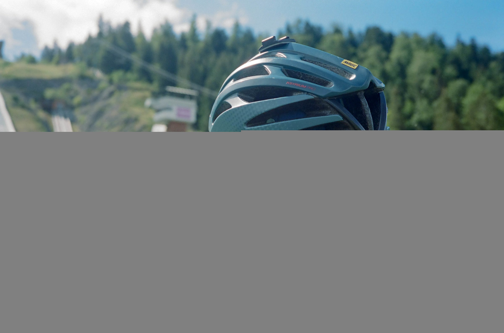

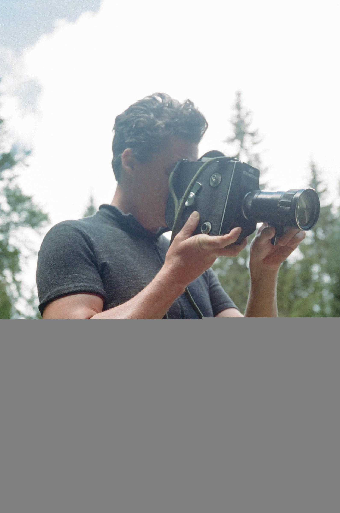

Nous repartons avec une grande humilité vers la vallée pour poursuivre notre parcours.  
La journée se déroulera à travers les milliers de fleurs sauvages, de gentianes et autres plantes médicinales qui recouvrent les vallons verdoyants du Doubs.

Tout cela est magnifique. La caméra 16 mm que nous avons emporté pour ce voyage tourne à plein régime, et les mètres de pellicule sont avalés par le moteur au rythme de 16 images par seconde ! Nous prendrons le temps de trouver le meilleur spot pour notre bivouac du soir.  
Au programme, saucisse de morteau, petit feu de camp et bières locales bien secouées depuis de dernier ravito ! La nuit sera bonne.

<!-- image manquante : 2020/08/JURA_GTJ_GRAVEL_PCR_GRAVIER_WIDE_00.jpg -->

> ***Un TGV pour rentrer***

Toutes les bonnes choses ont une fin. Ce petit trip de solstice est conçu sur-mesure pour pouvoir être réalisé en 4 jours. On aurait aimé en faire plus, mais hors vacances, c’est la durée max acceptable pour pouvoir s’échapper un peu de notre quotidien citadin.  
On termine donc notre voyage par une « petite » journée avec au programme, une belle dose de gravier, un petit col routier qui nous donnera un peu de fil à retordre, mais qui nous régalera d’une belle descente de 20 km jusqu’à notre destination finale.  
On profite de la journée pour perdre du temps en terrasse, à manger du croque monsieur pour réparer la seule et unique crevaison du voyage et pour franchir les derniers passages de pâturages.

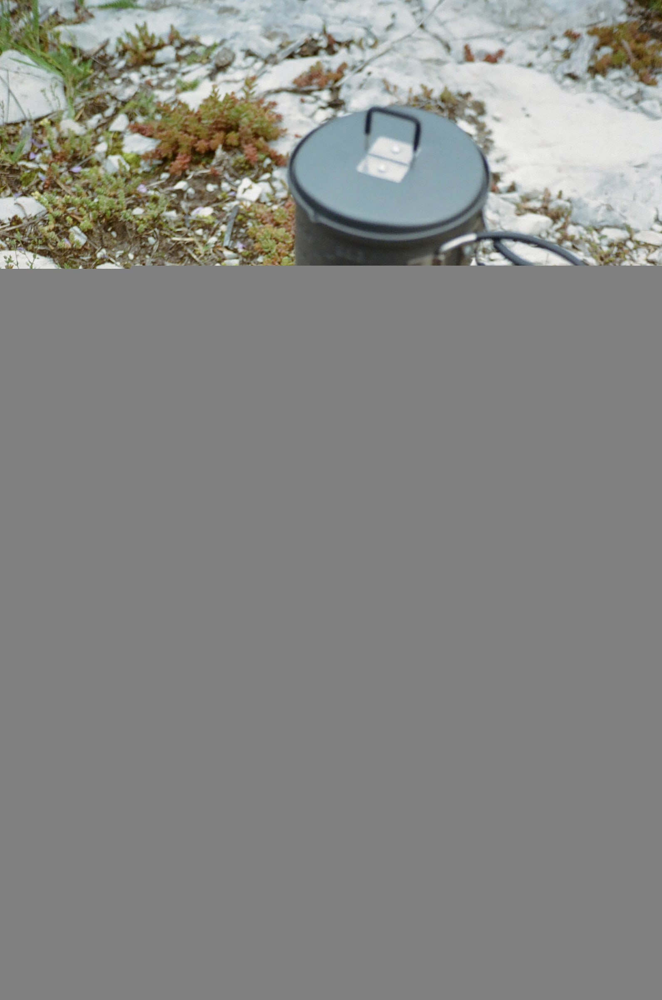

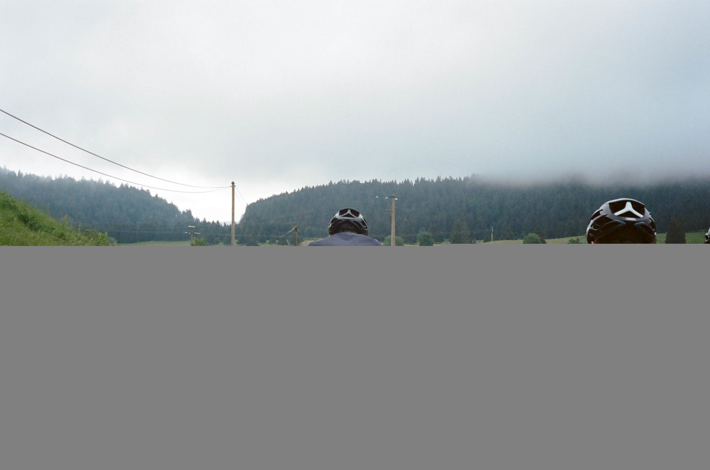

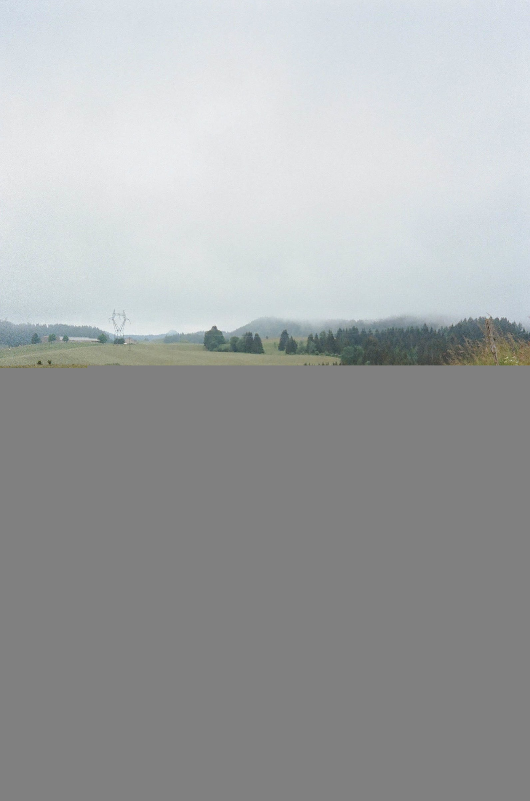

Tout cela se termine sur les bords du Rhône pour une canette de l’amitié, puis sur le quai TGV de la gare de Bellegarde (qui s’avère être une ville absolument horrible quand on y passe 3 h avant d’y prendre un train). Nous rentrons à Paris avec la satisfaction du devoir accompli : encore une victoire de la team Gravier. Un voyage sans accrocs, de belles images, un film à venir, des souvenirs, des bières et des copains.

On rentre aussi avec un passager clandestin : une tique s’est glissée sur le testicule gauche d’Hugues, qui paniquera un peu dans les chiottes du TGV. L’intrus sera extrait et brûlé sans états d’âme une fois arrivé à Paris. On ne le répétera jamais assez : vérifiez bien vos arrières quand vous allez faire caca dans les hautes herbes.

Sur ces belles paroles, stay tuned pour les prochaines aventures, et soyez bien certain que le JURA-SICK PARK est un must de l’hexagone pour tout amateur de bikepacking et de gravier !

---

***LA MAP***

https://ridewithgps.com/embeds?type=trip&id=53807621&title=PCR%20GRAVIER%20~%20JURASICK%20PARC&metricUnits=true&sampleGraph=true&overlay=esriTopo

  
–  
**330 km**  
**6500m D+**  
**4 JOURS**  
**–**

Photos : [Julien Sommier](https://www.instagram.com/julienpcr/) ~ [Simon Taulelle](https://www.instagram.com/sims_teuteul/) ~ [Renaud Skyronka](https://www.instagram.com/aknologic/)
