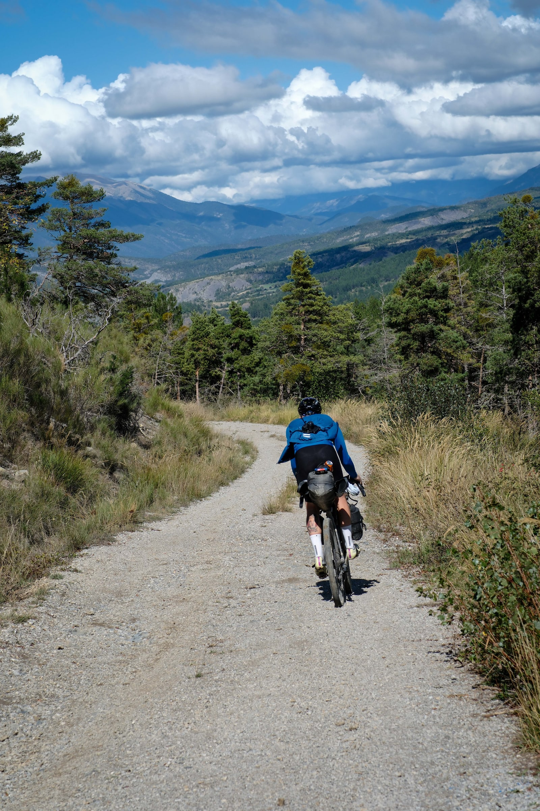

Partir en bikepacking 6 jours et 5 nuits c’est bien. Attaquer ce périple par le Ventoux 🤯 c’est mieux. L’idée derrière ce petit échauffement était de rejoindre les Baronnies Provençales rapidement par une trace vtt sombre, qui traverse le mont chauve vers le Nord. Classique ascension gravel par Bédoin, piste de la Jouanche, on aime.

<!-- image manquante : 2025/10/001-684x1024.jpg -->
<!-- image manquante : 2025/10/006-684x1024.jpg -->
<!-- image manquante : 2025/10/023-1-1024x684.jpg -->

Jour 2 de notre biketrip. Après le Ventoux en warmup on était au top pour continuer à grimper.
Beaucoup de sommets aujourd’hui sont au programme dont le Col de Mévouillon (889m), le Col d’Aulan (845m), le Col Saint-Jean (1159m),ou encore le Col de Muze (1209m).

La météo avait changé. Ciel couvert au réveil, on allait checker Rain Today souvent.

Map solide donc, beaucoup d’ascension offroad, nos premiers hike a bike. On passera dans les nuages, les éclairs au loin. On prendra la décision de cut un morceau de la trace du jour pour rejoindre Sisteron dans de bonnes conditions. Ce n’est que le deuxième jour du trip après tout.   

On a eu le nez creux, on passera de justesse à coté de l’orage, après un peu de boue, on fera les courses en ville avant de remonter un peu dans les hauteurs pour planter de jour. 

On quitte doucement la Provence pour les montagnes.

82,61 km 1 818 m D+

<!-- image manquante : 2025/10/031-1-1024x684.jpg -->
<!-- image manquante : 2025/10/032-1-684x1024.jpg -->
<!-- image manquante : 2025/10/033-684x1024.jpg -->
<!-- image manquante : 2025/10/037-1-684x1024.jpg -->
<!-- image manquante : 2025/10/039-1024x684.jpg -->

3ème jour de Middle Of Nowhere. Petite journée on a décidé de cut la première ascension pour trouver une pharmacie et profiter de la vie un peu. Ce sera donc 74km avec 1711m de D+. Départ de Sisteron pour rejoindre Dignes-Les-Bains en un peu plus de 5h. On dormira au chaud ce soir-là. Du coup, pas le temps de niaiser on va profiter d’une terrasse, radiers, puis prendre le temps de se faire à manger, de se laver et de bien dormir. 

Nous avions découvert les Terres Noires en 2020. Nous les traversons à nouveau. Les Terres Noires sont un véritable joyau pour les passionnés de VTT. En gravel on se régale toujours autant dans ces paysages lunaires. C’est si porn. Merci Mother Nature.

<!-- image manquante : 2025/10/DSCF5727-2-1.jpg -->
<!-- image manquante : 2025/10/058-684x1024.jpg -->
<!-- image manquante : 2025/10/053-1024x684.jpg -->

105,03km 2 580m D+ 7h 30min dont la moitié à plus de 1000m. Jour 4 (sur 6 rassurez-vous on arrive au bout) On remonte vers le Nord, vers Gap plus ou moins. De nombreux cols dont celui de des Guérins (1312m), le Col des Verniers (1042m), le Col de Fontbelle (1304m) ou encore le Col de Foureyssasse (1042m). Du gravel prestige. Comme on part jamais en randonnée sans notre vélo, on a poussé un peu, la pente frôlait les 20% dans une piste qui serpentait au dessus d’une petite ferme isolée. On se régale. Seuls. On ne croisera pas grand monde. On fera un quick stop à Ceüse pour un coca, avant de redescendre plus bas pour la nuit. On a trouvé un spot bivouac à la ferme. Le propriétaire prépare une aire naturelle pour 2026, mais nous laisse planter notre tente. Il y a deux marres, des poissons, et une table. Au top ! On mangera vite car de ce coté du massif il gèle. On sera mieux dans la tente et dans nos duvets.

<!-- image manquante : 2025/10/DSCF5861-2.jpg -->
<!-- image manquante : 2025/10/DSCF5809-2.jpg -->
<!-- image manquante : 2025/10/DSCF5851-2.jpg -->
<!-- image manquante : 2025/10/DSCF5949-2.jpg -->
<!-- image manquante : 2025/10/DSCF5904-2.jpg -->

Dernier jour offroad du voyage. Derniers cols à plus de 1000m. Le Col du Fays (1051m) et le Col de Rossas (1121m).  
Il fera proche de zéro au réveil. On descend à travers les pommiers. Quand j’y repense c’était l’hiver avant l’heure cette vague de froid. 

Le col du Fays va nous réchauffer, Arnaud le montera deux fois car il avait oublié son Fuji en bas. On le montera d’ailleurs avec Joel, un mec sympa qui mettra 10min à nous reconnaitre, il nous suit sur Insta depuis un bail. 

Au sommet à Ceüse, nos chemins se sépareront. La journée ne sera pas terminée, on va grimper encore un peu. Ça sent la fin du trip, on decide de se mettre bien ce soir. On opte pour le camping municipal de Remuzat. Mel nous rejoindra en van. Douche, apéro, festin, entrée plat dessert.
  
Demain c’est full asphalte jusqu’à la gare. En vrai on s’arrêtra à Pernes-Les-Fontaines à la fête du miel pour manger une crêpe. 

Middle of Nowhere, la solitude à deux pas de la maison. Vive la France.

Clap de fin sur ce biketrip gravel Bikepacking.

<!-- image manquante : 2025/10/096-684x1024.jpg -->
<!-- image manquante : 2025/10/0103-684x1024.jpg -->
<!-- image manquante : 2025/10/091-scaled.jpg -->
<!-- image manquante : 2025/10/088-684x1024.jpg -->
<!-- image manquante : 2025/10/095-684x1024.jpg -->
<!-- image manquante : 2025/10/093-1024x684.jpg -->

<!-- image manquante : 2025/10/DSCF5653-2.jpg -->
<!-- image manquante : 2025/10/DSCF5907-2.jpg -->
<!-- image manquante : 2025/10/DSCF5741-2.jpg -->
<!-- image manquante : 2025/10/DSCF5640-2.jpg -->
