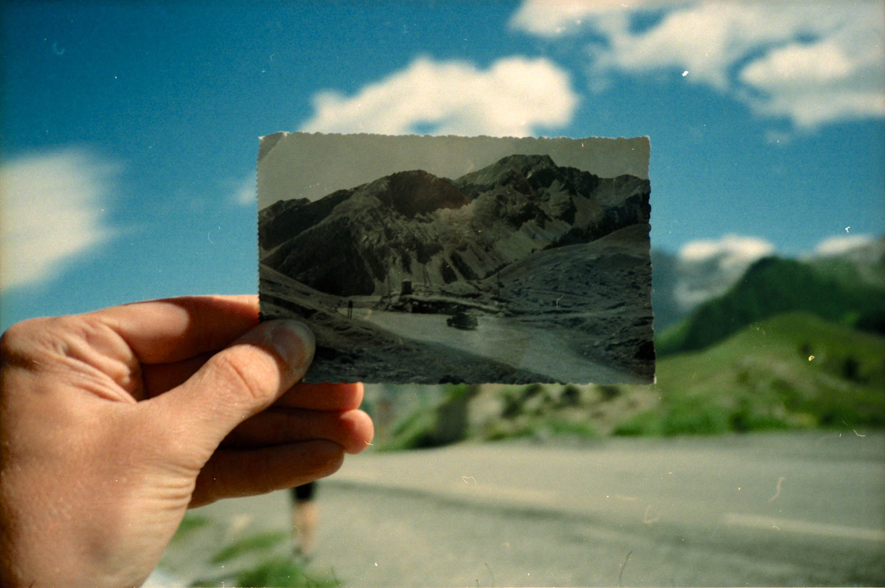
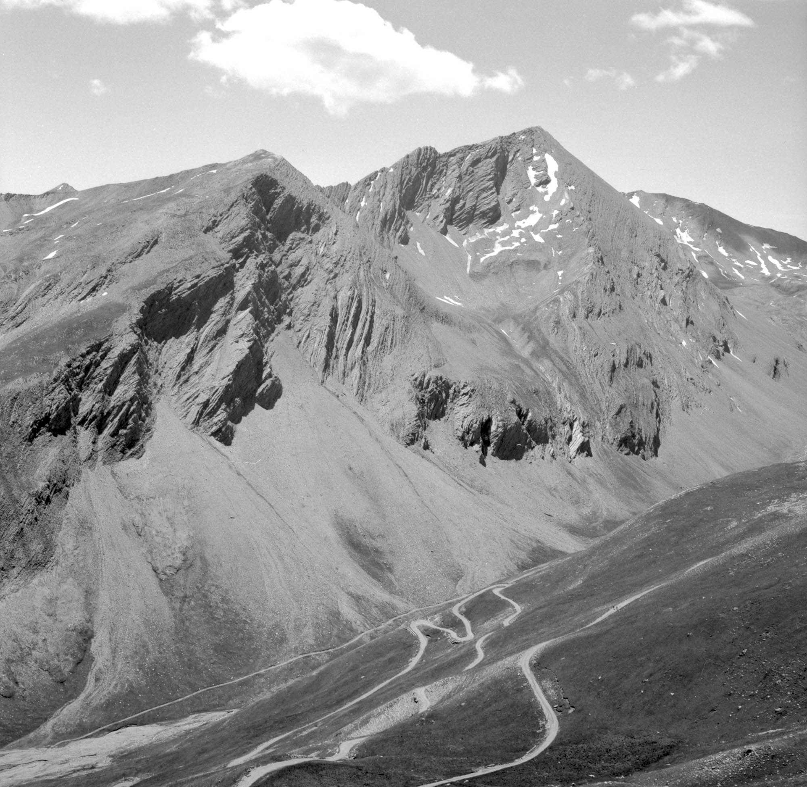
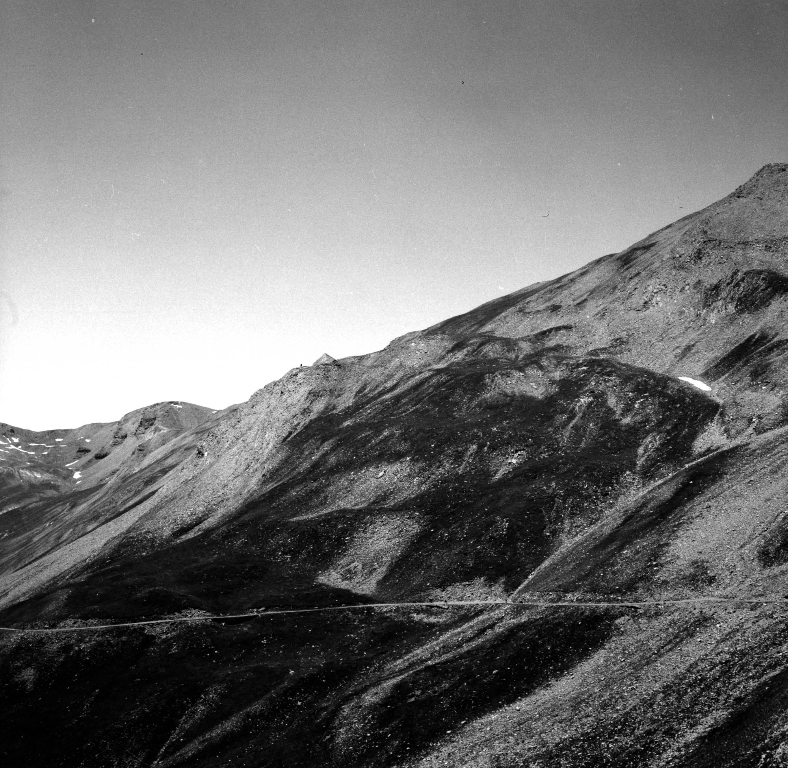
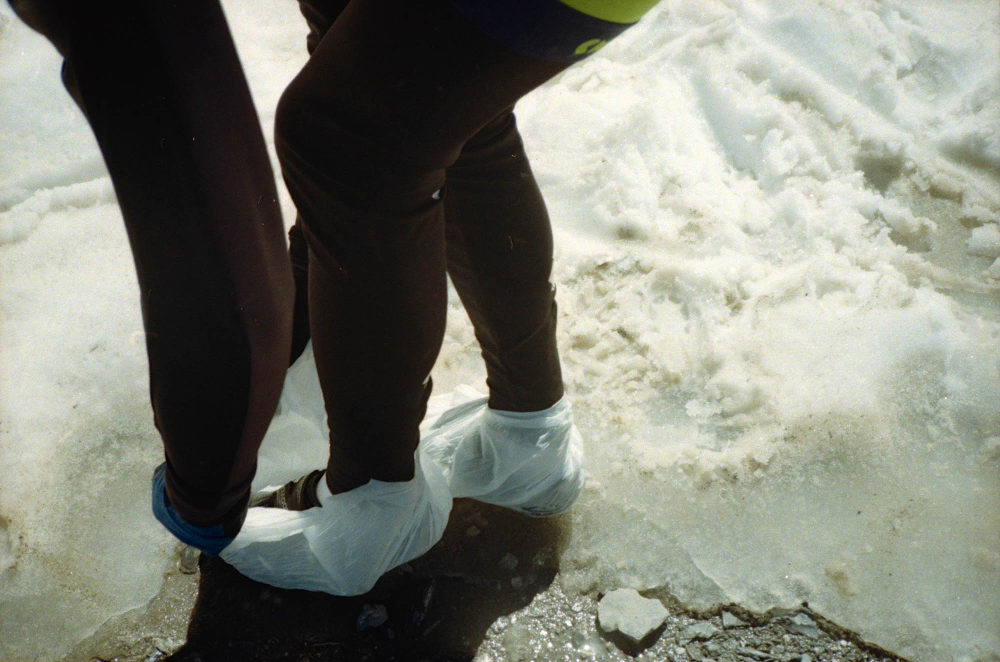
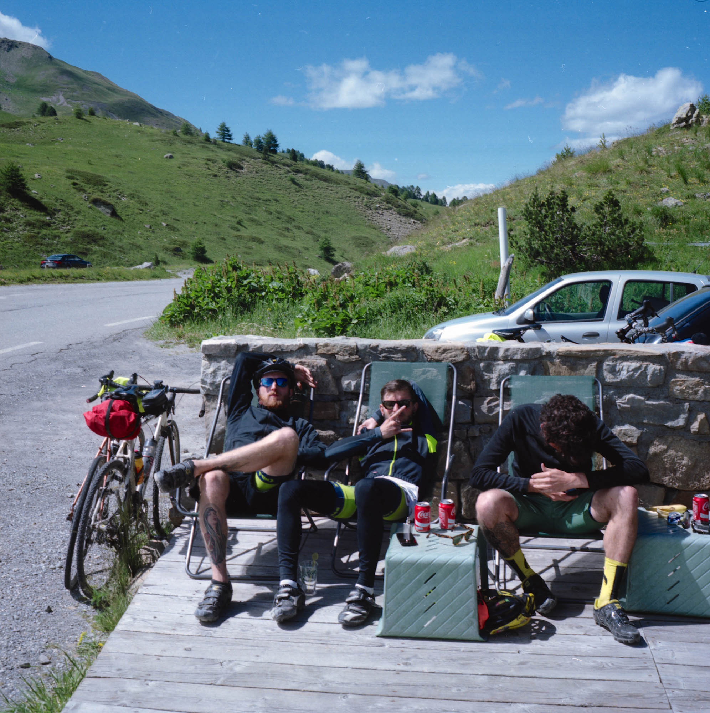
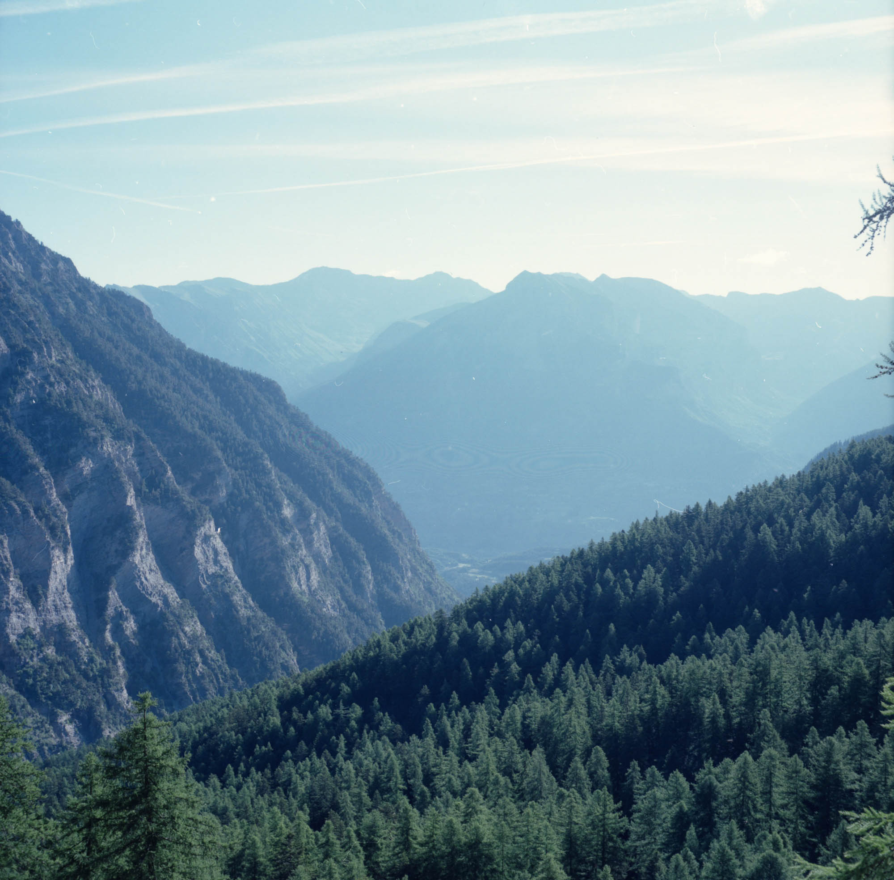
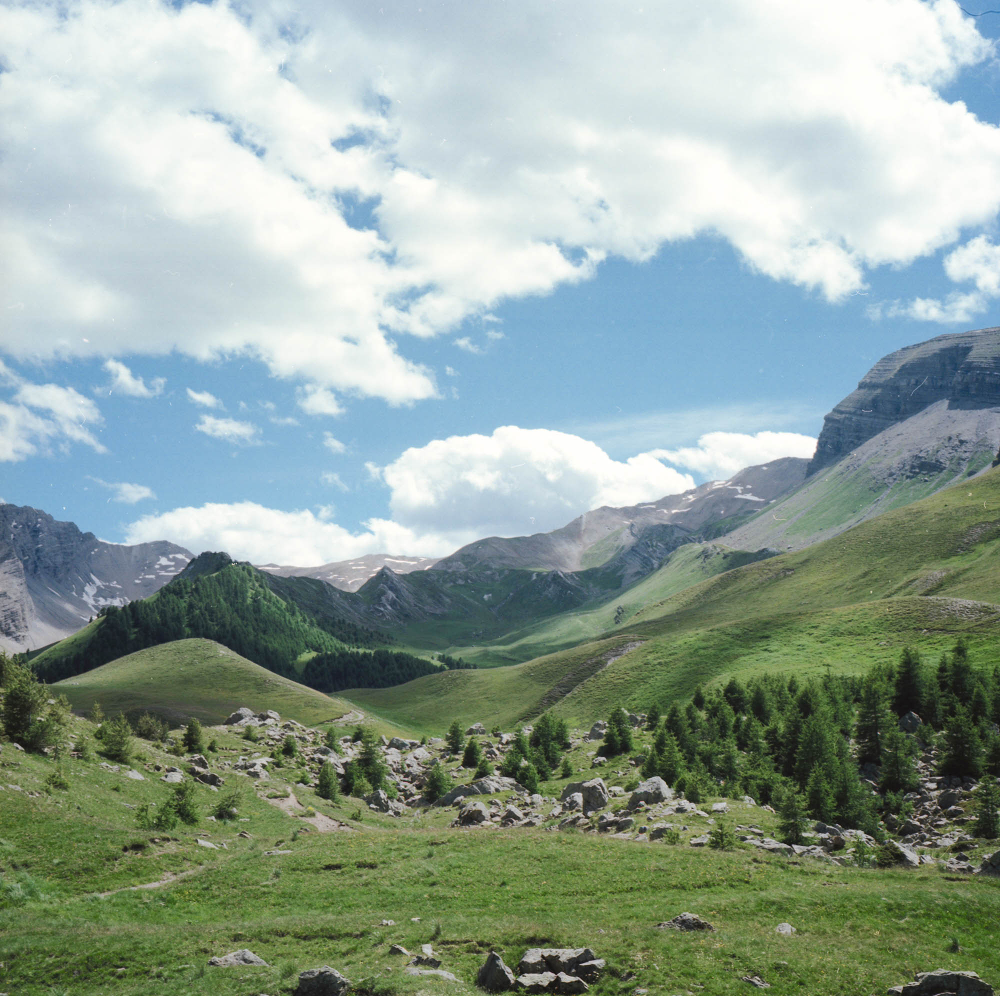
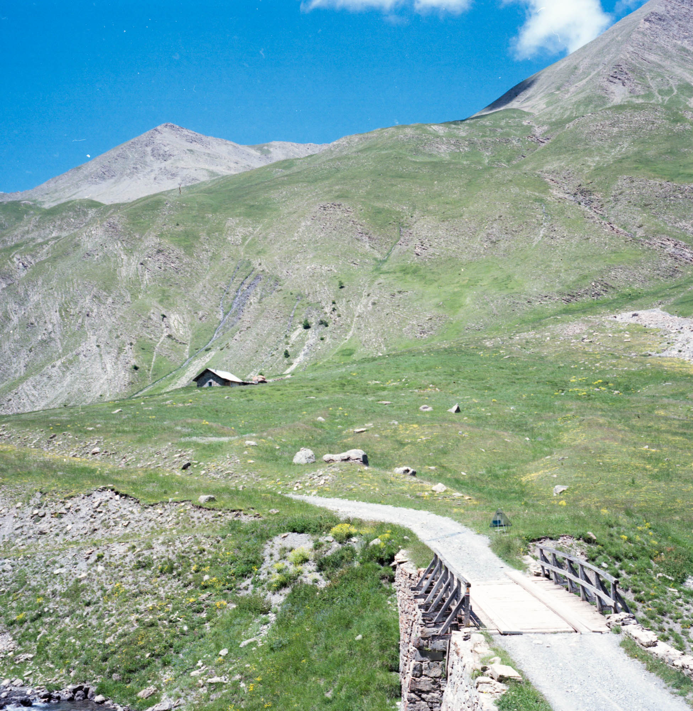
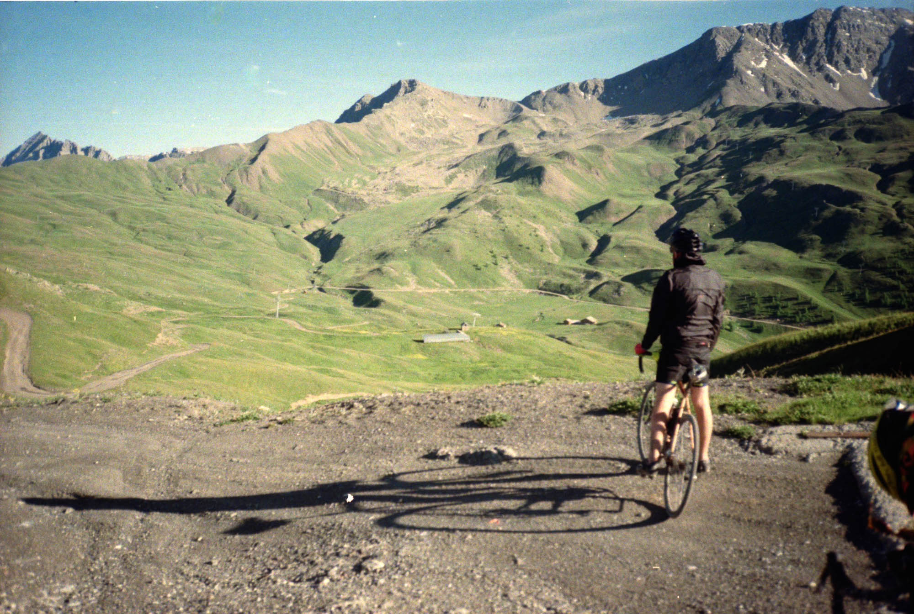
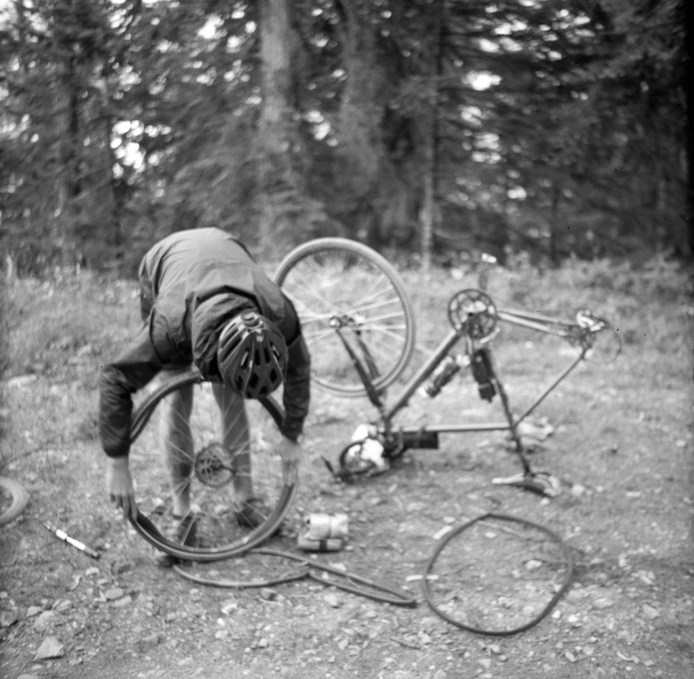

**PRÉAMBULE**

Il est des soirs au Penty où l’on se garderait bien de boire un septième Picon et une huitième tournée de Ricard. Il était un soir au Penty où, après avoir visionné le mythique documentaire *« Parpaillon »* du non moins mythique Luc Moullet, Renaud, Antoine, Julien et Pierre, on eu l’idée de s’attaquer au roi des cols des Alpes du Sud, le méconnu, l’indomptable et le non pavé : **Le Col du Parpaillon**. 

Culminant à 2645m, construit par l’armée en 1900, il surplombe majestueusement la vallée de l’Ubaye et de l’Embrunais et a pour particularité de connecter les deux vallées par un légendaire tunnel de 520m de long, non pavé, entièrement inondé et, cela va sans dire, sans éclairage aucun. 

**Un mythe, une légende**. 30km d’ascension, 1853 mètres de dénivelé positive, dont 17km d’ascension sur le gravier et autant de descente de l’autre versant.

**LE JOUR LE PLUS (PARPAIL)LONG**  
**ACTE 1 – Paris / Embrun**  
Allant à l’encontre de toute logique, et n’ayant pas d’autre choix, nous avons décidé de faire la route dans la nuit du vendredi au samedi pour attaquer les cols au petit matin. C’est ainsi que vendredi, à 21h, nos 4 cyclocross chargés, nous partons en direction des Alpes.

L’affaire était trop belle, trop parfaite, trop dans le timing. Renaud a donc décidé d’oublier ses chaussures chez lui histoire de mettre un peu de piment dans le défi. Au bout de quelques kilomètres, demi-tour et direction Paris. **O****n chope les chaussures, et au passage le cognac** qui était resté dans la cuisine, et là, ÇA REDÉMARRE ! petit effet « jour de la marmotte ».

> **Le truc bien quand on fait 7h de route avec 4 copains, c’est qu’on ne conduit que 2h. Le truc moins bien, c’est que personne ne dort dans la voiture, et qu’au final, on arrive totalement claqué mais en entiers après avoir esquivé une biche fusée dans les derniers kilomètres.**

Il est 6h30 pour admirer un splendide lever de soleil sur le lac de Serre-Ponçon, gonflés à bloc, nous sommes prêts pour attaquer le Parpaillon et ses copains.  
  
On décharge les vélos, on remplit les sacoches de selle, Renaud prend avec lui à peu près assez de bouffe et de matos pour ouvrir une succursale de Décathlon et un magasin de matériel photo au sommet. Antoine, selon ses mots, par avec «  à peu près rien » ce qui lui suffira, et une cassette de 28 dents qui va lui poser pas mal de galères. Pierre est équipé « Like a boss » et Julien, comme à son habitude, marie swag-kiss et élégance avec sacoche de cintre pleine de barres en tout genre.

On remplit les gourdes en buvant un café, **on tartine nos culs** de crème au parfum de Mont-Ventoux et on attaque cette journée épique.

**<!-- image manquante : 2018/10/COL_DU_PARPAILLON_GRAVIER-19.jpg -->**

**ACTE 2 – Le parpaillon**

8h, décollage, après un courte descente pour se mettre en jambe, nous attaquons les 30km d’ascension vers ce tunnel qui nous fait tant rêver. Les 15 premiers kilomètres se passent plutôt bien, bon bitume, Antoine et Pierre en tête comme des machines. Renaud et Julien derrière, à faire des photos et à commencer un documentaire animalier.

Ça grimpe tranquillement, mais surement, vers le village de Crévoux. On croise des moutons, des renards, des ours et des marmottes qui font des cris de marmottes, mais surtout : Pas une seule voiture ! à peine un quad qui nous doublera dans la montée. **Le kif total.**

On passe Crévoux quand les choses sérieuses commencent. L’idée de cette sortie était de la placer sous le signe du gravier. On en avait marre de faire des bornes sur du super bitume **#*outsideisfree***, et on avait vraiment envie de quelque chose de différent, de moins fréquenté, **sans photographe au sommet** ni voiture suiveuse pour faire la vidéo où nous donner quelques bons conseils. En fait, on cherchait à sortir des sentiers battus, et on se retrouve donc sur un sentier totalement défoncé. TOTALEMENT. Des cailloux énormes, des trous, des bosses, des petits cailloux pointus … sur 15km à 8% de moyenne. **Hardcore**.

<!-- image manquante : 2018/10/COL_DU_PARPAILLON_GRAVIER-2.jpg -->

L’ascension se fait en prenant notre temps. Pierre prend rapidement la tête du groupe suivi par Antoine qui force pas mal sur son gros braquet, et Ju et Renaud derrière, à chercher d’intéressants spécimens de marmottes à étudier.

Pour être honnête, **ce col est une sacrée épreuve**. Le revêtement ajoute une sacrée difficulté à l’exercice, mais le jeu en vaut complètement la chandelle. Le paysage est grandiose. Pas un bruit sauf celui de la nature. Une flore qui disparaît progressivement en atteignant le sommet, et même, un peu de neige à partir de 2500m ! L’oxygène se raréfie, les derniers kilomètres se font de plus en plus durs.

On croise à nouveau le Quad qui nous explique que le tunnel est ouvert, mais qu’il y a des flaques de 20cm de profondeur sur toute la largeur. Il nous souhaite bon courage. **On commence à flipper.**

Dernier virage, on aperçoit le sommet, et le haut du tunnel. La fin est proche. Pierre attend depuis 20 minutes, Antoine prend des photos. Tout le monde se retrouve au pied de ce fameux tunnel. Ce tunnel est long, trempé, sans lumière et s’annonce comme une expérience épique…

Quelques photos souvenirs, devant la porte, sur la porte, sous la porte, dans la neige, devant le paysage… Pierre s’équipe de ses **sur-chaussures dernier cri en sac poubelle véritable**, on allume nos phares, et on attaque la traversée.

Autant vous dire que ces 500m vont nous rester en mémoire un bon moment ! Au bout de 20m, on n’y voit presque plus rien ! De la neige sur les côtés, des flaques de vase un peu partout, l’eau qui suinte des murs et qui nous coule dessus depuis le plafond. **Ces 500m sont épiques !**

L’autre bout du tunnel grandit petit à petit et nous finissons par sortir. Deux motards nous gâchent un peu la vue, on leur souhaite bon courage.

L’autre versant du massif est à la hauteur du premier ! Incroyable ! La nature à l’état pur. Pas un bruit, pas une voiture, juste un chemin qui descend dans la vallée.

Pierre enlève les sacs poubelles de ses chaussures et on attaque la descente. Et là, c’est une autre histoire. En terme de freinage, il faut avouer que les cyclocross ne sont pas ce que l’on fait de mieux sur le marché. Pierre et Ju se font plaisir avec leur disques, Renaud et Antoine font chauffer les patins sur les 15 bornes de chemin défoncé à 10% !

On arrive au terme du chemin et là, la providence, **un hippie autochtone nous propose 4 bières**, qui ne seront pas de refus, malgré un prix proche d’un demi dans le marais !

Nous sommes presque épuisés, mais nous sommes bien. On a fait 40 bornes, ils nous en reste théoriquement 100.

<!-- image manquante : 2018/10/COL_DU_PARPAILLON_GRAVIER-16.jpg -->

**ACTE 3 – Le col de Vars**

Col de catégorie 1, culminant à 2 100m, un grand classique du Tour de France. Il affiche un joli 6% de moyenne. A priori, pas de quoi nous inquiéter après le Parpaillon. Mais c’était sans compter le vent de face sur toute l’ascension.

14km / 800m de D+ , pas si méchant, mais des sections à 11% de moyenne qui nous ont bien coupé les pattes. Pierre et Antoine caracolent en tête, non sans mal. Ce col devait initialement être un répit dans l’aventure, il nous a bien cassé. Sans non plus être quelconque, il ne présente pas de réelle particularité, que ce soit pour les paysages ou sa topographie.

Cette montée dure une éternité. Et là où le Parpaillon nous offrait un silence royal, l’ascension du col de Vars se fait dans le vacarme des **quelques 300 motos qui nous ont doublé façon Magny-Cours Bol d’or**, à 130km/h dans les virages, se tirant la bourre avec les copains. On a trouvé plus agréable comme contexte.

L’arrivée se fait après quelques lacets ; Renaud et Julien retrouvent Antoine et Pierre sirotant un Coca à 3 balles dans le chalet d’altitude. On s’écrase dans les transats, il fait 8°, un vent de dingue. On décide de manger un steak frites au sommet.

**4 steaks, 4 corbeilles de pain, 4 tubes de mayo plus tard**, il est l’heure de faire les comptes. Il est bien plus tard que prévu, nous avons fait 2 cols, un hors catégorie, un catégorie 1 ; 64km au compteur, on est parti depuis 7h. Théoriquement, il nous reste un col à faire depuis le bas de la vallée, puis la plus longue descente VTT d’Europe, soit 70km dont 1000m de D+.

Rapide calcul – il semble compliqué temporellement de faire la montée de Risoul, sur les conseils de la population locale, on va tenter un raccourci par la station de Vars, profiter de la nature et à nous la descente de folie !

<!-- image manquante : 2018/10/COL_DU_PARPAILLON_GRAVIER-18.jpg -->

**ACTE 4 – Le col de Valbelle**

On questionne donc les autochtones, tous sont unanimes, « le col de Valbelle, le plus simple, c’est par la station. Y’a une piste VTT, vous verrez, vous pouvez pas la louper ! » **FAUX**

Antoine reprogramme son Garmin, on attaque la descente du col de Vars, direction la station de ski. Au passage, la roue libre de Renaud fait des siennes et se met à hurler dès qu’il arrête de pédaler. Pratique, **ça s’ajoute à son dérailleur avant qu’il passe « à la main » en tirant sur le câble**. Autant dire que la fin du trip s’annonce dans les meilleures hospices. De plus la cassette d’Antoine, à trop tirer dessus à une tendance à se dévisser.

Le Garmin nous fait tirer **tout droit au milieu des télésièges**. On commence à vélo, mais pour être tout à fait honnête, une grande partie de cette ascension se fera à pied. Le soleil commence à descendre pour laisser place à une lumière splendide. Renaud s’en donne à cœur joie sur les photos, tandis que nous attaquons une pente à 35% (oui oui, 35%) poussant nos vélos dans le herbes hautes et sur les chemins totalement gravel entourés de marmottes.

C’est compliqué, mais c’est vraiment cool et improbable. Pour faire simple, imaginez le super télésiège qui remonte toute la station, et bien, on a suivi ce télésiège, à pied, en poussant nos vélos vers le sommet. c’était horrible. Mais c’était bien beau.

<!-- image manquante : 2018/10/COL_DU_PARPAILLON_GRAVIER-17.jpg -->

Arrivés au sommet, la délivrance. La vue sur les deux vallées est époustouflante. Nous ne sommes pas peu fiers de notre performance. Il ne reste plus que de la descente désormais, et quelle descente ! La piste VTT Vars / Embrun, réputée comme étant la plus longue d’Europe – **35km de chemin d’alpage 100% gravel – 1500m de dénivelé négatif.**

Soleil couchant, ULTRA KIF – bonheur en barre, soleil liquide. Le top. Un bonheur qui sera tout de même gâché par la bagatelle de 4 crevaisons, dont 3 pour Renaud, ce qui a eu le don de lui faire péter un bon câble. Ils ont eu l’idée de mettre des petites rigoles tout les 20m pour évacuer les eaux de pluie, jusque là, bonne idée, mais ils ont fait ça avec des sortes de rembardes d’autoroute absolument parfaites pour provoquer des crevaisons par pincement.

Bref, après la boulette chaussures, **il en a eu pour son grade. #Karma**

On met 2 bonnes heures pour redescendre, la lumière est splendide. La map se termine par 5 km de descente sur du bitume façon billard, ça nous change du gravier, « BitumeIsFree » !! On termine par une courte montée vers Embrun et on retrouve la voiture.

**ACTE 5 – épilogue**  
Fanés, repus, on a pris une super claque de vélo, de montagne, de beauté.

Le Parpaillon est à la hauteur de sa légende, somptueux.  
Le col de Vars est une vrai salope traitre qui casse les pattes.  
Le col de Valbelle, par la route, on ne le saura jamais, par les chemins et la station, nous ne sommes pas sûr de le refaire un jour.

Mais on vous le conseille pour la descente top classe, à faire par belle lumière ! Après une journée de chill chez le frère de Renaud à se la couler douce au bord de la rivière, il faut rentrer.

7h de caisse, mais sans oublier les chaussures cette fois ci !

---

***LA VIDÉO***

https://player.vimeo.com/video/131866464?color=6b7b5d&title=0&byline=0&portrait=0

---

***LA MAP***

https://ridewithgps.com/embeds?type=route&id=28884938&metricUnits=true&sampleGraph=true&overlay=esriTopo

**–**  
**100 km**  
**3230 D+**  
**1 Jour**  
**–**

Photos & Film : [Renaud Skyronka](https://www.instagram.com/aknologic/)

## Commentaires

**Brovence - PCR GRAVIER 21 November 2020** — 21 November 2020

[…] un peu l’acte fondateur du PCR Gravier, back en 2015. On vous conseille d’ailleurs de lire ce fabuleux récit, haut en […]
