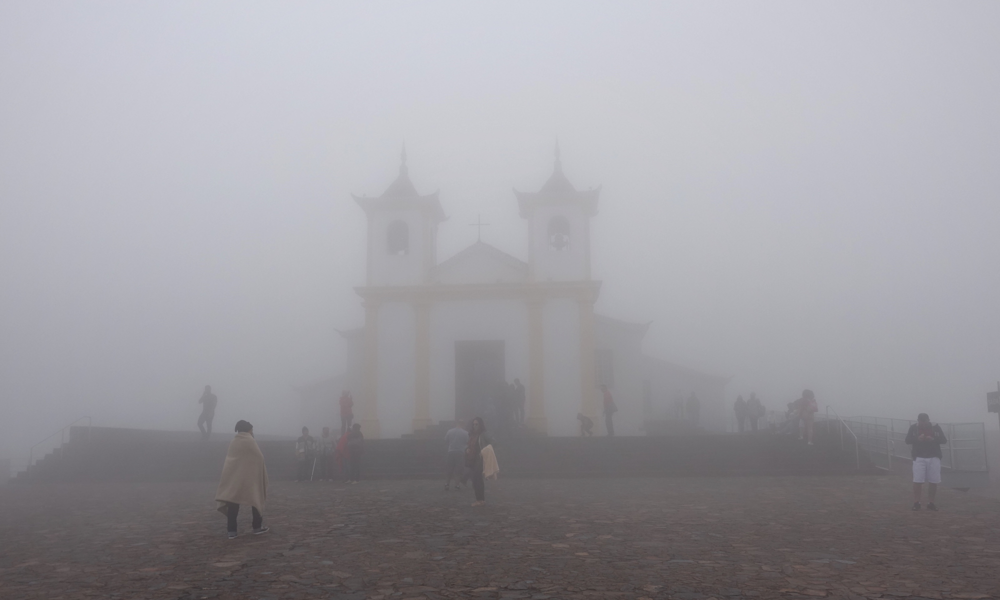

**A l’assault de la Sierra Da Piedade**

J’ai posé mes pneus, au Brésil, dans la région du Minas Gerais il y a presque un an maintenant. À **Belo Horizonte** exactement. Une ville moderne, construite il y a 120 ans au milieu d’une région montagneuse. Nous sommes à presque 1000m d’altitude et les forts % sont légions dans la région.

Un soir d’octobre, comme une envie d’aller grimper au sommet d’une des montagne du coin pour **s’échapper du tumulte urbain**, prendre un peu de hauteur et caresser de la piste. Ce sera une boucle gravel au départ de Sabará, un petit village historique à l’architecture portugaise, pas foncièrement moche, plutôt attachant même. Le brief est assez simple, 55km, 1350m de dénivelé positive pour atteindre le sommet de la Serra (montagne en portugais) da Piedade et revenir.

> **Route, gravier, gravier, gravier, route, gravier, gravier, route, bière.**

<!-- image manquante : 2018/11/serra-da-piedade_04.jpg -->

Un café, toujours trop sucré, et un pao de queijo (traditionnel pain au fromage brésilien), feu. Clips.  
Un début de ride gris, à l’image de la saison. 3 kilomètres de route pour un échauffement pas digne de ce nom, rond point, virage à gauche, virage à droite et un petit pont en bois m’accueille tel l’entrée du parc Astérix du Gravel. Le fun est palpable, un biotope exquis m’attends, peu poussiéreux et pas raviné. Avec la saison des pluies j’avais un peu peur d’arriver à Verdun. Il n’en n’est rien.

**On est sur une base compacte,** c’est parfait.   
Les premiers % en épingles font leur office, j’en ai pour une grosse vingtaine de kilomètres d’ici au sommet. Ce que j’aime ici c’est la rapidité avec laquelle on quitte la civilisation pour se retrouver dans des endroits sauvages, reculés dans une nature assez préservée et exotique.

<!-- image manquante : 2018/11/serra-da-piedade_01.jpg -->

<!-- image manquante : 2018/11/serra-da-piedade_02.jpg -->

Les couleurs sont folles, Instagram devrait s’en inspirer pour quelques nouveaux filtres. A ce sujet, je vais peut être ranger mon appareil car le ratio kilomètre/photo s’élève plus vite que l’altitude. 

**La grisaille rend la montée mystique**, je n’arrive pas distinguer le sommet caché dans la brume, je me croirais presque en Irlande. La ligne de crête commence à se dessiner, j’évolue sur une terre rouge, parfois brune mais une terre toujours roulante qui donne un bon sourire. Je croise le reste d’un squelette, dévoré par je ne sais quel prédateur local, les bruits sont pesants, petit rappel à l’ordre de *mother nature*. Fait pas l’con et surveille les bas côtés, le ciel et les serpents que tu détestes le plus au monde mais que tu vois quasiment jamais sont surement entrain de t’observer. 

<!-- image manquante : 2018/11/serra-da-piedade_06.jpg -->

J’appuie un chouilla plus sur les pédales en traversant une petite forêt de bambou qui va me conduire à la route. Ce n’est pas la meilleure partie. Le brouillard est épais sur ses 5km d’ascension avec des passages à 18%, il fait 10°C et le froid est pinçant à plus de 1600m. J’ai surtout une confiance proche de zéro en l’automobiliste brésilien, les accidents de la route sont un peu le sport national et la considération envers les cyclistes est souvent proche du néant. On sert les fesses.

<!-- image manquante : 2018/11/serra-da-piedade_07.jpg -->

<!-- image manquante : 2018/11/serra-da-piedade_11.jpg -->

Je double plusieurs groupes de pèlerins, croyants, touristes qui grimpent à pied pour rejoindre l’église et le sanctuaire *Nossa Senhora da Piedade*. Ils vont regretter la vue, aujourd’hui c’est une mer de coton qui nous entoure. Petit snack pas volé à la Lanchonete (sorte de boulangerie / épicerie / boutique) et je me remets en selle en quête du soleil qui est en train de pointer le bout de son nez. Je n’ai pas de gilet, la descente va être fraiche, surtout à plus de 70km/h. Là tu ne bénis pas Nossa Senhora mais plutôt l’ensemble du secteur BTP Brésilien qui t’offre ce genre de pente, tu prends 2G pour chaque 200m dévalé. Kif. J’en aurais presque loupé la sortie vers le sentier. **Back on track**. On est mieux sur du gravier. Fin velours sous mes roues et ce petit filou de soleil est bien là pour les derniers 25km. Obrigado amigo!

<!-- image manquante : 2018/11/serra-da-piedade_10.jpg -->

<!-- image manquante : 2018/11/serra-da-piedade_14.jpg -->

Une belle descente technique où je croiserais quelques motocross qui me demandent si je me suis perdu. C’est dans un portugais toujours approximatif que je leur expliquerai que non. Après quelques drift, j’arrive aux bords d’une rivière, changement de décor, on est directement plongée dans la jungle, avec ses odeurs et ses bruits d’animaux exotiques.

<!-- image manquante : 2018/11/serra-da-piedade_21.jpg -->

<!-- image manquante : 2018/11/serra-da-piedade_20.jpg -->

<!-- image manquante : 2018/11/serra-da-piedade_18.jpg -->

Single track, racines un petit pont et je me retrouve sur un billard de gravier. **J’aime ce réseau de route secondaires brésiliennes**, peu de voitures et de la piste prestige pour apprécier le gravel, le vrai, celui tant rechercher par cette fameuse communauté GBF. Ce n’est pas vraiment un signe d’avancée pour le Brésil et les locaux doivent réellement maudire ce gravier qui défonce les suspensions de leur voiture. Pour moi c’est d’une douceur exquise.

A Sabará, sortie de messe, une bière et pas mal de beaux souvenirs en tête.

<!-- image manquante : 2018/11/serra-da-piedade_25.jpg -->

[metaslider id=”422″]

---

***LA MAP***

https://ridewithgps.com/embeds?type=trip&id=29232464&metricUnits=true&sampleGraph=true&overlay=esriTopo

–  
**55km**  
**1393m D+**  
**3h30**  
–

photos : [Arthur Feraud](https://www.instagram.com/arthur_frd/)
