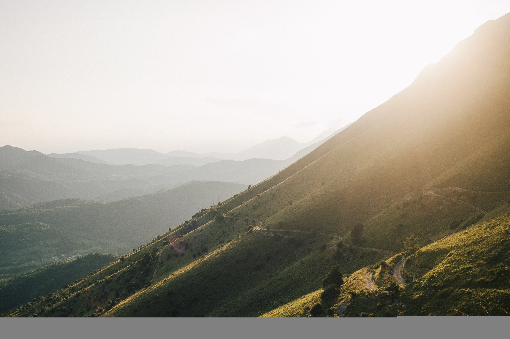
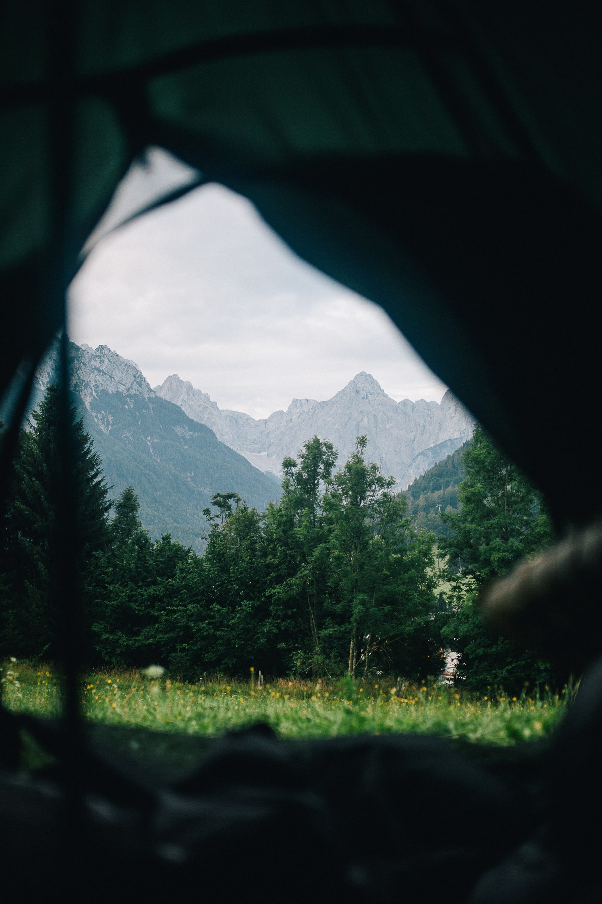
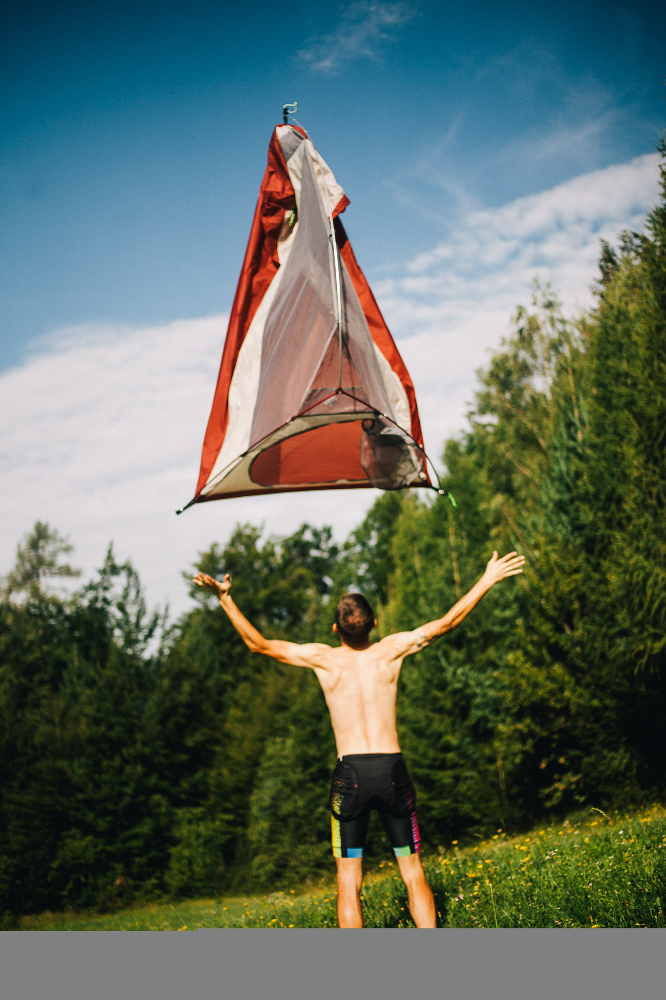
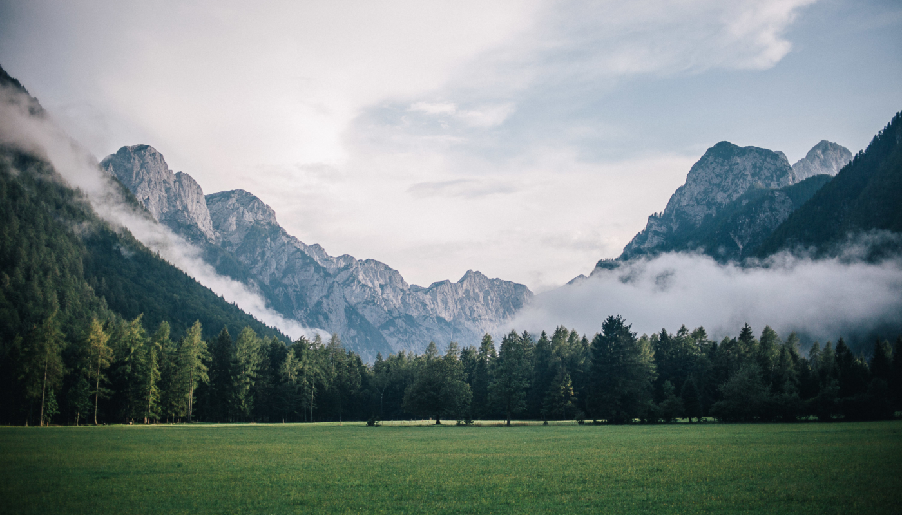
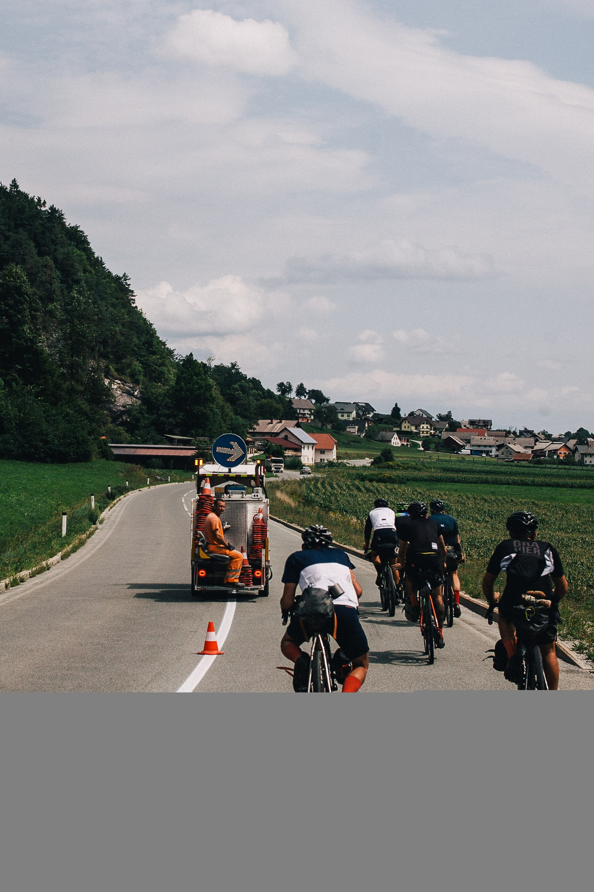
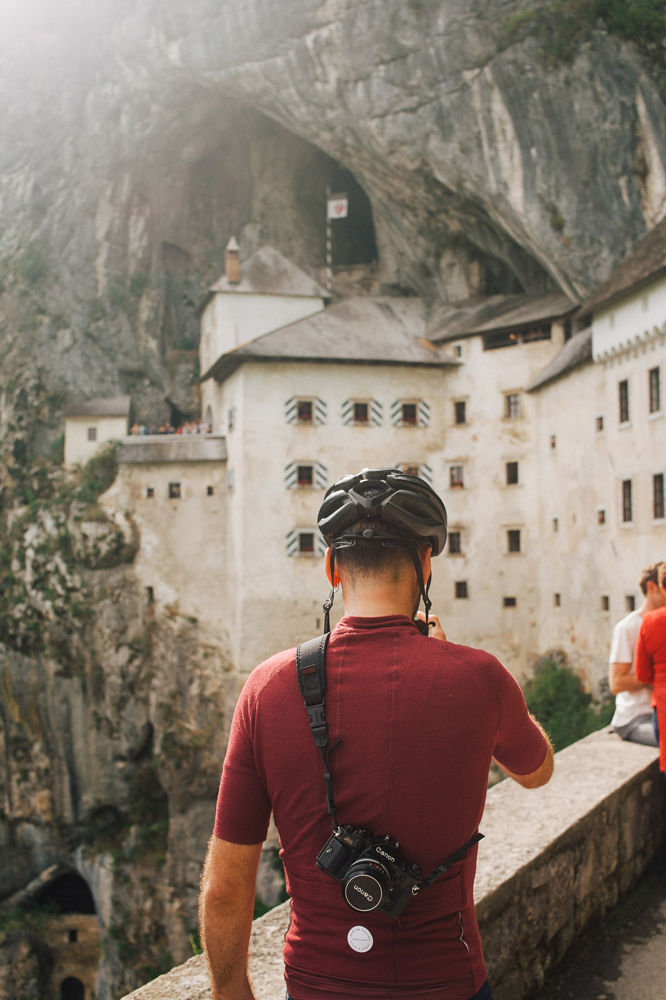
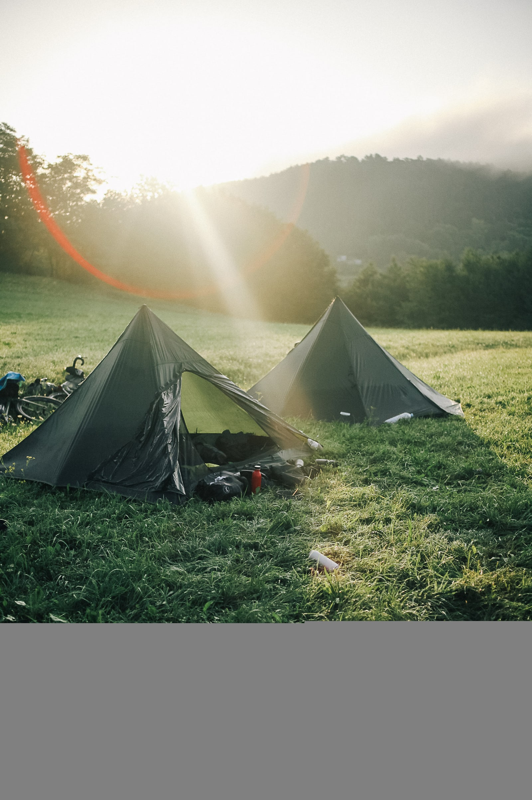

**A bikepacking adventure among beavers brought to you through the eyes of the PCR Gravier.**

L’été dernier on a fait un petit tour en Slovénie.  
On a pas l’habitude de voyager léger, alors on avait dans nos sacoches une demi-douzaine d’appareils photos argentiques, un drone et 2 gopros.  
On allait quand même pas garder tout ça dans nos tiroirs alors on vous a concocté un petit film stroboscopique qui exploite tout ça.  
On a donc mis en images notre fameux [« guide du voyage réussi en 8 leçons »](/slowvenia/).

Faites attention :  
1. Ça donne très envie de voyager entre amis dans un pays ou la bière ne coûte pas cher.  
2. Si vous êtes sujet à l’épilepsie, prévenez le 15 avant de lancer le film au cas où.

—

Last summer we took a little trip to Slovenia.  
We’re not used to traveling light, so we had in our bags half a dozen film cameras, a drone and 2 gopros.  
We weren’t going to keep all that stuff in our drawers, so we made you a little stroboscopic film that exploits all that.  
So we put in pictures our famous [“guide to a successful trip in 8 lessons”](/slowvenia/).

Pay attention:  
1. It makes you want to travel with friends to a country where beer is cheap.  
2. If you are prone to epilepsy, call for emergency before you start the film just in case.  
Enjoy, share and ride.

---

***Le Film***

https://player.vimeo.com/video/425880313?color=6b7b5d&title=0&byline=0&portrait=0

**–  
490km  
11200 D+  
7 Jours  
–**

Video : [Renaud Skyronka](https://vimeo.com/skyronka)

## Commentaires

**JURA-SICK PARK - PCR GRAVIER 6 August 2020** — 6 August 2020

[…] dernière lors de notre voyage en Slovénie, il nous a semblé avoir trouvé une forme de recettes ; une sorte de façon idéale de concevoir […]
