Partir en road trip avec une bande de potes peut sembler une bonne idée pour la plupart d’entre nous. La franche camaraderie, les cheveux au vent, l’effort collectif, la sensation du travail bien fait, les liens qui se soudent, dans la joie et la bonne humeur.

**FAUX**, c’est sans compter sur… **MOTHER NATURE**, mais aussi, les travaux publics, la relative solidité des pattes de dérailleur, celle des chevilles, des pneus tubeless, des rayons de ta roue avant, de la force du vent et de celle de la bière dont tu as bu 3 litres la veille. Bref, un voyage réussi, c’est pas simple mais cet été, les planètes se sont alignées. Le continuum espace-temps a fait une pause dans son chaos habituel et nous a offert le **PERFECT BRO SUMMER TRIP** de castors.

> Là, tout le monde se demande : *« Mais sérieux les gars ? C’est impossible, Mother Nature est une pute, vous avez au moins perdu une tente, une cheville ou un dérailleur non ??? Comment vous allez nous raconter tout ça si tout s’est bien passé ? »*

Facile.

\_\_\_\_

**CHAPITRE 1**

7 Bros sont partis faire du vélo pendant une semaine et 700 km en Slovénie  
tout s’est super bien passé

*FIN*

\_\_\_

<!-- image manquante : 2019/11/SLOWVENIA_INSTA-FACEBOOK.jpg -->

*« Oui, mais la recette c’est quoi alors ? »*  
Ce n’est pas une recette, mais un Manuel.

**LE MANUEL DES CASTORS SOLIDES EN 8 LEÇONS.**

**LEÇON #1**  
*La destination.*

Vaste sujet. Mais choix central dans la réussite du trip.  
Pas trop loin pour ne pas trop perdre de temps sur le trajet.  
Pas trop près pour changer un peu des magazines.

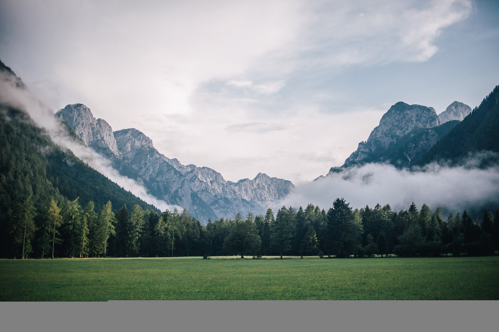

Notre choix de la **Slovénie** cette année est mûrement réfléchi.

Déjà, on adore les ours. D’ailleurs, qui n’aime pas les ours ? Franchement. La Slovénie, **c’est le pays des ours**, donc déjà, on est en plein dans le mille. Bonnes vibes sur la Slovénie en ce moment, sans déverser des palanquées de touristes en furie comme dans certaines régions d’Espagne ou d’Italie. Pile ce qu’il faut.  C’est aussi à portée de train, facilement, par le train de nuit Paris-Venise que nous avions expérimenté l’année dernière pour notre [Veni Vidi Bici](/veni-vidi-bici/).

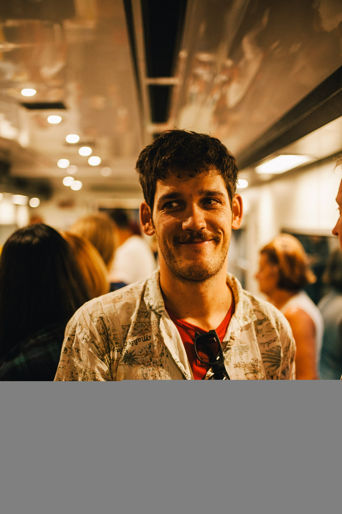

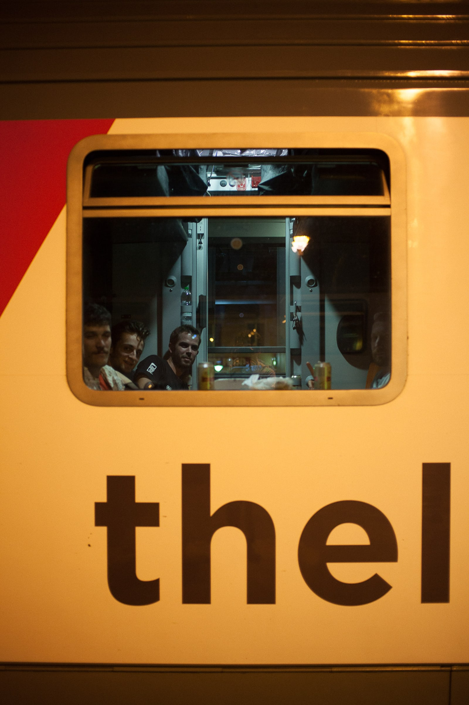

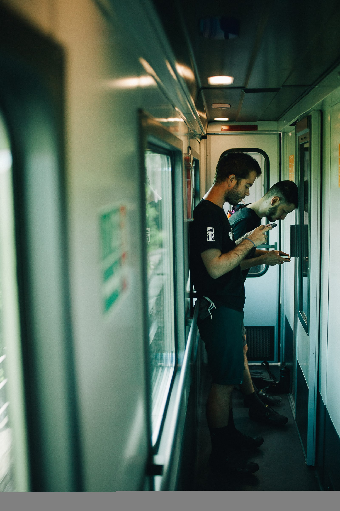

**La mer, la montagne, les plaines**. Franchement, ce pays c’est un mélange entre les décors de Jurassic Park (le premier, pas celui avec le volcan en éruption) et la Dolce Vita. **Un régal pour les pupilles et les papilles**, avec ses petits restos bien coquins qui laissent bien transparaître la proximité avec nos amis italiens, qui ont la best cycling food du monde. 10/10 pour la Slovénie, mention particulière pour le nord du pays et ce petit bout d’Alpes qui nous a régalé de montées et de descentes bien épiques.

***Pro tips castor : la cabine de 4 personnes des trains Thello. Vous dépliez les 6 lits et rangez tous les vélos en haut, OKLM.***

<!-- image manquante : 2019/11/slovenia-gravel-bikepacking-pcr-gravier-wide-12.jpg -->

**LEÇON #2**  
*Les bros.*

Amitié, solidité, castorité.  
Partir en groupe, c’est toujours complexe également à ce niveau.

**Jean-Claude Vegan** ne voudra pas manger au même resto que **Michel Saucisse**, qui adore la viande de Cerf. **Roger LaPince** voudra toujours manger des sandwichs triangle tandis que **Jean-Pierre Quatre-Voix** essayera coûte que coûte d’éviter tous les segments Gravel pour se délecter de l’asphalte fraîchement posé aux frais de la communauté européenne.

Pas simple de trouver un équilibre, et cet équilibre s’appelle **GRAVIER**.

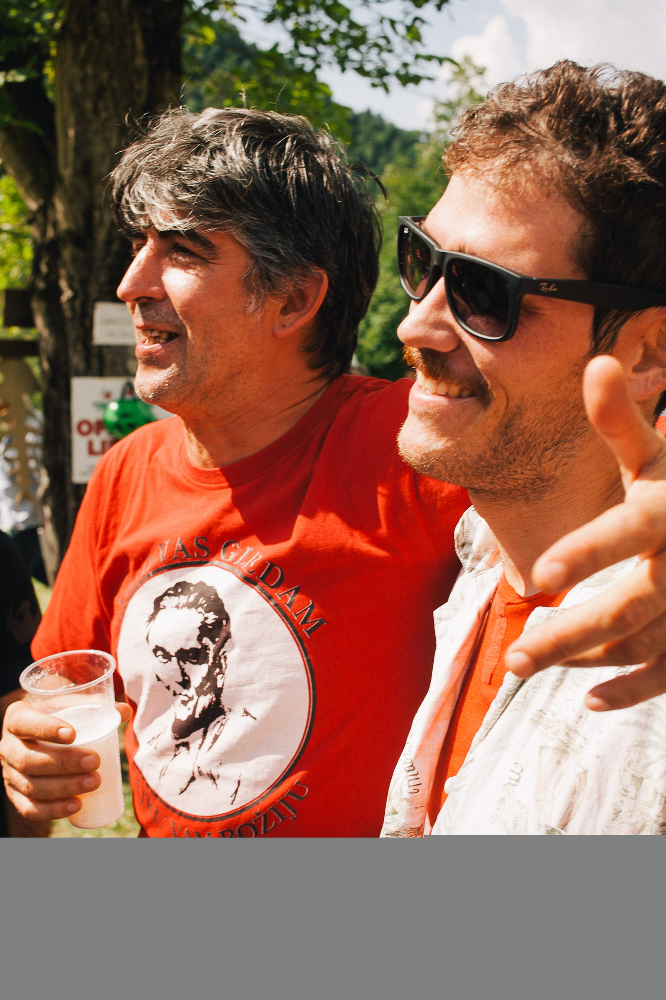

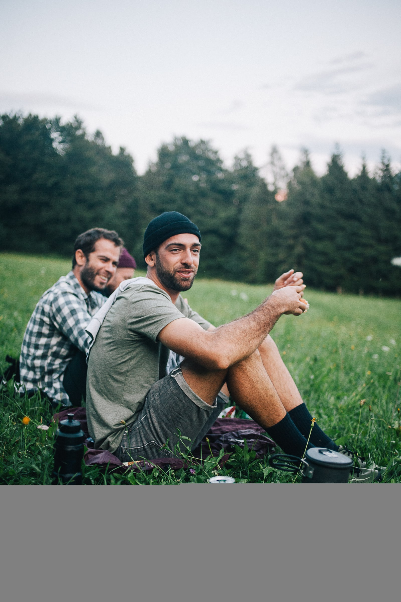

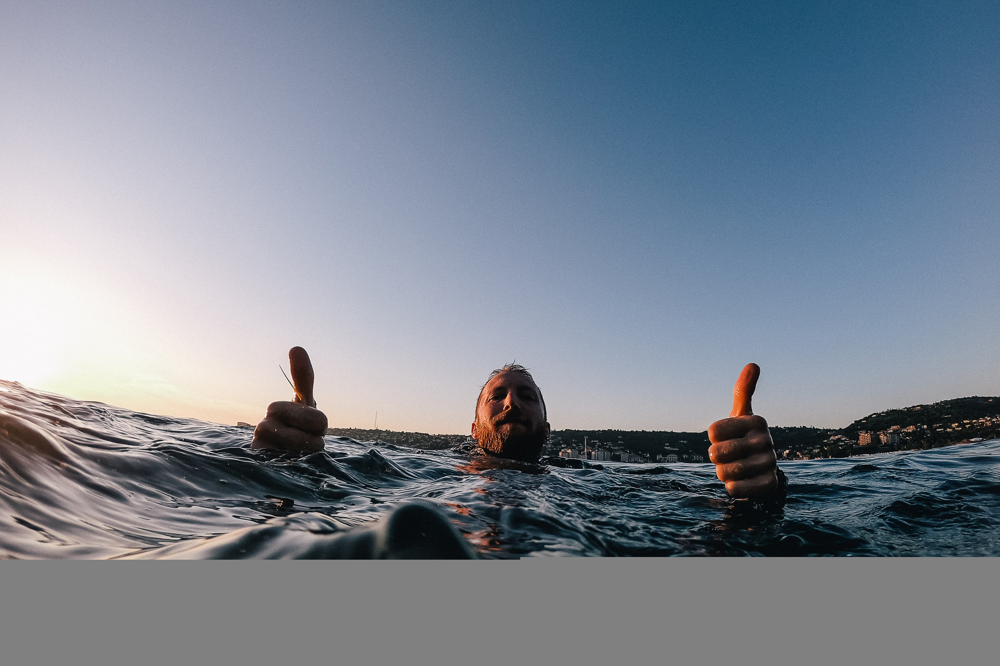

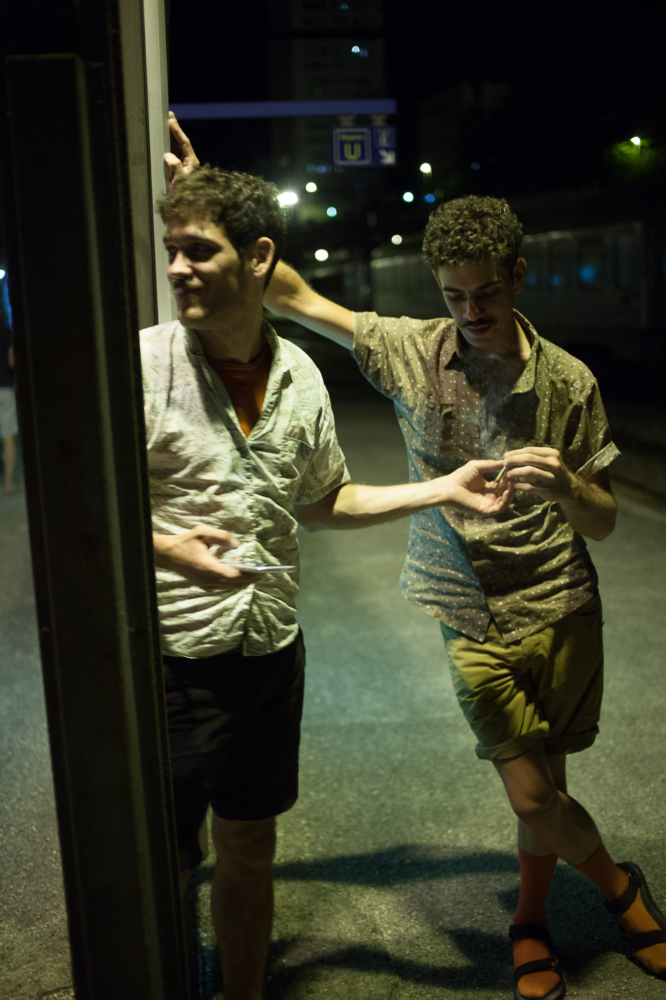

Best team cette année, zéro tension, adaptabilité. Il faut dire qu’on se connaît tous depuis un petit moment déjà, et que ce n’est pas notre coup d’essai, mais il faut avouer que l’équipe était quasi parfaite cette année. Il manquait juste à l’appel la fusée du groupe. Que dis-je, le **DRAGSTER** : [Louis](https://www.instagram.com/juniorjrjunior/). Mais peut-être doit-on interpréter la réussite de cette expédition par son absence ? L’avenir nous le dira !

***Pro tips castor : éviter de partir avec des inconnus.***

<!-- image manquante : 2019/11/slovenia-gravel-bikepacking-pcr-gravier-wide-1.jpg -->

**LEÇON #3**  
*La map.*

Point central. Capital.

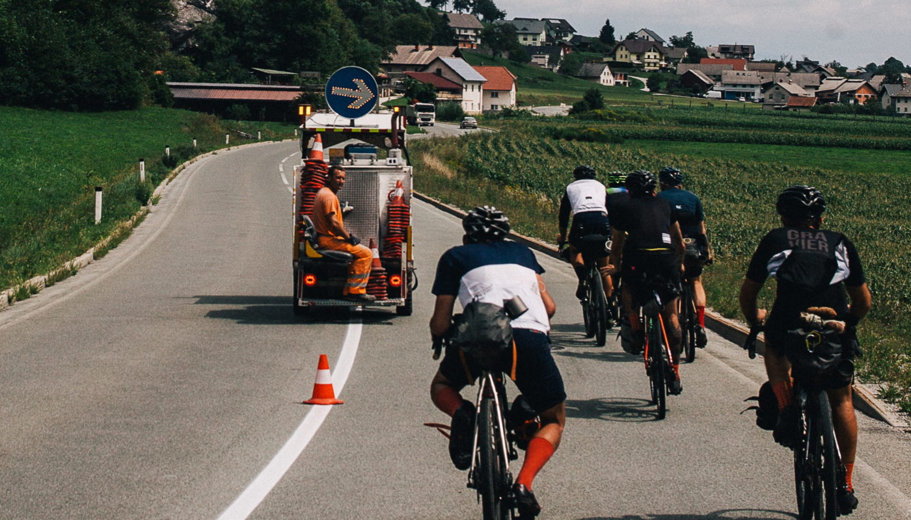  
Il n’est pas si simple de **se rendre d’un point A à un point B**. C’est une sorte de science même.  
En ce qui nous concerne, hors de question de se pointer à l’autre bout de l’Europe sans avoir une solide idée de l’itinéraire. Notre technique depuis quelques années, trouver une trace déjà éprouvée et validée (sur [bikepacking.com](https://bikepacking.com/) par exemple) puis la saucissonner, la modifier, la recoller avec d’autres traces, si il faut raccourcir ou rallonger le projet.

Pour la Slovénie, la trace est un mix de la [**Slovenia West Loop**](https://bikepacking.com/routes/bikepacking-slovenia/), mais comme on n’aime pas trop les loop, et que le voyage c’est quand même mieux quand on va quelque part, on l’a connectée avec **une trace VTT développé par l’office du tourisme slovène**, qui travers le pays d’est en ouest jusqu’à la mer.

On colle tout ça avec les outils qui vont bien. On utilise pas mal le **soft LAND de TwoNav**, qui est tellement complet sur la manipulation de GPX et de fonds de carte qu’on pourrait organiser un trek sur mars… mais qui a été codé par des martiens qui n’ont pas les mêmes notions d’ergonomie logiciel que l’humain moyen… idéal geek. Pour tracer les itinéraires nous même, on est plutôt sur RideWithGps ou Komoot, un peu plus simples d’utilisation.

Le moment **CRUTIAL** dans ce processus, c’est le découpage en jour à jour. Et là, attention à ne pas avoir les yeux plus gros que le ventre car on le rappelle, il existe un **RATIO D’ÉQUIVALENCE ROUTE/GRAVEL**. **1 km de route = 4 km de Gravel**.  
Donc les petits malins qui voudront organiser un road trip à 8 avec des journées de 120 km dans la pampa Gravel style GR20 avec portage et randonnée-vélo… Bon courage, on a essayé, bah ça ne marche pas.

***Pro tips castor : 70 km c’est bien. T’as plus de temps pour boire des bières et planter ta tente. De jour !***

<!-- image manquante : 2019/11/slovenia-gravel-bikepacking-pcr-gravier-wide-5.jpg -->

**LEÇON #4**  
*Les montures.*

Alors là pour le coup, loin de nous l’idée de juger les configs des uns et des autres. On a vu certains grimper le parpaillon avec un vélo de cyclocross en cantilever et roue libre défectueuse en s’en tirer avec seulement 8 crevaisons. Quelques impératifs tout de même. Pour un trip réussi, il existe une règle, un ticket d’entrée, qui devrait être obligatoire : **UNE PATTE DE DÉRAILLEUR DE RECHANGE**. Tant que vous y êtes, pensez à un maillon rapide, des galets de dérailleur neufs, une paire de câbles, des plaquettes neuves, un bon multitool et une putain de trousse à pharmacie.

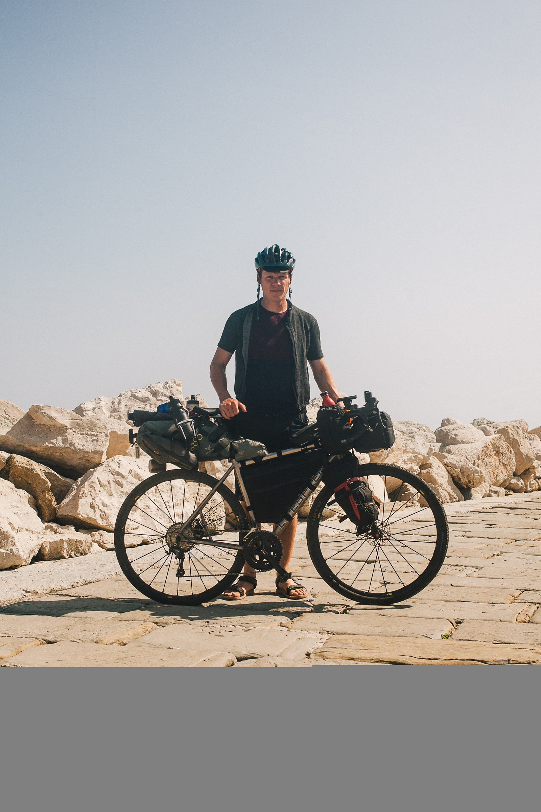

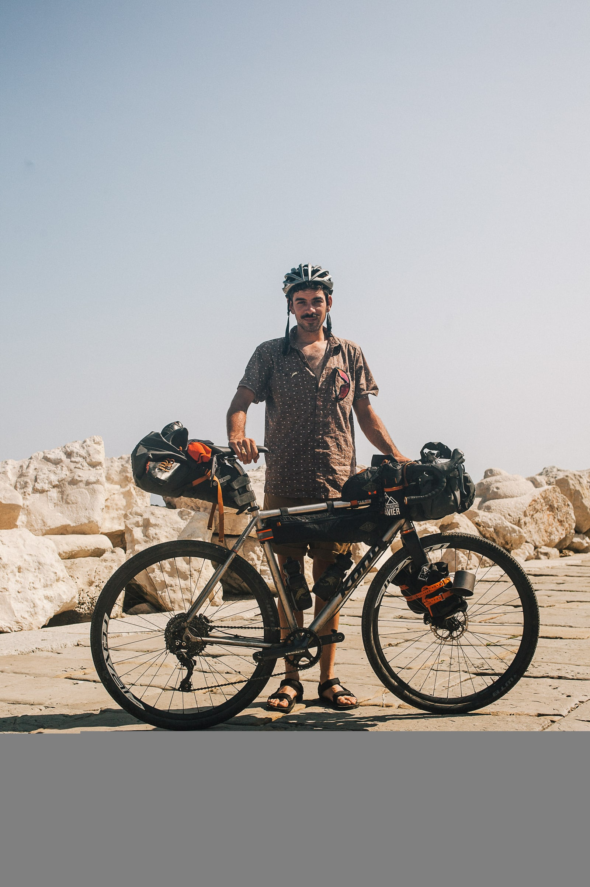

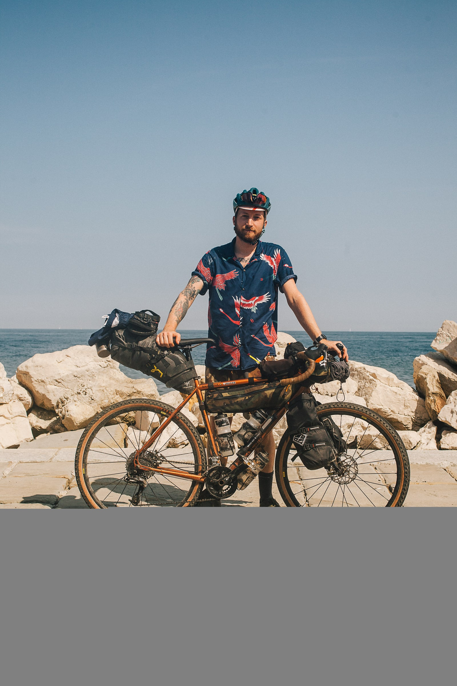

Pour le reste, c’est vous qui voyez (si possible en titane, mais c’est juste notre avis), on est ouvert à tout. On met juste un véto sur les cadres de VTT avec des cintres route et aux gravels avec prolongateurs. **Au final, on n’a pas deux vélos identiques dans le groupe**. C’est un peu la foire à la saucisse (en titane) entre les groupes, les largeurs de pneus, les sacoches…

***Pro tips castor : pour les pneus, plus c’est large, plus c’est marrant. Pour les sacoches : plus c’est étanche, moins c’est chiant. Pour les développements et les cassettes : plus c’est gros et mieux ça passe. Après, vous en faites ce que vous voulez !***

<!-- image manquante : 2019/11/slovenia-gravel-bikepacking-pcr-gravier-wide-6.jpg -->

**LEÇON #5**  
*La nourriture.*

<!-- image manquante : 2019/11/slovenia-gravel-bikepacking-pcr-gravier-108-1.jpg -->

Une leçon assez proche finalement de la leçon #1. **Si tu n’aimes pas les tapas, évite l’Espagne. Si tu aimes manger, va en Italie.**  
Attention tout de même aux excès en tout genre de nourriture locale. Affirmer que notre voyage slovène s’est passé tout à fait sans embûche est un peu mensonger. Pour deux d’entre nous, dont les prénoms seront modifiés pour garder leur anonymat, **le voyage aura été un chemin de croix sous le signe du caca.**

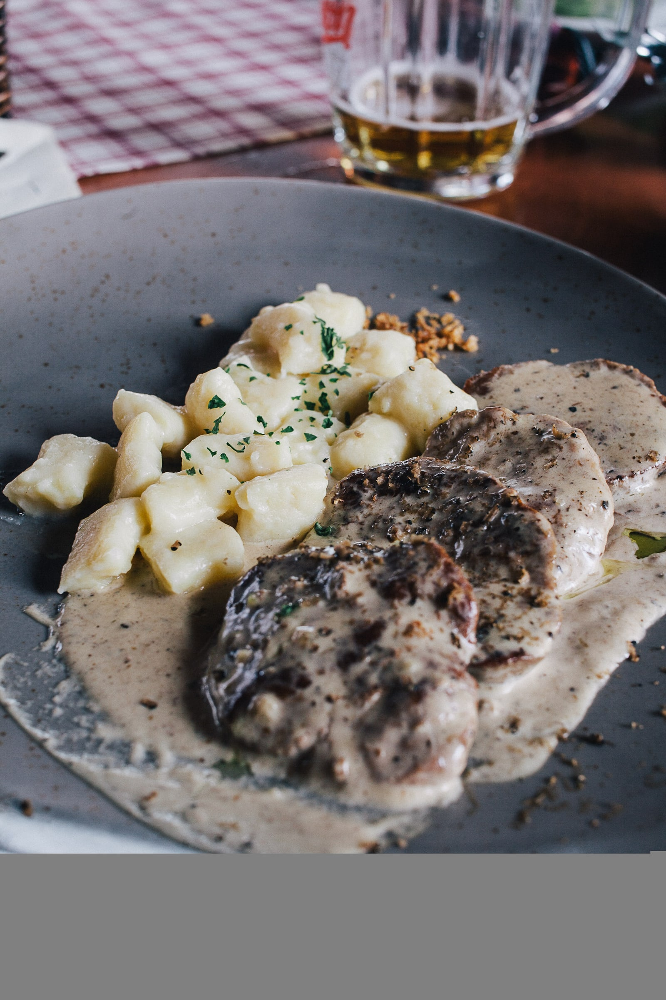

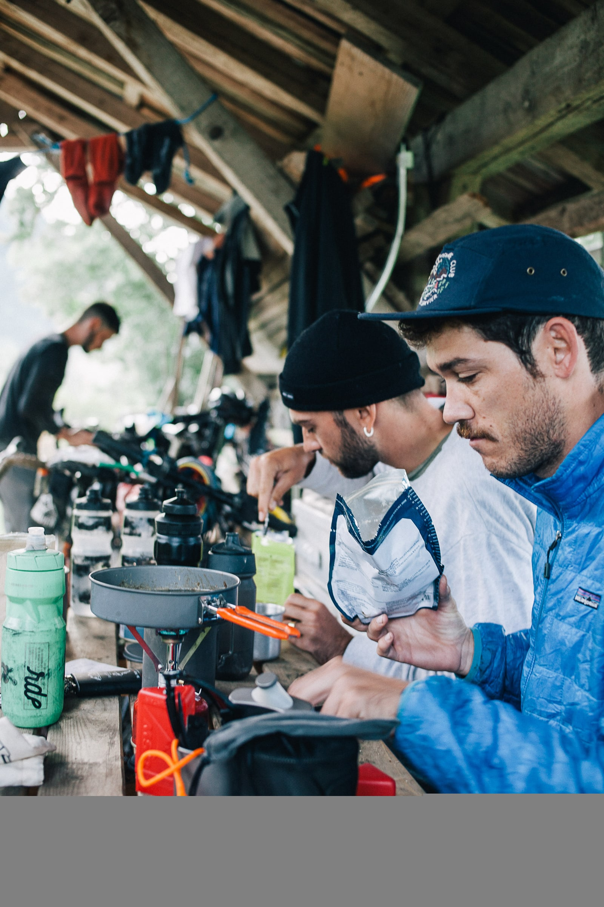

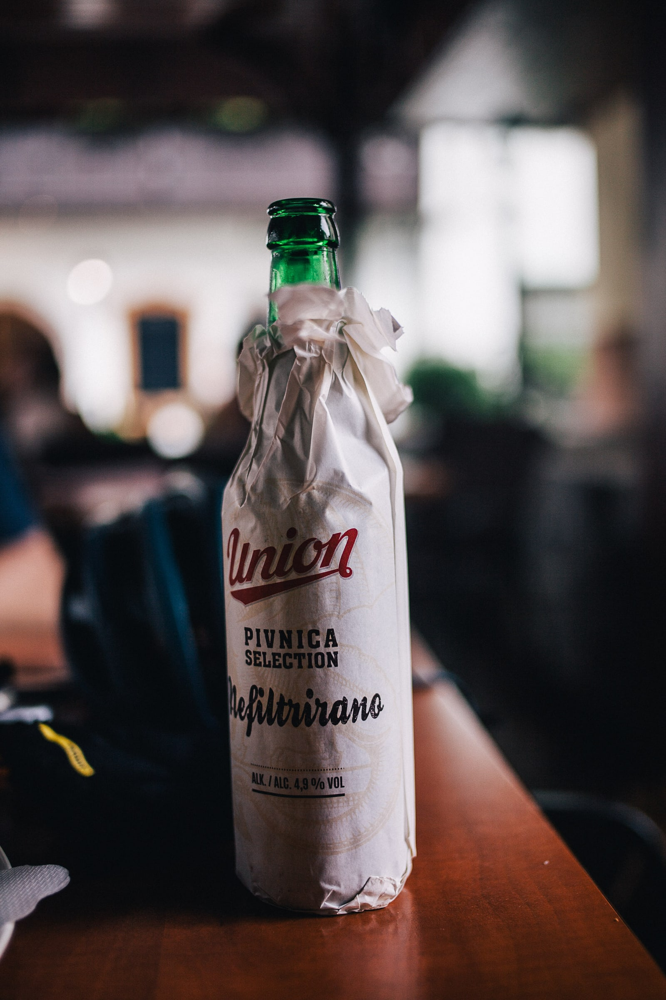

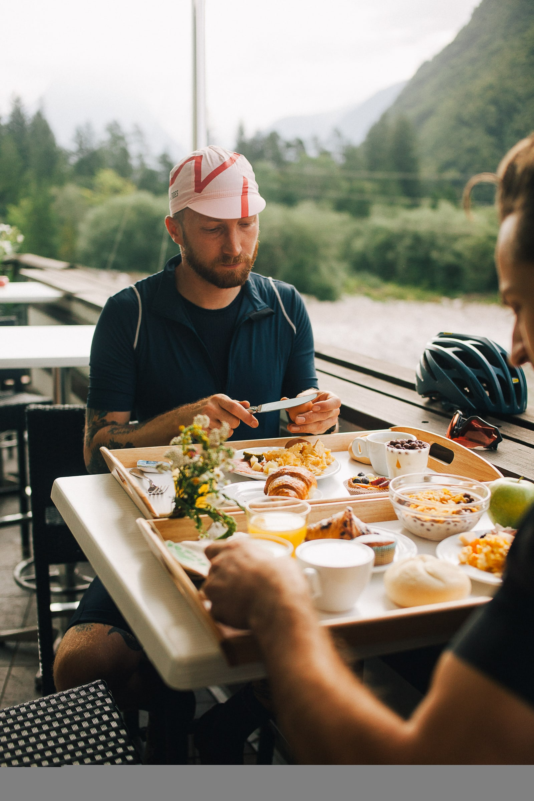

Suite à un couscous marocain un peu trop copieux sur le bivouac du premier soir, “Anatole” déposera une mythique galette à 3 m de sa tente, et développera un mal de ventre chronique pendant la quasi-totalité du voyage. Mal de ventre qui le poussera à écourter l’une des journées de montagne pour prendre un peu de repos et repartir de plus belle.  
Pour “Alexandre”, c’est un voyage qui s’est déroulé quasi totalement sans les bretelles de son cuissard. On vous laisse deviner pourquoi. La cause de ces soucis gastriques restant, à l’heure qu’il est, **l’une des plus grandes énigmes de la médecine moderne**.

Notre méthode en voyage, prévoir un mix entre plats lyophilisés (on s’approvisionne sur [lyophilisé & co](https://www.lyophilise.fr/), les seuls qui ont la glace napolitaine d’astronautes) et local food.

***Pro tips castor : une lifestraw si t’es un peu fragile du bidou.***

<!-- image manquante : 2019/11/slovenia-gravel-bikepacking-pcr-gravier-wide-7.jpg -->

**LEÇON #6**  
*La gestion du timing.*

<!-- image manquante : 2019/11/slovenia-gravel-bikepacking-pcr-gravier-134.jpg -->

Une journée réussie sur un vélo, c’est une journée sans anicroche, sans pépin, sans attente, sans ralentissement. Une journée où à midi t’as déjà plié la moitié de la map. Une journée où tu plantes ta tente de jour, et où ta moyenne pauses comprises est au-dessus des 5 km/h. Bref, une journée qui roule. Pour ça, **le réveil doit sonner tôt. Très tôt.**

Il faut **2 h pour un club de Castors pour replier 4 tentes et ranger 8 sacoches en déjeunant sur site**. Éviter alors de prendre une heure de plus en s’arrêtant à la boulangerie au bout de 4 km. Préférer un ravitaillement la veille, pour profiter de son pain au chocolat encore au chaud dans son duvet lors d’un **#WakeUpLikeThis** des familles.

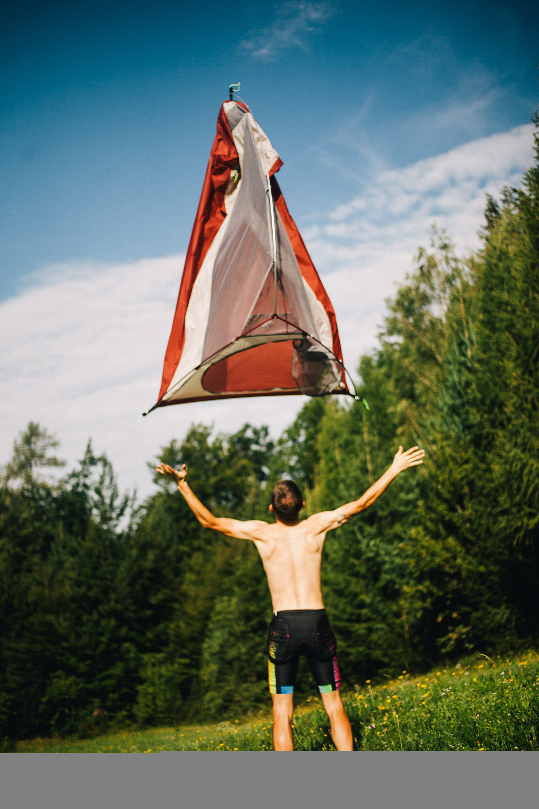

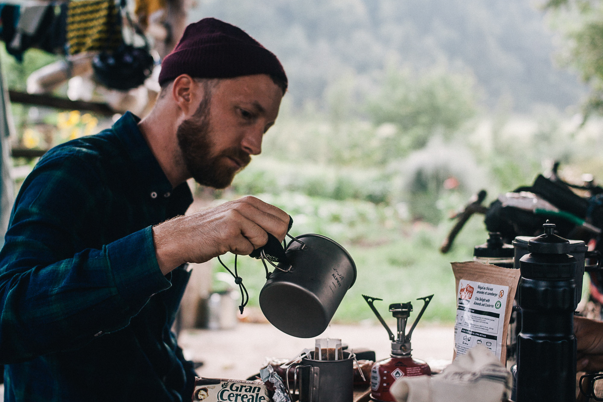

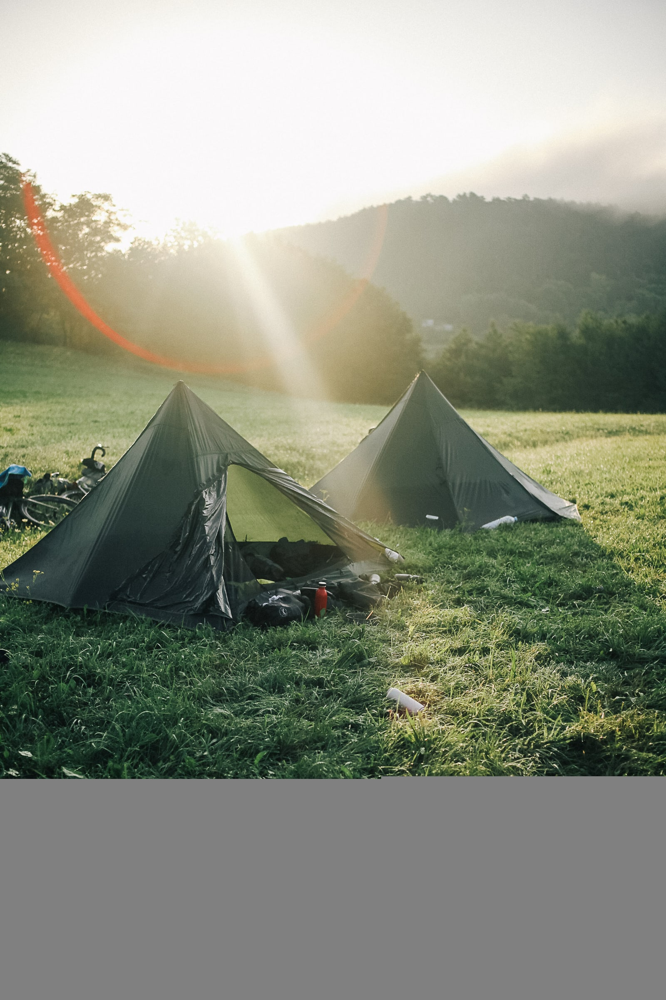

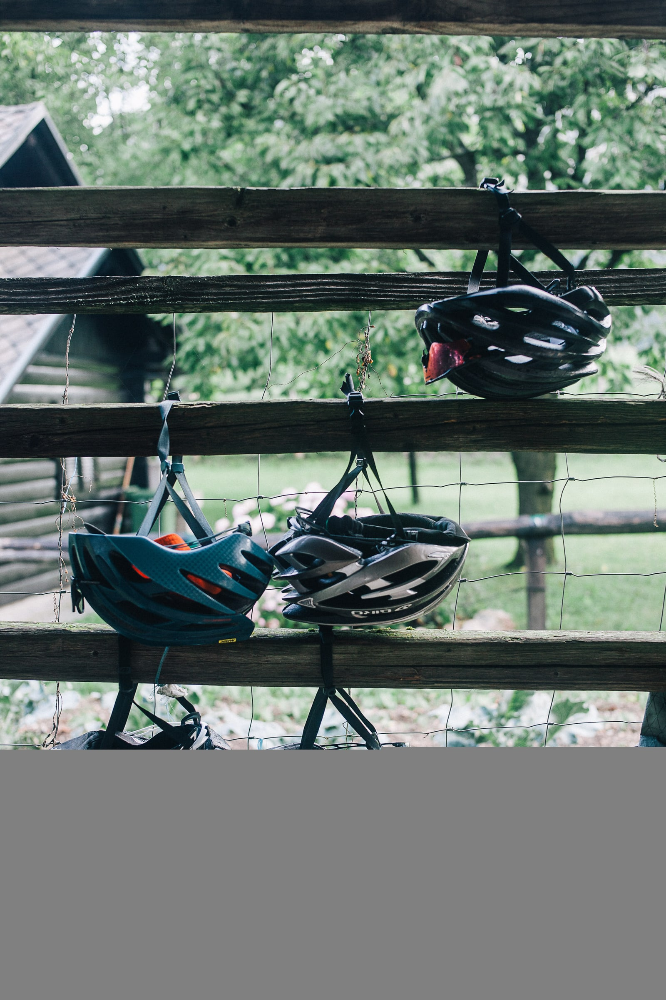

Limiter également la durée de la pause du midi. On aime tous traîner à table en famille et **prendre le dessert et le café vers 16h**. Mais là, ça va pas être possible si tu veux planter ta tente de jour.

***Pro tips castor : penser à la pinte de bière à 2€ qui t’attend en fin de journée pour minimiser les pauses inutiles dans l’après-midi.***

<!-- image manquante : 2019/11/slovenia-gravel-bikepacking-pcr-gravier-wide-8.jpg -->

**LEÇON #7**  
*La météo.*

<!-- image manquante : 2019/11/slovenia-gravel-bikepacking-pcr-gravier-131-1.jpg -->

N’est pas Évelyne Dhéliat qui veut. **La météo est à la fois une science et un art**. C’est aussi une activité chamanique qui consiste à implorer Mother Nature de nous épargner (cf [le report de la BTR](/born-to-ride-2019-les-citadelles/)).

Quoi qu’il arrive, **c’est Mother Nature qui décide**. Alors mieux vaut essayer de faire avec. Pour ça, la Slovénie nous a apporté son lot de surprises. Beau temps au sommet du col, et averse diluvienne en arrivant en bas. Nous sommes souvent passés entre les gouttes, en essayant de prévoir les temps d’averses au maximum grâce aux divers outils de radars pluie en ligne. Ne pas sous-estimer le vent également qui peut transformer une promenade de santé en calvaire sans nom.

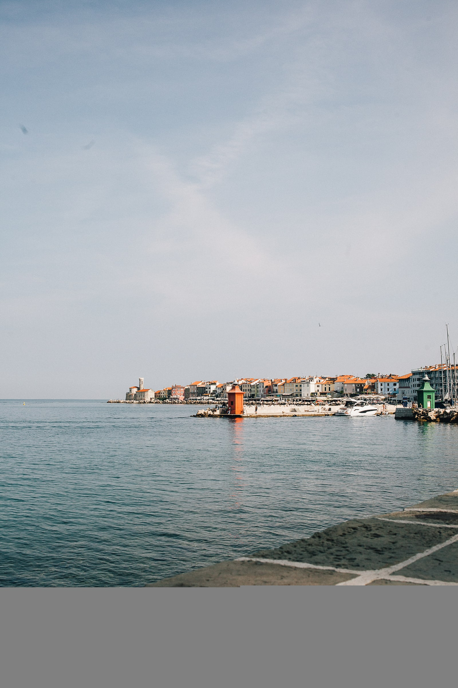

**La Slovénie n’est pas aussi verte pour rien**. Il y pleut une bonne partie de l’année, y compris en été. Nous avons eu beaucoup de chance cet été et avons su passer entre les gouttes. Que ce soit pour les bivouacs ou les rides.

***Pro tips castor : prendre une nuit à l’hôtel s’il est prévu beaucoup de pluie pendant la nuit. Franchement, ce n’est pas tricher. Au pire, vous faites comme nous en choisissant un Air BnB avec l’eau chaude cassée, comme ça vous resterez dans la philosophie castor.***

<!-- image manquante : 2019/11/slovenia-gravel-bikepacking-pcr-gravier-wide-9.jpg -->

**LEÇON #8**  
*Le vélo, c’est ce qui rend la vie plus intéressante que le vélo.*

<!-- image manquante : 2019/11/slovenia-gravel-bikepacking-pcr-gravier-101.jpg -->

Eh le jeune, **le vélo c’est fun, mais n’oublie pas que le reste c’est cool aussi**. Alors, ne passe pas à côté du petit château, du village médiéval, de la spécialité locale pour ne pas faire baisser ta moyenne. D’ailleurs, éteins-moi tout de suite cet “auto pause” de merde qui bipe tout le temps. **Les statistiques c’est bon pour les comptables**. Ici on parle de grand air et d’aventure et on ne va pas se mentir, tout le monde s’en tape de tes watts sur Zwift.  
Profite du paysage, guette les animaux, arrête-toi pour te baigner avec les ours, mange une glace, fais caca dans la nature, arrête-toi pour regarder ce paysage avec tes yeux au lieu de le prendre en photo sans t’arrêter. Parles avec tes potes et posez tous les téléphones au milieu de la table quand vous mangez. Respire un bon coup, tout va bien se passer.

**On est les premiers à scroller et alimenter Instagram pendant nos voyages**. Il est de notoriété publique qu’on fait plus de photos que de kilomètres, mais cette année on a essayé de lever un peu la pédale sur les GSM, et ça fait du bien.

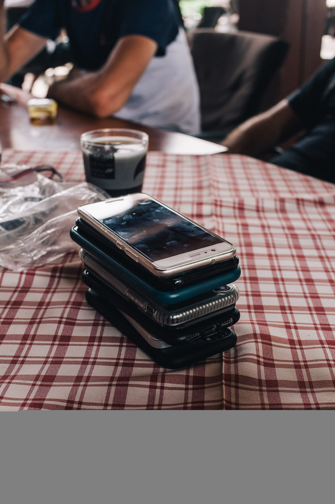

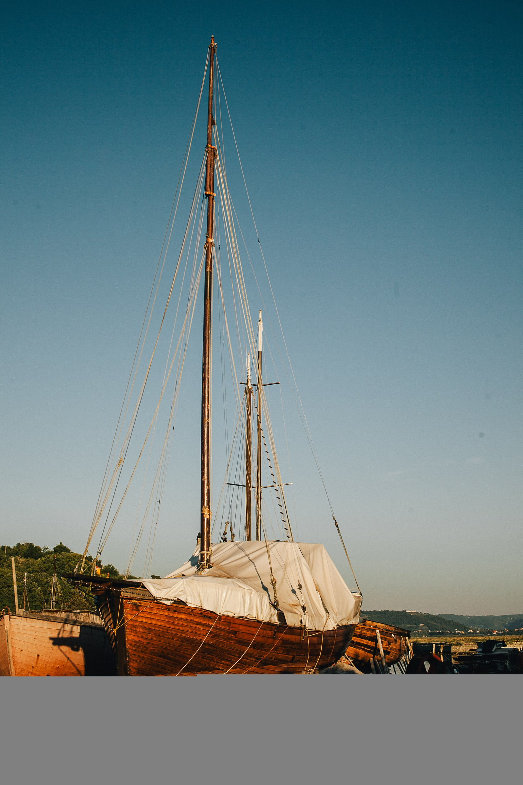

Du coup, en Slovénie on a pu profiter de couchers de soleil d’orthodontiste, on a scruté les ours, vu un château dans une montagne, le décor de Jurassic Park.  
On a vu des randonneurs et des golfeurs au milieu de notre trace, on s’est baigné dans la rivière, dans un lac et dans la mer.  
On a rigolé en buvant environ 70 L de bière à Ljubjana en prenant un appart pour se balader un peu sans les vélos.  
On a cuisiné au pied de notre tente, on a fait plein de photos, avec plein d’appareils pour se rappeler de tout ça à cause de la gueule de bois.  
On a fait caca dans la nature. Certains plusieurs fois par demi-journée.  
On a échappé à la pluie devant des supermarchés, on a planté de jour à peu près tous les jours. On a bu des canettes comme des clodos à côté de 8 nanas qui faisaient des photos en maillot.  
On a fait des dessins sur notre carte. On avait une carte.  
On a pris des trains, un peu plus que ce qui était prévu. On a pris le bateau aussi, car un bateau c’est toujours l’aventure.  
On a mangé des pâtes, des pizzas, des couscous, des aligots, du cerf, du sanglier, pas assez de verdure. On a rencontré des gens sympas, qui nous on prêté une cahute.

***On n’a à peu près rien cassé.***  
***On est rentré à peu près entiers.***

<!-- image manquante : 2019/11/slovenia-gravel-bikepacking-pcr-gravier-wide-11.jpg -->

**Merci aux leçons 1 à 7 d’avoir permis tout ça**. On va revenir sur toutes ces aventures dans pas longtemps avec notre petite publication annuelle, soyez-en sûr ! D’ici là, n’hésitez pas à écrire votre propre manuel et à kiffer la castor life du grand air.

---

***LA MAP***

https://ridewithgps.com/embeds?type=trip&id=38103050&title=PCR%20GRAVIER%20~%20SLOWVENIA&metricUnits=true&sampleGraph=true&overlay=esriTopo

  
–  
**490km**  
**11200m D+**  
**7 JOURS**  
**–**

Photos : [Renaud Skyronka](https://www.instagram.com/aknologic/)

## Commentaires

**Slowvenia – PCR Gravier – Rookies 6 June 2020** — 6 June 2020

[…] passer les notifications de leur nouvelle vidéo « Slowvenia », résumé de leur dernier trip en Slovénie.Et bien on a pas été déçu. D’une part parce qu’ils sont (encore une fois) parvenu […]

**Slowvenia Vidéo - PCR GRAVIER 10 June 2020** — 10 June 2020

[…] L’été dernier on a fait un petit tour en Slovénie. On a pas l’habitude de voyager léger, alors on avait dans nos sacoches une demi-douzaine d’appareils photos argentiques, un drone et 2 gopros. On allait quand même pas garder tout ça dans nos tiroirs alors on vous a concocté un petit film stroboscopique qui exploite tout ça. On a donc mis en images notre fameux « guide du voyage réussi en 8 leçons ». […]
