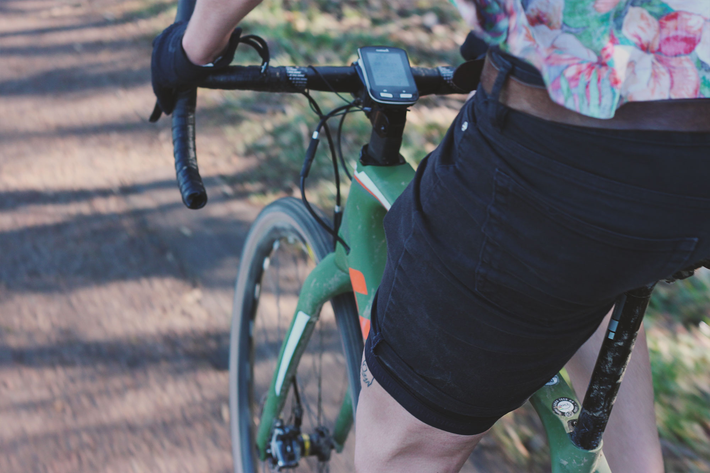
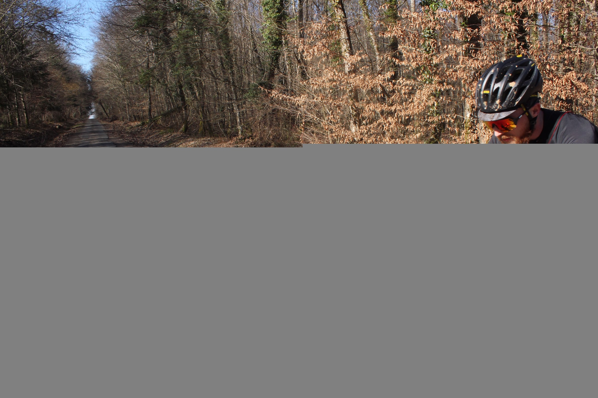
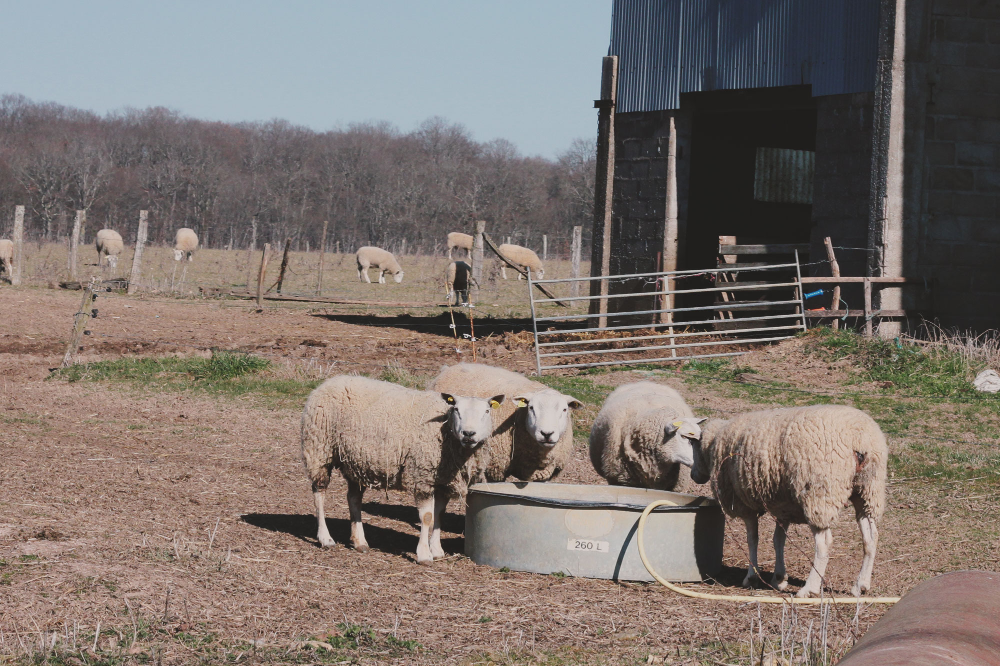
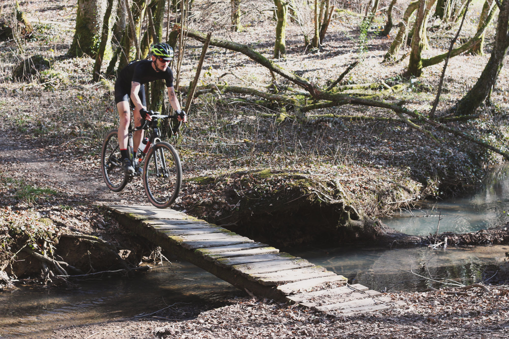
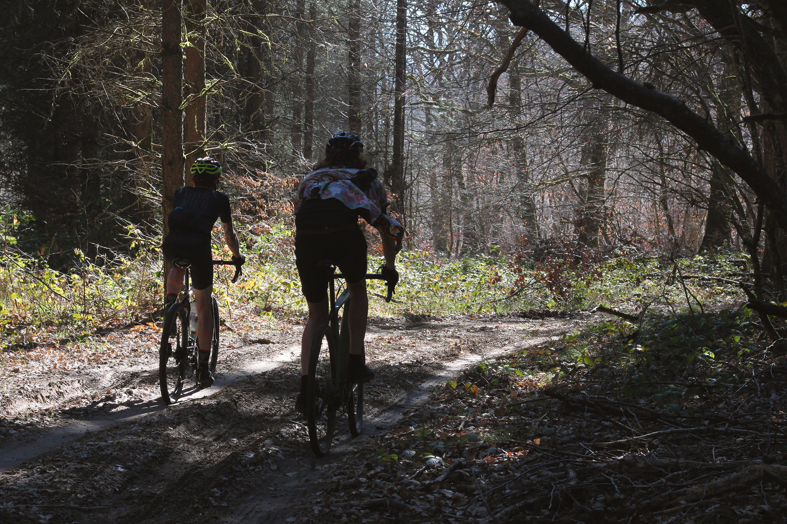
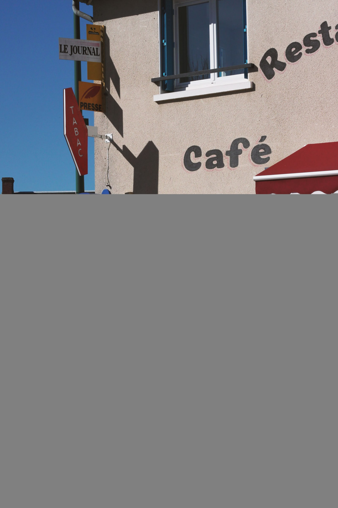

***Nevers mon amour.***

Nevers est assez méconnue pour le gravel. Nevers est assez méconnue tout court et c’est bien dommage.

> Les sensations sont là, le loisir aussi. Pause ravito obligatoire dans un PMU du cru.

<!-- image manquante : 2019/09/Nevers_001.jpg -->

Que faire à Nevers ?  
Boire “une“ pinte au Donald’s Pub, aller rendre visite à Swanee dans son shop Fée du Vélo, ou encore aller pécher le silure.  
On en a profité pour aller tester le biotope local. Nous étions sur site la veille pour le tournage de la vidéo de lancement du nouveau [Gravel LOOK 795RS](https://www.lookcycle.com/fr/velo/765-gravel-rs/), car oui, LOOK Cycle est basé à Nevers, l’usine, les bureaux, la DA, etc.

<!-- image manquante : 2019/09/Nevers_020_2-1024x682.jpg -->

On adapte une map trouvé sur internet, un savant mélange de *singletracks*, forêt et bords de Loire en mode *Strade Bianche*. On part du Campanile un peu tard (Donald’s Pub oblige…), on passe chez Swanee pour le café. Le shop est magnifique, un décor atypique pour un bike shop. Si vous êtes dans le coin, n’hésitez pas deux secondes.  
Il est temps d’aller rouler.

<!-- image manquante : 2019/09/Nevers_wide3.jpg -->  
Découverte du gravel pour Antho qui pour l’occasion roule la pointe de la technologie carbone du constructeur local. Les sensations sont là, le loisir aussi. Pause ravito obligatoire dans un PMU du cru. C’est l’été en février, on ride en manche courte (ça nous change des -2°c de la veille au matin sur le tournage, merci la post prod pour la retouche des lèvres bleues !), le micro climat nivernais à ce qu’il paraît.  
Un bien beau weekend.

<!-- image manquante : 2019/09/Nevers_004-1024x682.jpg -->

On reviendra pour la pêche au silure et continuer à découvrir les environs. Dernier atout de Nevers\*, depuis Paris c’est TER et qui dit TER dit tarif tout en douceur et pas besoin de démonter les vélos !

Nos régions ont du talent !

*\* aucune agence de lobbying Neversoise n’est intervenue dans la rédaction de cet article, on a vraiment beaucoup aimé sans déconner, allez-y !*

<!-- image manquante : 2019/09/Nevers_005.jpg -->

---

***LA MAP***

https://ridewithgps.com/embeds?type=route&id=31017057&title=PCR%20GRAVIER%20-%20NEVER%20EXPLORATION&metricUnits=true&sampleGraph=true&overlay=esriTopo

  
–  
**48km**  
**600m D+**  
**3h00**  
**–**

Photos : [Julien Sommier](https://www.instagram.com/julienpcr/)
