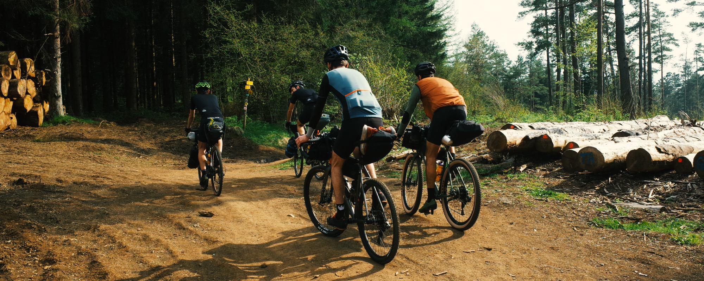

**Avec mon frère Mathieu Taulelle on se fait toujours surnommer « les Teuteul ». L’année dernière on s’est lancé dans notre premier trip en bike-packing sur les routes auvergnates depuis Paris. C’est ainsi qu’est** **né le concept de**  **« Teuteulade » : un label d’aventure à vélo faisant l’éloge de la camaraderie plus que de la performance. En 2018 on a décidé de remettre le couvert avec nos copains du PCR GRAVIER et du PIZZAYOLO.CC mais cette fois sur du gravier. Comme l’Auvergne nous avait fait plus d’effet que prévue, on s’est penché sur le tracé de la** **Grande Traversée du Massif Central** **aka la GTMC.**

<!-- image manquante : 2018/10/gtmc-gravel-teuteulade-map-.jpg -->

***1// MENU***  
*Le menu est la liste des divers mets qui composent le repas. Dans un restaurant, ou à la cantine, c’est l’ensemble des mets qui peuvent être servis pour un prix déterminé.*

On est en hiver à Paris et quoi de mieux pour s’occuper que de préparer un prochain trip à vélo. [La GTMC](https://www.la-gtmc.com/) est un morceau de choix et comme c’est une des plus anciennes traversée vtt, le stock d’informations est plutôt fourni sur internet, on trouve globalement vite réponse à toutes nos questions, sauf une : **« Est-ce que ça passe en Gravel ? »**. C’est bien la seule question qui divise la majorité de la communauté « Gravel Bike France » sur Facebook. Qu’à cela ne tienne on va vérifier ça par nous même ! La GTMC faisant peau neuve pour son 20ème anniversaire, on récupère vite une trace complète qu’on a plus qu’à diviser en étapes et à ajuster pour un détour chez les grands-parents.

On a aussi vu quelques reviews de restaurants sur TripAdvisor du type : **«Le patron du restaurant joue extrêmement bien l’homme bourré… A moins que ce ne soit pas du jeu ??!!»**. On se doit d’aller voir ça de plus prêt.

<!-- image manquante : 2018/10/gtmc-gravel-teuteulade-map.jpg -->

Samedi 5 mai à Clermont-Ferrand vers 13h. Nos castors parisiens transforment leurs vélos en sacs poubelles géants tandis qu’entre frangins on rejoindra notre point de départ depuis la Bretagne en voiture (#NosMamansOntDuTalent).

Accolade générale, excitation du départ, rapide pression des pneus et allumage de GPS. Pendant ce temps là une B-team s’organise pour aller acheter un casque à Élise qui à zappé le sien dans le train. **On a toujours pas roulé, mais l’aventure a déjà bien commencé.**

Depuis les préparatifs et le découpage des itinéraires, on à toujours eu un peu peur de cette première journée. Le brief : quitter Clermont-Ferrand pour prendre de la hauteur et se faire un bivouac à 60km de là. Sur le papier rien de fou à part les quelques **1800 mètres de D+ à grimper en si peu de kilomètres**, mais qu’importe ! On a soif de gravier et faim d’aventures.

***2// APERITIF***  
*Petit plat ou boisson alcoolisée qui ouvre l’appétit. Il est servi avant ou entre les plats d’un repas.*

Il est presque 14h et on s’élance sur nos vélos. La courte traversée de Clermont-Ferrand nous permet un bref échauffement car c’est seulement après deux ou trois kilomètres que commence notre ascension en direction du Puy de Dôme aka « le Puy de Doom ». On quitte rapidement la route pour se retrouver sur un chemin qui lui même se transforme en sentier pédestre avec quelques passages rocailleux.

Pendant que tout le monde essaie de refaire corps avec son vélo chargé, Pierre qui, en plus d’être déjà foutrement rapide sur la route, franchi tout **comme un petit cabri**. Il rend la chose presque facile à faire alors qu’on sait pertinemment que le poids de son vélo est plus proche de celui d’un Vélib’ que d’un vélo du Tour de France.

Passé cette première difficulté on contourne le « Puy de Doom » par le sud et s’offre à nous ce pourquoi nous sommes venu. Un enchaînement de chemins aussi beaux que fun à rouler avec uniquement des montagnes en guise de décor. **La chasse au fond d’écrans Windows est officiellement lancée**. C’était sans compter sur la première crevaison de Julien. On profite quand même du paysage et on l’attend dans un petit village en contrebas. Après vingt minutes on se décide à passer un coup de téléphone pour savoir ce qu’il en est. En réalité Pierre, Élise et Julien ne sont pas passés par le village et nous ont gentiment mis sept kilomètres d’avance. Ni une ni deux on remonte sur nos vélos bien décidé à rattraper notre retard. On en oublie presque de regarder le paysage tant le terrain est demandeur. On enchaîne quelques murs plutôt copieux aussi bien sur route qu’en gravier.

La légende raconte que Coach aurait même posé le pied sur une route goudronnée. Quelques temps après nous retrouvons le reste du groupe mais le soleil commence à se coucher, il est temps de trouver un restaurant.

Commence l’épopée du « où manger ?» et de tous ces restaurants fermés. Finalement un coup de téléphone et un faux plat de trois kilomètres plus tard avec coucher de soleil et **nous voilà accoudés au bar** du restaurant « Le Petit Balladou » dans le village de Pessade. Ce premier repas sera parfait. Énorme omelette et montagne de charcuterie à partager mais aussi du fromage et j’en passe. Pour couronner le tout **on est servi par la voisine psychanalyste** qui ne travaille pas là mais qui : « adore faire du service en salle de temps en temps. » On termine par la classique mais piquante poire du Chef et on file sous nos tentes. Nous camperons à 30 mètres du restaurant sur une base de loisirs.

<!-- image manquante : 2018/11/gtmc-gravel-teuteulade_011.jpg -->

***3//ENTREE***  
*En cuisine l’entrée est un plat chaud ou froid servi entre le potage ou les hors-d’œuvre et le plat principale.*

**Réveil fraîcheur sur la base de loisirs**. Pendant que certains plient le camp d’autres en profitent pour se faire un combo café/séchage de tente au soleil. Le Bike-packing en groupe génère souvent une inertie assez folle si bien que le temps de roulage effectif doit bien flirter avec celui de la niaise. Par exemple **le soir venu, Julien vide l’intégralité de ses sacoches dans sa tente** et pour le challenge, replace tout à un endroit différent le lendemain. Ceci dit, on est en vacances et se presser ne nous a pour l’instant même pas effleuré l’esprit.

Il est 10h, nous pouvons enfin partir. On décide ensemble de remplacer notre visite du Lac Chambon par un cassage de boulangerie à Murol.

***Bon à savoir : si vous êtes le premier à poser votre vélo lors d’un arrêt, il y a 99,9% de chance que tes amis aient toujours une préférence pour empiler leurs vélos sur le votre même avec 5 hectares à se partager.***

Il est 11h et on quitte Murol. On enchaîne des sentiers plus ou moins 4×4, on se conforte dans l’idée que pour l’instant, **la GTMC passe bien en gravel**. De plus la météo est avec nous et on peut dire qu’on a chaud, une pause piscine dans La fontaine de Besse-en-Chandesse pour baptiser tout ces castors s’impose. Vient ensuite le Lac Pavin et ses mythiques singles menant à la Godivelle. Le loisir est total sauf peut être pour Damien qui commence vraiment à regretter ne ne pas avoir quelques dents en plus sur sa cassette. Le pauvre homme à tellement forcé dans certaines ascensions qu’on raconte qu’après notre voyage, il avait les mêmes cuisses que Gregory Baugé.

<!-- image manquante : 2018/10/gtmc-gravel-teuteulade_129.jpg -->

Blague à part c’est pas le ventre creux qu’on arrivera à destination. J’avais repéré pendant mes recherches un restaurant parfait pour notre pause : « L’écir et l’angélique ». Cadre magnifique et lieu atypique mais quelques morceaux de fromage et 2 tranches de saucissons ne seront vraiment pas suffisant pour nous caler et l’assemblée décide de sortir le **Joker Yolo** (nourriture lyophilisée) pour ce midi, face à l’étang de la Godivelle.

La digestion est hardcore : 3km à travers champs à pousser le vélo avec 5 ou 6 portages au dessus des barbelés. Il nous faudra une bonne heure pour sortir de ce chantier aussi beau qu’impitoyable. Fort heureusement le gravier reprend de plus belle et nous sommes certains que : « Ce soir on sera à l’heure !». Après le village de La Boutaresse on contourne le Mont Chamouroux par le sud, qui sera notre point le plus haut du voyage. Cette ascension est exigeante mais on était loin d’imaginer la vue qui nous attendait la haut.

Un vrai 360° sur l’Auvergne à couper le souffle. C’était aussi le début d’une folle descente mi gravier, mis route jusqu’à Romaniargues. **Un passage à environ 70km/h de la route sur du gravier nous laissera à moi et coach un souvenir magique mais aussi terrifiant.** Après l’euphorie collective revient cependant le problème du « où est-ce qu’on mange ? »

On se rend compte que l’exode rurale est bien passée dans le coin et qu’il faudra sans doute pousser jusqu’à Murat pour trouver un restaurant ouvert. **La moitié du groupe est rôti**, genre vraiment et il nous reste 3km de route qui pour certains paraissent une éternité. C’était sans compter sur Pierre et Coach qui en ont toujours un peu sous la pédale pour pousser les copains dans les heures les plus sombres. **On est cuit mais ravis**, et après 100 kilomètres et 1900m de D+, on se gave à l’hôtel restaurant « Les Messageries » de Murat. Le stade qui est en face ne sera peut-être pas le plus beau coin pour camper mais il à le mérite d’être à 50 mètres du restaurant. La nuit sera bonne.

Depuis Clermont-Ferrand on s’est quand même mis en tête de ne pas perdre trop de temps car un passage chez les grands parents Teuteul est prévu depuis le début de l’aventure. **Pliage de tentes sur « Only You » de Steve Moonite** pour mettre tout le monde dans un bon mood et avec cette perspective de dormir au chaud ce soir on avance à bonne allure à travers chemins et petites routes pendant la matinée. Ça nous empêchera pas de passer sous quelques barbelés suite à des problèmes de GPS mais qu’importe, ça fait des belles photos dans les champs.

<!-- image manquante : 2018/11/gtmc-gravel-teuteulade_046.jpg -->

Pour la suite c’est sandwich éclair sur le parking du centre Leclerc de Saint-Flour histoire de se rendre compte qu’on peut vraiment construire des ZI dégueulasses dans les coins les plus cools de France. La digestion se fait sur le Mont Mouchet à la cool, chacun à son rythme. d’ailleurs avec Mathieu on a plutôt les mêmes goûts musicaux et on profite de ces moments où le groupe s’étire un peu pour mettre de la musique et grimper entre bros.

**Mathieu est un dromadaire, un maître de la régularité**. C’est l’homme qui te rappelle que tu es parti trop vite au début d’une montée, ou que tu as trop freiné pendant une descente. Bref il n’est jamais très loin !

<!-- image manquante : 2018/10/gtmc-gravel-teuteulade_130.jpg -->

Passé le Mont-Mouchet, on se met d’accord pour une bière au « Bar des Voyageurs » de Pinol, jusque là, quartier libre pour tout le monde sur une jolie route à flanc de collines. Ni une ni deux Coach et Pierre imposent un rythme de malade avec 5 castors en train de serrer les dents derrière eux. Ils finirons devant mais il faut avouer qu’en voyage à vélo, **un passage de route bien roulant peut s’avérer jubilatoire** après quelques jours sur des sentiers techniques. Bières pas volées dans un bar déjà mythique pour moi et Mathieu puis tout droit dans la descente de « l’Estivale » pour récupérer Mélanie qui nous attend à la gare de Langeac pour continuer l’aventure avec nous ! Dix minutes plus tard nous sommes chez les grands-parents. Une bonne partie de la famille est là et après une douche, un délicieux repas et quelques bonnes bouteilles plus tard, la nuit dans le dortoir des Teuteul sera bien silencieuse !

<!-- image manquante : 2018/11/gtmc-gravel-teuteulade_051.jpg -->

***4//PLAT PRINCIPAL***  
*Le plat principal est le principal plat servi durant un repas, et souvent le plus roboratif. Traditionnellement, en France au moins, il suit l’apéritif et l’entrée et précède le fromage et le dessert.*

Réveil douceur, ce matin on profite de la famille au maximum mais aussi de quelques litres de café. « Au revoir » collectif et photo de groupe qui finira sans doute sur la cheminée et en route pour Saugues. J’avais prévenu tout le monde : « commencez cette montée à la cool car c’est loin d’être une partie de plaisir. » C’est pas un col de montagne mais ça reste quand même **8 km à 7% de moyenne avec 5 pains au chocolat qui se battent dans le ventre.** Après un repas léger cette fois-ci, un bon café/bière s’impose dans le mythique « bar du Pont » à Chanaleilles.

Depuis une bonne heure on sent bien qu’un orage nous suit. On a déjà eu de la chance hier, car des trombes d’eaux sont tombées la veille pendant que nous comations chez les grands-parents au chaud. Manque de bol après le « Strade Bianche Auvergnat » autour du magnifique domaine « Le Sauvage », on se prend une averse de grêle, pas la petite non, celle qui dure 10mn et rend le sol complètement blanc en quelques minutes.

<!-- image manquante : 2018/11/gtmc-gravel-teuteulade_055.jpg -->  
Alors comme des castors, **on se regroupe les un contre les autres autour d’un arbre et on on boit du Genépi.** Après tout, vu le froid ça ne peut pas faire de mal. Quelques couches de Merinos en plus et nous voilà reparti sur un terrain de jeux plus que joueur. C’est roulant et fun : les virages, petits casses pattes et descentes s’enchaînent parfaitement autour de la « Réserve des bisons de la Margeride ». C’est aussi notre arrivée dans le département de la Lozère. Même Mother nature se fait plus clémente niveau météo. J’avais repéré avec Julien et Pierre un camping à coté d’un potentiel restaurant routier du côté de Laubert au nord-est de Mende.

On est accueilli par **un Chef de camping mi Cowboy / mi cellier / mi revendeur de champignons** qui nous explique que la nuit au camping sur le sol trempé nous coûtera sept euros par personne mais que si l’on souhaite, le gîte en face du resto est vide et nous coûtera dix euros.. Un simple regard vers le groupe et 3 secondes plus tard :

« On prend le gite ! »

Douche chaude pour le deuxième jour consécutif (c’est Byzance finalement la Teuteulade) et on se dirige au restaurant pour un combo bières / Aligot saucisses / Digestif de première classe ! Demain direction Florac avec un détour par le Mont Lozère.

<!-- image manquante : 2018/10/gtmc-gravel-teuteulade_131.jpg -->

Il est 9H et par miracle nous sommes déjà sur nos vélos. Le ciel bleu a part contre été remplacé dans la nuit par un épais brouillard. Qu’importe, on roulera à bonne allure jusqu’au Bleymard marquant le début de l’ascension vers le Mont Lozère.

Jusqu’en haut pas de surprise, Coach ouvre la route et nous met à tous 3 lacets d’avances en deux temps, trois mouvements. **Coach est une machine**, avant chaque grimpette ou bien dès qu’il prend la tête d’un relai, vous pouvez voir ses mollets grossir puis tourner de plus en plus vite et s’éloigner dans la poussière ou la brume. **Ceux qui on essayé de le suivre n’ont toujours pas donné de nouvelles**. En haut vous vous en doutez il fait un peu frais. Un petit thé au rhum nous fera donc le plus grand bien.

Photo de touriste et on redescend par des routes aussi belles que piégeuses. Direction le Puy-de-Montvert pour une pause boulangerie sur une terrasse au soleil. Notre après midi se résume en une chouette montée mais surtout en une folle descente ou l’on croisera des pompiers en plein shooting du nouveau calendrier. On cassera pas mal de chambre à air et de mon côté, je plie ma patte de dérailleur. Heureusement Mathieu en bon mécanicien vélo me résoudra le problème en moins de temps qu’il ne faut pour dire « Teuteul » et je pourrais continuer l’aventure. Nous voilà arrivés sans trop de douleurs à Florac.

<!-- image manquante : 2018/11/gtmc-gravel-teuteulade_079.jpg -->  
Cela fait maintenant trois jours que nous mangeons à chaque repas pour dix et on aurait pas dit non pour un simple plat de pâtes mais on vient d’arriver dans les Cévennes, pas la dernière région non plus en terme de yolo gastronomique. A défaut d’une pizza on refait le plein de calories dans un restaurant du centre. Sur les conseils d’une gentille serveuse on passera la nuit dans le parc du château, **haut lieu de camping sauvage de la région**. On trouvera d’ailleurs des voisins de bivouac le lendemain matin.

<!-- image manquante : 2018/11/gtmc-gravel-teuteulade_084.jpg -->

Ce matin tous les Castors sont en deuil. Mélanie décide de quitter l’aventure. Elle n’a pas trop envie de rentrer de vacances plus fatiguée qu’en partant et retournera à Paris en train. C’est à 8 qu’on continu notre route vers Saint-Enimi. Pendant mes recherches hivernales j’avais repéré un petit single-track longeant la route avec en tête **la possibilité d’un kiff plus intense** que celui de se faire doubler par une ribambelle de voitures et autres groupes de motards. Il s’est avéré qu’on a pas mal marché, faisant tourner l’horloge un peu plus vite que prévue.

On peut dire que c’était pas non plus la tasse de thé d’Élise. Faut dire que jusqu’ici, c’est la seule fille qu’on connaît qui est capable de franchir la GTMC sur un cyclocross avec des pneus en 32c et accessoirement de supporter 8 mecs qui veulent toujours la faire passer en vélo dans des endroits plus propices à la marche à pied qu’à la pratique du vélo. Mais qu’importe on est maintenant dans les Cévennes, son terrain de jeux favori, et on comprend mieux pourquoi.

Les Cévennes c’est un régal pour le vélo. Après une pause yolo à coté d’une vieille ferme on arrive enfin au pied du Mont-Aigoual. Ça commence à tirer un peu dans les cuisses de tout le monde c’est pourquoi **une courte PLS au sommet nous remet les idées au clair** et nous permet de profiter un peu de la vue du deuxième point le plus haut de notre voyage avant de redescendre comme des gosses vers Saint-Sauveur-Camprieu où « l’Auberge du Bonheur » nous régalera d’un plat chaud mérité et d’un « secret spot » bivouac entre la mairie et l’église du village. La soirée sera belle, mais la nuit bien fraîche.

***5// FROMAGES***  
*Le fromage est un aliment obtenu a partir de lait coagulé ou de produit laitier, puis d’un égouttage suivi ou non de fermentation et éventuellement d’affinage. Dans un repas le fromage, souvent présenté en assortiment sur un plateau, précède le dessert et suit le plat principal.*

Le lendemain matin, retour à l’auberge pour remercier la patronne pour ses bons conseils bivouac mais aussi pour un gros petit déjeuner à base de jambon de pays, fromages et autre joyeusetés locales. **« Avec ça dans le ventre la journée sera belle !»** nous lance la patronne. « Ah ça oui M’dame ! »

Elle a eu raison. Notre itinéraire commence par de la descente au départ de Saint-Sauveur-Camprieu avant une courte mais très raide ascension. Le Début d’une ascension sur la Teuteulade sera toujours synonyme d’un moment **« Radio Hugisme »**. La radio de Hugues se composant que de deux titres, « voyage voyage » de Desireless et… « Voyage voyage » de Desireless aussi. A peine ce CD deux titres terminé nous voilà perdu sur un sentier de randonné sans issue. On ne s’est pourtant pas trompé sur l’itinéraire mais après quelques aller et retour on se rend bien compte qu’il y a un problème sur notre droite :

Plus de pont !

On trouve un semblant de passage, on s’entraide pour porter nos vélos et une demie heure plus tard, nous revoilà en route vers la Dourbie et plus précisément au snack bar « chez Sylvie » qui n’a d’ailleurs rien d’un snack bar. Pâté de campagne maison à même le plat, ravioles par milliers et tropéziennes de 8 kg pièce. Digestion PLS une fois de plus et ça tombe bien car on a une belle côte pour digérer.

<!-- image manquante : 2018/11/gtmc-gravel-teuteulade_106.jpg -->

Heureusement on sait pertinemment que tout ce qui monte finit toujours par redescendre : c’est une autoroute de graviers fins qui doit nous conduire jusqu’au Larzac. A mon habitude, chaussé de pneus en 27,5×2,2, j’aborde cette descente en **« full Nasa mode »** c’est à dire toujours un peu plus vite que de raison, suivit de Julien. La seule différence c’est que plus on se rapproche de Montpellier, plus le terrain se fait cassant et la chambre à air éventrée de Julien en est la parfaite illustration. Réparation minute puis changement de décor.

Nous voilà tous au Larzac ! La GTMC nous emmène sur des pistes aussi belles que roulantes jusqu’à la Couvertoirade, dernier village templier de France, pour une folle soirée avant Montpellier. A notre habitude nous mangerons un plat simple et équilibré. FAUX !

<!-- image manquante : 2018/10/gtmc-gravel-teuteulade_132.jpg -->

***6// DESSERT***  
*Dans la culture occidentale moderne, le dessert est le dernier plat servi au cours d’un repas, typiquement composé d’aliments sucrés comme les fruits, pâtisseries, sorbets, ou flans.*

La nuit sera très fraîche et la météo du jour n’est clairement pas réglée sur le mode fun. On se lance donc à l’assaut d’un gravier des moins accueillant. Depuis la veille on avait déjà senti la différence en roulant. **Les racines ont peu à peu laissées place à des cailloux avides de sealant et de chambres à air**. Cette dernière journée ne déroge pas à la règle et c’est Élise qui lâche l’affaire en première pour un tout droit par la route jusqu’à Montpellier. Le reste des troupes se motive pour continuer sur la trace mais ils nous faudra pas plus de 15mn pour comprendre qu’Élise avait sûrement fait le bon choix.

**Sans rentrer dans les détails, on à du parcourir 5km en 1h30** et après avoir épuisé notre stock de rustines et de chambres à airs, c’était au tour de Pierre de déchirer le flanc de son pneus tubeless avec en cadeau beaucoup de sealant pour ses sacoches et mes pieds. La fatigue est bien présente pour tout le monde et comme à la fin de chaque aventure, la motivation baisse toujours un peu quand on sait que la ligne d’arrivée est toute proche. On se dit finalement qu’on a peut-être mangé assez de graviers ces sept derniers jours et on décide donc à notre tour de prendre la route mais c’est bien après plusieurs heures et en puisant dans nos dernières ressources qu’on arrive enfin à Montpellier. On retrouve Élise mais aussi le Frère de Julien ainsi qu’Enzo de la Nuitnoir.cc pour quelques bières dans les rues de Montpellier.

<!-- image manquante : 2018/11/gtmc-gravel-teuteulade_122.jpg -->

J’avais prévu un finish au soleil pour tout le monde à Marseille donc ni une ni deux nous voilà dans un TER direction Marseille pour une **maxi douche et une tempête de pizzas** si chère au [Pizzayolo.cc](https://www.instagram.com/pizzayolo_cycling_club). On est par contre toujours à la recherche du soleil du mois de Mai.

***7// DIGESTIF***  
*Un digestif est une boisson, alcoolisée, qui se prend habituellement à la fin d’un repas, et qui est censée faciliter la digestion et revigorer à la fin d’un long repas.*

8 jours, 8 vélos et un nombre infini de calories ingérées puis transpirées. On peut dire que l’Auvergne et plus généralement la France nous a encore mis bien. **La GTMC est définitivement l’une des plus belles traversée off-road que l’on peut faire en France.** Le nombre de paysages et de chemins magiques prennent le dessus sur toutes les galères qu’on n’a pas eu le temps de prévoir à l’avance, c’est sûr !

En attendant avec Mathieu on se dit que la chose la plus cool du voyage c’était pas forcement l’itinéraire en soit, mais plutôt le fait qu’on arrive à faire voyager avec nous ce groupe de joyeux copains à travers le pays, **et ça c’est Teuteulade Approuved !** La semaine prochaine par contre on ira tous jouer au loto, car il paraît qu’il y a 10 centimètres de neige un peu partout en Auvergne …

Ah oui et au fait. La Grande Traversée du Massif Central, ça passe en Gravel !

[TEUTEULADE](https://www.instagram.com/teuteulade/) ~ [PCRGRAVIER](https://www.instagram.com/pcrgravier/) ~ [PIZZAYOLO.CC](https://www.instagram.com/pizzayolo_cycling_club/)

---

***LA VIDÉO***

https://player.vimeo.com/video/273664131?color=6b7b5d&title=0&byline=0&portrait=0

---

***LA MAP***

https://ridewithgps.com/embeds?type=route&id=29000401&metricUnits=true&sampleGraph=true&overlay=esriTopo

**–**  
**640km**  
**8 jours**  
**11860 D+**  
**–**

Photos : [Mathieu Taulelle](https://www.instagram.com/a_bicyclette_bien_sur/) ~ [Simon Taulelle](https://www.instagram.com/sims_teuteul/) ~ [Julien Sommier](https://www.instagram.com/julienpcr/) ~ [Damien Veau](https://www.instagram.com/bravoveau/)
