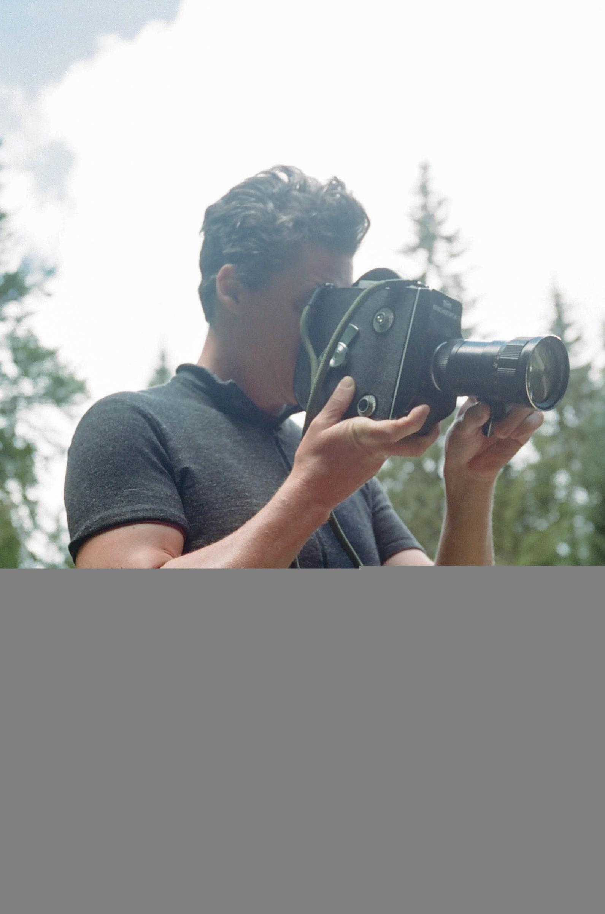
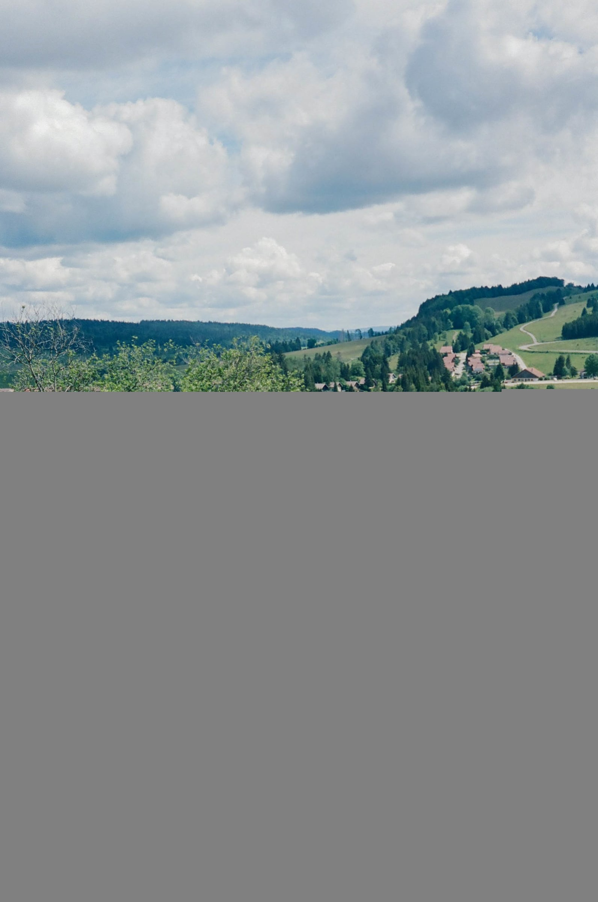
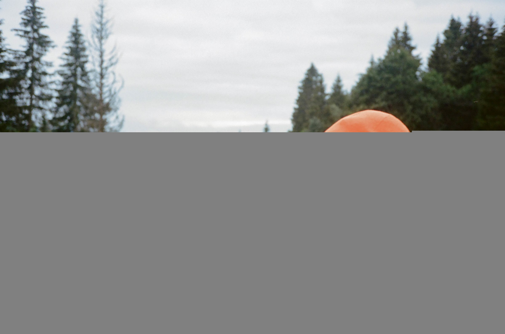
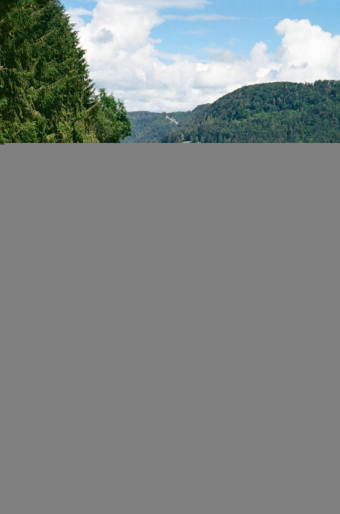
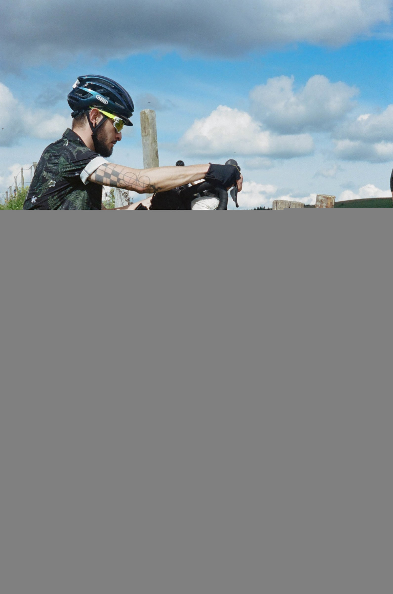

> A Bikepacking Adventure filmed in glorious 16mm in the Jura-Sick Park

La grande mode dans le cyclisme moderne, c’est d’avoir le vélo le plus léger du monde, et de claquer des sommes folles pour des gains qui se comptent en grammes. Au PCR Gravier, on trouve ça complètement con.

Alors du coup, on hésite pas à ajouter des kilos sur le vélo. De la bouffe, des popotes, du matos de camping, des appareils photos des années bissextiles… si bien qu’on se retrouve avec [des bécanes de 25 kilos](/camera-bag/) à trainer dans la pampa.  
On en arrive à un point ou on est plus à un ou deux kilos près… du coup pour cette grande traversée du jura, c’est une caméra 16mm russe de 1971, et son optique « Meteor » que Renaud a emporté dans ses sacoches. Le tout pour la modique somme de 3 kilos sans la pellicule.  
Vous trouvez ça complètement con ? Qu’à cela ne tienne !

Voilà le film réalisé pendant notre périple, un film 100% analogique, à base de 16mm donc, mais aussi de photos prises avec divers bijoux d’horlogerie tel le Rollei 35s, le Leica M2, ou le Contax TVS. Un film qui vous emmènera au cœur d’une question qui obsède l’humanité depuis toujours : comment trouver l’esprit GRAVIER.

**~**

The big fashion in modern cycling is to have the lightest bike in the world, and to spend huge sums of money for gains that can be counted in grams. At PCR Gravel, we find it completely stupid.

In fact we don’t hesitate to add kilos to the bike. Food, meals, camping equipment, leap year cameras… so much so that we end up with [25 kilo bikes](/camera-bag/) to ride around the pampas.  
We get to a point where we are one or two kilos away… So for this great crossing of the jura, it is a Russian 16mm camera from 1971, and its “Meteor” optics that Renaud took with him in his bags. All this for the modest sum of 3 kilos without the film.  
Do you think it’s completely stupid? It doesn’t matter!

Here is the film made during our trip, a 100% analogue film, based on 16mm, but also photos taken with various watchmaking jewels such as the Rollei 35s, the Leica M2, or the Contax TVS.  
A film that will take you to the heart of a question that has always obsessed mankind: how to find the GRAVIER spirit.

---

***Le Film***

https://player.vimeo.com/video/453605188?color=6b7b5d&title=0&byline=0&portrait=0

**–  
330km  
6500 D+  
4 Jours  
–**

Video : [Renaud Skyronka](https://vimeo.com/skyronka)
