**VENI VIDI BICI**

Chaque été depuis 3 ans, le temps s’arrête pendant 8 jours, et nous partons faire du vélo le plus éloigné possible des voitures et des immeubles. Nous partons en autonomie, avec tout le nécessaire pour nous débrouiller pendant une semaine.

> **Notre confrontation avec la réalité sera plus violente que prévu. Pour faire simple, ce que nous avions identifié comme étant des sentiers s’avère être des chemins de randonnée, avec leur lot de pierres à escalader, de flanc de falaise, de passages de guet, et d’arbres en travers. Rien d’impossible, mais une perte de temps incroyable pour nous.**

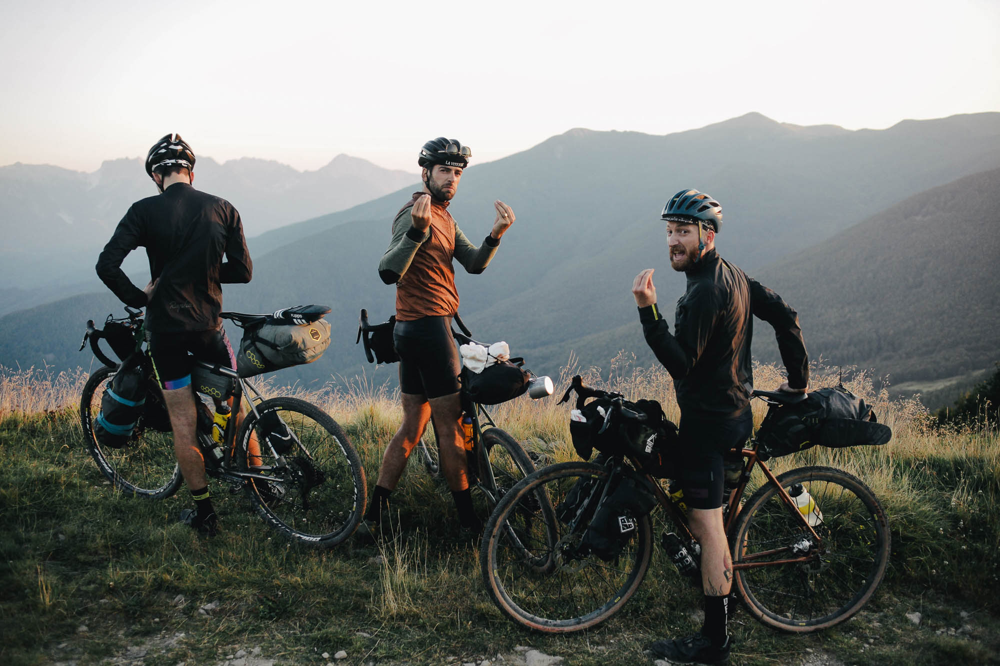

Pendant toute l’année, nous réfléchissons à ce que seront ces 8 jours. On pense au pays, à la région, aux montagnes, aux chemins, à la manière de s’y rendre, à celle de rentrer une fois le chemin accompli. **On passe un certain temps aussi à tracer cet itinéraire**, sur ordinateur, en zoomant le plus possible sur les images satellites disponibles, en sachant pertinemment qu’au niveau du sol rien ne sera comme vu de l’espace.

Cet été, nous sommes partis **en Italie, dans le nord des Apennins**, cette chaîne de moyenne montagne qui coupe la péninsule dans le sens de la longueur sur 1200 km. C’est un terrain de jeu quasi infini dont nous n’aurons qu’un rapide aperçu. De ce voyage, on pourrait parler de la beauté des paysages, de la nature luxuriante italienne, de son climat méditerranéen idéal.

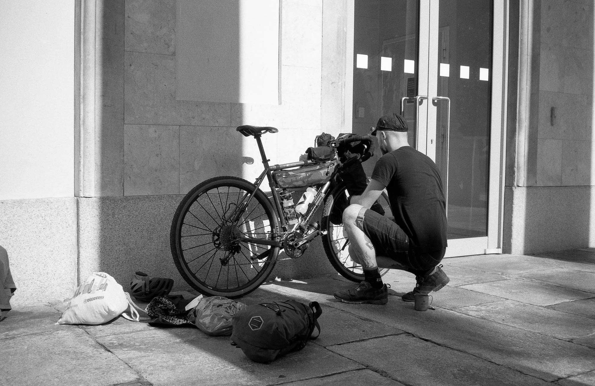

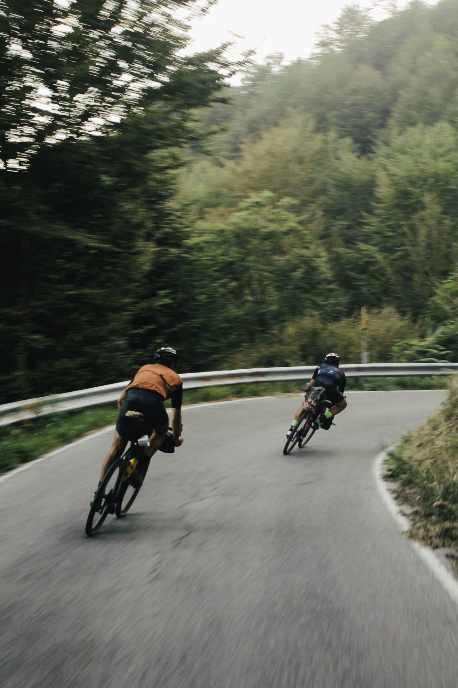

On pourrait parler de la qualité des routes et des chemins, de l’accueil des autochtones et des festins de toute première catégorie, même au fin fond de la montagne. On pourrait parler de l’enchaînement de chaque journée de vélo, où il nous fallait 2 h pour se préparer chaque matin, puis 12 h sur la selle à suivre le petit trait noir sur notre GPS, les yeux écarquillés. Planter notre toile de tente au plus bel endroit possible au milieu de la nature la nuit tombée pour s’effondrer dans les bras de Morphée en 3 minutes chrono. On aurait pu parler de tout ça. Du voyage idéal.

Mais qui aime savoir que tout se passe bien, que les routes sont jolies et que les pizzas sont bonnes ? Personne.

**Il n’y a d’aventure que lorsque rien ne se passe comme prévu**, et, quel que soit le temps passé sur Google Street View pour préparer l’itinéraire, quel que soit le nombre de visites sur “Météo Earth” pour savoir s’il fera beau, il est strictement impossible de tout prévoir. S’il fallait résumer notre périple italien en un mot, ce serait sûrement celui-là : **imprévisible**.

<!-- image manquante : 2018/10/VVB_ITALY_GENOVA_FLORENCE_GRAVIER_DIGITAL-25.jpg -->

***L’itinéraire impossible.***

En 8 jours, à 7 cyclistes et sur des sentiers muletiers, on peut raisonnablement envisager de parcourir entre 500 et 800 km. Notre méthode consiste à chercher dans un premier temps des itinéraires ayant déjà été empruntés par des cyclistes de notre catégorie, de récupérer leur trace GPS, puis de l’adapter en fonction de nos points de départ et d’arrivée pour en faire un voyage sur mesure.

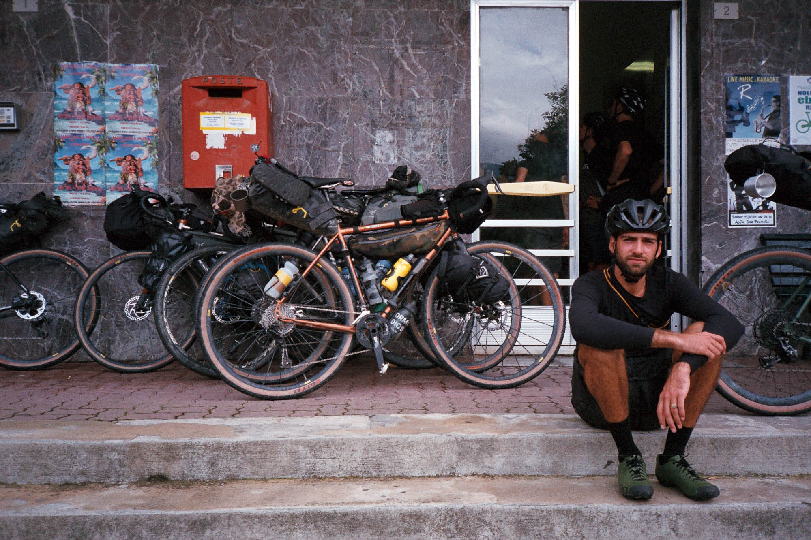

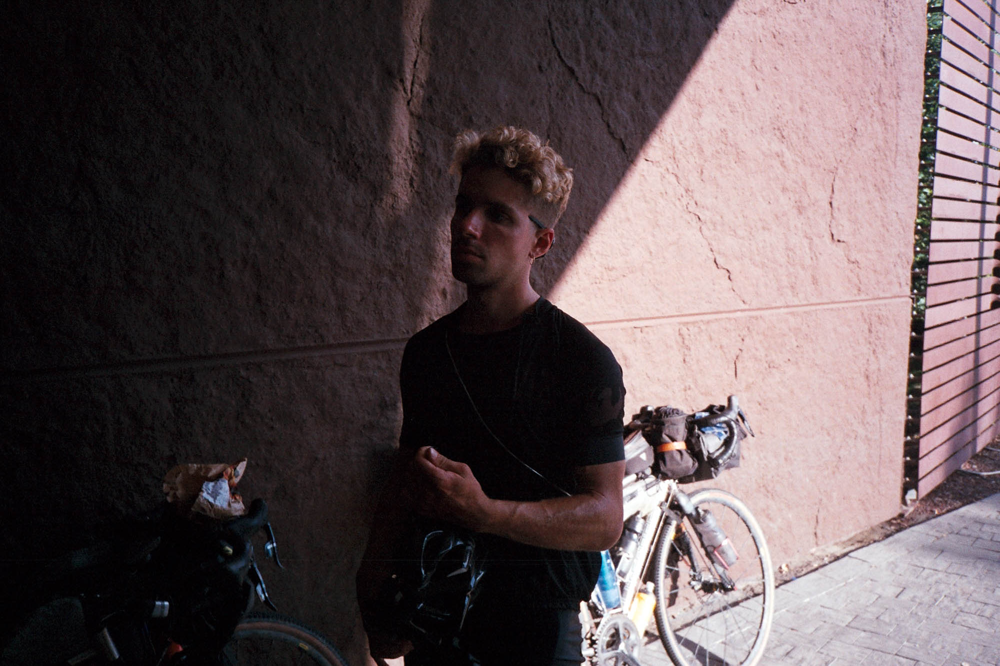

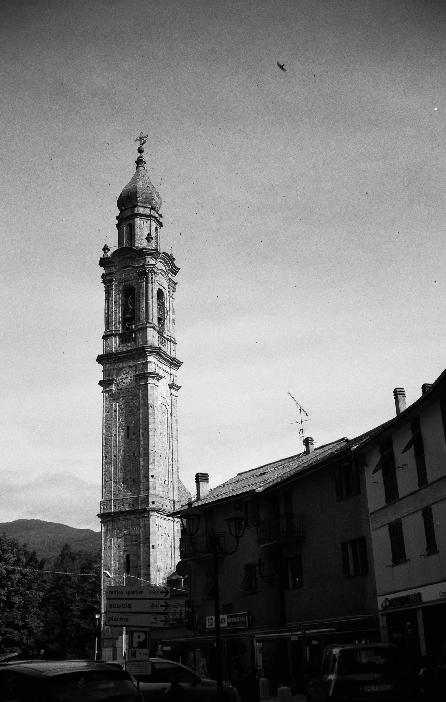

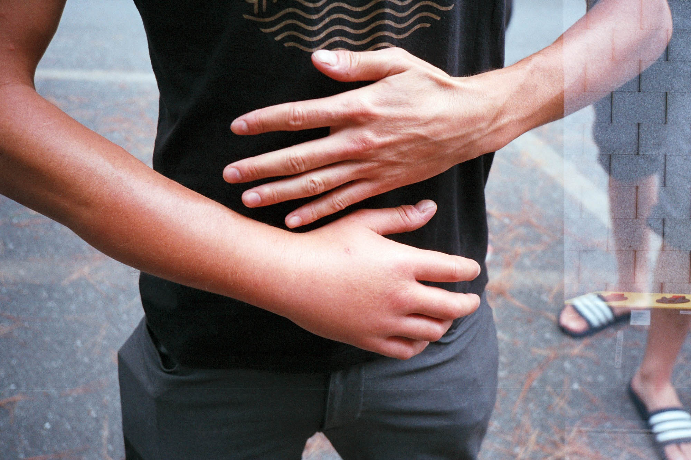

Cette année, nous avions repéré sur le site [bikepacking.com](http://www.bikepacking.com/), une trace reliant Vintimille à La Spezia en suivant la Via Alta Ligurie. Ce sentier semblait complexe avec beaucoup de dénivelés, mais à notre portée. Notre idée étant de **partir de Gènes, puis de terminer à Florence** (avant tout pour des raisons logistiques, mais aussi pour « voir Florence et mourir ») il fallait trouver un moyen de continuer vers Florence depuis La Spezia, en remontant dans les montagnes. Pour cela, nous allons suivre le [Grand Italian Trail](http://www.bikepacking.it/grand-italian-trail/). Une trace de plusieurs centaines de kilomètres qui traverse l’Italie du nord au sud, réputée pour être particulièrement grandiose. **Voilà pour la théorie**.

Nous avons donc à notre disposition une trace GPS sur un fond de carte. La moitié déjà empruntée par des vélos, l’autre non. À ce stade du travail, la seule chose que l’on peut faire, c’est émettre des hypothèses.

*« Ce sentier est pendu, mais large »*  
*« Celui-ci semble être dans la forêt, mais on peut y voir les deux lignes de traces de 4×4 »*  
*« Là, on ne voit rien, et c’est impossible de savoir si ça passera »*

Le fond de carte nous aide aussi. Deux traits pleins, c’est une route ; deux lignes en points tillés : c’est un chemin carrossable ; **une ligne en pointillé** : c’est un sentier. Quelle sera sa largeur ? Son revêtement ? Impossible de le savoir sans y mettre les pieds. C’est donc avec toutes ces hypothèses que nous montons dans le train de nuit en direction de Gènes.

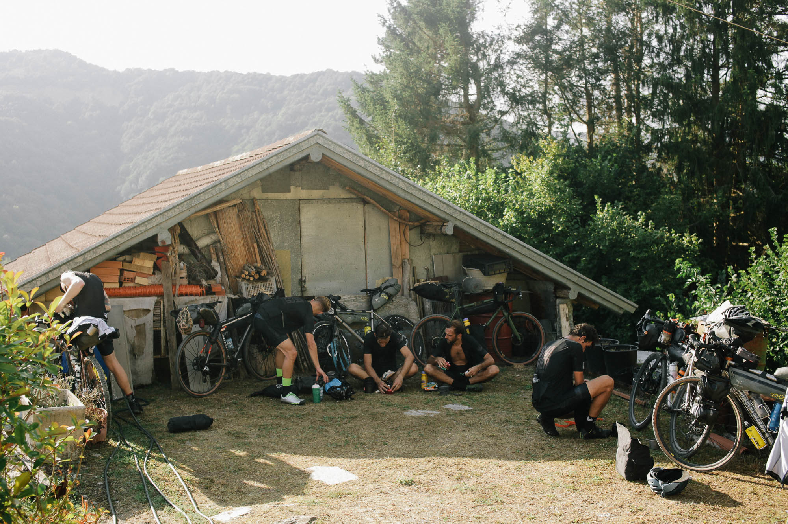

Notre confrontation avec la réalité sera plus violente que prévu. Pour faire simple, ce que nous avions identifié comme étant des sentiers s’avère être des chemins de randonnée, avec leur lot de pierres à escalader, de flanc de falaise, de passages de guet, et d’arbres en travers. Rien d’impossible, mais une perte de temps incroyable pour nous.

Si l’on peut raisonnablement envisager rouler à 20 km/h de moyenne sur un revêtement praticable, la moyenne chute à 4 ou 5 km/h dans ces conditions, où la difficulté du parcours s’ajoute au poids de nos vélos et de nos équipements. Il est alors impossible de tenir les délais. Impossible de parcourir les 80 km quotidiens, impossible de planter nos tentes avant la nuit.

Notre semaine sera ponctuée de réévaluations d’itinéraires sur site. **Téléphone dans une main, montre au poignet et GPS dans l’autre**. Nous contournerons les lignes simples en pointillé, qui deviendront notre hantise. Sauf bien entendu lorsqu’elles seront la seule manière de changer de vallée ou de rejoindre un village sans faire 40 km de détour. Ce qui s’avérera être le cas dans 80 % des cas ! Alors nous mettons pied à terre et nous poussons

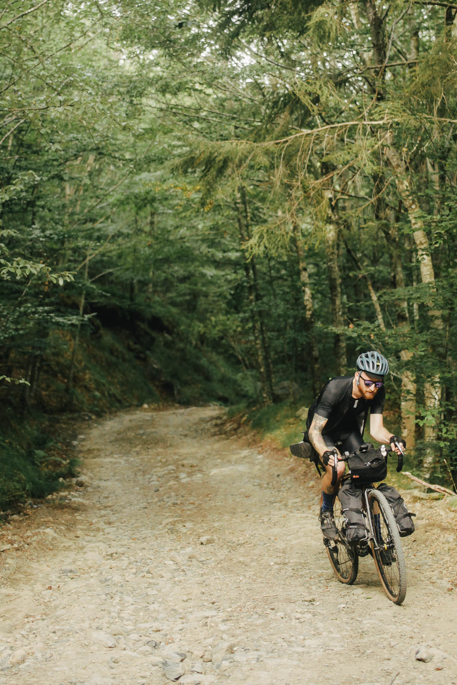

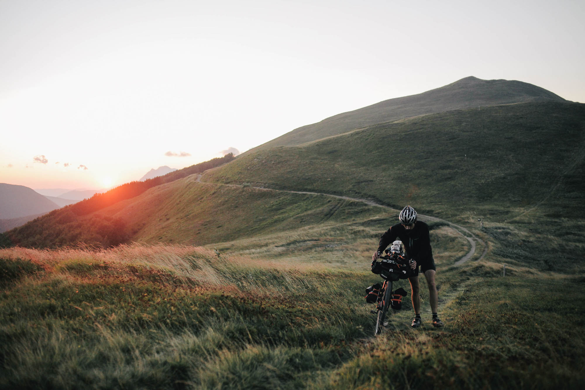

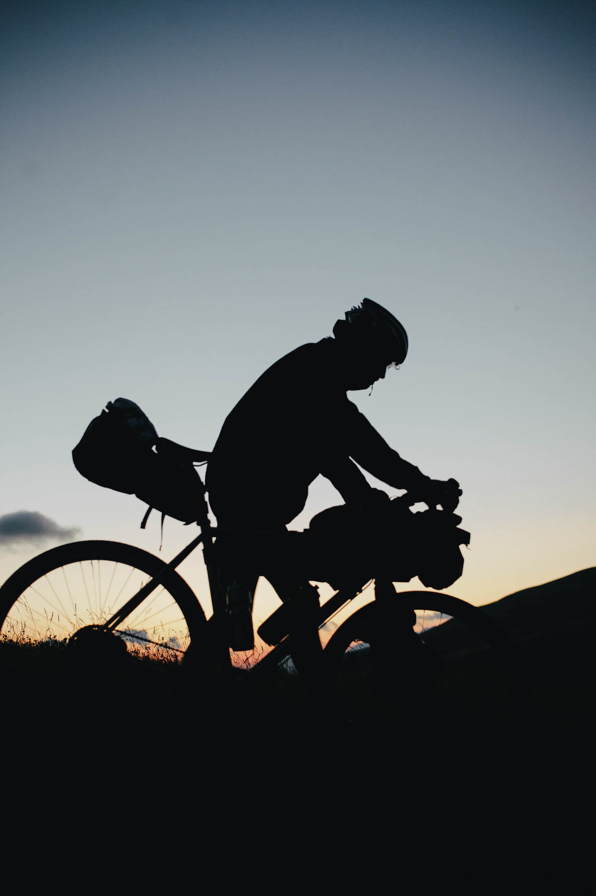

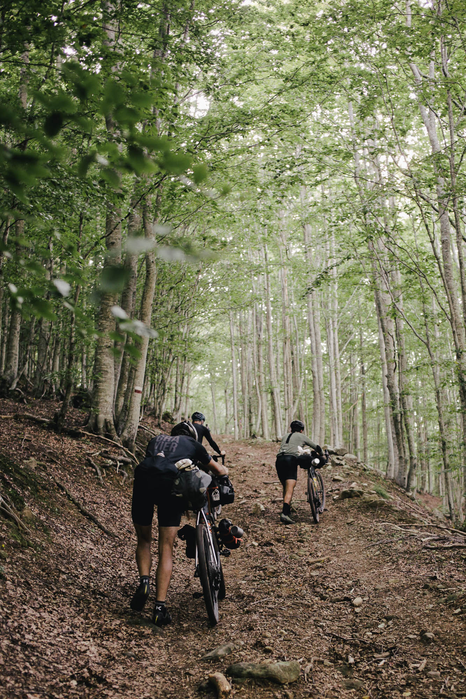

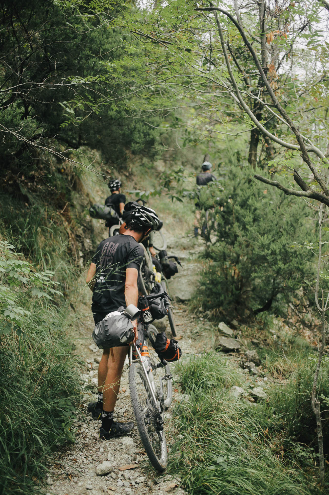

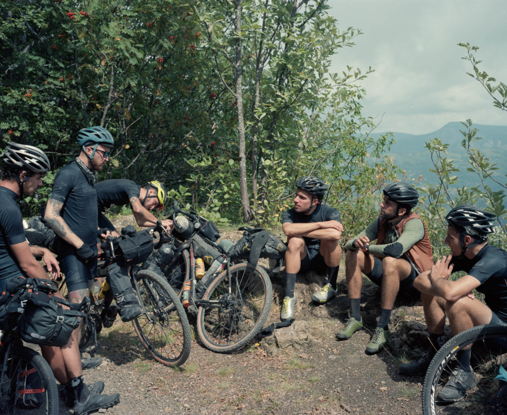

***L’erreur humaine.***

Le vélo, en plus d’être un moyen d’évasion, est d’abord pour nous un moyen de transport au quotidien. Nous roulons tous plusieurs milliers de kilomètres annuellement dans les rues de Paris, Marseille, Belo Horizonte ou Copenhague. C’est d’ailleurs en ville que nous nous sommes tous rencontrés via le collectif Paris Chill Racing. Ce n’est que dans un second temps que le collectif Gravier est né, regroupant **le noyau dur ayant soif d’aventures.**

<!-- image manquante : 2018/10/VVB_ITALY_GENOVA_FLORENCE_GRAVIER_DIGITAL-26.jpg -->

D’abord 5 lors de notre premier périple, nous sommes aujourd’hui 9. Impossible de couper aux lois mathématiques : **plus on est de fous, plus on a de chances d’avoir de la casse**. Notre ballade italienne ne dérogera pas à cette règle. Ainsi, chacun ou presque y est allé de son souci de santé, de son problème mécanique, de son erreur de tracé.

La palme revient tout de même à Louis. Incontestablement le plus athlétique du groupe, il roule bien souvent en tête, et il n’est pas rare qu’il oublie de regarder les virages sur son GPS, et qu’il rate une intersection en pleine descente lancé à 70 km/h. Il sera également le blessé du voyage. Une chute dans un virage lancé à pleine vitesse lui vaudra une belle pizza sur la cuisse droite, et une vilaine chute à l’arrêt dans le dévers suite à une bête perte d’équilibre se soldera par une légère entorse. Elle ne l’empêchera pas de pédaler, mais réduira au strict minimum ses capacités de portage et de marche dans les secteurs graviers les plus engagés.

De quoi couper une journée complète dans les montagnes pour trouver un centre hospitalier et récupérer l’itinéraire du lendemain. **Un pour tous, tous pour un**. Pas question de se séparer en plein milieu du voyage pour des raisons de revêtement ! Après tout, qu’avons-nous raté à part des lignes pleines et des pointillés sur la carte ?

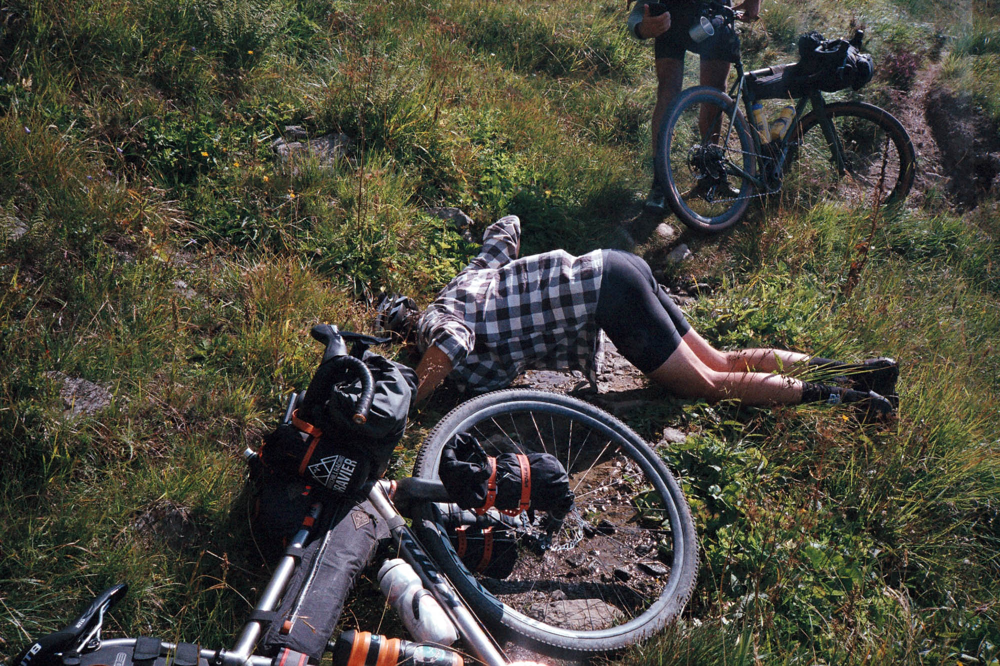

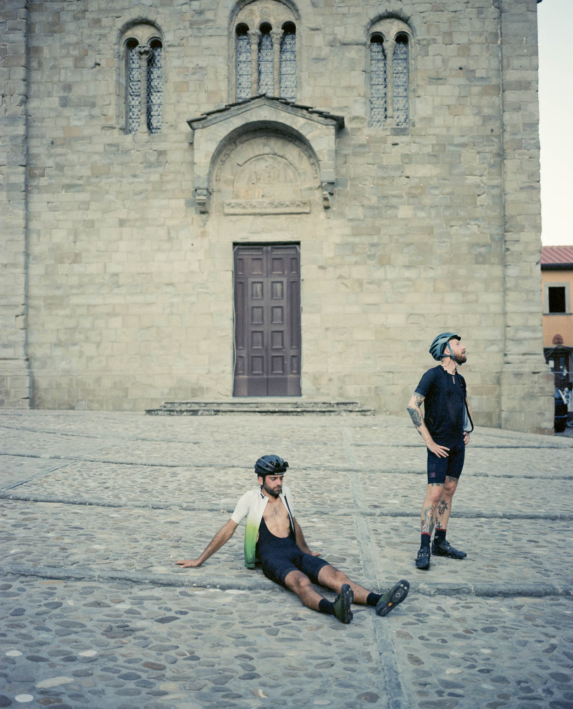

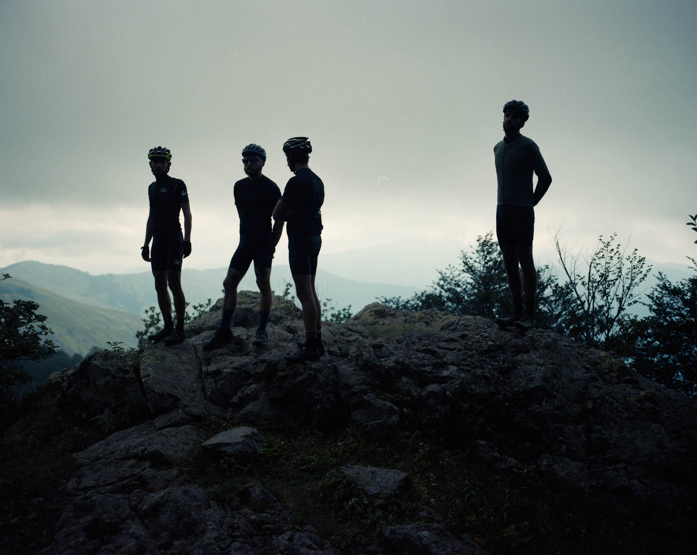

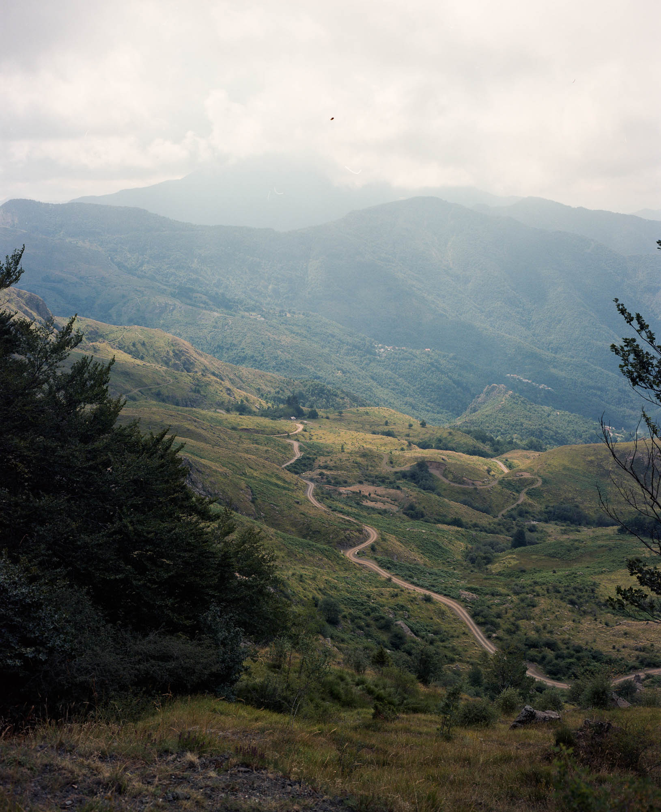

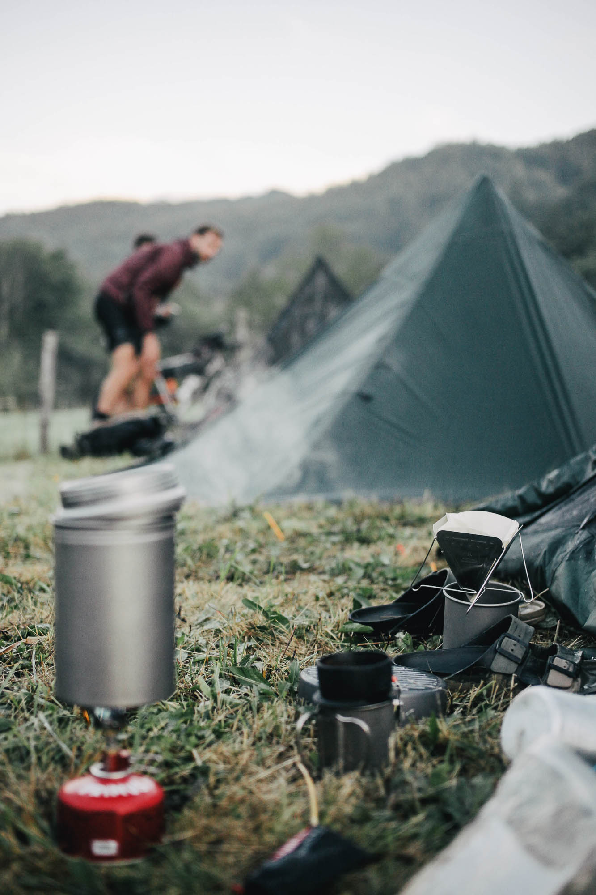

***Mère Nature.***

C’est incontestablement **les facéties de la nature** qui auront remis en question notre périple. C’est à elle que l’on doit l’abandon d’un de nos camarades de jeu suite à un concours de circonstances pour le moins rocambolesque. À l’issue du deuxième jour, après une averse dantesque et une réécriture de l’itinéraire pour éviter une ligne en pointillée que nous imaginions recouverte de 30 cm de boue, nous décidons de rejoindre la cité balnéaire de Deiva Marina pour y trouver un camping à l’abri.

Un fois sur place la nuit tombée, nous repérons une sorte de chantier abandonné où deux villas semblent avoir été laissées inachevées sur le front de mer non loin de l’entrée de la ville. Nous y trouverons deux maisons fermées à double tour, mais également **une sorte de pool house de 8 m par 3** qui nous semblera absolument parfait pour y passer la nuit. Ouverte aux quatre vents et jonchée de débris de chantier, c’était loin d’être un palace, mais notre sens des priorités et l’orage imminent nous pousse à y passer la nuit.

<!-- image manquante : 2018/11/VVB_ITALY_GENOVA_FLORENCE_GRAVIER_ANALOG-13.jpg -->

Tous, sauf Pierre et Julien qui décidèrent de tout de même planter leur tente. La chaleur, l’état du sol et la perspective d’être entassés les uns sur les autres n’y étaient sûrement pas pour rien. L’orage éclate. La pluie commence à tomber à seaux. Le vent se lève. Nous sommes tous les 7 dans notre pool house en train de manger quand une bourrasque fait tomber nos vélos dehors et nous détrempe de pluie à travers les barreaux qui servent de fenêtres. **Louis demande à Pierre si leur tente est bien plantée**. Moment de silence. Bien entendu qu’elle est plantée, et bien même ! Dehors, plus de tente. Juste la bâche qui l’isole du sol et 8 sardines orange.

Plus  
de  
tente.

Le vent l’a emportée. Pas dans un bosquet, ou quelques mètres plus bas non… le vent l’a emportée avec lui là où le vent emporte les choses. Elle n’est plus là. Le passeport, les duvets et les matelas qui étaient à l’intérieur ne sont plus là bien entendu… Cet épisode nous vaudra un second jour de raté, pendant lequel nous chercherons la tente, en long en large et en travers sur le bord de mer, sans succès. Il nous faudra trouver du matériel de camping pour remplacer celui disparu dans la tempête…

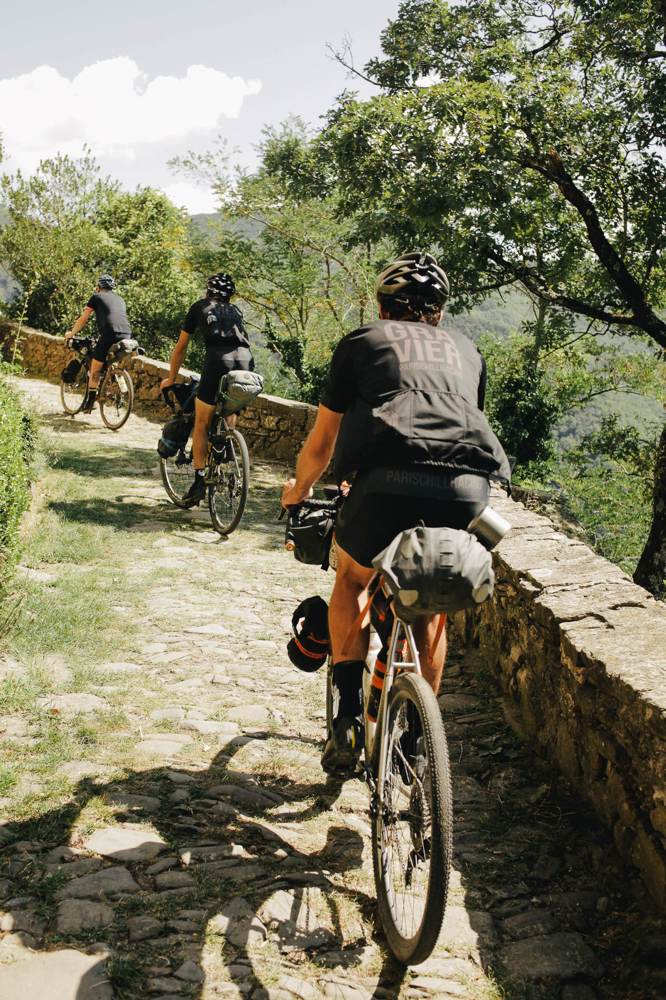

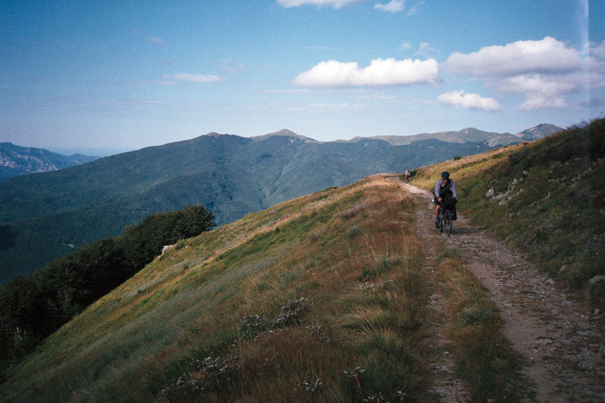

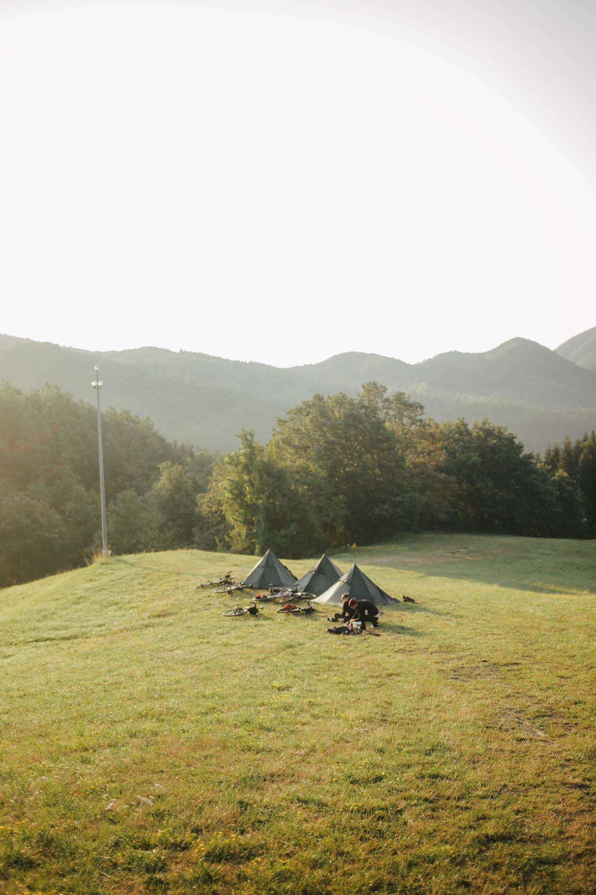

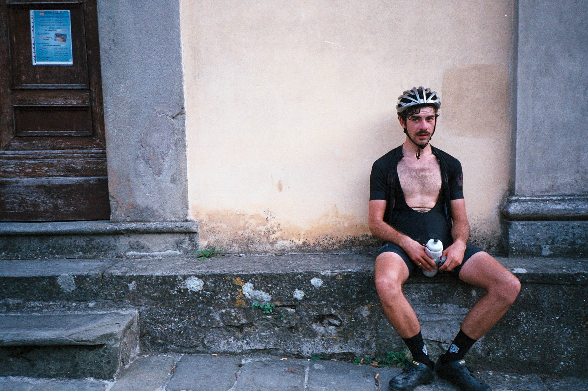

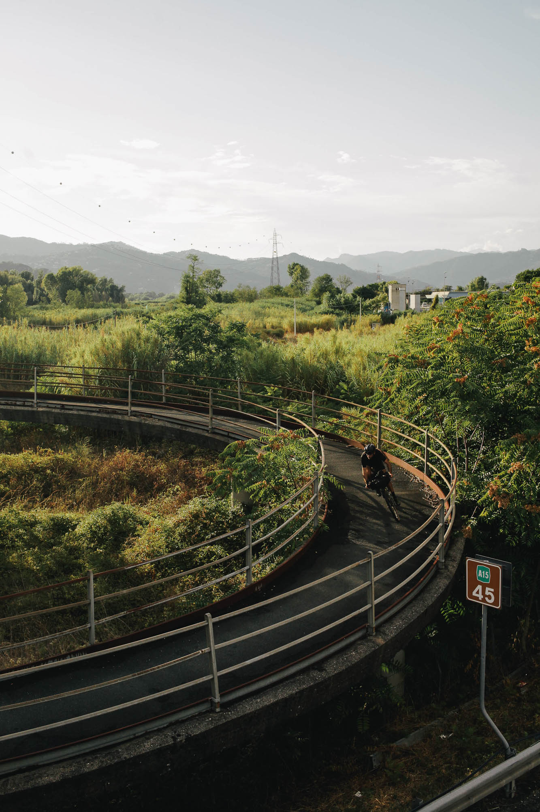

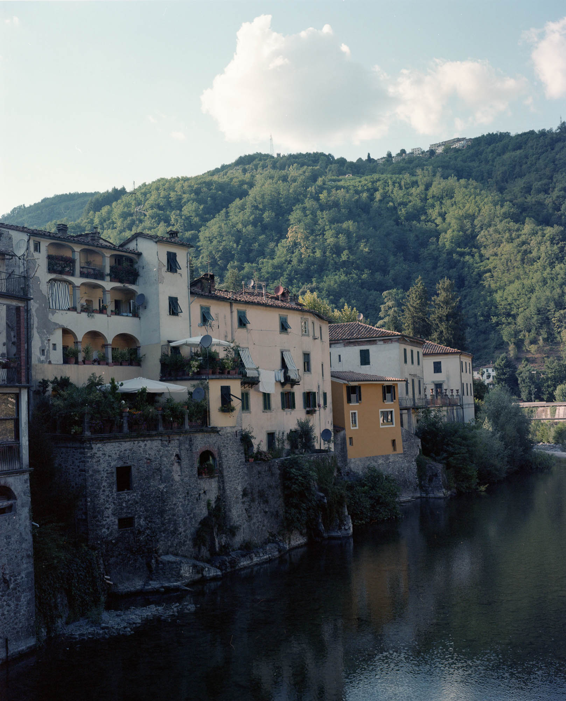

La route vers le décathlon le plus proche aura raison de Pierre et de sa patte de dérailleur.  
Cette petite pièce sert à fixer le dérailleur au cadre du vélo. En cas de choc, contre un rocher ou une souche, et c’est cette patte qui se brise ou se tord plutôt que le vélo. C’est un fusible. **Le fusible de Pierre va donc se tordre au pire moment** du voyage. N’en ayant pas de rechange, c’est donc la fin de l’aventure qui sonne pour lui au terme de 24 heures apocalyptiques dont nous nous souviendrons longtemps.

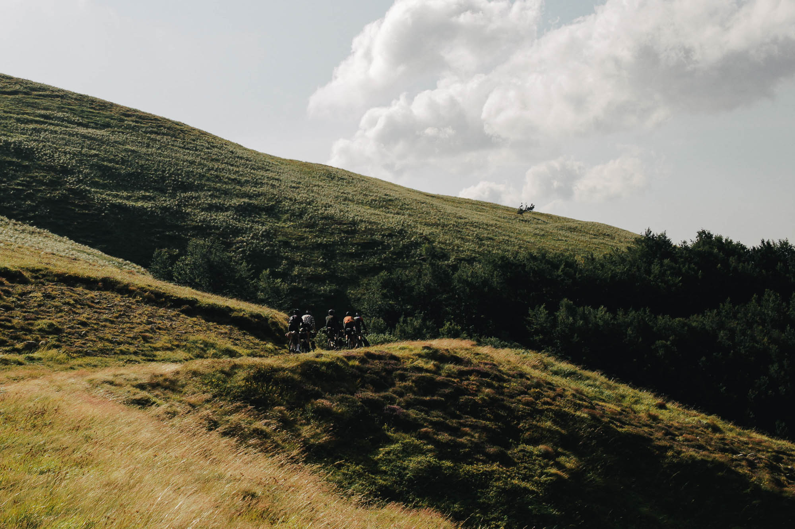

J’entends déjà d’ici les aventuriers aguerris qui nous diront qu’on s’y prend comme des manches et qu’un voyage peut s’organiser mieux que ça. C’est vrai. Mais on apprend toujours de ses erreurs, et **personne ne fait d’erreurs au fond de son canapé.**

Notre aventure italienne nous aura appris 3 choses. La nature ne fait pas de cadeaux, sauf peut-être les mirabelles au bord de la route… Le matériel est fait pour casser un jour ou l’autre, le vélo n’est pas adapté aux chemins de randonnée pédestre.

Voilà qui, une fois pris en compte, devrait nous faire gagner un peu de temps l’année prochaine. Il sera sûrement question de bateaux gonflables, de pays de l’Est, de [col du Parpaillon](/parpaillon/) et de gastronomie locale. **La seule chose dont nous sommes à peu près certains, c’est que rien ne se passera comme prévu**. Espérons qu’on rentrera entiers, avec beaucoup d’histoires à raconter.

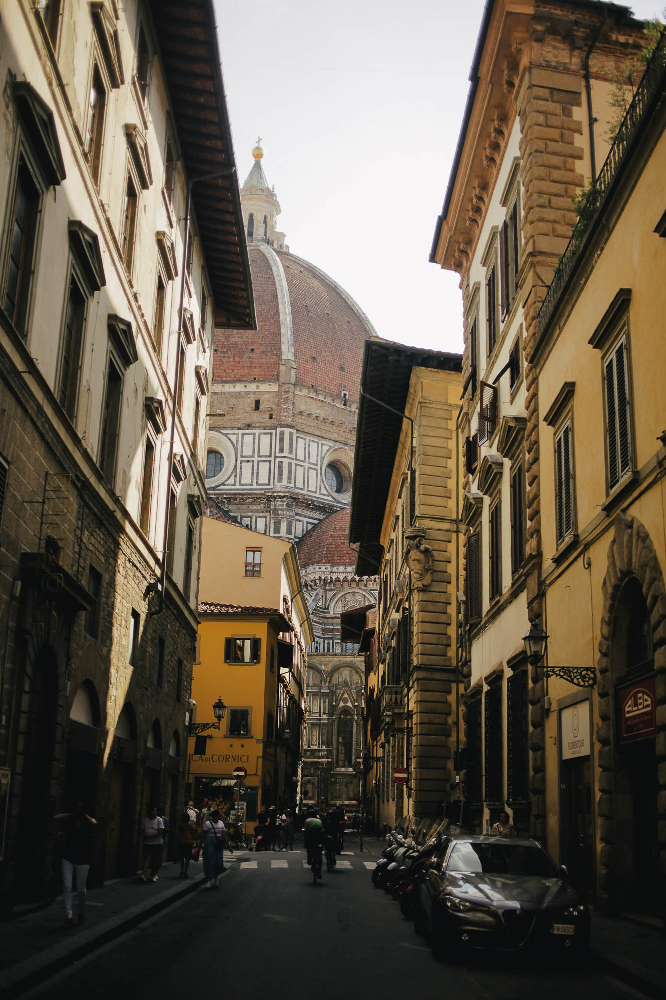

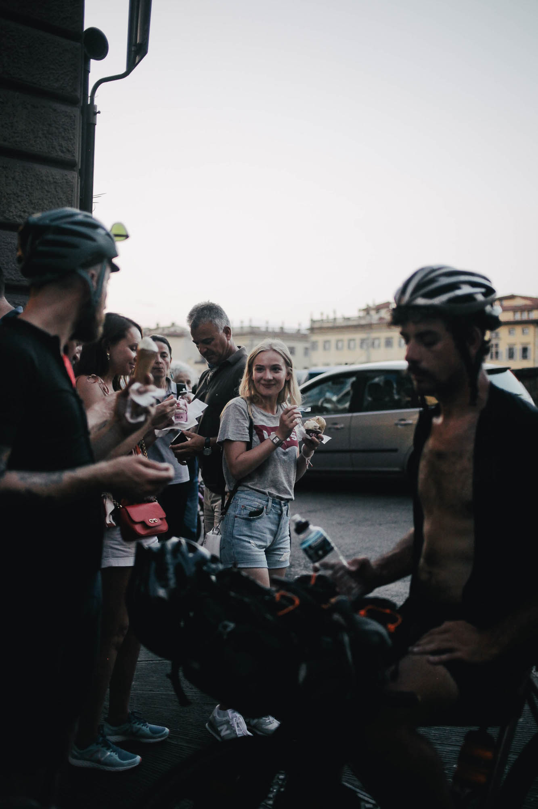

[metaslider id=”868″]

---

***LA MAP***

https://ridewithgps.com/embeds?type=route&id=28884914&metricUnits=true&sampleGraph=true&overlay=esriTopo

**–  
514km  
9887 D+  
7 Jours  
–**

Photos : [Renaud Skyronka](https://www.instagram.com/aknologic/) ~ [Julien Sommier](https://www.instagram.com/julienpcr/)

## Commentaires

**Veni Vidi Bici Video - PCR GRAVIER 14 January 2019** — 14 January 2019

[…] été nous avons été faire du vélo tout terrain en Italie. Le seul souci c’est que nos vélos n’étaient pas tout à fait tout terrain et que le terrain […]

**SLOWVENIA - PCR GRAVIER 4 December 2019** — 4 December 2019

[…] Déjà, on adore les ours. D’ailleurs, qui n’aime pas les ours ? Franchement. La Slovénie, c’est le pays des ours, donc déjà, on est en plein dans le mille. Bonnes vibes sur la Slovénie en ce moment, sans déverser des palanquées de touristes en furie comme dans certaines régions d’Espagne ou d’Italie. Pile ce qu’il faut.  C’est aussi à portée de train, facilement, par le train de nuit Paris-Venise que nous avions expérimenté l’année dernière pour notre Veni Vidi Bici. […]
