**Qui a dit que la saison 2019 des gros weekends était finie?**

La Toussaint et son week-end de 3 jours approche. L’occasion de se dire qu’il fait pas encore trop froid pour aller jouer dans la forêt. Ouais, c’est ça… Julien propose **3 jours, 3 maps**, à sillonner le nord-ouest du **Parc Naturel Régional du Ballon des Vosges**. En principe, 2 jours de gravel, 1 jour de route. Mais **à vélo, les principes et nous, ça fait 47.**

47 comme le taux de boisement des vosges, 4e au classement national. Pas dégeu comme biotope. Nous serons 7 à partir, 7  [Tétras](https://fr.wikipedia.org/wiki/Grand_T%C3%A9tras)  (comme des quadras mais à 30 piges), 6 mâles et 1 dame.

> La nuit tombe sur les remontées mécaniques et nos mécaniques à nous ne peuvent plus se cacher. Ca grince, ça clipse et ça déclipse, ça gratte, ça couine. Dans le noir de la forêt, il n’y a que nos animaux de métal, tous les autres ont déjà fui bien loin de nous.

<!-- image manquante : 2020/01/pcr-gravier-gravel-vosges-4.jpg -->

***JOUR 1***

Vendredi matin: Rendez-vous dans le 12ème arrondissement à la levée du jour. Il pleut des trombes sur Paris, on arrive déjà bien rincés. C’est un avant goût de ce qui nous attend là-bas, **on s’attend à avoir de la pluie tout le wee-kend**. On sera pas déçu…

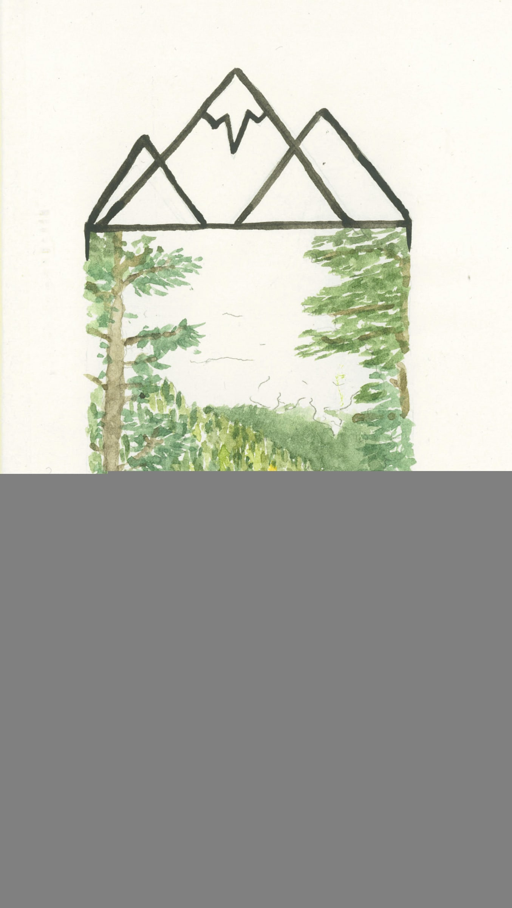

Café, on se change, on met les sapes mouillées en quarantaine en attendant ce soir, et on charge les voitures aussi efficacement que possible. Plus tôt on partira, plus tôt on pourra faire du vélo une fois là-bas.

5h de route, l’occasion pour certains de siester et finir la nuit trop courte. **Les premiers conifères et autres résineux sont en vue**, et les premiers reliefs Vosgiens nous accueillent. Après un stop éclair pour récupérer les rations du weekend, on arrive au gîte de type Heidi dans les grandes collines trichromiques: du vert, du jaune et du rouge. Mélangez, nuancez, éclairez. Vous avez là une **carte postale gravel made in l’automne.**

<!-- image manquante : 2020/01/pcr-gravier-gravel-vosges_wide_6.jpg -->

15h30, on est pas venus que pour se raconter des histoires au coin du feu. il est temps d’aller faire du vélo. Direction la première map. Arrivés **au pied de la station de ski de Gerardmer** à 16h, on part davantage sur un plan “repérages” que sur un gran fondo. Pas grave, comme d’hab, on a faim de nature quoiqu’il en soit.

Pas le temps de niaiser. Ça monte, direct, sur une route qui grésille, qui croustille sous les peuneus. Tout le monde mouline au calme, sauf un : Licata et sa cassette route sur son CX, qui ne facilite pas les choses. Mais déjà, c’est beau. Malgré la bruine, il en faut peu pour être trempés. Même pas arrivés **en haut de la première difficulté, on est rincés.**

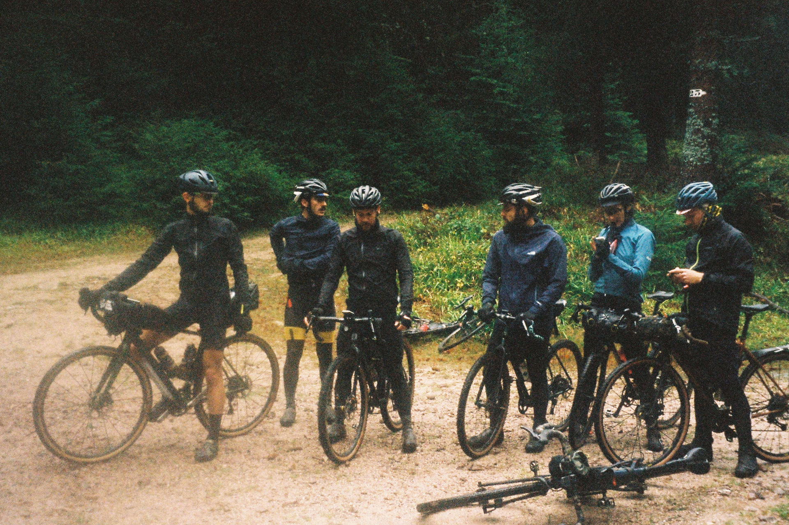

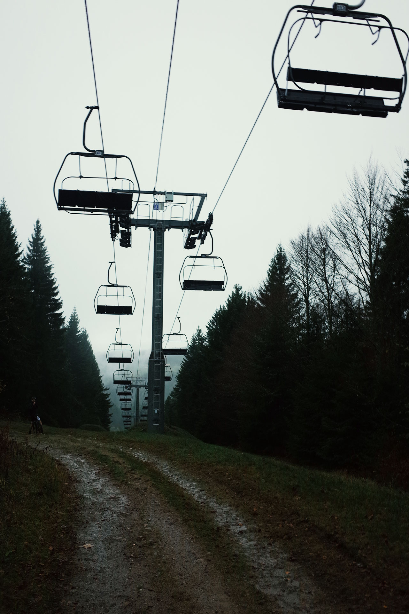

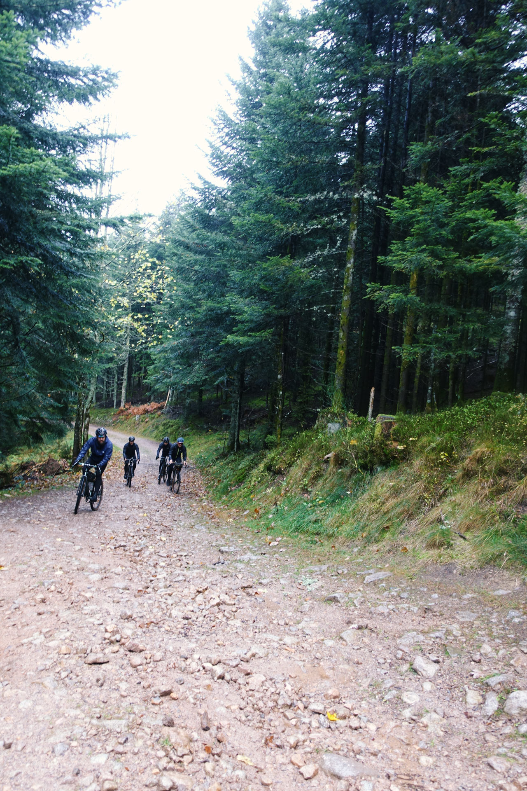

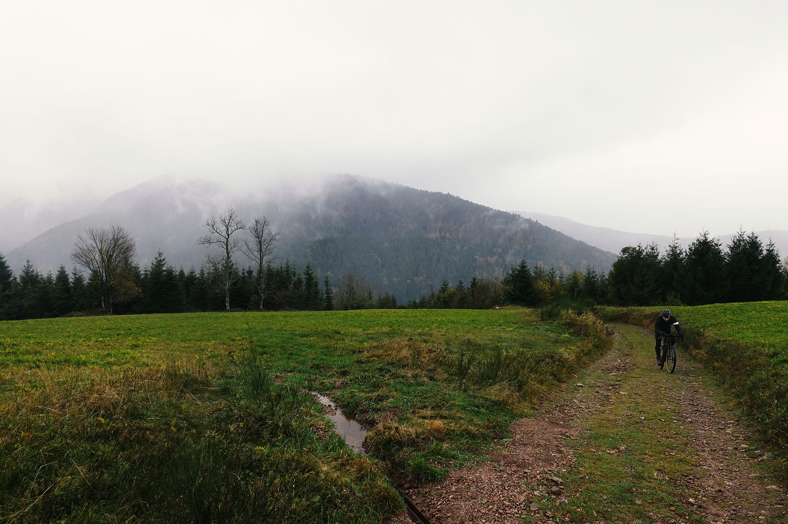

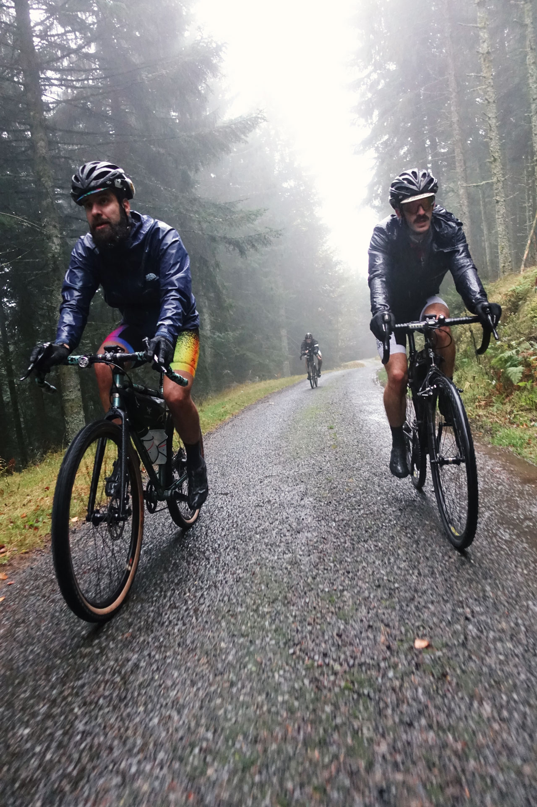

C’est tout pour la route, **c’est parti pour le gravel… Et là, c’est pas gras, c’est carrément liquide.** Pas de boue qui colle, tant mieux. On slalome entre des flaques dont on ne voit presque jamais le fond. Ambiance pédiluve surprise, on ose y mettre les roues au risque de plus avoir pied. C’est à la fois roulant et glissant. Ça alterne entre singles au milieu d’une piste (20 cm de terre+boue+flaques au milieu de 5 mètres d’herbe), et champs de boue. Sur l’herbe, on est pas à l’abri de drifter à chaque coup de pédale.

Arrivés en haut après un gentil roller coaster et un bon gros raidillon, on shortcut, sachant qu’on a pas beaucoup avancé et qu’un **1er Novembre, dans l’est, la nuit arrive plus vite qu’ailleurs.** Tacitement, on comprend tous qu’on fera un certaine partie du ride de nuit. Ça promet. Mais personne ne bronche, je crois qu’on est juste contents d’être là, whatever the weather.

<!-- image manquante : 2020/01/pcr-gravier-gravel-vosges-1.jpg -->

La nuit tombe sur les remontées mécaniques et nos mécaniques à nous ne peuvent plus se cacher. **Ca grince, ça clipse et ça déclipse, ça gratte, ça couine.** Dans le noir de la forêt, il n’y a que nos animaux de métal, tous les autres ont déjà fui bien loin de nous.  
Ambiance Stranger Things où on découvre des descentes bien raides, leurs racines et feuilles mortes à la lueur des lampes.  
Belle cascade slow-mo de Julien dans une boue bien profonde, et on redescend sur les freins (ou sur les semelles pour Mél et Arnaud, dont les plaquettes ne veulent pas coopérer – faudra régler ça d’ici demain). **Il fait nuit noire. On a l’impression qu’il est 2h du mat’ à 19h.**  
Vite, direction le poêle du gîte, et les 300 kilos de pâtes qui nous attendent. Full gas sur le chauffage pour sécher les habits de lumière.

***JOUR 2***

Réveil tout doux, petit déj de champions. Pendant que certains changent de pelage, d’autres affûtent les vélos. **On corrige les jeux, on met de l’huile, on change les patins.** Ce matin, on part direct du gîte dans les hauteurs, façon chasse aux champignons.

<!-- image manquante : 2020/01/aquarelles_licata_vosges_gravier-6-scaled.jpg -->

Sans surprise, encore un ciel gris, et de la pluie. Comme ça, pas de déçus et une fois n’est pas coutume, ça commence par une belle ascension jusqu’aux cîmes. Clairement, on est pas venus pour taper du Kom, et de toute manière, les Vosges nous cassent les pattes à la moindre occasion. **Un bon gros raidard à 18% pour nous réchauffer**, et le goudron fait place à la terre. La journée peut réellement commencer.

<!-- image manquante : 2020/01/pcr-gravier-gravel-vosges_wide_2.jpg -->

On tombe les vestes, et les feuilles tombent des arbres. **Pour la matinée, le gang se déploie en trois** : Pipi, Damien, Hugo et Arnaud – et son demi-galet de dérailleur- en éclaireurs devant. Derrière, Julien avec Mélanie. Intercalé, Licata ménage sa cassette de routard en prenant des photos tous les deux mètres. Ça fera de belles compos à dessiner.

**Petit point bison futé** au moment d’attaquer la grosse descente de mi-parcours. Mél bifurque pour rejoindre le gîte par la route,  pour chasser le champignon et titiller les chasseurs. De notre côté, descente à fond le Ballon (des Vosges) vers la vallée, à la recherche d’une table. **C’est aussi l’heure du Daily Bravo’s puncture point.** En guise d’apéro, on cherchera des épines dans le peuneu arrière de Damien, pendant que Julien et Hugo nous trouvent une auberge 50 étoiles. Moquette au sol et chaises en tissu. On rentre en mode mosquée, les surchaussures dehors, et les **vestes retournées sous nos fesses pour pas transformer le resto en basse-cour.**

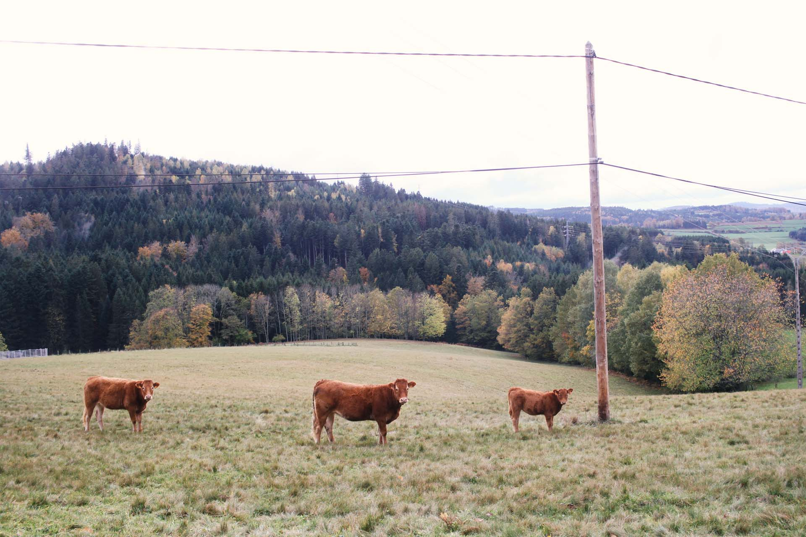

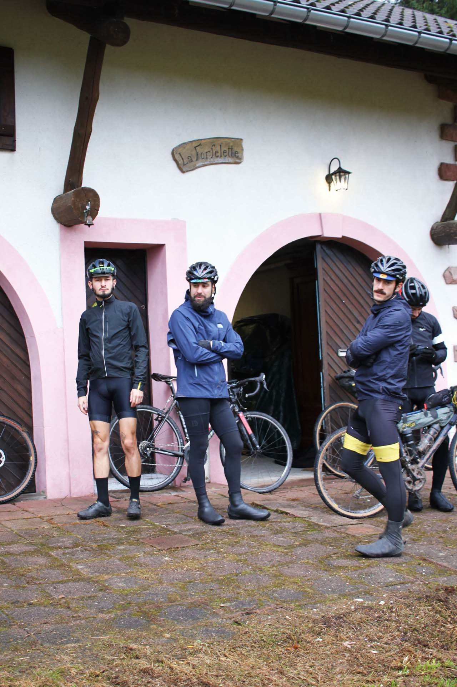

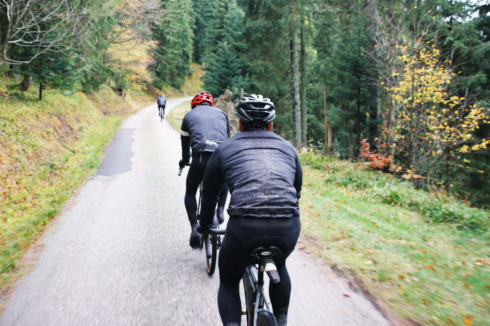

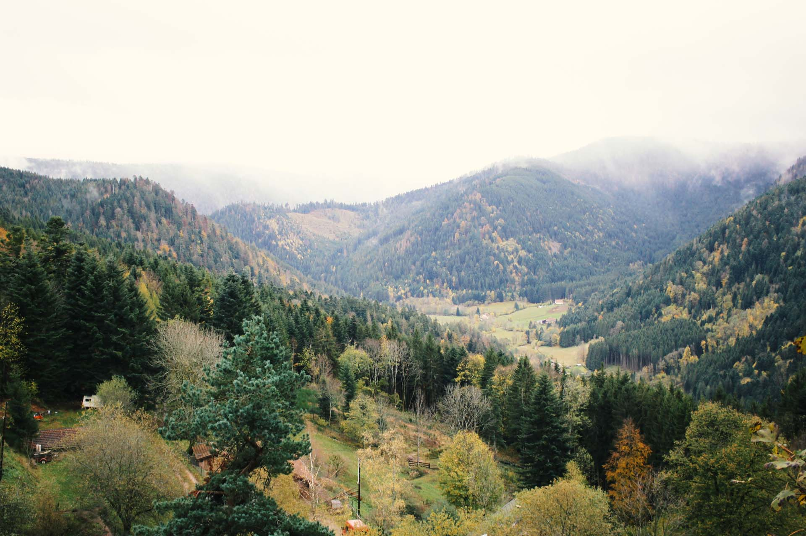

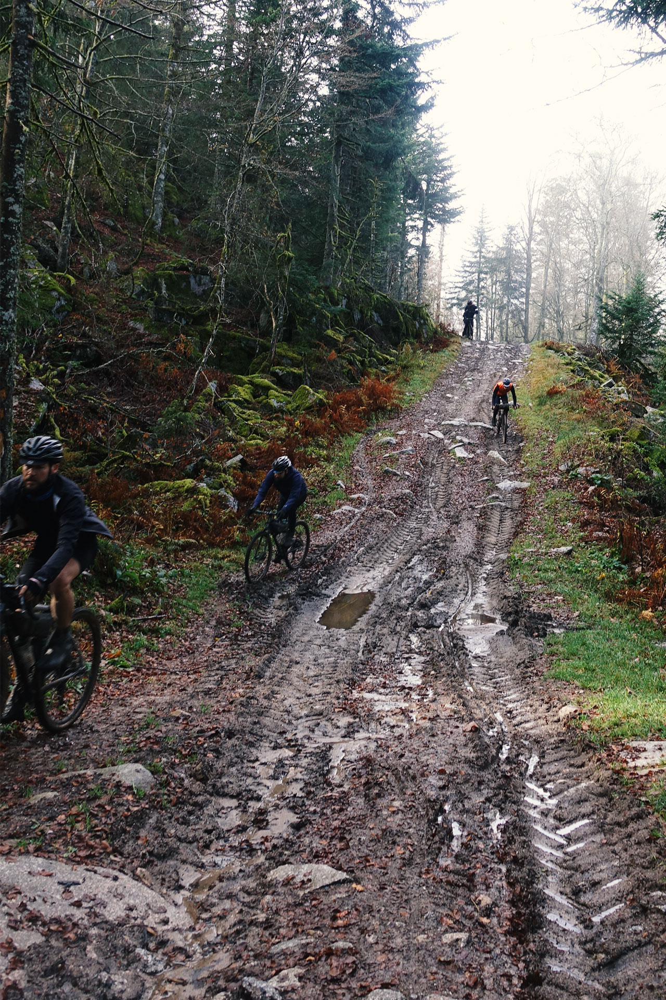

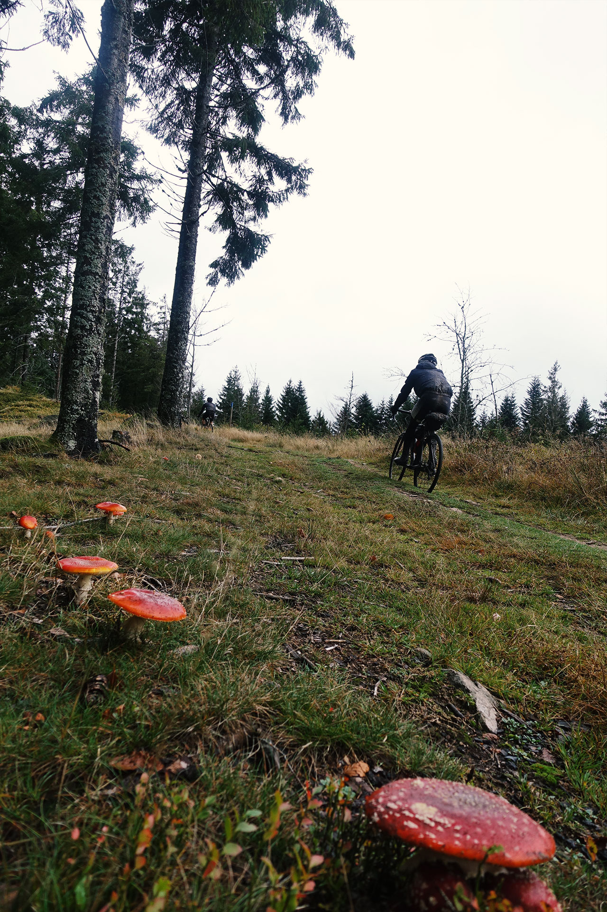

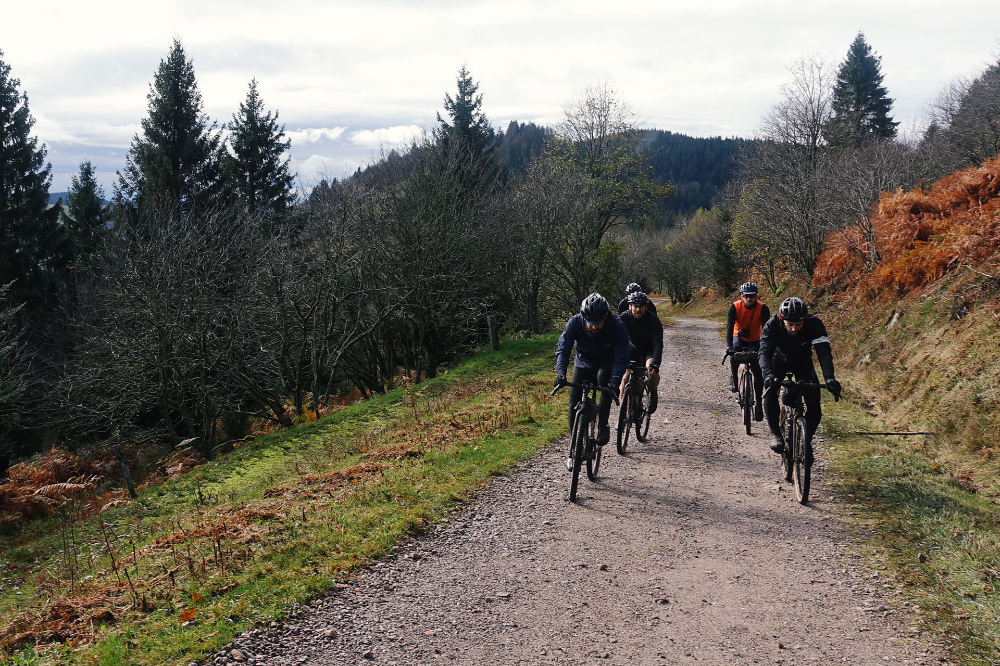

On décolle tant bien que mal après un repas encore plus copieux que les pâtes de la veille.  
Surtout que la deuxième grosse difficulté de la journée nous attend. Pas la digestion mais la fin de la map. **On a clairement eu les yeux plus gros que le ventre en terme de kilomètres à parcourir**, la nuit approche à grand pas. On décide de shortcuter un peu pour finir de jour.  
On continue à arpenter les sapinières accompagnées de leur dénivelé positif. On se régale.

On rentrera presque à l’heure du goûter, ça change de la nuit. On allume la cheminée et on chill. La vie la vraie.

<!-- image manquante : 2020/01/pcr-gravier-gravel-vosges-25.jpg -->

***JOUR 3***

On est tellement en train de tomber amoureux du gravel Vosgien, qu’on décide de retenter la Map du jour 1 à défaut d’aller jouer au Grand Ballon. Au moins, **on verra de jour, ce qu’on a pas vu de nuit** avant hier.

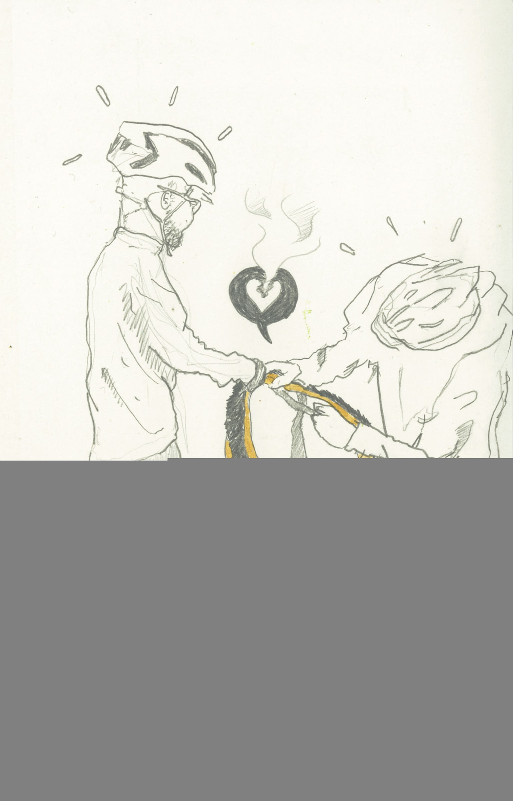

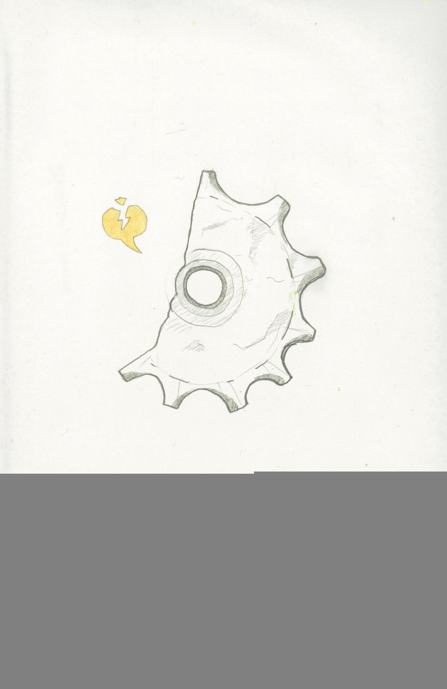

On connaît donc déjà la moitié du tracé, ça nous permet d’avancer comme il faut. Pour le reste, surprises sur pistes…  
Et bonne mère, les Vosges vont nous offrir un finish de toute beauté ! 35km de routes de crêtes, avec une montée tout en haut de la station de ski, et un soleil qui s’invite à la fête en deuxième partie de journée.

<!-- image manquante : 2020/01/pcr-gravier-gravel-vosges_wide_5.jpg -->

Le gravel est roulant, ça shred comme il faut, malgré les dérailleurs arrières de certains qui font des siennes. On tombe même sur des champs à flanc de vallée sous un soleil d’automne prestige. **On longe les champignons, les fougères et les prairies en mode “famille Ingalls”.** On a peut-être pas de principes, mais on a des rituels: **à 5km du gîte, c’est l’heure du Daily Bravo’s Puncture point.** La roue avant cette fois-ci, et un joli poc sur la jante en prime. **Les Vosges c’est beau, mais les Vosges, ça casse un peu aussi.**

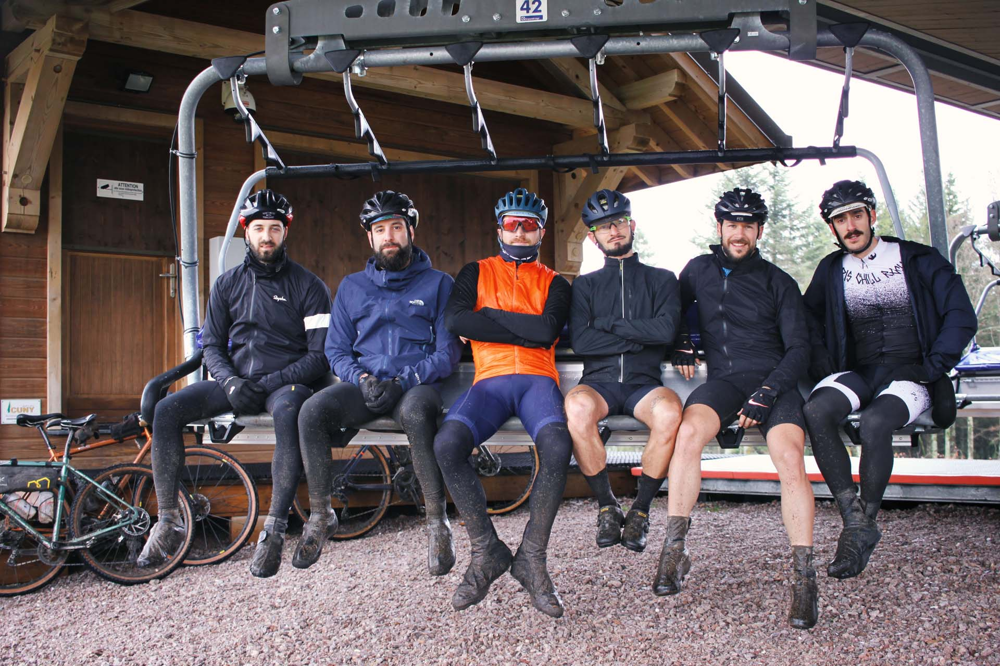

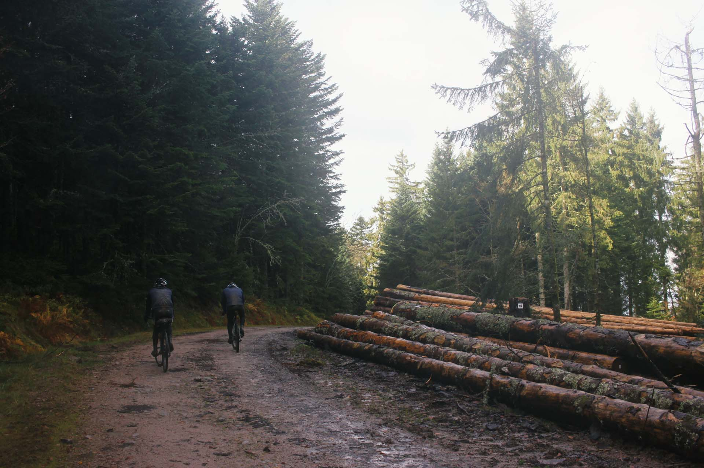

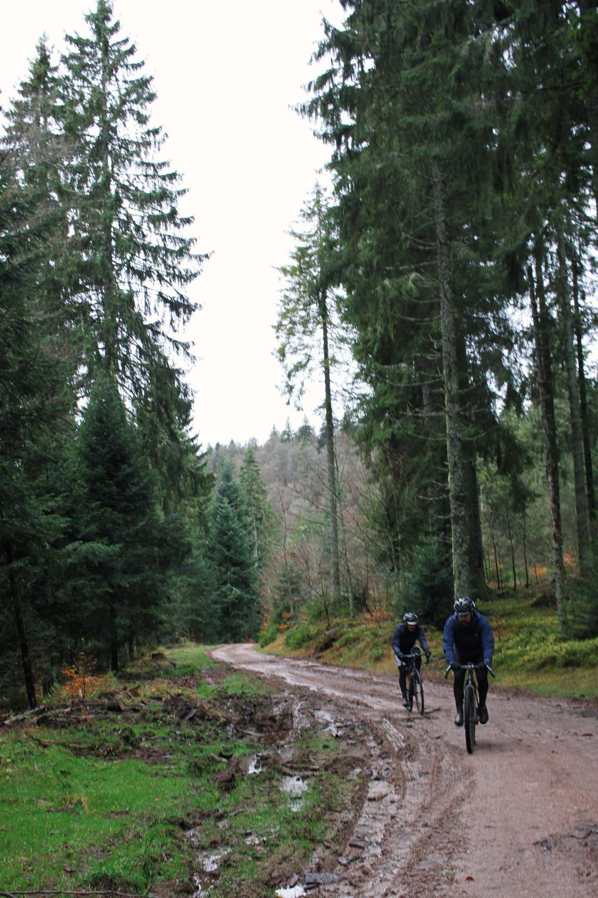

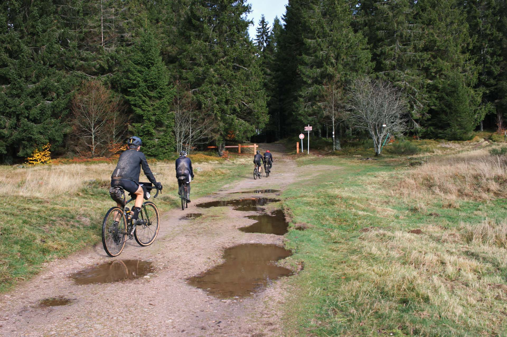

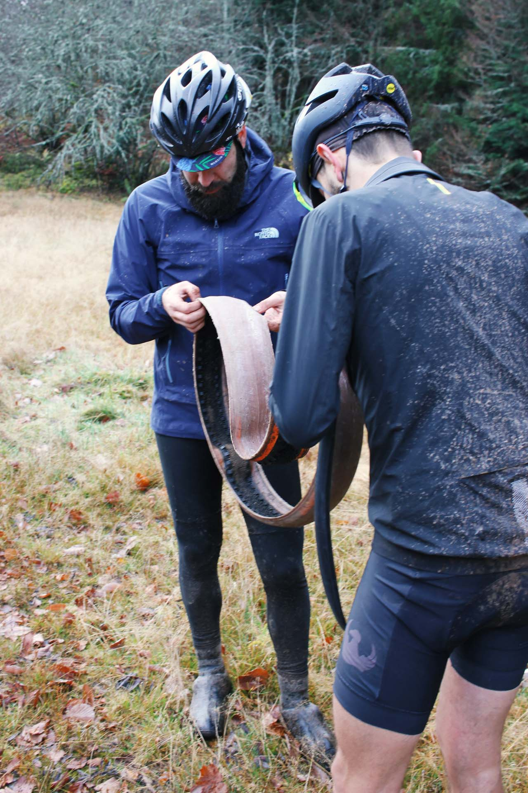

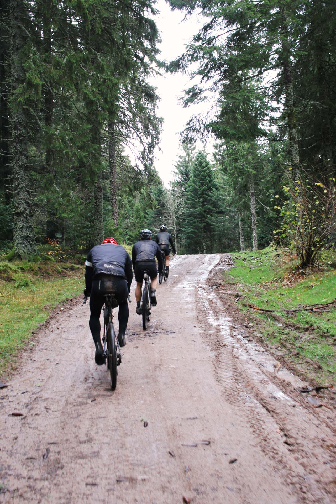

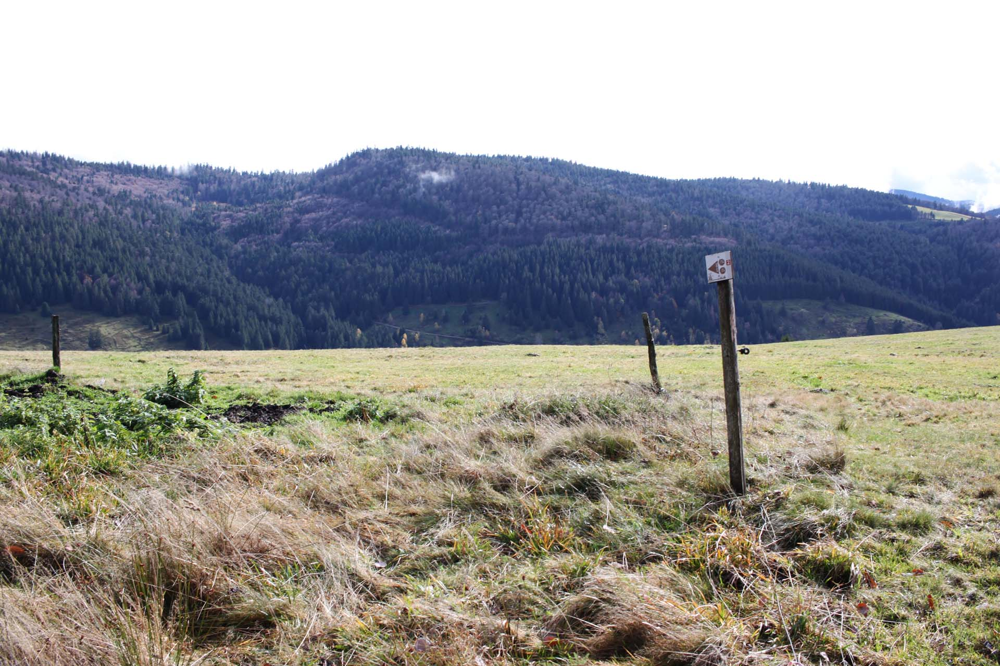

Retour au bercail. On douche, on nettoie, on sèche. Et on fait sauter les plombs. **Notre occupation de castors modernes aura eu raison de l’infrastructure électrique locale.** On a cassé les Vosges.

C’est le signal. Décollage pour Paris.

<!-- image manquante : 2020/01/pcr-gravier-gravel-vosges-44.jpg -->

Les Vosges nous auront bien régalés, **de jour comme de nuit. De la table aux sommets. Du sec au trempé. Du début à la fin. Surtout à la fin.** On partira sans doute en se disant qu’on aurait pu explorer davantage le coin. Mais on aurait plus de raisons de revenir. Parce que **c’est clair, on reviendra. A très vite les Vosges.** Merci Alex pour ces mots.

---

***LA MAP ~ JOUR 1 – 3***

https://ridewithgps.com/embeds?type=trip&id=43785686&title=PCR%20GRAVIER%20~%20VOSGES%20JOUR%201%20%26%203&metricUnits=true&sampleGraph=true&overlay=esriTopo

**–**  
**45 km**  
**950 D+**  
**3H00**

**–**

---

***LA MAP ~ JOUR 2***

https://ridewithgps.com/embeds?type=trip&id=43785711&title=PCR%20GRAVIER%20~%20VOSGES%20JOUR%202&metricUnits=true&sampleGraph=true&overlay=esriTopo

**–**  
**98 km**  
**2450 D+**  
**6H30**

**–**

Photos : [Julien Sommier](https://www.instagram.com/julienpcr/) ~ [Pierre Reinur](https://www.instagram.com/pierre_baron_de_groschill/) ~ [Arnaud.S](https://www.instagram.com/arno75000/) ~ [Alexandre Licata](https://www.instagram.com/c.a.s.t.a.c.h.e/)  
Illustrations : [Alexandre Licata](https://www.instagram.com/c.a.s.t.a.c.h.e/)

## Commentaires

**VOSGES – DÜREL GRAVEL 2 February 2021** — 2 February 2021

[…] Vosges ! […]
