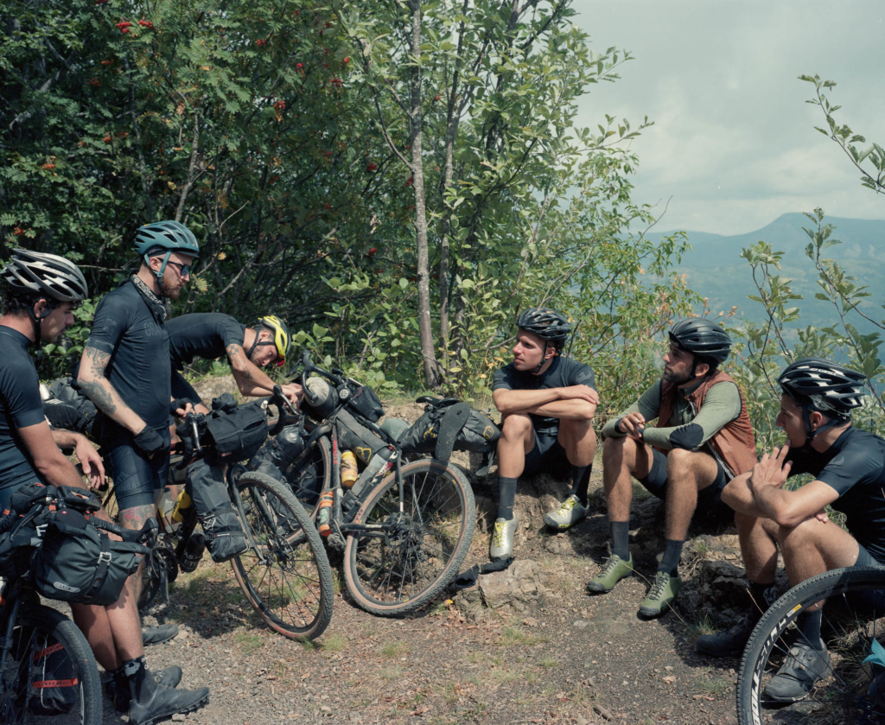

**PCR Gravier** est un collectif de cyclistes réunis autour d’une passion pour l’aventure à vélo et une attirance certaine pour les chemins de traverse.

~

Née en 2015 au sein du Paris Chill Racing, nous souhaitions sortir des sentiers battus, nous éloigner du goudron des nationales et des voitures et d’allier notre passion du vélo avec notre amour des voyages. La bande se compose aujourd’hui de 9 membres, basés à Paris, Marseille, Copenhague et Bello Horizonte, ayant pour point commun une envie galopante de nature, de chemins et d’aventure.

~

Le terme « Gravier » pour nous, n’est pas forcement à mettre en opposition avec « asphalte ». A vrai dire, nous roulons sur tout type de terrain. Nous constatons simplement que plus la route est cabossée, moins les voitures vont y rouler ! Nos vélos sont donc des couteaux suisses du cyclisme moderne, capables de transporter 15kg de matériel et de nous emmener sur n’importe quel chemin, n’importe quelle aventure, fidèle à l’idée qu’il suffit de rouler pour avoir des histoires à raconter.

~

**Get in touch : pcrgravier@gmail.com**

***Partenaires de Shred :***

[<!-- image manquante : 2018/11/WTB.jpg -->](https://www.wtb.com/)[<!-- image manquante : 2018/11/MAVIC.jpg -->](https://www.mavic.com/)
